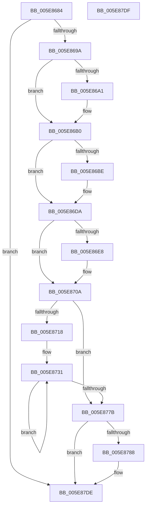

# RtlpCopyLegacyContextArm

- RVA: `0x005E8684`–`0x005E87E0` (길이 `348` bytes)
- VA: `0x00000001405E8684`
- 실행 섹션: `.text`
- PDB 이름 있음: `예`; PDB Function 태그: `아니요`
- unwind 정보 RVA: `0x000DB714`
- 디코드: `89`개 명령, `348/348` bytes 표시
- 미해석 바이트: `0` (있으면 어셈블리에 `.byte`로 보존)

> 이 문서는 커널 이미지의 기계어와 PDB 기호를 분석해 생성했습니다. 4번과 5번은 함수 원형과 자료형을 바이너리 사용 방식에서 추정한 C 해석이며 원본 소스 복구 결과는 아닙니다.

## 1. Dependencies

- 직접 호출 지점: **0**; 고유 호출 대상: **0**
- 직접 호출자로 확인된 함수: **2**
- RIP 상대 이미지 참조: **0**

### Outgoing calls
- 직접 디코드된 call 명령이 없습니다.

### Direct callers
- [sub_003F518A](../3F/Unknown_function_003F518A.md) at `0x003F519C`
- [RtlpCopyLegacyContext](../3F/RtlpCopyLegacyContext_function_003F54A0.md) at `0x003F56D2`

### Static image references
- 디코드된 RIP-relative 메모리 참조가 없습니다.

## 2. Other-region calls and transfers

- 다른 실행 섹션으로 향하는 call: **0**
- 별도 외부 분기/꼬리 이동을 확인하지 못했습니다.

## 3. Assembly (complete function range)

```asm
005E8684  41 8B C0                        mov eax, r8d
005E8687  41 BA FF FF FF 67               mov r10d, 0x67ffffff
005E868D  41 23 C2                        and eax, r10d
005E8690  89 02                           mov dword ptr [rdx], eax
005E8692  84 C9                           test cl, cl
005E8694  0F 84 44 01 00 00               je 0x1405e87de
005E869A  41 0F BA E0 1E                  bt r8d, 0x1e
005E869F  73 0F                           jae 0x1405e86b0
005E86A1  41 8B 01                        mov eax, dword ptr [r9]
005E86A4  8B C8                           mov ecx, eax
005E86A6  41 33 C8                        xor ecx, r8d
005E86A9  41 23 CA                        and ecx, r10d
005E86AC  33 C8                           xor ecx, eax
005E86AE  89 0A                           mov dword ptr [rdx], ecx
005E86B0  B9 01 00 20 00                  mov ecx, 0x200001
005E86B5  41 8B C0                        mov eax, r8d
005E86B8  23 C1                           and eax, ecx
005E86BA  3B C1                           cmp eax, ecx
005E86BC  75 1C                           jne 0x1405e86da
005E86BE  41 8B 41 40                     mov eax, dword ptr [r9 + 0x40]
005E86C2  89 42 40                        mov dword ptr [rdx + 0x40], eax
005E86C5  41 8B 41 38                     mov eax, dword ptr [r9 + 0x38]
005E86C9  89 42 38                        mov dword ptr [rdx + 0x38], eax
005E86CC  41 8B 41 3C                     mov eax, dword ptr [r9 + 0x3c]
005E86D0  89 42 3C                        mov dword ptr [rdx + 0x3c], eax
005E86D3  41 8B 41 44                     mov eax, dword ptr [r9 + 0x44]
005E86D7  89 42 44                        mov dword ptr [rdx + 0x44], eax
005E86DA  B9 02 00 20 00                  mov ecx, 0x200002
005E86DF  41 8B C0                        mov eax, r8d
005E86E2  23 C1                           and eax, ecx
005E86E4  3B C1                           cmp eax, ecx
005E86E6  75 22                           jne 0x1405e870a
005E86E8  41 0F 10 41 04                  movups xmm0, xmmword ptr [r9 + 4]
005E86ED  0F 11 42 04                     movups xmmword ptr [rdx + 4], xmm0
005E86F1  41 0F 10 49 14                  movups xmm1, xmmword ptr [r9 + 0x14]
005E86F6  0F 11 4A 14                     movups xmmword ptr [rdx + 0x14], xmm1
005E86FA  41 0F 10 41 24                  movups xmm0, xmmword ptr [r9 + 0x24]
005E86FF  0F 11 42 24                     movups xmmword ptr [rdx + 0x24], xmm0
005E8703  41 8B 41 34                     mov eax, dword ptr [r9 + 0x34]
005E8707  89 42 34                        mov dword ptr [rdx + 0x34], eax
005E870A  B9 04 00 20 00                  mov ecx, 0x200004
005E870F  41 8B C0                        mov eax, r8d
005E8712  23 C1                           and eax, ecx
005E8714  3B C1                           cmp eax, ecx
005E8716  75 63                           jne 0x1405e877b
005E8718  41 8B 41 48                     mov eax, dword ptr [r9 + 0x48]
005E871C  49 8D 49 50                     lea rcx, [r9 + 0x50]
005E8720  41 BA 02 00 00 00               mov r10d, 2
005E8726  89 42 48                        mov dword ptr [rdx + 0x48], eax
005E8729  48 8D 42 50                     lea rax, [rdx + 0x50]
005E872D  45 8D 5A 7E                     lea r11d, [r10 + 0x7e]
005E8731  0F 10 01                        movups xmm0, xmmword ptr [rcx]
005E8734  0F 11 00                        movups xmmword ptr [rax], xmm0
005E8737  0F 10 49 10                     movups xmm1, xmmword ptr [rcx + 0x10]
005E873B  0F 11 48 10                     movups xmmword ptr [rax + 0x10], xmm1
005E873F  0F 10 41 20                     movups xmm0, xmmword ptr [rcx + 0x20]
005E8743  0F 11 40 20                     movups xmmword ptr [rax + 0x20], xmm0
005E8747  0F 10 49 30                     movups xmm1, xmmword ptr [rcx + 0x30]
005E874B  0F 11 48 30                     movups xmmword ptr [rax + 0x30], xmm1
005E874F  0F 10 41 40                     movups xmm0, xmmword ptr [rcx + 0x40]
005E8753  0F 11 40 40                     movups xmmword ptr [rax + 0x40], xmm0
005E8757  0F 10 49 50                     movups xmm1, xmmword ptr [rcx + 0x50]
005E875B  0F 11 48 50                     movups xmmword ptr [rax + 0x50], xmm1
005E875F  0F 10 41 60                     movups xmm0, xmmword ptr [rcx + 0x60]
005E8763  0F 11 40 60                     movups xmmword ptr [rax + 0x60], xmm0
005E8767  49 03 C3                        add rax, r11
005E876A  0F 10 49 70                     movups xmm1, xmmword ptr [rcx + 0x70]
005E876E  49 03 CB                        add rcx, r11
005E8771  0F 11 48 F0                     movups xmmword ptr [rax - 0x10], xmm1
005E8775  49 83 EA 01                     sub r10, 1
005E8779  75 B6                           jne 0x1405e8731
005E877B  B8 08 00 20 00                  mov eax, 0x200008
005E8780  44 23 C0                        and r8d, eax
005E8783  44 3B C0                        cmp r8d, eax
005E8786  75 56                           jne 0x1405e87de
005E8788  41 0F 10 81 50 01 00 00         movups xmm0, xmmword ptr [r9 + 0x150]
005E8790  0F 11 82 50 01 00 00            movups xmmword ptr [rdx + 0x150], xmm0
005E8797  41 0F 10 89 60 01 00 00         movups xmm1, xmmword ptr [r9 + 0x160]
005E879F  0F 11 8A 60 01 00 00            movups xmmword ptr [rdx + 0x160], xmm1
005E87A6  41 0F 10 81 70 01 00 00         movups xmm0, xmmword ptr [r9 + 0x170]
005E87AE  0F 11 82 70 01 00 00            movups xmmword ptr [rdx + 0x170], xmm0
005E87B5  41 0F 10 89 80 01 00 00         movups xmm1, xmmword ptr [r9 + 0x180]
005E87BD  0F 11 8A 80 01 00 00            movups xmmword ptr [rdx + 0x180], xmm1
005E87C4  41 8B 81 90 01 00 00            mov eax, dword ptr [r9 + 0x190]
005E87CB  89 82 90 01 00 00               mov dword ptr [rdx + 0x190], eax
005E87D1  41 8B 81 94 01 00 00            mov eax, dword ptr [r9 + 0x194]
005E87D8  89 82 94 01 00 00               mov dword ptr [rdx + 0x194], eax
005E87DE  C3                              ret
005E87DF  CC                              int3
```

## 4. C-style interpretation (structured pseudocode)

```c
__int64 __fastcall RtlpCopyLegacyContextArm(unsigned __int8 a1, __int64 a2, int a3, __int64 a4)
{
    __int64 result;
    __int64 v_r10;

    result = (unsigned int)(((unsigned int)(a3)) & ((unsigned int)((unsigned int)(0x67FFFFFFULL))));
    *(unsigned int *)(a2) = (unsigned int)(result);
    if (a1 == 0) goto loc_005E87DE;
    if (!(condition_is_above_or_equal)) {
        result = *(unsigned int *)(a4);
        a1 = (unsigned int)(result);
        a1 = (unsigned int)((a1) ^ (a3));
        a1 = (unsigned int)((a1) & ((unsigned int)((unsigned int)(0x67FFFFFFULL))));
        a1 = (unsigned int)((a1) ^ ((unsigned int)(result)));
        *(unsigned int *)(a2) = a1;
    }
    result = (unsigned int)(((unsigned int)(a3)) & ((unsigned int)((unsigned int)(0x200001ULL))));
    if (((unsigned int)(result)) == ((unsigned int)((unsigned int)(0x200001ULL)))) {
        result = *(unsigned int *)(a4 + 64);
        *(unsigned int *)(a2 + 64) = (unsigned int)(result);
        result = *(unsigned int *)(a4 + 56);
        *(unsigned int *)(a2 + 56) = (unsigned int)(result);
        result = *(unsigned int *)(a4 + 60);
        *(unsigned int *)(a2 + 60) = (unsigned int)(result);
        result = *(unsigned int *)(a4 + 68);
        *(unsigned int *)(a2 + 68) = (unsigned int)(result);
    }
    result = (unsigned int)(((unsigned int)(a3)) & ((unsigned int)((unsigned int)(0x200002ULL))));
    if (((unsigned int)(result)) == ((unsigned int)((unsigned int)(0x200002ULL)))) {
        *(unsigned __int64 *)(a2 + 4) = v_xmm0;
        *(unsigned __int64 *)(a2 + 20) = v_xmm1;
        *(unsigned __int64 *)(a2 + 36) = v_xmm0;
        result = *(unsigned int *)(a4 + 52);
        *(unsigned int *)(a2 + 52) = (unsigned int)(result);
    }
    result = (unsigned int)(((unsigned int)(a3)) & ((unsigned int)((unsigned int)(0x200004ULL))));
    if (((unsigned int)(result)) != ((unsigned int)((unsigned int)(0x200004ULL)))) goto loc_005E877B;
    *(unsigned int *)(a2 + 72) = (unsigned int)((unsigned int)(*(unsigned int *)(a4 + 72)));
loc_005E8731:
    *(unsigned __int64 *)(a2 + 80) = v_xmm0;
    *(unsigned __int64 *)(a2 + 80 + 16) = v_xmm1;
    *(unsigned __int64 *)(a2 + 80 + 32) = v_xmm0;
    *(unsigned __int64 *)(a2 + 80 + 48) = v_xmm1;
    *(unsigned __int64 *)(a2 + 80 + 64) = v_xmm0;
    *(unsigned __int64 *)(a2 + 80 + 80) = v_xmm1;
    *(unsigned __int64 *)(a2 + 80 + 96) = v_xmm0;
    result = (a2 + 80) + (2 + 126);
    a1 = (a4 + 80) + (2 + 126);
    *(unsigned __int64 *)(result - 16) = v_xmm1;
    v_r10 = (2) - (1);
    if (condition_is_not_equal) goto loc_005E8731;
loc_005E877B:
    a3 = (unsigned int)((a3) & ((unsigned int)((unsigned int)(0x200008ULL))));
    result = (unsigned int)(0x200008ULL);
    if (a3 == ((unsigned int)((unsigned int)(0x200008ULL)))) {
        *(unsigned __int64 *)(a2 + 336) = v_xmm0;
        *(unsigned __int64 *)(a2 + 352) = v_xmm1;
        *(unsigned __int64 *)(a2 + 368) = v_xmm0;
        *(unsigned __int64 *)(a2 + 384) = v_xmm1;
        result = *(unsigned int *)(a4 + 400);
        *(unsigned int *)(a2 + 400) = (unsigned int)(result);
        result = *(unsigned int *)(a4 + 404);
        *(unsigned int *)(a2 + 404) = (unsigned int)(result);
    }
    return result;
}
```

## 5. (Beta) C Style

```c
int64_t RtlpCopyLegacyContextArm(uint8_t Arg1, void *Arg2, int32_t Arg3, void *Arg4)
{
    uint8_t *arg2 = (uint8_t *)Arg2;
    uint8_t *arg4 = (uint8_t *)Arg4;

    int64_t result;
    int64_t local_r10;

    result = (uint32_t)(((uint32_t)(Arg3)) & ((uint32_t)((uint32_t)(0x67FFFFFFULL))));
    *(uint32_t *)(arg2) = (uint32_t)(result);
    if (Arg1 == 0) goto loc_005E87DE;
    if (!(condition_is_above_or_equal)) {
        result = *(uint32_t *)(arg4);
        Arg1 = (uint32_t)(result);
        Arg1 = (uint32_t)((Arg1) ^ (Arg3));
        Arg1 = (uint32_t)((Arg1) & ((uint32_t)((uint32_t)(0x67FFFFFFULL))));
        Arg1 = (uint32_t)((Arg1) ^ ((uint32_t)(result)));
        *(uint32_t *)(arg2) = Arg1;
    }
    result = (uint32_t)(((uint32_t)(Arg3)) & ((uint32_t)((uint32_t)(0x200001ULL))));
    if (((uint32_t)(result)) == ((uint32_t)((uint32_t)(0x200001ULL)))) {
        result = *(uint32_t *)(arg4 + 0x40);
        *(uint32_t *)(arg2 + 0x40) = (uint32_t)(result);
        result = *(uint32_t *)(arg4 + 0x38);
        *(uint32_t *)(arg2 + 0x38) = (uint32_t)(result);
        result = *(uint32_t *)(arg4 + 0x3C);
        *(uint32_t *)(arg2 + 0x3C) = (uint32_t)(result);
        result = *(uint32_t *)(arg4 + 0x44);
        *(uint32_t *)(arg2 + 0x44) = (uint32_t)(result);
    }
    result = (uint32_t)(((uint32_t)(Arg3)) & ((uint32_t)((uint32_t)(0x200002ULL))));
    if (((uint32_t)(result)) == ((uint32_t)((uint32_t)(0x200002ULL)))) {
        *(uint64_t *)(arg2 + 0x4) = v_xmm0;
        *(uint64_t *)(arg2 + 0x14) = v_xmm1;
        *(uint64_t *)(arg2 + 0x24) = v_xmm0;
        result = *(uint32_t *)(arg4 + 0x34);
        *(uint32_t *)(arg2 + 0x34) = (uint32_t)(result);
    }
    result = (uint32_t)(((uint32_t)(Arg3)) & ((uint32_t)((uint32_t)(0x200004ULL))));
    if (((uint32_t)(result)) != ((uint32_t)((uint32_t)(0x200004ULL)))) goto loc_005E877B;
    *(uint32_t *)(arg2 + 0x48) = (uint32_t)((uint32_t)(*(uint32_t *)(arg4 + 0x48)));
loc_005E8731:
    *(uint64_t *)(arg2 + 0x50) = v_xmm0;
    *(uint64_t *)(arg2 + 0x50 + 0x10) = v_xmm1;
    *(uint64_t *)(arg2 + 0x50 + 0x20) = v_xmm0;
    *(uint64_t *)(arg2 + 0x50 + 0x30) = v_xmm1;
    *(uint64_t *)(arg2 + 0x50 + 0x40) = v_xmm0;
    *(uint64_t *)(arg2 + 0x50 + 0x50) = v_xmm1;
    *(uint64_t *)(arg2 + 0x50 + 0x60) = v_xmm0;
    result = (Arg2 + 80) + (2 + 126);
    Arg1 = (Arg4 + 80) + (2 + 126);
    *(uint64_t *)(result - 0x10) = v_xmm1;
    local_r10 = (2) - (1);
    if (condition_is_not_equal) goto loc_005E8731;
loc_005E877B:
    Arg3 = (uint32_t)((Arg3) & ((uint32_t)((uint32_t)(0x200008ULL))));
    result = (uint32_t)(0x200008ULL);
    if (Arg3 == ((uint32_t)((uint32_t)(0x200008ULL)))) {
        *(uint64_t *)(arg2 + 0x150) = v_xmm0;
        *(uint64_t *)(arg2 + 0x160) = v_xmm1;
        *(uint64_t *)(arg2 + 0x170) = v_xmm0;
        *(uint64_t *)(arg2 + 0x180) = v_xmm1;
        result = *(uint32_t *)(arg4 + 0x190);
        *(uint32_t *)(arg2 + 0x190) = (uint32_t)(result);
        result = *(uint32_t *)(arg4 + 0x194);
        *(uint32_t *)(arg2 + 0x194) = (uint32_t)(result);
    }
    return result;
}
```

### 관측된 메모리 오프셋

구조체 형식이 확인되지 않은 접근은 인자 기준의 오프셋으로만 기록했습니다.

| 기준 인자 | 오프셋 표현 | 폭 (bit) | 접근 |
|---|---:|---:|---|
| `Arg2` | `- 0x10` | `128` | `R` |
| `Arg2` | `+ 0x0` | `32` | `W` |
| `Arg2` | `+ 0x0` | `128` | `R` |
| `Arg2` | `+ 0x4` | `128` | `R` |
| `Arg2` | `+ 0x10` | `128` | `R` |
| `Arg2` | `+ 0x14` | `128` | `R` |
| `Arg2` | `+ 0x20` | `128` | `R` |
| `Arg2` | `+ 0x24` | `128` | `R` |
| `Arg2` | `+ 0x30` | `128` | `R` |
| `Arg2` | `+ 0x34` | `32` | `W` |
| `Arg2` | `+ 0x38` | `32` | `W` |
| `Arg2` | `+ 0x3C` | `32` | `W` |
| `Arg2` | `+ 0x40` | `32` | `W` |
| `Arg2` | `+ 0x40` | `128` | `R` |
| `Arg2` | `+ 0x44` | `32` | `W` |
| `Arg2` | `+ 0x48` | `32` | `W` |
| `Arg2` | `+ 0x50` | `64` | `R` |
| `Arg2` | `+ 0x50` | `128` | `R` |
| `Arg2` | `+ 0x60` | `128` | `R` |
| `Arg2` | `+ 0x150` | `128` | `R` |
| `Arg2` | `+ 0x160` | `128` | `R` |
| `Arg2` | `+ 0x170` | `128` | `R` |
| `Arg2` | `+ 0x180` | `128` | `R` |
| `Arg2` | `+ 0x190` | `32` | `W` |
| `Arg2` | `+ 0x194` | `32` | `W` |
| `Arg4` | `+ 0x0` | `32` | `R` |
| `Arg4` | `+ 0x0` | `128` | `R` |
| `Arg4` | `+ 0x4` | `128` | `R` |
| `Arg4` | `+ 0x10` | `128` | `R` |
| `Arg4` | `+ 0x14` | `128` | `R` |
| `Arg4` | `+ 0x20` | `128` | `R` |
| `Arg4` | `+ 0x24` | `128` | `R` |

추가 오프셋 18개는 표에서 생략했습니다.

## 6. Execution-region graph

[열기: 2D/3D 그래프와 함수 탐색 컨트롤 패널](../../../control-panel.html?section=text&rva=0x005E8684&view=graph)

- 2D 그래프는 위에서 아래로 흐르고, 3D 그래프는 빈 공간을 드래그해 회전합니다. Shift+드래그는 이동, 휠은 확대·축소, 함수 노드 선택은 대상 보고서 이동입니다.

### Static fallback


