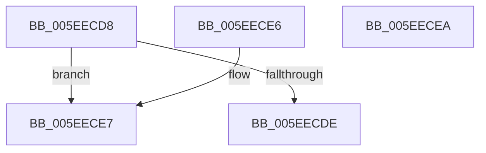

# RtlpCountLeadingZeroes64

- RVA: `0x005EECD8`–`0x005EECEB` (길이 `19` bytes)
- VA: `0x00000001405EECD8`
- 실행 섹션: `.text`
- PDB 이름 있음: `예`; PDB Function 태그: `아니요`
- unwind 정보 RVA: `0x000DB714`
- 디코드: `9`개 명령, `19/19` bytes 표시
- 미해석 바이트: `0` (있으면 어셈블리에 `.byte`로 보존)

> 이 문서는 커널 이미지의 기계어와 PDB 기호를 분석해 생성했습니다. 4번과 5번은 함수 원형과 자료형을 바이너리 사용 방식에서 추정한 C 해석이며 원본 소스 복구 결과는 아닙니다.

## 1. Dependencies

- 직접 호출 지점: **0**; 고유 호출 대상: **0**
- 직접 호출자로 확인된 함수: **1**
- RIP 상대 이미지 참조: **0**

### Outgoing calls
- 직접 디코드된 call 명령이 없습니다.

### Direct callers
- [RtlpComputeFraction](../4F/RtlpComputeFraction_function_004FC140.md) at `0x004FC164`
- [RtlpComputeFraction](../4F/RtlpComputeFraction_function_004FC140.md) at `0x004FC181`

### Static image references
- 디코드된 RIP-relative 메모리 참조가 없습니다.

## 2. Other-region calls and transfers

- 다른 실행 섹션으로 향하는 call: **0**
- 별도 외부 분기/꼬리 이동을 확인하지 못했습니다.

## 3. Assembly (complete function range)

```asm
005EECD8  48 0F BD D1                     bsr rdx, rcx
005EECDC  74 09                           je 0x1405eece7
005EECDE  B8 3F 00 00 00                  mov eax, 0x3f
005EECE3  2A C2                           sub al, dl
005EECE5  C3                              ret
005EECE6  CC                              int3
005EECE7  B0 40                           mov al, 0x40
005EECE9  C3                              ret
005EECEA  CC                              int3
```

## 4. C-style interpretation (structured pseudocode)

```c
__int64 __fastcall RtlpCountLeadingZeroes64(__int64 a1)
{
    __int64 result;

    if (condition_is_equal) goto loc_005EECE7;
    result = (unsigned __int8)((63) - ((unsigned __int8)(a2)));
    return result;
loc_005EECE7:
    return 64;
}
```

## 5. (Beta) C Style

```c
int64_t RtlpCountLeadingZeroes64(int64_t Arg1)
{
    int64_t result;

    if (condition_is_equal) goto loc_005EECE7;
    result = (uint8_t)((63) - ((uint8_t)(a2)));
    return result;
loc_005EECE7:
    return 64;
}
```

## 6. Execution-region graph

[열기: 2D/3D 그래프와 함수 탐색 컨트롤 패널](../../../control-panel.html?section=text&rva=0x005EECD8&view=graph)

- 2D 그래프는 위에서 아래로 흐르고, 3D 그래프는 빈 공간을 드래그해 회전합니다. Shift+드래그는 이동, 휠은 확대·축소, 함수 노드 선택은 대상 보고서 이동입니다.

### Static fallback


