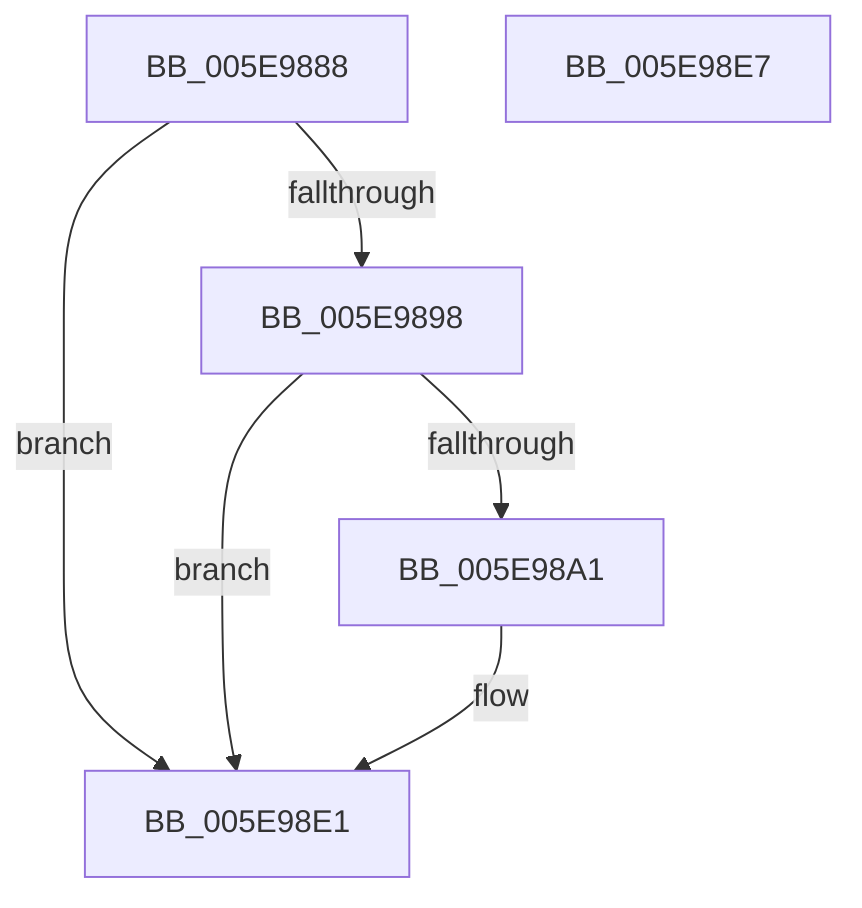

# RtlpCreateHeapEncoding

- RVA: `0x005E9888`–`0x005E98E8` (길이 `96` bytes)
- VA: `0x00000001405E9888`
- 실행 섹션: `.text`
- PDB 이름 있음: `예`; PDB Function 태그: `아니요`
- unwind 정보 RVA: `0x0005CF00`
- 디코드: `23`개 명령, `96/96` bytes 표시
- 미해석 바이트: `0` (있으면 어셈블리에 `.byte`로 보존)

> 이 문서는 커널 이미지의 기계어와 PDB 기호를 분석해 생성했습니다. 4번과 5번은 함수 원형과 자료형을 바이너리 사용 방식에서 추정한 C 해석이며 원본 소스 복구 결과는 아닙니다.

## 1. Dependencies

- 직접 호출 지점: **2**; 고유 호출 대상: **1**
- 직접 호출자로 확인된 함수: **1**
- RIP 상대 이미지 참조: **0**

### Outgoing calls
- `0x005E98BD` → [ExGenRandom](../41/ExGenRandom_function_0041B010.md) (function, `0x0041B010`)
- `0x005E98CD` → [ExGenRandom](../41/ExGenRandom_function_0041B010.md) (function, `0x0041B010`)

### Direct callers
- [RtlpCreateHeap](../4E/RtlpCreateHeap_function_004E1904.md) at `0x004E218C`

### Static image references
- 디코드된 RIP-relative 메모리 참조가 없습니다.

## 2. Other-region calls and transfers

- 다른 실행 섹션으로 향하는 call: **0**
- 별도 외부 분기/꼬리 이동을 확인하지 못했습니다.

## 3. Assembly (complete function range)

```asm
005E9888  40 53                           push rbx
005E988A  48 83 EC 20                     sub rsp, 0x20
005E988E  8B 41 78                        mov eax, dword ptr [rcx + 0x78]
005E9891  48 8B D9                        mov rbx, rcx
005E9894  A8 02                           test al, 2
005E9896  75 49                           jne 0x1405e98e1
005E9898  F7 41 70 00 00 00 04            test dword ptr [rcx + 0x70], 0x4000000
005E989F  75 40                           jne 0x1405e98e1
005E98A1  83 A1 88 00 00 00 00            and dword ptr [rcx + 0x88], 0
005E98A8  C6 81 8A 00 00 00 10            mov byte ptr [rcx + 0x8a], 0x10
005E98AF  8B 81 88 00 00 00               mov eax, dword ptr [rcx + 0x88]
005E98B5  89 41 7C                        mov dword ptr [rcx + 0x7c], eax
005E98B8  B9 01 00 00 00                  mov ecx, 1
005E98BD  E8 4E 17 E3 FF                  call 0x14041b010
005E98C2  09 83 88 00 00 00               or dword ptr [rbx + 0x88], eax
005E98C8  B9 01 00 00 00                  mov ecx, 1
005E98CD  E8 3E 17 E3 FF                  call 0x14041b010
005E98D2  66 83 A3 8E 00 00 00 00         and word ptr [rbx + 0x8e], 0
005E98DA  66 89 83 8C 00 00 00            mov word ptr [rbx + 0x8c], ax
005E98E1  48 83 C4 20                     add rsp, 0x20
005E98E5  5B                              pop rbx
005E98E6  C3                              ret
005E98E7  CC                              int3
```

## 4. C-style interpretation (structured pseudocode)

```c
__int64 __fastcall RtlpCreateHeapEncoding(__int64 a1)
{
    __int64 result;
    __int64 v_rsp;

    v_rsp = (v_rsp) - (32);
    if ((((unsigned __int8)((unsigned int)(*(unsigned int *)(a1 + 120)))) & (2)) != 0) goto loc_005E98E1;
    result = (unsigned int)(*(unsigned int *)(a1 + 120));
    if (((*(unsigned int *)(a1 + 112)) & (0x4000000ULL)) == 0) {
        *(unsigned __int8 *)(a1 + 138) = 16;
        result = *(unsigned int *)(a1 + 136);
        *(unsigned int *)(a1 + 124) = (unsigned int)(result);
        a1 = 1;
        result = ExGenRandom(a1, a2, a3, a4);
        a1 = 1;
        result = ExGenRandom(a1, a2, a3, a4);
        *(unsigned __int16 *)(a1 + 140) = (unsigned __int16)(result);
    }
    v_rsp = (v_rsp) + (32);
    return result;
}
```

## 5. (Beta) C Style

```c
int64_t RtlpCreateHeapEncoding(void *Arg1)
{
    uint8_t *arg1 = (uint8_t *)Arg1;

    int64_t result;
    int64_t local_rsp;

    local_rsp = (local_rsp) - (32);
    if ((((uint8_t)((uint32_t)(*(uint32_t *)(arg1 + 0x78)))) & (2)) != 0) goto loc_005E98E1;
    result = (uint32_t)(*(uint32_t *)(arg1 + 0x78));
    if (((*(uint32_t *)(arg1 + 0x70)) & (0x4000000ULL)) == 0) {
        *(uint8_t *)(arg1 + 0x8A) = 16;
        result = *(uint32_t *)(arg1 + 0x88);
        *(uint32_t *)(arg1 + 0x7C) = (uint32_t)(result);
        Arg1 = 1;
        result = ExGenRandom(Arg1, a2, a3, a4);
        Arg1 = 1;
        result = ExGenRandom(Arg1, a2, a3, a4);
        *(uint16_t *)(arg1 + 0x8C) = (uint16_t)(result);
    }
    local_rsp = (local_rsp) + (32);
    return result;
}
```

### 관측된 메모리 오프셋

구조체 형식이 확인되지 않은 접근은 인자 기준의 오프셋으로만 기록했습니다.

| 기준 인자 | 오프셋 표현 | 폭 (bit) | 접근 |
|---|---:|---:|---|
| `Arg1` | `+ 0x70` | `32` | `R` |
| `Arg1` | `+ 0x78` | `32` | `R` |
| `Arg1` | `+ 0x7C` | `32` | `W` |
| `Arg1` | `+ 0x88` | `32` | `R` |
| `Arg1` | `+ 0x88` | `32` | `R/W` |
| `Arg1` | `+ 0x8A` | `8` | `W` |
| `Arg1` | `+ 0x8C` | `16` | `W` |
| `Arg1` | `+ 0x8E` | `16` | `R/W` |

## 6. Execution-region graph

[열기: 2D/3D 그래프와 함수 탐색 컨트롤 패널](../../../control-panel.html?section=text&rva=0x005E9888&view=graph)

- 2D 그래프는 위에서 아래로 흐르고, 3D 그래프는 빈 공간을 드래그해 회전합니다. Shift+드래그는 이동, 휠은 확대·축소, 함수 노드 선택은 대상 보고서 이동입니다.

### Static fallback


