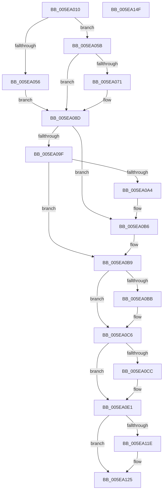

# RtlpCreateUCREntry

- RVA: `0x005EA010`–`0x005EA150` (길이 `320` bytes)
- VA: `0x00000001405EA010`
- 실행 섹션: `.text`
- PDB 이름 있음: `예`; PDB Function 태그: `아니요`
- unwind 정보 RVA: `0x0005D7BC`
- 디코드: `82`개 명령, `320/320` bytes 표시
- 미해석 바이트: `0` (있으면 어셈블리에 `.byte`로 보존)

> 이 문서는 커널 이미지의 기계어와 PDB 기호를 분석해 생성했습니다. 4번과 5번은 함수 원형과 자료형을 바이너리 사용 방식에서 추정한 C 해석이며 원본 소스 복구 결과는 아닙니다.

## 1. Dependencies

- 직접 호출 지점: **4**; 고유 호출 대상: **4**
- 직접 호출자로 확인된 함수: **3**
- RIP 상대 이미지 참조: **2**

### Outgoing calls
- `0x005EA088` → [RtlpLogHeapFailure](../35/RtlpLogHeapFailure_function_0035B7BC.md) (function, `0x0035B7BC`)
- `0x005EA0AB` → [DbgPrint](../35/DbgPrint_function_00358CB0.md) (function, `0x00358CB0`)
- `0x005EA0B0` → [RtlpHeapHandleError](../5F/RtlpHeapHandleError_function_005F12AC.md) (function, `0x005F12AC`)
- `0x005EA0E7` → [RtlpInsertUCRBlock](RtlpInsertUCRBlock_function_005EB7E8.md) (function, `0x005EB7E8`)

### Direct callers
- [RtlpDeCommitFreeBlock](RtlpDeCommitFreeBlock_function_005EA158.md) at `0x005EA3A5`
- [RtlpDeCommitFreeBlock](RtlpDeCommitFreeBlock_function_005EA158.md) at `0x005EA6A7`
- [RtlpFindAndCommitPages](RtlpFindAndCommitPages_function_005EA95C.md) at `0x005EAB63`
- [RtlpInitializeHeapSegment](RtlpInitializeHeapSegment_function_005EB1DC.md) at `0x005EB43B`

### Static image references
- `0x005EA08D` → RVA `0x00E67B60` (`.data`; read)
- `0x005EA0A4` → RVA `0x006CC910` (` ?? ::FNODOBFM::`string'`; read)

## 2. Other-region calls and transfers

- 다른 실행 섹션으로 향하는 call: **0**
- 별도 외부 분기/꼬리 이동을 확인하지 못했습니다.

## 3. Assembly (complete function range)

```asm
005EA010  48 8B C4                        mov rax, rsp
005EA013  48 89 58 08                     mov qword ptr [rax + 8], rbx
005EA017  48 89 68 10                     mov qword ptr [rax + 0x10], rbp
005EA01B  48 89 70 18                     mov qword ptr [rax + 0x18], rsi
005EA01F  48 89 78 20                     mov qword ptr [rax + 0x20], rdi
005EA023  41 56                           push r14
005EA025  48 83 EC 30                     sub rsp, 0x30
005EA029  4D 89 48 28                     mov qword ptr [r8 + 0x28], r9
005EA02D  49 8D 58 F0                     lea rbx, [r8 - 0x10]
005EA031  48 8B EA                        mov rbp, rdx
005EA034  C6 43 0F 03                     mov byte ptr [rbx + 0xf], 3
005EA038  49 8D 40 30                     lea rax, [r8 + 0x30]
005EA03C  4D 8B F0                        mov r14, r8
005EA03F  49 89 40 20                     mov qword ptr [r8 + 0x20], rax
005EA043  48 8B F9                        mov rdi, rcx
005EA046  C7 43 08 04 00 01 00            mov dword ptr [rbx + 8], 0x10004
005EA04D  48 8B 52 28                     mov rdx, qword ptr [rdx + 0x28]
005EA051  48 3B D5                        cmp rdx, rbp
005EA054  75 05                           jne 0x1405ea05b
005EA056  40 32 F6                        xor sil, sil
005EA059  EB 32                           jmp 0x1405ea08d
005EA05B  48 8B F3                        mov rsi, rbx
005EA05E  48 2B F5                        sub rsi, rbp
005EA061  48 C1 EE 10                     shr rsi, 0x10
005EA065  48 FF C6                        inc rsi
005EA068  48 81 FE FE 00 00 00            cmp rsi, 0xfe
005EA06F  72 1C                           jb 0x1405ea08d
005EA071  48 83 64 24 28 00               and qword ptr [rsp + 0x28], 0
005EA077  4C 8B CD                        mov r9, rbp
005EA07A  48 83 64 24 20 00               and qword ptr [rsp + 0x20], 0
005EA080  4C 8B C3                        mov r8, rbx
005EA083  B9 03 00 00 00                  mov ecx, 3
005EA088  E8 2F 17 D7 FF                  call 0x14035b7bc
005EA08D  83 3D CC DA 87 00 01            cmp dword ptr [rip + 0x87dacc], 1
005EA094  40 88 73 0E                     mov byte ptr [rbx + 0xe], sil
005EA098  48 8B 74 24 60                  mov rsi, qword ptr [rsp + 0x60]
005EA09D  7C 17                           jl 0x1405ea0b6
005EA09F  48 3B F3                        cmp rsi, rbx
005EA0A2  76 15                           jbe 0x1405ea0b9
005EA0A4  48 8D 0D 65 28 0E 00            lea rcx, [rip + 0xe2865]
005EA0AB  E8 00 EC D6 FF                  call 0x140358cb0
005EA0B0  E8 F7 71 00 00                  call 0x1405f12ac
005EA0B5  CC                              int3
005EA0B6  48 3B F3                        cmp rsi, rbx
005EA0B9  74 0B                           je 0x1405ea0c6
005EA0BB  0F B7 87 8C 00 00 00            movzx eax, word ptr [rdi + 0x8c]
005EA0C2  66 89 43 0C                     mov word ptr [rbx + 0xc], ax
005EA0C6  83 7F 7C 00                     cmp dword ptr [rdi + 0x7c], 0
005EA0CA  74 15                           je 0x1405ea0e1
005EA0CC  8A 4B 0A                        mov cl, byte ptr [rbx + 0xa]
005EA0CF  32 4B 09                        xor cl, byte ptr [rbx + 9]
005EA0D2  32 4B 08                        xor cl, byte ptr [rbx + 8]
005EA0D5  88 4B 0B                        mov byte ptr [rbx + 0xb], cl
005EA0D8  8B 87 88 00 00 00               mov eax, dword ptr [rdi + 0x88]
005EA0DE  31 43 08                        xor dword ptr [rbx + 8], eax
005EA0E1  49 8B D6                        mov rdx, r14
005EA0E4  48 8B CF                        mov rcx, rdi
005EA0E7  E8 FC 16 00 00                  call 0x1405eb7e8
005EA0EC  FF 45 54                        inc dword ptr [rbp + 0x54]
005EA0EF  49 8B 46 28                     mov rax, qword ptr [r14 + 0x28]
005EA0F3  48 C1 E8 0C                     shr rax, 0xc
005EA0F7  01 45 50                        add dword ptr [rbp + 0x50], eax
005EA0FA  48 8B 8F 40 02 00 00            mov rcx, qword ptr [rdi + 0x240]
005EA101  49 2B 4E 28                     sub rcx, qword ptr [r14 + 0x28]
005EA105  FF 87 64 02 00 00               inc dword ptr [rdi + 0x264]
005EA10B  48 89 8F 40 02 00 00            mov qword ptr [rdi + 0x240], rcx
005EA112  49 8B 46 28                     mov rax, qword ptr [r14 + 0x28]
005EA116  48 3D 00 F0 0F 00               cmp rax, 0xff000
005EA11C  72 07                           jb 0x1405ea125
005EA11E  48 01 87 48 02 00 00            add qword ptr [rdi + 0x248], rax
005EA125  48 8B 44 24 68                  mov rax, qword ptr [rsp + 0x68]
005EA12A  48 2B DE                        sub rbx, rsi
005EA12D  48 8B 6C 24 48                  mov rbp, qword ptr [rsp + 0x48]
005EA132  48 8B 74 24 50                  mov rsi, qword ptr [rsp + 0x50]
005EA137  48 8B 7C 24 58                  mov rdi, qword ptr [rsp + 0x58]
005EA13C  48 C1 FB 04                     sar rbx, 4
005EA140  48 89 18                        mov qword ptr [rax], rbx
005EA143  48 8B 5C 24 40                  mov rbx, qword ptr [rsp + 0x40]
005EA148  48 83 C4 30                     add rsp, 0x30
005EA14C  41 5E                           pop r14
005EA14E  C3                              ret
005EA14F  CC                              int3
```

## 4. C-style interpretation (structured pseudocode)

```c
__int64 __fastcall RtlpCreateUCREntry(__int64 a1, __int64 a2, __int64 a3, __int64 a4, __int64 a5, __int64 a6)
{
    __int64 result;
    __int64 v_rbx;
    __int64 v_rsi;
    __int64 v_rsp;
    unsigned __int64 v_stack_m10;
    unsigned __int64 v_stack_m18;
    unsigned __int64 v_stack_p10;
    unsigned __int64 v_stack_p18;
    unsigned __int64 v_stack_p20;
    unsigned __int64 v_stack_p8;

    *(unsigned __int64 *)(v_rsp + 8) = v_rbx;
    *(unsigned __int64 *)(v_rsp + 16) = v_rbp;
    *(unsigned __int64 *)(v_rsp + 24) = v_rsi;
    *(unsigned __int64 *)(v_rsp + 32) = v_rdi;
    v_rsp = (v_rsp) - (48);
    *(unsigned __int64 *)(a3 + 40) = a4;
    *(unsigned __int8 *)(a3 - 16 + 15) = 3;
    *(unsigned __int64 *)(a3 + 32) = a3 + 48;
    *(unsigned int *)(a3 - 16 + 8) = 0x10004ULL;
    if ((*(unsigned __int64 *)(a2 + 40)) != a2) goto loc_005EA05B;
    v_rsi = 0;
    goto loc_005EA08D;
loc_005EA05B:
    v_rsi = (a3 - 16) - (a2);
    v_rsi = (v_rsi) >> (16);
    v_rsi = (v_rsi) + 1;
    result = a3 + 48;
    if (v_rsi >= 254) {
        a4 = a2;
        a3 = a3 - 16;
        a1 = 3;
        result = RtlpLogHeapFailure(a1, *(unsigned __int64 *)(a2 + 40), a3, a4);
    }
    *(unsigned __int8 *)(a3 - 16 + 14) = (unsigned __int8)(v_rsi);
    if ((*(unsigned int *)(v_rip + 8903372)) < 1) goto loc_005EA0B6;
    if (a5 <= (a3 - 16)) goto loc_005EA0B9;
    result = DbgPrint(v_rip + 927845, *(unsigned __int64 *)(a2 + 40), a3, a4);
    result = RtlpHeapHandleError(v_rip + 927845, *(unsigned __int64 *)(a2 + 40), a3, a4);
loc_005EA0B6:
loc_005EA0B9:
    if (a5 != (a3 - 16)) {
        result = *(unsigned __int16 *)(a1 + 140);
        *(unsigned __int16 *)(a3 - 16 + 12) = (unsigned __int16)(result);
    }
    if ((*(unsigned int *)(a1 + 124)) != 0) {
        a1 = *(unsigned __int8 *)(a3 - 16 + 10);
        a1 = (unsigned __int8)((a1) ^ (*(unsigned __int8 *)(a3 - 16 + 9)));
        a1 = (unsigned __int8)((a1) ^ (*(unsigned __int8 *)(a3 - 16 + 8)));
        *(unsigned __int8 *)(a3 - 16 + 11) = (unsigned __int8)(a1);
        result = *(unsigned int *)(a1 + 136);
    }
    result = RtlpInsertUCRBlock(a1, a3, a3, a4);
    result = (*(unsigned __int64 *)(a3 + 40)) >> (12);
    a1 = (*(unsigned __int64 *)(a1 + 576)) - (*(unsigned __int64 *)(a3 + 40));
    *(unsigned __int64 *)(a1 + 576) = a1;
    if ((*(unsigned __int64 *)(a3 + 40)) >= 0xFF000ULL) {
    }
    v_rbx = (a3 - 16) - (a5);
    v_rbx = (v_rbx) >> (4);
    *(unsigned __int64 *)(a6) = v_rbx;
    v_rsp = (v_rsp) + (48);
    return a6;
}
```

## 5. (Beta) C Style

```c
void *RtlpCreateUCREntry(void *Arg1, void *Arg2, void *Arg3, int64_t Arg4, int64_t Arg5, void *Arg6)
{
    uint8_t *arg1 = (uint8_t *)Arg1;
    uint8_t *arg2 = (uint8_t *)Arg2;
    uint8_t *arg3 = (uint8_t *)Arg3;
    uint8_t *arg6 = (uint8_t *)Arg6;

    int64_t result;
    int64_t local_rbx;
    int64_t local_rsi;
    int64_t local_rsp;
    uint64_t v_stack_m10;
    uint64_t v_stack_m18;
    uint64_t v_stack_p10;
    uint64_t v_stack_p18;
    uint64_t v_stack_p20;
    uint64_t v_stack_p8;

    *(uint64_t *)(local_rsp + 0x8) = local_rbx;
    *(uint64_t *)(local_rsp + 0x10) = local_rbp;
    *(uint64_t *)(local_rsp + 0x18) = local_rsi;
    *(uint64_t *)(local_rsp + 0x20) = local_rdi;
    local_rsp = (local_rsp) - (48);
    *(uint64_t *)(arg3 + 0x28) = Arg4;
    *(uint8_t *)(arg3 - 0x10 + 0xF) = 3;
    *(void **)(arg3 + 0x20) = Arg3 + 48;
    *(uint32_t *)(arg3 - 0x10 + 0x8) = 0x10004ULL;
    if ((*(uint64_t *)(arg2 + 0x28)) != Arg2) goto loc_005EA05B;
    local_rsi = 0;
    goto loc_005EA08D;
loc_005EA05B:
    local_rsi = (Arg3 - 16) - (Arg2);
    local_rsi = (local_rsi) >> (16);
    local_rsi = (local_rsi) + 1;
    result = Arg3 + 48;
    if (local_rsi >= 254) {
        Arg4 = Arg2;
        Arg3 = Arg3 - 16;
        Arg1 = 3;
        result = RtlpLogHeapFailure(Arg1, *(uint64_t *)(arg2 + 0x28), Arg3, Arg4);
    }
    *(uint8_t *)(arg3 - 0x10 + 0xE) = (uint8_t)(local_rsi);
    if ((*(uint32_t *)(v_rip + 0x87DACC)) < 1) goto loc_005EA0B6;
    if (Arg5 <= (Arg3 - 16)) goto loc_005EA0B9;
    result = DbgPrint(v_rip + 927845, *(uint64_t *)(arg2 + 0x28), Arg3, Arg4);
    result = RtlpHeapHandleError(v_rip + 927845, *(uint64_t *)(arg2 + 0x28), Arg3, Arg4);
loc_005EA0B6:
loc_005EA0B9:
    if (Arg5 != (Arg3 - 16)) {
        result = *(uint16_t *)(arg1 + 0x8C);
        *(uint16_t *)(arg3 - 0x10 + 0xC) = (uint16_t)(result);
    }
    if ((*(uint32_t *)(arg1 + 0x7C)) != 0) {
        Arg1 = *(uint8_t *)(arg3 - 0x10 + 0xA);
        Arg1 = (uint8_t)((Arg1) ^ (*(uint8_t *)(arg3 - 0x10 + 0x9)));
        Arg1 = (uint8_t)((Arg1) ^ (*(uint8_t *)(arg3 - 0x10 + 0x8)));
        *(uint8_t *)(arg3 - 0x10 + 0xB) = (uint8_t)(Arg1);
        result = *(uint32_t *)(arg1 + 0x88);
    }
    result = RtlpInsertUCRBlock(Arg1, Arg3, Arg3, Arg4);
    result = (*(uint64_t *)(arg3 + 0x28)) >> (12);
    Arg1 = (*(uint64_t *)(arg1 + 0x240)) - (*(uint64_t *)(arg3 + 0x28));
    *(void **)(arg1 + 0x240) = Arg1;
    if ((*(uint64_t *)(arg3 + 0x28)) >= 0xFF000ULL) {
    }
    local_rbx = (Arg3 - 16) - (Arg5);
    local_rbx = (local_rbx) >> (4);
    *(uint64_t *)(arg6) = local_rbx;
    local_rsp = (local_rsp) + (48);
    return Arg6;
}
```

### 관측된 메모리 오프셋

구조체 형식이 확인되지 않은 접근은 인자 기준의 오프셋으로만 기록했습니다.

| 기준 인자 | 오프셋 표현 | 폭 (bit) | 접근 |
|---|---:|---:|---|
| `Arg1` | `+ 0x7C` | `32` | `R` |
| `Arg1` | `+ 0x88` | `32` | `R` |
| `Arg1` | `+ 0x8C` | `16` | `R` |
| `Arg1` | `+ 0x240` | `64` | `R` |
| `Arg1` | `+ 0x240` | `64` | `W` |
| `Arg1` | `+ 0x248` | `64` | `R/W` |
| `Arg1` | `+ 0x264` | `32` | `R/W` |
| `Arg2` | `+ 0x28` | `64` | `R` |
| `Arg2` | `+ 0x50` | `32` | `R/W` |
| `Arg2` | `+ 0x54` | `32` | `R/W` |
| `Arg3` | `- 0x10` | `64` | `R` |
| `Arg3` | `+ 0x8` | `8` | `R` |
| `Arg3` | `+ 0x8` | `32` | `R/W` |
| `Arg3` | `+ 0x8` | `32` | `W` |
| `Arg3` | `+ 0x9` | `8` | `R` |
| `Arg3` | `+ 0xA` | `8` | `R` |
| `Arg3` | `+ 0xB` | `8` | `W` |
| `Arg3` | `+ 0xC` | `16` | `W` |
| `Arg3` | `+ 0xE` | `8` | `W` |
| `Arg3` | `+ 0xF` | `8` | `W` |
| `Arg3` | `+ 0x20` | `64` | `W` |
| `Arg3` | `+ 0x28` | `64` | `R` |
| `Arg3` | `+ 0x28` | `64` | `W` |
| `Arg3` | `+ 0x30` | `64` | `R` |
| `Arg6` | `+ 0x0` | `64` | `W` |

## 6. Execution-region graph

[열기: 2D/3D 그래프와 함수 탐색 컨트롤 패널](../../../control-panel.html?section=text&rva=0x005EA010&view=graph)

- 2D 그래프는 위에서 아래로 흐르고, 3D 그래프는 빈 공간을 드래그해 회전합니다. Shift+드래그는 이동, 휠은 확대·축소, 함수 노드 선택은 대상 보고서 이동입니다.

### Static fallback


