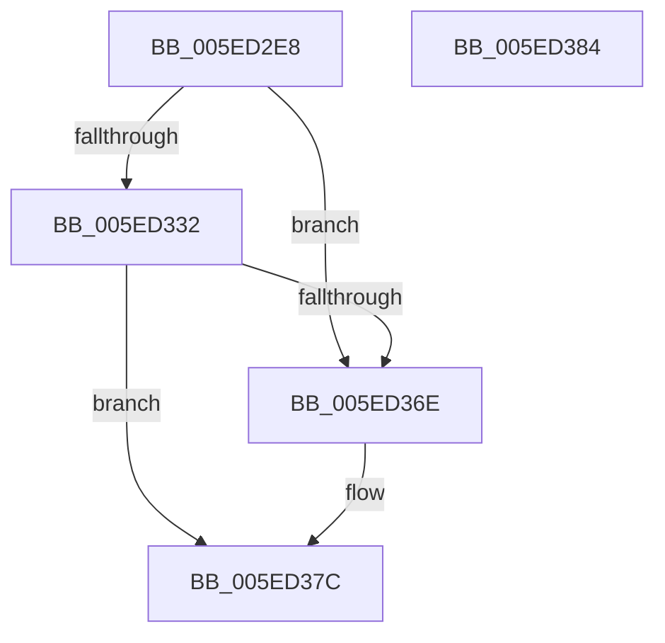

# RtlpEcReadPolicyState

- RVA: `0x005ED2E8`–`0x005ED385` (길이 `157` bytes)
- VA: `0x00000001405ED2E8`
- 실행 섹션: `.text`
- PDB 이름 있음: `예`; PDB Function 태그: `아니요`
- unwind 정보 RVA: `0x00064C80`
- 디코드: `38`개 명령, `157/157` bytes 표시
- 미해석 바이트: `0` (있으면 어셈블리에 `.byte`로 보존)

> 이 문서는 커널 이미지의 기계어와 PDB 기호를 분석해 생성했습니다. 4번과 5번은 함수 원형과 자료형을 바이너리 사용 방식에서 추정한 C 해석이며 원본 소스 복구 결과는 아닙니다.

## 1. Dependencies

- 직접 호출 지점: **2**; 고유 호출 대상: **1**
- 직접 호출자로 확인된 함수: **1**
- RIP 상대 이미지 참조: **8**

### Outgoing calls
- `0x005ED327` → [RtlpEtcGetDwordFromPersistedState](RtlpEtcGetDwordFromPersistedState_function_005ED38C.md) (function, `0x005ED38C`)
- `0x005ED363` → [RtlpEtcGetDwordFromPersistedState](RtlpEtcGetDwordFromPersistedState_function_005ED38C.md) (function, `0x005ED38C`)

### Direct callers
- [RtlIsFeatureEnabledForEnterprise](RtlIsFeatureEnabledForEnterprise_function_005ED210.md) at `0x005ED270`

### Static image references
- `0x005ED2FD` → RVA `0x006CCDB0` (` ?? ::FNODOBFM::`string'`; read)
- `0x005ED304` → RVA `0x006CCD60` (` ?? ::FNODOBFM::`string'`; read)
- `0x005ED319` → RVA `0x006CCDF0` (` ?? ::FNODOBFM::`string'`; read)
- `0x005ED320` → RVA `0x006CD0D0` (` ?? ::FNODOBFM::`string'`; read)
- `0x005ED342` → RVA `0x006CD150` (` ?? ::FNODOBFM::`string'`; read)
- `0x005ED349` → RVA `0x006CD0F0` (` ?? ::FNODOBFM::`string'`; read)
- `0x005ED350` → RVA `0x006CD170` (` ?? ::FNODOBFM::`string'`; read)
- `0x005ED35C` → RVA `0x006CD050` (` ?? ::FNODOBFM::`string'`; read)

## 2. Other-region calls and transfers

- 다른 실행 섹션으로 향하는 call: **0**
- 별도 외부 분기/꼬리 이동을 확인하지 못했습니다.

## 3. Assembly (complete function range)

```asm
005ED2E8  40 53                           push rbx
005ED2EA  48 83 EC 30                     sub rsp, 0x30
005ED2EE  83 64 24 48 00                  and dword ptr [rsp + 0x48], 0
005ED2F3  48 8D 44 24 48                  lea rax, [rsp + 0x48]
005ED2F8  48 89 44 24 28                  mov qword ptr [rsp + 0x28], rax
005ED2FD  4C 8D 0D AC FA 0D 00            lea r9, [rip + 0xdfaac]
005ED304  48 8D 05 55 FA 0D 00            lea rax, [rip + 0xdfa55]
005ED30B  48 8B D9                        mov rbx, rcx
005ED30E  41 B8 1A 00 00 00               mov r8d, 0x1a
005ED314  48 89 44 24 20                  mov qword ptr [rsp + 0x20], rax
005ED319  48 8D 15 D0 FA 0D 00            lea rdx, [rip + 0xdfad0]
005ED320  48 8D 0D A9 FD 0D 00            lea rcx, [rip + 0xdfda9]
005ED327  E8 60 00 00 00                  call 0x1405ed38c
005ED32C  8B D0                           mov edx, eax
005ED32E  85 C0                           test eax, eax
005ED330  79 3C                           jns 0x1405ed36e
005ED332  48 8D 44 24 48                  lea rax, [rsp + 0x48]
005ED337  41 B8 0A 00 00 00               mov r8d, 0xa
005ED33D  48 89 44 24 28                  mov qword ptr [rsp + 0x28], rax
005ED342  4C 8D 0D 07 FE 0D 00            lea r9, [rip + 0xdfe07]
005ED349  48 8D 05 A0 FD 0D 00            lea rax, [rip + 0xdfda0]
005ED350  48 8D 15 19 FE 0D 00            lea rdx, [rip + 0xdfe19]
005ED357  48 89 44 24 20                  mov qword ptr [rsp + 0x20], rax
005ED35C  48 8D 0D ED FC 0D 00            lea rcx, [rip + 0xdfced]
005ED363  E8 24 00 00 00                  call 0x1405ed38c
005ED368  8B D0                           mov edx, eax
005ED36A  85 C0                           test eax, eax
005ED36C  78 0E                           js 0x1405ed37c
005ED36E  8B 44 24 48                     mov eax, dword ptr [rsp + 0x48]
005ED372  FF C8                           dec eax
005ED374  83 F8 01                        cmp eax, 1
005ED377  0F 96 C0                        setbe al
005ED37A  88 03                           mov byte ptr [rbx], al
005ED37C  8B C2                           mov eax, edx
005ED37E  48 83 C4 30                     add rsp, 0x30
005ED382  5B                              pop rbx
005ED383  C3                              ret
005ED384  CC                              int3
```

## 4. C-style interpretation (structured pseudocode)

```c
__int64 __fastcall RtlpEcReadPolicyState(__int64 a1)
{
    __int64 result;
    __int64 v_rsp;
    unsigned __int64 v_stack_m10;
    unsigned __int64 v_stack_m18;
    unsigned int v_stack_p10;

    v_rsp = (v_rsp) - (48);
    v_stack_m10 = v_stack_p10;
    v_stack_m18 = v_rip + 916053;
    result = RtlpEtcGetDwordFromPersistedState(v_rip + 916905, v_rip + 916176, 26, v_rip + 916140);
    if (!sign_flag) goto loc_005ED36E;
    v_stack_m10 = v_stack_p10;
    v_stack_m18 = v_rip + 916896;
    result = RtlpEtcGetDwordFromPersistedState(v_rip + 916717, v_rip + 917017, 10, v_rip + 916999);
    if (!(sign_flag)) {
        result = v_stack_p10;
        result = (unsigned int)((result) - 1);
        result = (((unsigned int)(result)) <= 1) ? 1 : 0;
        *(unsigned __int8 *)(a1) = (unsigned __int8)(result);
    }
    v_rsp = (v_rsp) + (48);
    return (unsigned int)((unsigned int)((unsigned int)((unsigned int)(result))));
}
```

## 5. (Beta) C Style

```c
int64_t RtlpEcReadPolicyState(void *Arg1)
{
    uint8_t *arg1 = (uint8_t *)Arg1;

    int64_t result;
    int64_t local_rsp;
    uint64_t v_stack_m10;
    uint64_t v_stack_m18;
    uint32_t v_stack_p10;

    local_rsp = (local_rsp) - (48);
    v_stack_m10 = v_stack_p10;
    v_stack_m18 = v_rip + 916053;
    result = RtlpEtcGetDwordFromPersistedState(v_rip + 916905, v_rip + 916176, 26, v_rip + 916140);
    if (!sign_flag) goto loc_005ED36E;
    v_stack_m10 = v_stack_p10;
    v_stack_m18 = v_rip + 916896;
    result = RtlpEtcGetDwordFromPersistedState(v_rip + 916717, v_rip + 917017, 10, v_rip + 916999);
    if (!(sign_flag)) {
        result = v_stack_p10;
        result = (uint32_t)((result) - 1);
        result = (((uint32_t)(result)) <= 1) ? 1 : 0;
        *(uint8_t *)(arg1) = (uint8_t)(result);
    }
    local_rsp = (local_rsp) + (48);
    return (uint32_t)((uint32_t)((uint32_t)((uint32_t)(result))));
}
```

### 관측된 메모리 오프셋

구조체 형식이 확인되지 않은 접근은 인자 기준의 오프셋으로만 기록했습니다.

| 기준 인자 | 오프셋 표현 | 폭 (bit) | 접근 |
|---|---:|---:|---|
| `Arg1` | `+ 0x0` | `8` | `W` |

## 6. Execution-region graph

[열기: 2D/3D 그래프와 함수 탐색 컨트롤 패널](../../../control-panel.html?section=text&rva=0x005ED2E8&view=graph)

- 2D 그래프는 위에서 아래로 흐르고, 3D 그래프는 빈 공간을 드래그해 회전합니다. Shift+드래그는 이동, 휠은 확대·축소, 함수 노드 선택은 대상 보고서 이동입니다.

### Static fallback


