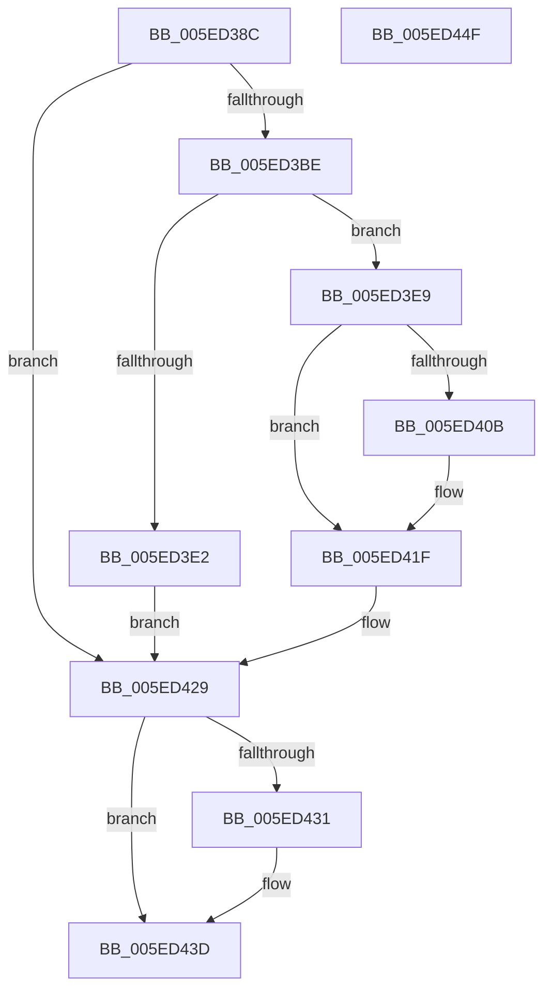

# RtlpEtcGetDwordFromPersistedState

- RVA: `0x005ED38C`–`0x005ED450` (길이 `196` bytes)
- VA: `0x00000001405ED38C`
- 실행 섹션: `.text`
- PDB 이름 있음: `예`; PDB Function 태그: `아니요`
- unwind 정보 RVA: `0x000CFE04`
- 디코드: `56`개 명령, `196/196` bytes 표시
- 미해석 바이트: `0` (있으면 어셈블리에 `.byte`로 보존)

> 이 문서는 커널 이미지의 기계어와 PDB 기호를 분석해 생성했습니다. 4번과 5번은 함수 원형과 자료형을 바이너리 사용 방식에서 추정한 C 해석이며 원본 소스 복구 결과는 아닙니다.

## 1. Dependencies

- 직접 호출 지점: **6**; 고유 호출 대상: **5**
- 직접 호출자로 확인된 함수: **1**
- RIP 상대 이미지 참조: **1**

### Outgoing calls
- `0x005ED3B3` → [RtlpGetPersistedRegistryLocation](RtlpGetPersistedRegistryLocation_function_005ED5BC.md) (function, `0x005ED5BC`)
- `0x005ED3D5` → [ExAllocatePool2](../../poolcode/B8/ExAllocatePool2_function_00B820F0.md) (function, `0x00B820F0`)
- `0x005ED400` → [RtlStringCchPrintfW](../48/RtlStringCchPrintfW_function_00482D5C.md) (function, `0x00482D5C`)
- `0x005ED418` → [RtlpEtcGetDwordFromRegistry](RtlpEtcGetDwordFromRegistry_function_005ED458.md) (function, `0x005ED458`)
- `0x005ED424` → [ExFreePoolWithTag](../../poolcode/B8/ExFreePoolWithTag_function_00B82870.md) (function, `0x00B82870`)
- `0x005ED438` → [ExFreePoolWithTag](../../poolcode/B8/ExFreePoolWithTag_function_00B82870.md) (function, `0x00B82870`)

### Direct callers
- [RtlpEcReadPolicyState](RtlpEcReadPolicyState_function_005ED2E8.md) at `0x005ED327`
- [RtlpEcReadPolicyState](RtlpEcReadPolicyState_function_005ED2E8.md) at `0x005ED363`

### Static image references
- `0x005ED3EE` → RVA `0x006CCD50` (` ?? ::FNODOBFM::`string'`; read)

## 2. Other-region calls and transfers

- 다른 실행 섹션으로 향하는 call: **3**
  - `0x005ED3D5` → [ExAllocatePool2](../../poolcode/B8/ExAllocatePool2_function_00B820F0.md) (`.text` → `POOLCODE`)
  - `0x005ED424` → [ExFreePoolWithTag](../../poolcode/B8/ExFreePoolWithTag_function_00B82870.md) (`.text` → `POOLCODE`)
  - `0x005ED438` → [ExFreePoolWithTag](../../poolcode/B8/ExFreePoolWithTag_function_00B82870.md) (`.text` → `POOLCODE`)
- 별도 외부 분기/꼬리 이동을 확인하지 못했습니다.

## 3. Assembly (complete function range)

```asm
005ED38C  48 8B C4                        mov rax, rsp
005ED38F  48 89 58 08                     mov qword ptr [rax + 8], rbx
005ED393  48 89 68 10                     mov qword ptr [rax + 0x10], rbp
005ED397  57                              push rdi
005ED398  48 83 EC 40                     sub rsp, 0x40
005ED39C  48 83 60 F0 00                  and qword ptr [rax - 0x10], 0
005ED3A1  49 8B E9                        mov rbp, r9
005ED3A4  83 60 E8 00                     and dword ptr [rax - 0x18], 0
005ED3A8  4C 8D 48 E8                     lea r9, [rax - 0x18]
005ED3AC  41 8B F8                        mov edi, r8d
005ED3AF  4C 8D 40 F0                     lea r8, [rax - 0x10]
005ED3B3  E8 04 02 00 00                  call 0x1405ed5bc
005ED3B8  8B D8                           mov ebx, eax
005ED3BA  85 C0                           test eax, eax
005ED3BC  78 6B                           js 0x1405ed429
005ED3BE  8B 4C 24 30                     mov ecx, dword ptr [rsp + 0x30]
005ED3C2  41 B8 53 74 72 67               mov r8d, 0x67727453
005ED3C8  03 CF                           add ecx, edi
005ED3CA  8B D9                           mov ebx, ecx
005ED3CC  48 8D 14 09                     lea rdx, [rcx + rcx]
005ED3D0  B9 00 01 00 00                  mov ecx, 0x100
005ED3D5  E8 16 4D 59 00                  call 0x140b820f0
005ED3DA  48 8B F8                        mov rdi, rax
005ED3DD  48 85 C0                        test rax, rax
005ED3E0  75 07                           jne 0x1405ed3e9
005ED3E2  BB 17 00 00 C0                  mov ebx, 0xc0000017
005ED3E7  EB 40                           jmp 0x1405ed429
005ED3E9  4C 8B 4C 24 38                  mov r9, qword ptr [rsp + 0x38]
005ED3EE  4C 8D 05 5B F9 0D 00            lea r8, [rip + 0xdf95b]
005ED3F5  48 8B D3                        mov rdx, rbx
005ED3F8  48 89 6C 24 20                  mov qword ptr [rsp + 0x20], rbp
005ED3FD  48 8B CF                        mov rcx, rdi
005ED400  E8 57 59 E9 FF                  call 0x140482d5c
005ED405  8B D8                           mov ebx, eax
005ED407  85 C0                           test eax, eax
005ED409  78 14                           js 0x1405ed41f
005ED40B  4C 8B 44 24 78                  mov r8, qword ptr [rsp + 0x78]
005ED410  48 8B CF                        mov rcx, rdi
005ED413  48 8B 54 24 70                  mov rdx, qword ptr [rsp + 0x70]
005ED418  E8 3B 00 00 00                  call 0x1405ed458
005ED41D  8B D8                           mov ebx, eax
005ED41F  33 D2                           xor edx, edx
005ED421  48 8B CF                        mov rcx, rdi
005ED424  E8 47 54 59 00                  call 0x140b82870
005ED429  48 83 7C 24 38 00               cmp qword ptr [rsp + 0x38], 0
005ED42F  74 0C                           je 0x1405ed43d
005ED431  48 8B 4C 24 38                  mov rcx, qword ptr [rsp + 0x38]
005ED436  33 D2                           xor edx, edx
005ED438  E8 33 54 59 00                  call 0x140b82870
005ED43D  48 8B 6C 24 58                  mov rbp, qword ptr [rsp + 0x58]
005ED442  8B C3                           mov eax, ebx
005ED444  48 8B 5C 24 50                  mov rbx, qword ptr [rsp + 0x50]
005ED449  48 83 C4 40                     add rsp, 0x40
005ED44D  5F                              pop rdi
005ED44E  C3                              ret
005ED44F  CC                              int3
```

## 4. C-style interpretation (structured pseudocode)

```c
__int64 __fastcall RtlpEtcGetDwordFromPersistedState(__int64 a1, __int64 a2, int a3, __int64 a4, __int64 a5, __int64 a6)
{
    __int64 result;
    __int64 v_rbx;
    __int64 v_rsp;
    unsigned __int64 v_stack_m10;
    unsigned int v_stack_m18;
    unsigned __int64 v_stack_m28;
    unsigned __int64 v_stack_p10;
    unsigned __int64 v_stack_p8;

    *(unsigned __int64 *)(v_rsp + 8) = v_rbx;
    *(unsigned __int64 *)(v_rsp + 16) = v_rbp;
    v_rsp = (v_rsp) - (64);
    result = RtlpGetPersistedRegistryLocation(a1, a2, v_rsp - 16, v_rsp - 24);
    if (sign_flag) goto loc_005ED429;
    a1 = (unsigned int)(((unsigned int)(v_stack_m18)) + ((unsigned int)((unsigned int)(a3))));
    result = ExAllocatePool2(256, a1 + a1 * 1, (unsigned int)(0x67727453ULL), v_rsp - 24);
    if (result != 0) goto loc_005ED3E9;
    goto loc_005ED429;
loc_005ED3E9:
    v_stack_m28 = a4;
    result = RtlStringCchPrintfW(result, (unsigned int)(0xC0000017ULL), v_rip + 915803, v_stack_m10);
    v_rbx = (unsigned int)((unsigned int)(result));
    if (!(sign_flag)) {
        a3 = a6;
        a1 = result;
        a2 = a5;
        result = RtlpEtcGetDwordFromRegistry(a1, a2, a3, v_stack_m10);
        v_rbx = (unsigned int)(result);
    }
    a2 = 0;
    result = ExFreePoolWithTag(result, a2, a3, v_stack_m10);
loc_005ED429:
    if (v_stack_m10 != 0) {
        a1 = v_stack_m10;
        a2 = 0;
        result = ExFreePoolWithTag(a1, a2, a3, v_stack_m10);
    }
    v_rsp = (v_rsp) + (64);
    return (unsigned int)((unsigned int)(v_rbx));
}
```

## 5. (Beta) C Style

```c
int64_t RtlpEtcGetDwordFromPersistedState(int64_t Arg1, int64_t Arg2, int32_t Arg3, int64_t Arg4, int64_t Arg5, int64_t Arg6)
{
    int64_t result;
    int64_t local_rbx;
    int64_t local_rsp;
    uint64_t v_stack_m10;
    uint32_t v_stack_m18;
    uint64_t v_stack_m28;
    uint64_t v_stack_p10;
    uint64_t v_stack_p8;

    *(uint64_t *)(local_rsp + 0x8) = local_rbx;
    *(uint64_t *)(local_rsp + 0x10) = local_rbp;
    local_rsp = (local_rsp) - (64);
    result = RtlpGetPersistedRegistryLocation(Arg1, Arg2, local_rsp - 16, local_rsp - 24);
    if (sign_flag) goto loc_005ED429;
    Arg1 = (uint32_t)(((uint32_t)(v_stack_m18)) + ((uint32_t)((uint32_t)(Arg3))));
    result = ExAllocatePool2(256, Arg1 + Arg1 * 1, (uint32_t)(0x67727453ULL), local_rsp - 24);
    if (result != 0) goto loc_005ED3E9;
    goto loc_005ED429;
loc_005ED3E9:
    v_stack_m28 = Arg4;
    result = RtlStringCchPrintfW(result, (uint32_t)(0xC0000017ULL), v_rip + 915803, v_stack_m10);
    local_rbx = (uint32_t)((uint32_t)(result));
    if (!(sign_flag)) {
        Arg3 = Arg6;
        Arg1 = result;
        Arg2 = Arg5;
        result = RtlpEtcGetDwordFromRegistry(Arg1, Arg2, Arg3, v_stack_m10);
        local_rbx = (uint32_t)(result);
    }
    Arg2 = 0;
    result = ExFreePoolWithTag(result, Arg2, Arg3, v_stack_m10);
loc_005ED429:
    if (v_stack_m10 != 0) {
        Arg1 = v_stack_m10;
        Arg2 = 0;
        result = ExFreePoolWithTag(Arg1, Arg2, Arg3, v_stack_m10);
    }
    local_rsp = (local_rsp) + (64);
    return (uint32_t)((uint32_t)(local_rbx));
}
```

## 6. Execution-region graph

[열기: 2D/3D 그래프와 함수 탐색 컨트롤 패널](../../../control-panel.html?section=text&rva=0x005ED38C&view=graph)

- 2D 그래프는 위에서 아래로 흐르고, 3D 그래프는 빈 공간을 드래그해 회전합니다. Shift+드래그는 이동, 휠은 확대·축소, 함수 노드 선택은 대상 보고서 이동입니다.

### Static fallback


