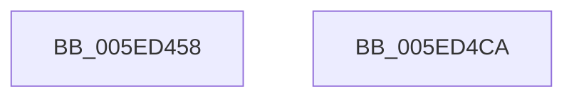

# RtlpEtcGetDwordFromRegistry

- RVA: `0x005ED458`–`0x005ED4CB` (길이 `115` bytes)
- VA: `0x00000001405ED458`
- 실행 섹션: `.text`
- PDB 이름 있음: `예`; PDB Function 태그: `아니요`
- unwind 정보 RVA: `0x000CFE38`
- 디코드: `28`개 명령, `115/115` bytes 표시
- 미해석 바이트: `0` (있으면 어셈블리에 `.byte`로 보존)

> 이 문서는 커널 이미지의 기계어와 PDB 기호를 분석해 생성했습니다. 4번과 5번은 함수 원형과 자료형을 바이너리 사용 방식에서 추정한 C 해석이며 원본 소스 복구 결과는 아닙니다.

## 1. Dependencies

- 직접 호출 지점: **2**; 고유 호출 대상: **2**
- 직접 호출자로 확인된 함수: **3**
- RIP 상대 이미지 참조: **0**

### Outgoing calls
- `0x005ED47E` → [memset](../6C/memset_function_006C6C40.md) (function, `0x006C6C40`)
- `0x005ED4B0` → [RtlQueryRegistryValuesEx](../../page/8C/RtlQueryRegistryValuesEx_function_008C8FF0.md) (function, `0x008C8FF0`)

### Direct callers
- [RtlIsFeatureEnabledForEnterprise](RtlIsFeatureEnabledForEnterprise_function_005ED210.md) at `0x005ED23A`
- [RtlpEtcGetDwordFromPersistedState](RtlpEtcGetDwordFromPersistedState_function_005ED38C.md) at `0x005ED418`
- [RtlpEtcIsValidFeatureId](RtlpEtcIsValidFeatureId_function_005ED4D4.md) at `0x005ED57C`

### Static image references
- 디코드된 RIP-relative 메모리 참조가 없습니다.

## 2. Other-region calls and transfers

- 다른 실행 섹션으로 향하는 call: **1**
  - `0x005ED4B0` → [RtlQueryRegistryValuesEx](../../page/8C/RtlQueryRegistryValuesEx_function_008C8FF0.md) (`.text` → `PAGE`)
- 별도 외부 분기/꼬리 이동을 확인하지 못했습니다.

## 3. Assembly (complete function range)

```asm
005ED458  48 89 5C 24 08                  mov qword ptr [rsp + 8], rbx
005ED45D  48 89 74 24 10                  mov qword ptr [rsp + 0x10], rsi
005ED462  57                              push rdi
005ED463  48 81 EC A0 00 00 00            sub rsp, 0xa0
005ED46A  48 8B DA                        mov rbx, rdx
005ED46D  49 8B F8                        mov rdi, r8
005ED470  33 D2                           xor edx, edx
005ED472  48 8B F1                        mov rsi, rcx
005ED475  48 8D 4C 24 30                  lea rcx, [rsp + 0x30]
005ED47A  44 8D 42 70                     lea r8d, [rdx + 0x70]
005ED47E  E8 BD 97 0D 00                  call 0x1406c6c40
005ED483  48 83 64 24 20 00               and qword ptr [rsp + 0x20], 0
005ED489  4C 8D 44 24 30                  lea r8, [rsp + 0x30]
005ED48E  45 33 C9                        xor r9d, r9d
005ED491  C7 44 24 38 34 01 00 00         mov dword ptr [rsp + 0x38], 0x134
005ED499  48 8B D6                        mov rdx, rsi
005ED49C  48 89 5C 24 40                  mov qword ptr [rsp + 0x40], rbx
005ED4A1  33 C9                           xor ecx, ecx
005ED4A3  C7 44 24 50 00 00 00 04         mov dword ptr [rsp + 0x50], 0x4000000
005ED4AB  48 89 7C 24 48                  mov qword ptr [rsp + 0x48], rdi
005ED4B0  E8 3B BB 2D 00                  call 0x1408c8ff0
005ED4B5  4C 8D 9C 24 A0 00 00 00         lea r11, [rsp + 0xa0]
005ED4BD  49 8B 5B 10                     mov rbx, qword ptr [r11 + 0x10]
005ED4C1  49 8B 73 18                     mov rsi, qword ptr [r11 + 0x18]
005ED4C5  49 8B E3                        mov rsp, r11
005ED4C8  5F                              pop rdi
005ED4C9  C3                              ret
005ED4CA  CC                              int3
```

## 4. C-style interpretation (structured pseudocode)

```c
__int64 __fastcall RtlpEtcGetDwordFromRegistry(__int64 a1, __int64 a2, __int64 a3, int a4)
{
    __int64 result;
    __int64 v_rsp;
    unsigned int v_stack_m58;
    unsigned __int64 v_stack_m60;
    unsigned __int64 v_stack_m68;
    unsigned int v_stack_m70;
    unsigned __int64 v_stack_m78;
    unsigned __int64 v_stack_m8;
    unsigned __int64 v_stack_m88;
    unsigned __int64 v_stack_p10;
    unsigned __int64 v_stack_p8;

    v_stack_p8 = v_rbx;
    v_stack_p10 = v_rsi;
    v_rsp = (v_rsp) - (160);
    a2 = 0;
    result = memset(v_stack_m78, a2, a2 + 112, a4);
    a4 = 0;
    v_stack_m70 = 308;
    v_stack_m68 = 0;
    a1 = 0;
    v_stack_m58 = 0x4000000ULL;
    v_stack_m60 = a3;
    result = RtlQueryRegistryValuesEx(a1, a1, v_stack_m78, a4);
    return result;
}
```

## 5. (Beta) C Style

```c
int64_t RtlpEtcGetDwordFromRegistry(int64_t Arg1, int64_t Arg2, int64_t Arg3, int32_t Arg4)
{
    int64_t result;
    int64_t local_rsp;
    uint32_t v_stack_m58;
    uint64_t v_stack_m60;
    uint64_t v_stack_m68;
    uint32_t v_stack_m70;
    uint64_t v_stack_m78;
    uint64_t v_stack_m8;
    uint64_t v_stack_m88;
    uint64_t v_stack_p10;
    uint64_t v_stack_p8;

    v_stack_p8 = local_rbx;
    v_stack_p10 = local_rsi;
    local_rsp = (local_rsp) - (160);
    Arg2 = 0;
    result = memset(v_stack_m78, Arg2, Arg2 + 112, Arg4);
    Arg4 = 0;
    v_stack_m70 = 308;
    v_stack_m68 = 0;
    Arg1 = 0;
    v_stack_m58 = 0x4000000ULL;
    v_stack_m60 = Arg3;
    result = RtlQueryRegistryValuesEx(Arg1, Arg1, v_stack_m78, Arg4);
    return result;
}
```

## 6. Execution-region graph

[열기: 2D/3D 그래프와 함수 탐색 컨트롤 패널](../../../control-panel.html?section=text&rva=0x005ED458&view=graph)

- 2D 그래프는 위에서 아래로 흐르고, 3D 그래프는 빈 공간을 드래그해 회전합니다. Shift+드래그는 이동, 휠은 확대·축소, 함수 노드 선택은 대상 보고서 이동입니다.

### Static fallback


