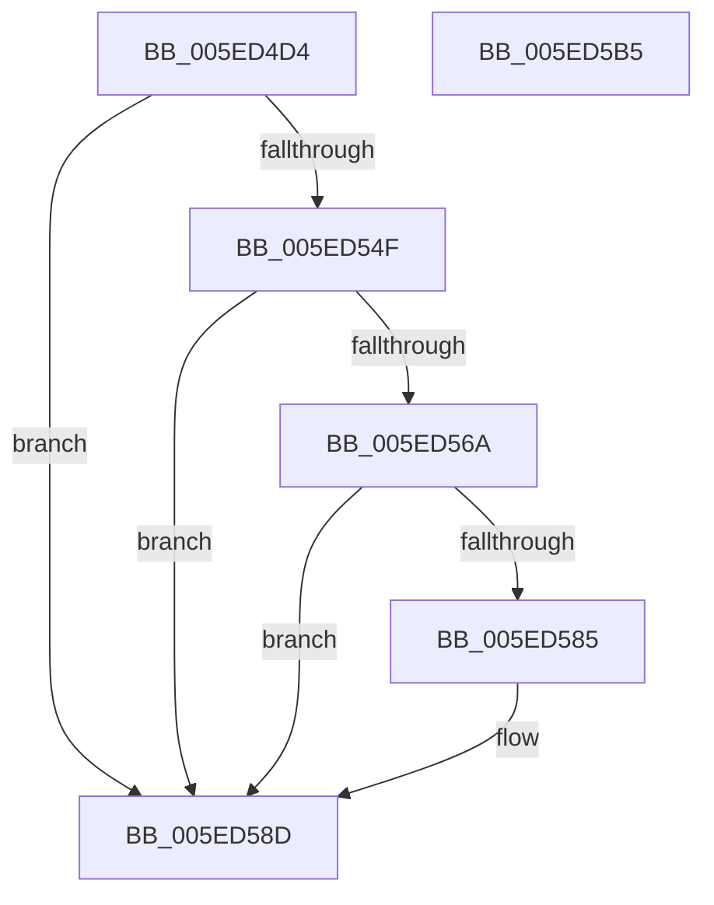

# RtlpEtcIsValidFeatureId

- RVA: `0x005ED4D4`–`0x005ED5B6` (길이 `226` bytes)
- VA: `0x00000001405ED4D4`
- 실행 섹션: `.text`
- PDB 이름 있음: `예`; PDB Function 태그: `아니요`
- unwind 정보 RVA: `0x000CFE18`
- 디코드: `53`개 명령, `226/226` bytes 표시
- 미해석 바이트: `0` (있으면 어셈블리에 `.byte`로 보존)

> 이 문서는 커널 이미지의 기계어와 PDB 기호를 분석해 생성했습니다. 4번과 5번은 함수 원형과 자료형을 바이너리 사용 방식에서 추정한 C 해석이며 원본 소스 복구 결과는 아닙니다.

## 1. Dependencies

- 직접 호출 지점: **6**; 고유 호출 대상: **4**
- 직접 호출자로 확인된 함수: **1**
- RIP 상대 이미지 참조: **4**

### Outgoing calls
- `0x005ED512` → [memset](../6C/memset_function_006C6C40.md) (function, `0x006C6C40`)
- `0x005ED522` → [memset](../6C/memset_function_006C6C40.md) (function, `0x006C6C40`)
- `0x005ED546` → [RtlStringCchPrintfW](../48/RtlStringCchPrintfW_function_00482D5C.md) (function, `0x00482D5C`)
- `0x005ED561` → [RtlStringCchPrintfW](../48/RtlStringCchPrintfW_function_00482D5C.md) (function, `0x00482D5C`)
- `0x005ED57C` → [RtlpEtcGetDwordFromRegistry](RtlpEtcGetDwordFromRegistry_function_005ED458.md) (function, `0x005ED458`)
- `0x005ED59B` → [_security_check_cookie](../6A/_security_check_cookie_function_006AC640.md) (function, `0x006AC640`)

### Direct callers
- [RtlIsFeatureEnabledForEnterprise](RtlIsFeatureEnabledForEnterprise_function_005ED210.md) at `0x005ED263`

### Static image references
- `0x005ED4E6` → RVA `0x00E0A740` (`.data`; read)
- `0x005ED527` → RVA `0x006CCE60` (` ?? ::FNODOBFM::`string'`; read)
- `0x005ED532` → RVA `0x006CCF20` (` ?? ::FNODOBFM::`string'`; read)
- `0x005ED552` → RVA `0x006CCF30` (` ?? ::FNODOBFM::`string'`; read)

## 2. Other-region calls and transfers

- 다른 실행 섹션으로 향하는 call: **0**
- 별도 외부 분기/꼬리 이동을 확인하지 못했습니다.

## 3. Assembly (complete function range)

```asm
005ED4D4  48 89 5C 24 18                  mov qword ptr [rsp + 0x18], rbx
005ED4D9  48 89 74 24 20                  mov qword ptr [rsp + 0x20], rsi
005ED4DE  57                              push rdi
005ED4DF  48 81 EC C0 01 00 00            sub rsp, 0x1c0
005ED4E6  48 8B 05 53 D2 81 00            mov rax, qword ptr [rip + 0x81d253]
005ED4ED  48 33 C4                        xor rax, rsp
005ED4F0  48 89 84 24 B0 01 00 00         mov qword ptr [rsp + 0x1b0], rax
005ED4F8  8B DA                           mov ebx, edx
005ED4FA  8B F1                           mov esi, ecx
005ED4FC  33 FF                           xor edi, edi
005ED4FE  48 8D 8C 24 80 00 00 00         lea rcx, [rsp + 0x80]
005ED506  33 D2                           xor edx, edx
005ED508  89 7C 24 30                     mov dword ptr [rsp + 0x30], edi
005ED50C  41 B8 2C 01 00 00               mov r8d, 0x12c
005ED512  E8 29 97 0D 00                  call 0x1406c6c40
005ED517  33 D2                           xor edx, edx
005ED519  44 8D 47 40                     lea r8d, [rdi + 0x40]
005ED51D  48 8D 4C 24 40                  lea rcx, [rsp + 0x40]
005ED522  E8 19 97 0D 00                  call 0x1406c6c40
005ED527  4C 8D 0D 32 F9 0D 00            lea r9, [rip + 0xdf932]
005ED52E  89 5C 24 20                     mov dword ptr [rsp + 0x20], ebx
005ED532  4C 8D 05 E7 F9 0D 00            lea r8, [rip + 0xdf9e7]
005ED539  BA 96 00 00 00                  mov edx, 0x96
005ED53E  48 8D 8C 24 80 00 00 00         lea rcx, [rsp + 0x80]
005ED546  E8 11 58 E9 FF                  call 0x140482d5c
005ED54B  85 C0                           test eax, eax
005ED54D  78 3E                           js 0x1405ed58d
005ED54F  44 8B CE                        mov r9d, esi
005ED552  4C 8D 05 D7 F9 0D 00            lea r8, [rip + 0xdf9d7]
005ED559  8D 57 20                        lea edx, [rdi + 0x20]
005ED55C  48 8D 4C 24 40                  lea rcx, [rsp + 0x40]
005ED561  E8 F6 57 E9 FF                  call 0x140482d5c
005ED566  85 C0                           test eax, eax
005ED568  78 23                           js 0x1405ed58d
005ED56A  4C 8D 44 24 30                  lea r8, [rsp + 0x30]
005ED56F  48 8D 54 24 40                  lea rdx, [rsp + 0x40]
005ED574  48 8D 8C 24 80 00 00 00         lea rcx, [rsp + 0x80]
005ED57C  E8 D7 FE FF FF                  call 0x1405ed458
005ED581  85 C0                           test eax, eax
005ED583  78 08                           js 0x1405ed58d
005ED585  39 7C 24 30                     cmp dword ptr [rsp + 0x30], edi
005ED589  40 0F 95 C7                     setne dil
005ED58D  40 8A C7                        mov al, dil
005ED590  48 8B 8C 24 B0 01 00 00         mov rcx, qword ptr [rsp + 0x1b0]
005ED598  48 33 CC                        xor rcx, rsp
005ED59B  E8 A0 F0 0B 00                  call 0x1406ac640
005ED5A0  4C 8D 9C 24 C0 01 00 00         lea r11, [rsp + 0x1c0]
005ED5A8  49 8B 5B 20                     mov rbx, qword ptr [r11 + 0x20]
005ED5AC  49 8B 73 28                     mov rsi, qword ptr [r11 + 0x28]
005ED5B0  49 8B E3                        mov rsp, r11
005ED5B3  5F                              pop rdi
005ED5B4  C3                              ret
005ED5B5  CC                              int3
```

## 4. C-style interpretation (structured pseudocode)

```c
__int64 __fastcall RtlpEtcIsValidFeatureId(int a1, int a2)
{
    __int64 result;
    __int64 v_rdi;
    __int64 v_rsp;
    unsigned __int64 v_stack_m148;
    unsigned __int64 v_stack_m18;
    unsigned __int64 v_stack_m188;
    unsigned int v_stack_m198;
    unsigned int v_stack_m1A8;
    unsigned __int64 v_stack_m8;
    unsigned __int64 v_stack_p18;
    unsigned __int64 v_stack_p20;

    v_stack_p18 = v_rbx;
    v_stack_p20 = v_rsi;
    v_rsp = (v_rsp) - (448);
    result = (*(unsigned __int64 *)(v_rip + 8507987)) ^ (v_rsp);
    v_stack_m18 = result;
    v_rdi = 0;
    a2 = 0;
    v_stack_m198 = 0;
    result = memset(v_stack_m148, a2, 300, a4);
    a2 = 0;
    result = memset(v_stack_m188, a2, v_rdi + 64, a4);
    v_stack_m1A8 = (unsigned int)((unsigned int)(a2));
    result = RtlStringCchPrintfW(v_stack_m148, 150, v_rip + 915943, v_rip + 915762);
    if (sign_flag) goto loc_005ED58D;
    result = RtlStringCchPrintfW(v_stack_m188, v_rdi + 32, v_rip + 915927, (unsigned int)((unsigned int)((unsigned int)(a1))));
    if (sign_flag) goto loc_005ED58D;
    result = RtlpEtcGetDwordFromRegistry(v_stack_m148, v_stack_m188, v_stack_m198, (unsigned int)((unsigned int)((unsigned int)(a1))));
    if (!(sign_flag)) {
        v_rdi = (v_stack_m198 != 0) ? 1 : 0;
    }
    a1 = (v_stack_m18) ^ (v_rsp);
    result = _security_check_cookie(a1, v_stack_m188, v_stack_m198, (unsigned int)((unsigned int)((unsigned int)(a1))));
    return result;
}
```

## 5. (Beta) C Style

```c
int64_t RtlpEtcIsValidFeatureId(int32_t Arg1, int32_t Arg2)
{
    int64_t result;
    int64_t local_rdi;
    int64_t local_rsp;
    uint64_t v_stack_m148;
    uint64_t v_stack_m18;
    uint64_t v_stack_m188;
    uint32_t v_stack_m198;
    uint32_t v_stack_m1A8;
    uint64_t v_stack_m8;
    uint64_t v_stack_p18;
    uint64_t v_stack_p20;

    v_stack_p18 = local_rbx;
    v_stack_p20 = local_rsi;
    local_rsp = (local_rsp) - (448);
    result = (*(uint64_t *)(v_rip + 0x81D253)) ^ (local_rsp);
    v_stack_m18 = result;
    local_rdi = 0;
    Arg2 = 0;
    v_stack_m198 = 0;
    result = memset(v_stack_m148, Arg2, 300, a4);
    Arg2 = 0;
    result = memset(v_stack_m188, Arg2, local_rdi + 64, a4);
    v_stack_m1A8 = (uint32_t)((uint32_t)(Arg2));
    result = RtlStringCchPrintfW(v_stack_m148, 150, v_rip + 915943, v_rip + 915762);
    if (sign_flag) goto loc_005ED58D;
    result = RtlStringCchPrintfW(v_stack_m188, local_rdi + 32, v_rip + 915927, (uint32_t)((uint32_t)((uint32_t)(Arg1))));
    if (sign_flag) goto loc_005ED58D;
    result = RtlpEtcGetDwordFromRegistry(v_stack_m148, v_stack_m188, v_stack_m198, (uint32_t)((uint32_t)((uint32_t)(Arg1))));
    if (!(sign_flag)) {
        local_rdi = (v_stack_m198 != 0) ? 1 : 0;
    }
    Arg1 = (v_stack_m18) ^ (local_rsp);
    result = _security_check_cookie(Arg1, v_stack_m188, v_stack_m198, (uint32_t)((uint32_t)((uint32_t)(Arg1))));
    return result;
}
```

## 6. Execution-region graph

[열기: 2D/3D 그래프와 함수 탐색 컨트롤 패널](../../../control-panel.html?section=text&rva=0x005ED4D4&view=graph)

- 2D 그래프는 위에서 아래로 흐르고, 3D 그래프는 빈 공간을 드래그해 회전합니다. Shift+드래그는 이동, 휠은 확대·축소, 함수 노드 선택은 대상 보고서 이동입니다.

### Static fallback


