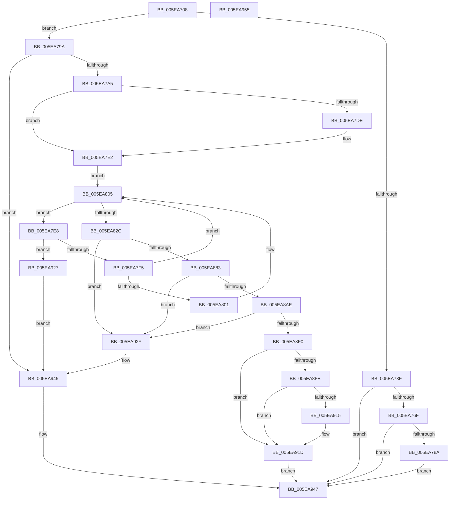

# RtlpExtendHeap

- RVA: `0x005EA708`–`0x005EA956` (길이 `590` bytes)
- VA: `0x00000001405EA708`
- 실행 섹션: `.text`
- PDB 이름 있음: `예`; PDB Function 태그: `아니요`
- unwind 정보 RVA: `0x000CFBF0`
- 디코드: `148`개 명령, `590/590` bytes 표시
- 미해석 바이트: `0` (있으면 어셈블리에 `.byte`로 보존)

> 이 문서는 커널 이미지의 기계어와 PDB 기호를 분석해 생성했습니다. 4번과 5번은 함수 원형과 자료형을 바이너리 사용 방식에서 추정한 C 해석이며 원본 소스 복구 결과는 아닙니다.

## 1. Dependencies

- 직접 호출 지점: **10**; 고유 호출 대상: **8**
- 직접 호출자로 확인된 함수: **1**
- RIP 상대 이미지 참조: **0**

### Outgoing calls
- `0x005EA735` → [RtlpFindAndCommitPages](RtlpFindAndCommitPages_function_005EA95C.md) (function, `0x005EA95C`)
- `0x005EA74E` → [RtlpCoalesceFreeBlocks](RtlpCoalesceFreeBlocks_function_005E952C.md) (function, `0x005E952C`)
- `0x005EA760` → [RtlpInsertFreeBlock](RtlpInsertFreeBlock_function_005EB4C0.md) (function, `0x005EB4C0`)
- `0x005EA790` → [RtlpAnalyzeHeapFailure](../5F/RtlpAnalyzeHeapFailure_function_005F0F9C.md) (function, `0x005F0F9C`)
- `0x005EA823` → [ZwAllocateVirtualMemory](../6A/ZwAllocateVirtualMemory_function_006AD3D0.md) (function, `0x006AD3D0`)
- `0x005EA876` → [RtlpHpHeapCheckCommitLimit](../45/RtlpHpHeapCheckCommitLimit_function_0045820C.md) (function, `0x0045820C`)
- `0x005EA8A1` → [ZwAllocateVirtualMemory](../6A/ZwAllocateVirtualMemory_function_006AD3D0.md) (function, `0x006AD3D0`)
- `0x005EA8E7` → [RtlpInitializeHeapSegment](RtlpInitializeHeapSegment_function_005EB1DC.md) (function, `0x005EB1DC`)
- `0x005EA918` → [RtlpAnalyzeHeapFailure](../5F/RtlpAnalyzeHeapFailure_function_005F0F9C.md) (function, `0x005F0F9C`)
- `0x005EA940` → [ZwFreeVirtualMemory](../6A/ZwFreeVirtualMemory_function_006AD490.md) (function, `0x006AD490`)

### Direct callers
- [RtlpAllocateHeap](RtlpAllocateHeap_function_005E8B1C.md) at `0x005E8E4A`

### Static image references
- 디코드된 RIP-relative 메모리 참조가 없습니다.

## 2. Other-region calls and transfers

- 다른 실행 섹션으로 향하는 call: **0**
- 별도 외부 분기/꼬리 이동을 확인하지 못했습니다.

## 3. Assembly (complete function range)

```asm
005EA708  40 55                           push rbp
005EA70A  53                              push rbx
005EA70B  56                              push rsi
005EA70C  57                              push rdi
005EA70D  41 57                           push r15
005EA70F  48 8B EC                        mov rbp, rsp
005EA712  48 83 EC 50                     sub rsp, 0x50
005EA716  48 83 65 F0 00                  and qword ptr [rbp - 0x10], 0
005EA71B  48 8D 82 FF 0F 00 00            lea rax, [rdx + 0xfff]
005EA722  25 00 F0 FF FF                  and eax, 0xfffff000
005EA727  48 8B F2                        mov rsi, rdx
005EA72A  48 8D 55 48                     lea rdx, [rbp + 0x48]
005EA72E  48 89 45 48                     mov qword ptr [rbp + 0x48], rax
005EA732  48 8B D9                        mov rbx, rcx
005EA735  E8 22 02 00 00                  call 0x1405ea95c
005EA73A  48 85 C0                        test rax, rax
005EA73D  74 5B                           je 0x1405ea79a
005EA73F  48 C1 6D 48 04                  shr qword ptr [rbp + 0x48], 4
005EA744  4C 8D 45 48                     lea r8, [rbp + 0x48]
005EA748  48 8B D0                        mov rdx, rax
005EA74B  48 8B CB                        mov rcx, rbx
005EA74E  E8 D9 ED FF FF                  call 0x1405e952c
005EA753  4C 8B 45 48                     mov r8, qword ptr [rbp + 0x48]
005EA757  48 8B D0                        mov rdx, rax
005EA75A  48 8B CB                        mov rcx, rbx
005EA75D  48 8B F8                        mov rdi, rax
005EA760  E8 5B 0D 00 00                  call 0x1405eb4c0
005EA765  83 7B 7C 00                     cmp dword ptr [rbx + 0x7c], 0
005EA769  0F 84 D8 01 00 00               je 0x1405ea947
005EA76F  8B 93 88 00 00 00               mov edx, dword ptr [rbx + 0x88]
005EA775  31 57 08                        xor dword ptr [rdi + 8], edx
005EA778  8A 4F 0A                        mov cl, byte ptr [rdi + 0xa]
005EA77B  32 4F 09                        xor cl, byte ptr [rdi + 9]
005EA77E  32 4F 08                        xor cl, byte ptr [rdi + 8]
005EA781  38 4F 0B                        cmp byte ptr [rdi + 0xb], cl
005EA784  0F 84 BD 01 00 00               je 0x1405ea947
005EA78A  48 8B D7                        mov rdx, rdi
005EA78D  48 8B CB                        mov rcx, rbx
005EA790  E8 07 68 00 00                  call 0x1405f0f9c
005EA795  E9 AD 01 00 00                  jmp 0x1405ea947
005EA79A  8B 43 70                        mov eax, dword ptr [rbx + 0x70]
005EA79D  A8 02                           test al, 2
005EA79F  0F 84 A0 01 00 00               je 0x1405ea945
005EA7A5  48 8B 83 A0 00 00 00            mov rax, qword ptr [rbx + 0xa0]
005EA7AC  48 8D BE 00 20 00 00            lea rdi, [rsi + 0x2000]
005EA7B3  48 83 65 40 00                  and qword ptr [rbp + 0x40], 0
005EA7B8  48 8B CF                        mov rcx, rdi
005EA7BB  48 3B F8                        cmp rdi, rax
005EA7BE  48 0F 46 C8                     cmovbe rcx, rax
005EA7C2  B8 00 00 FD 00                  mov eax, 0xfd0000
005EA7C7  48 81 C1 FF FF 00 00            add rcx, 0xffff
005EA7CE  48 81 E1 00 00 FF FF            and rcx, 0xffffffffffff0000
005EA7D5  48 89 4D 38                     mov qword ptr [rbp + 0x38], rcx
005EA7D9  48 3B C8                        cmp rcx, rax
005EA7DC  72 04                           jb 0x1405ea7e2
005EA7DE  48 89 45 38                     mov qword ptr [rbp + 0x38], rax
005EA7E2  49 83 CF FF                     or r15, 0xffffffffffffffff
005EA7E6  EB 1D                           jmp 0x1405ea805
005EA7E8  48 8B 45 38                     mov rax, qword ptr [rbp + 0x38]
005EA7EC  48 3B C7                        cmp rax, rdi
005EA7EF  0F 84 32 01 00 00               je 0x1405ea927
005EA7F5  48 D1 E8                        shr rax, 1
005EA7F8  48 89 45 38                     mov qword ptr [rbp + 0x38], rax
005EA7FC  48 3B C7                        cmp rax, rdi
005EA7FF  73 04                           jae 0x1405ea805
005EA801  48 89 7D 38                     mov qword ptr [rbp + 0x38], rdi
005EA805  C7 44 24 28 04 00 00 00         mov dword ptr [rsp + 0x28], 4
005EA80D  4C 8D 4D 38                     lea r9, [rbp + 0x38]
005EA811  45 33 C0                        xor r8d, r8d
005EA814  C7 44 24 20 00 20 00 00         mov dword ptr [rsp + 0x20], 0x2000
005EA81C  48 8D 55 40                     lea rdx, [rbp + 0x40]
005EA820  49 8B CF                        mov rcx, r15
005EA823  E8 A8 2B 0C 00                  call 0x1406ad3d0
005EA828  85 C0                           test eax, eax
005EA82A  78 BC                           js 0x1405ea7e8
005EA82C  48 8B 45 38                     mov rax, qword ptr [rbp + 0x38]
005EA830  48 8D 8E 00 10 00 00            lea rcx, [rsi + 0x1000]
005EA837  48 01 83 A0 00 00 00            add qword ptr [rbx + 0xa0], rax
005EA83E  4C 8D 8B 78 01 00 00            lea r9, [rbx + 0x178]
005EA845  48 8B 83 A8 00 00 00            mov rax, qword ptr [rbx + 0xa8]
005EA84C  4C 8B C3                        mov r8, rbx
005EA84F  48 8B 93 40 02 00 00            mov rdx, qword ptr [rbx + 0x240]
005EA856  48 3B C8                        cmp rcx, rax
005EA859  48 0F 46 C8                     cmovbe rcx, rax
005EA85D  48 2B 93 A0 02 00 00            sub rdx, qword ptr [rbx + 0x2a0]
005EA864  48 81 C1 FF 0F 00 00            add rcx, 0xfff
005EA86B  48 81 E1 00 F0 FF FF            and rcx, 0xfffffffffffff000
005EA872  48 89 4D F0                     mov qword ptr [rbp - 0x10], rcx
005EA876  E8 91 D9 E6 FF                  call 0x14045820c
005EA87B  85 C0                           test eax, eax
005EA87D  0F 84 AC 00 00 00               je 0x1405ea92f
005EA883  C7 44 24 28 04 00 00 00         mov dword ptr [rsp + 0x28], 4
005EA88B  4C 8D 4D F0                     lea r9, [rbp - 0x10]
005EA88F  45 33 C0                        xor r8d, r8d
005EA892  C7 44 24 20 00 10 00 00         mov dword ptr [rsp + 0x20], 0x1000
005EA89A  48 8D 55 40                     lea rdx, [rbp + 0x40]
005EA89E  49 8B CF                        mov rcx, r15
005EA8A1  E8 2A 2B 0C 00                  call 0x1406ad3d0
005EA8A6  85 C0                           test eax, eax
005EA8A8  0F 88 81 00 00 00               js 0x1405ea92f
005EA8AE  48 8B 55 40                     mov rdx, qword ptr [rbp + 0x40]
005EA8B2  4C 8B 45 38                     mov r8, qword ptr [rbp + 0x38]
005EA8B6  48 8B 4D F0                     mov rcx, qword ptr [rbp - 0x10]
005EA8BA  49 81 C0 00 F0 FF FF            add r8, -0x1000
005EA8C1  4C 03 C2                        add r8, rdx
005EA8C4  48 03 CA                        add rcx, rdx
005EA8C7  4C 89 44 24 38                  mov qword ptr [rsp + 0x38], r8
005EA8CC  41 B8 70 00 00 00               mov r8d, 0x70
005EA8D2  48 89 4C 24 30                  mov qword ptr [rsp + 0x30], rcx
005EA8D7  48 8B CB                        mov rcx, rbx
005EA8DA  48 89 54 24 28                  mov qword ptr [rsp + 0x28], rdx
005EA8DF  C7 44 24 20 02 00 00 00         mov dword ptr [rsp + 0x20], 2
005EA8E7  E8 F0 08 00 00                  call 0x1405eb1dc
005EA8EC  84 C0                           test al, al
005EA8EE  74 3F                           je 0x1405ea92f
005EA8F0  83 7B 7C 00                     cmp dword ptr [rbx + 0x7c], 0
005EA8F4  48 8B 45 40                     mov rax, qword ptr [rbp + 0x40]
005EA8F8  48 8B 50 40                     mov rdx, qword ptr [rax + 0x40]
005EA8FC  74 1F                           je 0x1405ea91d
005EA8FE  8B 8B 88 00 00 00               mov ecx, dword ptr [rbx + 0x88]
005EA904  31 4A 08                        xor dword ptr [rdx + 8], ecx
005EA907  8A 4A 0A                        mov cl, byte ptr [rdx + 0xa]
005EA90A  32 4A 09                        xor cl, byte ptr [rdx + 9]
005EA90D  32 4A 08                        xor cl, byte ptr [rdx + 8]
005EA910  38 4A 0B                        cmp byte ptr [rdx + 0xb], cl
005EA913  74 08                           je 0x1405ea91d
005EA915  48 8B CB                        mov rcx, rbx
005EA918  E8 7F 66 00 00                  call 0x1405f0f9c
005EA91D  48 8B 45 40                     mov rax, qword ptr [rbp + 0x40]
005EA921  48 8B 78 40                     mov rdi, qword ptr [rax + 0x40]
005EA925  EB 20                           jmp 0x1405ea947
005EA927  FF 83 80 02 00 00               inc dword ptr [rbx + 0x280]
005EA92D  EB 16                           jmp 0x1405ea945
005EA92F  41 B9 00 80 00 00               mov r9d, 0x8000
005EA935  4C 8D 45 38                     lea r8, [rbp + 0x38]
005EA939  48 8D 55 40                     lea rdx, [rbp + 0x40]
005EA93D  49 8B CF                        mov rcx, r15
005EA940  E8 4B 2B 0C 00                  call 0x1406ad490
005EA945  33 FF                           xor edi, edi
005EA947  48 8B C7                        mov rax, rdi
005EA94A  48 83 C4 50                     add rsp, 0x50
005EA94E  41 5F                           pop r15
005EA950  5F                              pop rdi
005EA951  5E                              pop rsi
005EA952  5B                              pop rbx
005EA953  5D                              pop rbp
005EA954  C3                              ret
005EA955  CC                              int3
```

## 4. C-style interpretation (structured pseudocode)

```c
__int64 __fastcall RtlpExtendHeap(__int64 a1, __int64 a2)
{
    __int64 result;
    __int64 v_r15;
    __int64 v_rdi;
    __int64 v_rsp;
    unsigned __int64 v_stack_m38;
    unsigned __int64 v_stack_m40;
    unsigned __int64 v_stack_m48;
    unsigned int v_stack_m50;
    unsigned int v_stack_m58;
    unsigned __int64 v_stack_p10;
    unsigned __int64 v_stack_p18;
    unsigned __int64 v_stack_p20;

    v_rsp = (v_rsp) - (80);
    result = (unsigned int)((a2 + 4095) & (0xFFFFF000ULL));
    v_stack_p20 = result;
    result = RtlpFindAndCommitPages(a1, v_stack_p20, a3, a4);
    if (result == 0) goto loc_005EA79A;
    result = RtlpCoalesceFreeBlocks(a1, result, v_stack_p20, a4);
    result = RtlpInsertFreeBlock(a1, result, v_stack_p20, a4);
    if ((*(unsigned int *)(a1 + 124)) == 0) goto loc_005EA947;
    a1 = (unsigned __int8)((*(unsigned __int8 *)(result + 10)) ^ (*(unsigned __int8 *)(result + 9)));
    a1 = (unsigned __int8)((a1) ^ (*(unsigned __int8 *)(result + 8)));
    if ((*(unsigned __int8 *)(result + 11)) == ((unsigned __int8)(a1))) goto loc_005EA947;
    result = RtlpAnalyzeHeapFailure(a1, result, v_stack_p20, a4);
    goto loc_005EA947;
loc_005EA79A:
    if ((((unsigned __int8)((unsigned int)(*(unsigned int *)(a1 + 112)))) & (2)) == 0) goto loc_005EA945;
    a1 = a2 + 8192;
    if ((a2 + 8192) <= (*(unsigned __int64 *)(a1 + 160))) { a1 = *(unsigned __int64 *)(a1 + 160); }
    a1 = (a1) + (0xFFFFULL);
    a1 = (a1) & (0xFFFFFFFFFFFF0000ULL);
    v_stack_p10 = a1;
    if (a1 >= ((unsigned int)(0xFD0000ULL))) {
        v_stack_p10 = (unsigned int)(0xFD0000ULL);
    }
    v_r15 = (v_r15) | (-1);
    goto loc_005EA805;
loc_005EA7E8:
    if (v_stack_p10 == (a2 + 8192)) goto loc_005EA927;
    result = (v_stack_p10) >> (1);
    v_stack_p10 = result;
    if (result < (a2 + 8192)) {
        v_stack_p10 = a2 + 8192;
    }
    v_stack_m50 = 4;
    a3 = 0;
    v_stack_m58 = 0x2000ULL;
    result = ZwAllocateVirtualMemory(v_r15, v_stack_p18, a3, v_stack_p10);
    if (sign_flag) goto loc_005EA7E8;
    a1 = a2 + 4096;
    if ((a2 + 4096) <= (*(unsigned __int64 *)(a1 + 168))) { a1 = *(unsigned __int64 *)(a1 + 168); }
    a2 = (*(unsigned __int64 *)(a1 + 576)) - (*(unsigned __int64 *)(a1 + 672));
    a1 = (a1) + (0xFFFULL);
    a1 = (a1) & (0xFFFFFFFFFFFFF000ULL);
    v_stack_m38 = a1;
    result = RtlpHpHeapCheckCommitLimit(a1, a2, a1, a1 + 376);
    if ((unsigned int)(result) == 0) goto loc_005EA92F;
    v_stack_m50 = 4;
    a3 = 0;
    v_stack_m58 = 0x1000ULL;
    result = ZwAllocateVirtualMemory(v_r15, v_stack_p18, a3, v_stack_m38);
    if (sign_flag) goto loc_005EA92F;
    a3 = (v_stack_p10) + (0xFFFFFFFFFFFFF000ULL);
    a3 = (a3) + (v_stack_p18);
    a1 = (v_stack_m38) + (v_stack_p18);
    v_stack_m40 = a3;
    v_stack_m48 = a1;
    v_stack_m50 = v_stack_p18;
    v_stack_m58 = 2;
    result = RtlpInitializeHeapSegment(a1, v_stack_p18, 112, v_stack_m38);
    if ((unsigned __int8)(result) == 0) goto loc_005EA92F;
    if ((*(unsigned int *)(a1 + 124)) == 0) goto loc_005EA91D;
    a1 = (unsigned __int8)((*(unsigned __int8 *)(*(unsigned __int64 *)(v_stack_p18 + 64) + 10)) ^ (*(unsigned __int8 *)(*(unsigned __int64 *)(v_stack_p18 + 64) + 9)));
    a1 = (unsigned __int8)((a1) ^ (*(unsigned __int8 *)(*(unsigned __int64 *)(v_stack_p18 + 64) + 8)));
    result = v_stack_p18;
    if ((*(unsigned __int8 *)(*(unsigned __int64 *)(v_stack_p18 + 64) + 11)) != ((unsigned __int8)(a1))) {
        a1 = a1;
        result = RtlpAnalyzeHeapFailure(a1, *(unsigned __int64 *)(v_stack_p18 + 64), 112, v_stack_m38);
    }
    goto loc_005EA947;
loc_005EA927:
    goto loc_005EA945;
loc_005EA92F:
    result = ZwFreeVirtualMemory(v_r15, v_stack_p18, v_stack_p10, (unsigned int)(0x8000ULL));
loc_005EA945:
    v_rdi = 0;
loc_005EA947:
    v_rsp = (v_rsp) + (80);
    return 0;
}
```

## 5. (Beta) C Style

```c
int64_t RtlpExtendHeap(void *Arg1, void *Arg2)
{
    uint8_t *arg1 = (uint8_t *)Arg1;
    uint8_t *arg2 = (uint8_t *)Arg2;

    int64_t result;
    int64_t local_r15;
    int64_t local_rdi;
    int64_t local_rsp;
    uint64_t v_stack_m38;
    uint64_t v_stack_m40;
    uint64_t v_stack_m48;
    uint32_t v_stack_m50;
    uint32_t v_stack_m58;
    uint64_t v_stack_p10;
    uint64_t v_stack_p18;
    uint64_t v_stack_p20;

    local_rsp = (local_rsp) - (80);
    result = (uint32_t)((Arg2 + 4095) & (0xFFFFF000ULL));
    v_stack_p20 = result;
    result = RtlpFindAndCommitPages(Arg1, v_stack_p20, a3, a4);
    if (result == 0) goto loc_005EA79A;
    result = RtlpCoalesceFreeBlocks(Arg1, result, v_stack_p20, a4);
    result = RtlpInsertFreeBlock(Arg1, result, v_stack_p20, a4);
    if ((*(uint32_t *)(arg1 + 0x7C)) == 0) goto loc_005EA947;
    Arg1 = (uint8_t)((*(uint8_t *)(result + 0xA)) ^ (*(uint8_t *)(result + 0x9)));
    Arg1 = (uint8_t)((Arg1) ^ (*(uint8_t *)(result + 0x8)));
    if ((*(uint8_t *)(result + 0xB)) == ((uint8_t)(Arg1))) goto loc_005EA947;
    result = RtlpAnalyzeHeapFailure(Arg1, result, v_stack_p20, a4);
    goto loc_005EA947;
loc_005EA79A:
    if ((((uint8_t)((uint32_t)(*(uint32_t *)(arg1 + 0x70)))) & (2)) == 0) goto loc_005EA945;
    Arg1 = Arg2 + 8192;
    if ((Arg2 + 8192) <= (*(uint64_t *)(arg1 + 0xA0))) { Arg1 = *(uint64_t *)(arg1 + 0xA0); }
    Arg1 = (Arg1) + (0xFFFFULL);
    Arg1 = (Arg1) & (0xFFFFFFFFFFFF0000ULL);
    v_stack_p10 = Arg1;
    if (Arg1 >= ((uint32_t)(0xFD0000ULL))) {
        v_stack_p10 = (uint32_t)(0xFD0000ULL);
    }
    local_r15 = (local_r15) | (-1);
    goto loc_005EA805;
loc_005EA7E8:
    if (v_stack_p10 == (Arg2 + 8192)) goto loc_005EA927;
    result = (v_stack_p10) >> (1);
    v_stack_p10 = result;
    if (result < (Arg2 + 8192)) {
        v_stack_p10 = Arg2 + 8192;
    }
    v_stack_m50 = 4;
    a3 = 0;
    v_stack_m58 = 0x2000ULL;
    result = ZwAllocateVirtualMemory(local_r15, v_stack_p18, a3, v_stack_p10);
    if (sign_flag) goto loc_005EA7E8;
    Arg1 = Arg2 + 4096;
    if ((Arg2 + 4096) <= (*(uint64_t *)(arg1 + 0xA8))) { Arg1 = *(uint64_t *)(arg1 + 0xA8); }
    Arg2 = (*(uint64_t *)(arg1 + 0x240)) - (*(uint64_t *)(arg1 + 0x2A0));
    Arg1 = (Arg1) + (0xFFFULL);
    Arg1 = (Arg1) & (0xFFFFFFFFFFFFF000ULL);
    v_stack_m38 = Arg1;
    result = RtlpHpHeapCheckCommitLimit(Arg1, Arg2, Arg1, Arg1 + 376);
    if ((uint32_t)(result) == 0) goto loc_005EA92F;
    v_stack_m50 = 4;
    a3 = 0;
    v_stack_m58 = 0x1000ULL;
    result = ZwAllocateVirtualMemory(local_r15, v_stack_p18, a3, v_stack_m38);
    if (sign_flag) goto loc_005EA92F;
    a3 = (v_stack_p10) + (0xFFFFFFFFFFFFF000ULL);
    a3 = (a3) + (v_stack_p18);
    Arg1 = (v_stack_m38) + (v_stack_p18);
    v_stack_m40 = a3;
    v_stack_m48 = Arg1;
    v_stack_m50 = v_stack_p18;
    v_stack_m58 = 2;
    result = RtlpInitializeHeapSegment(Arg1, v_stack_p18, 112, v_stack_m38);
    if ((uint8_t)(result) == 0) goto loc_005EA92F;
    if ((*(uint32_t *)(arg1 + 0x7C)) == 0) goto loc_005EA91D;
    Arg1 = (uint8_t)((*(uint8_t *)(*(uint64_t *)(v_stack_p18 + 0x40) + 0xA)) ^ (*(uint8_t *)(*(uint64_t *)(v_stack_p18 + 0x40) + 0x9)));
    Arg1 = (uint8_t)((Arg1) ^ (*(uint8_t *)(*(uint64_t *)(v_stack_p18 + 0x40) + 0x8)));
    result = v_stack_p18;
    if ((*(uint8_t *)(*(uint64_t *)(v_stack_p18 + 0x40) + 0xB)) != ((uint8_t)(Arg1))) {
        Arg1 = Arg1;
        result = RtlpAnalyzeHeapFailure(Arg1, *(uint64_t *)(v_stack_p18 + 0x40), 112, v_stack_m38);
    }
    goto loc_005EA947;
loc_005EA927:
    goto loc_005EA945;
loc_005EA92F:
    result = ZwFreeVirtualMemory(local_r15, v_stack_p18, v_stack_p10, (uint32_t)(0x8000ULL));
loc_005EA945:
    local_rdi = 0;
loc_005EA947:
    local_rsp = (local_rsp) + (80);
    return 0;
}
```

### 관측된 메모리 오프셋

구조체 형식이 확인되지 않은 접근은 인자 기준의 오프셋으로만 기록했습니다.

| 기준 인자 | 오프셋 표현 | 폭 (bit) | 접근 |
|---|---:|---:|---|
| `Arg1` | `+ 0x70` | `32` | `R` |
| `Arg1` | `+ 0x7C` | `32` | `R` |
| `Arg1` | `+ 0x88` | `32` | `R` |
| `Arg1` | `+ 0xA0` | `64` | `R` |
| `Arg1` | `+ 0xA0` | `64` | `R/W` |
| `Arg1` | `+ 0xA8` | `64` | `R` |
| `Arg1` | `+ 0x178` | `64` | `R` |
| `Arg1` | `+ 0x240` | `64` | `R` |
| `Arg1` | `+ 0x280` | `32` | `R/W` |
| `Arg1` | `+ 0x2A0` | `64` | `R` |
| `Arg2` | `+ 0xFFF` | `64` | `R` |
| `Arg2` | `+ 0x1000` | `64` | `R` |
| `Arg2` | `+ 0x2000` | `64` | `R` |

## 6. Execution-region graph

[열기: 2D/3D 그래프와 함수 탐색 컨트롤 패널](../../../control-panel.html?section=text&rva=0x005EA708&view=graph)

- 2D 그래프는 위에서 아래로 흐르고, 3D 그래프는 빈 공간을 드래그해 회전합니다. Shift+드래그는 이동, 휠은 확대·축소, 함수 노드 선택은 대상 보고서 이동입니다.

### Static fallback


