# RtlpFindAndCommitPages

- RVA: `0x005EA95C`–`0x005EABB8` (길이 `604` bytes)
- VA: `0x00000001405EA95C`
- 실행 섹션: `.text`
- PDB 이름 있음: `예`; PDB Function 태그: `아니요`
- unwind 정보 RVA: `0x000CFC24`
- 디코드: `155`개 명령, `604/604` bytes 표시
- 미해석 바이트: `0` (있으면 어셈블리에 `.byte`로 보존)

> 이 문서는 커널 이미지의 기계어와 PDB 기호를 분석해 생성했습니다. 4번과 5번은 함수 원형과 자료형을 바이너리 사용 방식에서 추정한 C 해석이며 원본 소스 복구 결과는 아닙니다.

## 1. Dependencies

- 직접 호출 지점: **11**; 고유 호출 대상: **11**
- 직접 호출자로 확인된 함수: **1**
- RIP 상대 이미지 참조: **3**

### Outgoing calls
- `0x005EA97D` → [RtlpFindUCREntry](../5F/RtlpFindUCREntry_function_005F1828.md) (function, `0x005F1828`)
- `0x005EA9AE` → [DbgPrint](../35/DbgPrint_function_00358CB0.md) (function, `0x00358CB0`)
- `0x005EA9B3` → [RtlpHeapHandleError](../5F/RtlpHeapHandleError_function_005F12AC.md) (function, `0x005F12AC`)
- `0x005EAA05` → [guard_dispatch_icall](../6B/guard_dispatch_icall_function_006BAAD0.md) (function, `0x006BAAD0`)
- `0x005EAA38` → [RtlpHpHeapCheckCommitLimit](../45/RtlpHpHeapCheckCommitLimit_function_0045820C.md) (function, `0x0045820C`)
- `0x005EAA67` → [ZwAllocateVirtualMemory](../6A/ZwAllocateVirtualMemory_function_006AD3D0.md) (function, `0x006AD3D0`)
- `0x005EAA74` → [RtlpUpdateHeapRates](RtlpUpdateHeapRates_function_005EBC98.md) (function, `0x005EBC98`)
- `0x005EAAC5` → [RtlpAnalyzeHeapFailure](../5F/RtlpAnalyzeHeapFailure_function_005F0F9C.md) (function, `0x005F0F9C`)
- `0x005EAAD5` → [RtlpRemoveUCRBlock](RtlpRemoveUCRBlock_function_005EB8B0.md) (function, `0x005EB8B0`)
- `0x005EAB63` → [RtlpCreateUCREntry](RtlpCreateUCREntry_function_005EA010.md) (function, `0x005EA010`)
- `0x005EABA4` → [RtlpLogHeapFailure](../35/RtlpLogHeapFailure_function_0035B7BC.md) (function, `0x0035B7BC`)

### Direct callers
- [RtlpExtendHeap](RtlpExtendHeap_function_005EA708.md) at `0x005EA735`

### Static image references
- `0x005EA995` → RVA `0x00E67B60` (`.data`; read)
- `0x005EA9A7` → RVA `0x006CC9C0` (` ?? ::FNODOBFM::`string'`; read)
- `0x005EA9F1` → RVA `0x00E67B30` (`.data`; read)

## 2. Other-region calls and transfers

- 다른 실행 섹션으로 향하는 call: **0**
- 별도 외부 분기/꼬리 이동을 확인하지 못했습니다.

## 3. Assembly (complete function range)

```asm
005EA95C  48 89 5C 24 10                  mov qword ptr [rsp + 0x10], rbx
005EA961  48 89 6C 24 18                  mov qword ptr [rsp + 0x18], rbp
005EA966  48 89 74 24 20                  mov qword ptr [rsp + 0x20], rsi
005EA96B  57                              push rdi
005EA96C  41 56                           push r14
005EA96E  41 57                           push r15
005EA970  48 83 EC 30                     sub rsp, 0x30
005EA974  4C 8B FA                        mov r15, rdx
005EA977  48 8B D9                        mov rbx, rcx
005EA97A  48 8B 12                        mov rdx, qword ptr [rdx]
005EA97D  E8 A6 6E 00 00                  call 0x1405f1828
005EA982  4C 8D 83 F0 00 00 00            lea r8, [rbx + 0xf0]
005EA989  4C 8B F0                        mov r14, rax
005EA98C  49 3B C0                        cmp rax, r8
005EA98F  0F 84 EE 00 00 00               je 0x1405eaa83
005EA995  83 3D C4 D1 87 00 01            cmp dword ptr [rip + 0x87d1c4], 1
005EA99C  7C 1B                           jl 0x1405ea9b9
005EA99E  49 8B 17                        mov rdx, qword ptr [r15]
005EA9A1  48 39 50 28                     cmp qword ptr [rax + 0x28], rdx
005EA9A5  73 12                           jae 0x1405ea9b9
005EA9A7  48 8D 0D 12 20 0E 00            lea rcx, [rip + 0xe2012]
005EA9AE  E8 FD E2 D6 FF                  call 0x140358cb0
005EA9B3  E8 F4 68 00 00                  call 0x1405f12ac
005EA9B8  CC                              int3
005EA9B9  48 8D 78 F0                     lea rdi, [rax - 0x10]
005EA9BD  33 ED                           xor ebp, ebp
005EA9BF  0F B6 47 0E                     movzx eax, byte ptr [rdi + 0xe]
005EA9C3  84 C0                           test al, al
005EA9C5  74 17                           je 0x1405ea9de
005EA9C7  48 C1 E0 10                     shl rax, 0x10
005EA9CB  48 81 E7 00 00 FF FF            and rdi, 0xffffffffffff0000
005EA9D2  48 2B F8                        sub rdi, rax
005EA9D5  48 81 C7 00 00 01 00            add rdi, 0x10000
005EA9DC  EB 03                           jmp 0x1405ea9e1
005EA9DE  48 8B FB                        mov rdi, rbx
005EA9E1  49 8B 46 20                     mov rax, qword ptr [r14 + 0x20]
005EA9E5  48 89 44 24 50                  mov qword ptr [rsp + 0x50], rax
005EA9EA  48 8B 83 68 01 00 00            mov rax, qword ptr [rbx + 0x168]
005EA9F1  48 33 05 38 D1 87 00            xor rax, qword ptr [rip + 0x87d138]
005EA9F8  74 12                           je 0x1405eaa0c
005EA9FA  4D 8B C7                        mov r8, r15
005EA9FD  48 8D 54 24 50                  lea rdx, [rsp + 0x50]
005EAA02  48 8B CB                        mov rcx, rbx
005EAA05  E8 C6 00 0D 00                  call 0x1406baad0
005EAA0A  EB 6D                           jmp 0x1405eaa79
005EAA0C  49 8B 0F                        mov rcx, qword ptr [r15]
005EAA0F  4C 8D 8B 78 01 00 00            lea r9, [rbx + 0x178]
005EAA16  48 81 C1 FF 0F 00 00            add rcx, 0xfff
005EAA1D  4C 8B C3                        mov r8, rbx
005EAA20  48 81 E1 00 F0 FF FF            and rcx, 0xfffffffffffff000
005EAA27  49 89 0F                        mov qword ptr [r15], rcx
005EAA2A  48 8B 93 40 02 00 00            mov rdx, qword ptr [rbx + 0x240]
005EAA31  48 2B 93 A0 02 00 00            sub rdx, qword ptr [rbx + 0x2a0]
005EAA38  E8 CF D7 E6 FF                  call 0x14045820c
005EAA3D  85 C0                           test eax, eax
005EAA3F  75 07                           jne 0x1405eaa48
005EAA41  B8 2D 01 00 C0                  mov eax, 0xc000012d
005EAA46  EB 24                           jmp 0x1405eaa6c
005EAA48  C7 44 24 28 04 00 00 00         mov dword ptr [rsp + 0x28], 4
005EAA50  48 8D 54 24 50                  lea rdx, [rsp + 0x50]
005EAA55  4D 8B CF                        mov r9, r15
005EAA58  C7 44 24 20 00 10 00 00         mov dword ptr [rsp + 0x20], 0x1000
005EAA60  45 33 C0                        xor r8d, r8d
005EAA63  48 83 C9 FF                     or rcx, 0xffffffffffffffff
005EAA67  E8 64 29 0C 00                  call 0x1406ad3d0
005EAA6C  BA 02 00 00 00                  mov edx, 2
005EAA71  48 8B CB                        mov rcx, rbx
005EAA74  E8 1F 12 00 00                  call 0x1405ebc98
005EAA79  85 C0                           test eax, eax
005EAA7B  79 22                           jns 0x1405eaa9f
005EAA7D  FF 83 80 02 00 00               inc dword ptr [rbx + 0x280]
005EAA83  33 C0                           xor eax, eax
005EAA85  48 8B 5C 24 58                  mov rbx, qword ptr [rsp + 0x58]
005EAA8A  48 8B 6C 24 60                  mov rbp, qword ptr [rsp + 0x60]
005EAA8F  48 8B 74 24 68                  mov rsi, qword ptr [rsp + 0x68]
005EAA94  48 83 C4 30                     add rsp, 0x30
005EAA98  41 5F                           pop r15
005EAA9A  41 5E                           pop r14
005EAA9C  5F                              pop rdi
005EAA9D  C3                              ret
005EAA9E  CC                              int3
005EAA9F  49 8D 76 F0                     lea rsi, [r14 - 0x10]
005EAAA3  39 6B 7C                        cmp dword ptr [rbx + 0x7c], ebp
005EAAA6  74 22                           je 0x1405eaaca
005EAAA8  8B 8B 88 00 00 00               mov ecx, dword ptr [rbx + 0x88]
005EAAAE  31 4E 08                        xor dword ptr [rsi + 8], ecx
005EAAB1  8A 4E 0A                        mov cl, byte ptr [rsi + 0xa]
005EAAB4  32 4E 09                        xor cl, byte ptr [rsi + 9]
005EAAB7  32 4E 08                        xor cl, byte ptr [rsi + 8]
005EAABA  38 4E 0B                        cmp byte ptr [rsi + 0xb], cl
005EAABD  74 0B                           je 0x1405eaaca
005EAABF  48 8B D6                        mov rdx, rsi
005EAAC2  48 8B CB                        mov rcx, rbx
005EAAC5  E8 D2 64 00 00                  call 0x1405f0f9c
005EAACA  49 8B D6                        mov rdx, r14
005EAACD  40 88 6E 0A                     mov byte ptr [rsi + 0xa], bpl
005EAAD1  40 88 6E 0F                     mov byte ptr [rsi + 0xf], bpl
005EAAD5  E8 D6 0D 00 00                  call 0x1405eb8b0
005EAADA  83 C9 FF                        or ecx, 0xffffffff
005EAADD  01 4F 54                        add dword ptr [rdi + 0x54], ecx
005EAAE0  49 8B 46 28                     mov rax, qword ptr [r14 + 0x28]
005EAAE4  48 C1 E8 0C                     shr rax, 0xc
005EAAE8  29 47 50                        sub dword ptr [rdi + 0x50], eax
005EAAEB  48 8B 83 40 02 00 00            mov rax, qword ptr [rbx + 0x240]
005EAAF2  49 03 46 28                     add rax, qword ptr [r14 + 0x28]
005EAAF6  FF 83 68 02 00 00               inc dword ptr [rbx + 0x268]
005EAAFC  01 8B 64 02 00 00               add dword ptr [rbx + 0x264], ecx
005EAB02  48 89 83 40 02 00 00            mov qword ptr [rbx + 0x240], rax
005EAB09  49 8B 46 28                     mov rax, qword ptr [r14 + 0x28]
005EAB0D  48 3D 00 F0 0F 00               cmp rax, 0xff000
005EAB13  72 07                           jb 0x1405eab1c
005EAB15  48 29 83 48 02 00 00            sub qword ptr [rbx + 0x248], rax
005EAB1C  4D 8B 4E 28                     mov r9, qword ptr [r14 + 0x28]
005EAB20  49 8B 17                        mov rdx, qword ptr [r15]
005EAB23  4C 3B CA                        cmp r9, rdx
005EAB26  77 1D                           ja 0x1405eab45
005EAB28  49 8B 4E 20                     mov rcx, qword ptr [r14 + 0x20]
005EAB2C  49 03 C9                        add rcx, r9
005EAB2F  48 3B 4F 48                     cmp rcx, qword ptr [rdi + 0x48]
005EAB33  74 10                           je 0x1405eab45
005EAB35  0F B7 46 08                     movzx eax, word ptr [rsi + 8]
005EAB39  48 C1 E0 04                     shl rax, 4
005EAB3D  48 03 C2                        add rax, rdx
005EAB40  49 89 07                        mov qword ptr [r15], rax
005EAB43  EB 27                           jmp 0x1405eab6c
005EAB45  4D 8B 46 20                     mov r8, qword ptr [r14 + 0x20]
005EAB49  4C 2B CA                        sub r9, rdx
005EAB4C  48 83 C2 D0                     add rdx, -0x30
005EAB50  4C 89 7C 24 28                  mov qword ptr [rsp + 0x28], r15
005EAB55  4C 03 C2                        add r8, rdx
005EAB58  48 89 74 24 20                  mov qword ptr [rsp + 0x20], rsi
005EAB5D  48 8B D7                        mov rdx, rdi
005EAB60  48 8B CB                        mov rcx, rbx
005EAB63  E8 A8 F4 FF FF                  call 0x1405ea010
005EAB68  49 C1 27 04                     shl qword ptr [r15], 4
005EAB6C  40 88 6E 0B                     mov byte ptr [rsi + 0xb], bpl
005EAB70  48 8B 57 28                     mov rdx, qword ptr [rdi + 0x28]
005EAB74  48 3B D7                        cmp rdx, rdi
005EAB77  74 33                           je 0x1405eabac
005EAB79  48 8B DE                        mov rbx, rsi
005EAB7C  48 2B DF                        sub rbx, rdi
005EAB7F  48 C1 EB 10                     shr rbx, 0x10
005EAB83  48 FF C3                        inc rbx
005EAB86  48 81 FB FE 00 00 00            cmp rbx, 0xfe
005EAB8D  72 1A                           jb 0x1405eaba9
005EAB8F  48 89 6C 24 28                  mov qword ptr [rsp + 0x28], rbp
005EAB94  4C 8B CF                        mov r9, rdi
005EAB97  4C 8B C6                        mov r8, rsi
005EAB9A  48 89 6C 24 20                  mov qword ptr [rsp + 0x20], rbp
005EAB9F  B9 03 00 00 00                  mov ecx, 3
005EABA4  E8 13 0C D7 FF                  call 0x14035b7bc
005EABA9  40 8A EB                        mov bpl, bl
005EABAC  40 88 6E 0E                     mov byte ptr [rsi + 0xe], bpl
005EABB0  48 8B C6                        mov rax, rsi
005EABB3  E9 CD FE FF FF                  jmp 0x1405eaa85
```

## 4. C-style interpretation (structured pseudocode)

```c
__int64 __fastcall RtlpFindAndCommitPages(__int64 a1, __int64 a2)
{
    __int64 result;
    __int64 v_rbp;
    __int64 v_rbx;
    __int64 v_rdi;
    __int64 v_rsp;
    unsigned int v_stack_m20;
    unsigned int v_stack_m28;
    unsigned __int64 v_stack_p10;
    unsigned __int64 v_stack_p18;
    unsigned __int64 v_stack_p20;
    unsigned __int64 v_stack_p28;
    unsigned __int64 v_stack_p8;

    v_stack_p10 = v_rbx;
    v_stack_p18 = v_rbp;
    v_stack_p20 = v_rsi;
    v_rsp = (v_rsp) - (48);
    result = RtlpFindUCREntry(a1, *(unsigned __int64 *)(a2), a3, a4);
    if (result == (a1 + 240)) goto loc_005EAA83;
    if ((*(unsigned int *)(v_rip + 8901060)) < 1) goto loc_005EA9B9;
    if ((*(unsigned __int64 *)(result + 40)) < (*(unsigned __int64 *)(a2))) {
        a1 = v_rip + 925714;
        result = DbgPrint(a1, *(unsigned __int64 *)(a2), a1 + 240, a4);
        result = RtlpHeapHandleError(a1, *(unsigned __int64 *)(a2), a1 + 240, a4);
    }
    v_rbp = 0;
    if ((unsigned __int8)(*(unsigned __int8 *)(result - 16 + 14)) == 0) goto loc_005EA9DE;
    result = (*(unsigned __int8 *)(result - 16 + 14)) << (16);
    v_rdi = (result - 16) & (0xFFFFFFFFFFFF0000ULL);
    v_rdi = (v_rdi) - (result);
    v_rdi = (v_rdi) + (0x10000ULL);
    goto loc_005EA9E1;
loc_005EA9DE:
loc_005EA9E1:
    v_stack_p8 = *(unsigned __int64 *)(result + 32);
    result = (*(unsigned __int64 *)(a1 + 360)) ^ (*(unsigned __int64 *)(v_rip + 8900920));
    if (condition_is_equal) goto loc_005EAA0C;
    result = guard_dispatch_icall(a1, v_stack_p8, a2, a4);
    goto loc_005EAA79;
loc_005EAA0C:
    a1 = (*(unsigned __int64 *)(a2)) + (0xFFFULL);
    a1 = (a1) & (0xFFFFFFFFFFFFF000ULL);
    *(unsigned __int64 *)(a2) = a1;
    a2 = (*(unsigned __int64 *)(a1 + 576)) - (*(unsigned __int64 *)(a1 + 672));
    result = RtlpHpHeapCheckCommitLimit(a1, a2, a1, a1 + 376);
    if ((unsigned int)(result) != 0) goto loc_005EAA48;
    goto loc_005EAA6C;
loc_005EAA48:
    v_stack_m20 = 4;
    v_stack_m28 = 0x1000ULL;
    a3 = 0;
    a1 = (a1) | (-1);
    result = ZwAllocateVirtualMemory(a1, v_stack_p8, a3, a2);
loc_005EAA6C:
    result = RtlpUpdateHeapRates(a1, 2, a3, a2);
loc_005EAA79:
    if (!sign_flag) goto loc_005EAA9F;
loc_005EAA83:
    result = 0;
loc_005EAA85:
    v_rsp = (v_rsp) + (48);
    return result;
loc_005EAA9F:
    if ((*(unsigned int *)(v_stack_p10 + 124)) == ((unsigned int)(v_stack_p18))) goto loc_005EAACA;
    a1 = (unsigned __int8)((*(unsigned __int8 *)(result - 16 + 10)) ^ (*(unsigned __int8 *)(result - 16 + 9)));
    a1 = (unsigned __int8)((a1) ^ (*(unsigned __int8 *)(result - 16 + 8)));
    if ((*(unsigned __int8 *)(result - 16 + 11)) != ((unsigned __int8)(a1))) {
        a2 = result - 16;
        a1 = v_stack_p10;
        result = RtlpAnalyzeHeapFailure(a1, a2, a3, a2);
    }
    *(unsigned __int8 *)(result - 16 + 10) = (unsigned __int8)(v_stack_p18);
    *(unsigned __int8 *)(result - 16 + 15) = (unsigned __int8)(v_stack_p18);
    result = RtlpRemoveUCRBlock(a1, result, a3, a2);
    a1 = (unsigned int)((a1) | (0xFFFFFFFFULL));
    result = (*(unsigned __int64 *)(result + 40)) >> (12);
    result = (*(unsigned __int64 *)(v_stack_p10 + 576)) + (*(unsigned __int64 *)(result + 40));
    *(unsigned __int64 *)(v_stack_p10 + 576) = result;
    if ((*(unsigned __int64 *)(result + 40)) >= 0xFF000ULL) {
    }
    if ((*(unsigned __int64 *)(result + 40)) > (*(unsigned __int64 *)(a2))) goto loc_005EAB45;
    a1 = (*(unsigned __int64 *)(result + 32)) + (*(unsigned __int64 *)(result + 40));
    if (a1 == (*(unsigned __int64 *)(a1 + 72))) goto loc_005EAB45;
    result = (*(unsigned __int16 *)(result - 16 + 8)) << (4);
    result = (result) + (*(unsigned __int64 *)(a2));
    *(unsigned __int64 *)(a2) = result;
    goto loc_005EAB6C;
loc_005EAB45:
    a4 = (*(unsigned __int64 *)(result + 40)) - (*(unsigned __int64 *)(a2));
    a2 = (*(unsigned __int64 *)(a2)) + (-48);
    v_stack_p28 = a2;
    a3 = (*(unsigned __int64 *)(result + 32)) + (a2);
    v_stack_p20 = result - 16;
    result = RtlpCreateUCREntry(v_stack_p10, a1, a3, a4);
loc_005EAB6C:
    *(unsigned __int8 *)(result - 16 + 11) = (unsigned __int8)(v_stack_p18);
    if ((*(unsigned __int64 *)(a1 + 40)) == a1) goto loc_005EABAC;
    v_rbx = (result - 16) - (a1);
    v_rbx = (v_rbx) >> (16);
    v_rbx = (v_rbx) + 1;
    if (v_rbx >= 254) {
        v_stack_p28 = v_stack_p18;
        a4 = a1;
        a3 = result - 16;
        v_stack_p20 = v_stack_p18;
        a1 = 3;
        result = RtlpLogHeapFailure(a1, *(unsigned __int64 *)(a1 + 40), a3, a4);
    }
loc_005EABAC:
    *(unsigned __int8 *)(result - 16 + 14) = (unsigned __int8)((unsigned __int8)(v_rbx));
    goto loc_005EAA85;
}
```

## 5. (Beta) C Style

```c
int64_t RtlpFindAndCommitPages(void *Arg1, void *Arg2)
{
    uint8_t *arg1 = (uint8_t *)Arg1;
    uint8_t *arg2 = (uint8_t *)Arg2;

    int64_t result;
    int64_t local_rbp;
    int64_t local_rbx;
    int64_t local_rdi;
    int64_t local_rsp;
    uint32_t v_stack_m20;
    uint32_t v_stack_m28;
    uint64_t v_stack_p10;
    uint64_t v_stack_p18;
    uint64_t v_stack_p20;
    uint64_t v_stack_p28;
    uint64_t v_stack_p8;

    v_stack_p10 = local_rbx;
    v_stack_p18 = local_rbp;
    v_stack_p20 = local_rsi;
    local_rsp = (local_rsp) - (48);
    result = RtlpFindUCREntry(Arg1, *(uint64_t *)(arg2), a3, a4);
    if (result == (Arg1 + 240)) goto loc_005EAA83;
    if ((*(uint32_t *)(v_rip + 0x87D1C4)) < 1) goto loc_005EA9B9;
    if ((*(uint64_t *)(result + 0x28)) < (*(uint64_t *)(arg2))) {
        Arg1 = v_rip + 925714;
        result = DbgPrint(Arg1, *(uint64_t *)(arg2), Arg1 + 240, a4);
        result = RtlpHeapHandleError(Arg1, *(uint64_t *)(arg2), Arg1 + 240, a4);
    }
    local_rbp = 0;
    if ((uint8_t)(*(uint8_t *)(result - 0x10 + 0xE)) == 0) goto loc_005EA9DE;
    result = (*(uint8_t *)(result - 0x10 + 0xE)) << (16);
    local_rdi = (result - 16) & (0xFFFFFFFFFFFF0000ULL);
    local_rdi = (local_rdi) - (result);
    local_rdi = (local_rdi) + (0x10000ULL);
    goto loc_005EA9E1;
loc_005EA9DE:
loc_005EA9E1:
    v_stack_p8 = *(uint64_t *)(result + 0x20);
    result = (*(uint64_t *)(arg1 + 0x168)) ^ (*(uint64_t *)(v_rip + 0x87D138));
    if (condition_is_equal) goto loc_005EAA0C;
    result = guard_dispatch_icall(Arg1, v_stack_p8, Arg2, a4);
    goto loc_005EAA79;
loc_005EAA0C:
    Arg1 = (*(uint64_t *)(arg2)) + (0xFFFULL);
    Arg1 = (Arg1) & (0xFFFFFFFFFFFFF000ULL);
    *(void **)(arg2) = Arg1;
    Arg2 = (*(uint64_t *)(arg1 + 0x240)) - (*(uint64_t *)(arg1 + 0x2A0));
    result = RtlpHpHeapCheckCommitLimit(Arg1, Arg2, Arg1, Arg1 + 376);
    if ((uint32_t)(result) != 0) goto loc_005EAA48;
    goto loc_005EAA6C;
loc_005EAA48:
    v_stack_m20 = 4;
    v_stack_m28 = 0x1000ULL;
    a3 = 0;
    Arg1 = (Arg1) | (-1);
    result = ZwAllocateVirtualMemory(Arg1, v_stack_p8, a3, Arg2);
loc_005EAA6C:
    result = RtlpUpdateHeapRates(Arg1, 2, a3, Arg2);
loc_005EAA79:
    if (!sign_flag) goto loc_005EAA9F;
loc_005EAA83:
    result = 0;
loc_005EAA85:
    local_rsp = (local_rsp) + (48);
    return result;
loc_005EAA9F:
    if ((*(uint32_t *)(v_stack_p10 + 0x7C)) == ((uint32_t)(v_stack_p18))) goto loc_005EAACA;
    Arg1 = (uint8_t)((*(uint8_t *)(result - 0x10 + 0xA)) ^ (*(uint8_t *)(result - 0x10 + 0x9)));
    Arg1 = (uint8_t)((Arg1) ^ (*(uint8_t *)(result - 0x10 + 0x8)));
    if ((*(uint8_t *)(result - 0x10 + 0xB)) != ((uint8_t)(Arg1))) {
        Arg2 = result - 16;
        Arg1 = v_stack_p10;
        result = RtlpAnalyzeHeapFailure(Arg1, Arg2, a3, Arg2);
    }
    *(uint8_t *)(result - 0x10 + 0xA) = (uint8_t)(v_stack_p18);
    *(uint8_t *)(result - 0x10 + 0xF) = (uint8_t)(v_stack_p18);
    result = RtlpRemoveUCRBlock(Arg1, result, a3, Arg2);
    Arg1 = (uint32_t)((Arg1) | (0xFFFFFFFFULL));
    result = (*(uint64_t *)(result + 0x28)) >> (12);
    result = (*(uint64_t *)(v_stack_p10 + 0x240)) + (*(uint64_t *)(result + 0x28));
    *(uint64_t *)(v_stack_p10 + 0x240) = result;
    if ((*(uint64_t *)(result + 0x28)) >= 0xFF000ULL) {
    }
    if ((*(uint64_t *)(result + 0x28)) > (*(uint64_t *)(arg2))) goto loc_005EAB45;
    Arg1 = (*(uint64_t *)(result + 0x20)) + (*(uint64_t *)(result + 0x28));
    if (Arg1 == (*(uint64_t *)(arg1 + 0x48))) goto loc_005EAB45;
    result = (*(uint16_t *)(result - 0x10 + 0x8)) << (4);
    result = (result) + (*(uint64_t *)(arg2));
    *(uint64_t *)(arg2) = result;
    goto loc_005EAB6C;
loc_005EAB45:
    a4 = (*(uint64_t *)(result + 0x28)) - (*(uint64_t *)(arg2));
    Arg2 = (*(uint64_t *)(arg2)) + (-48);
    v_stack_p28 = Arg2;
    a3 = (*(uint64_t *)(result + 0x20)) + (Arg2);
    v_stack_p20 = result - 16;
    result = RtlpCreateUCREntry(v_stack_p10, Arg1, a3, a4);
loc_005EAB6C:
    *(uint8_t *)(result - 0x10 + 0xB) = (uint8_t)(v_stack_p18);
    if ((*(uint64_t *)(arg1 + 0x28)) == Arg1) goto loc_005EABAC;
    local_rbx = (result - 16) - (Arg1);
    local_rbx = (local_rbx) >> (16);
    local_rbx = (local_rbx) + 1;
    if (local_rbx >= 254) {
        v_stack_p28 = v_stack_p18;
        a4 = Arg1;
        a3 = result - 16;
        v_stack_p20 = v_stack_p18;
        Arg1 = 3;
        result = RtlpLogHeapFailure(Arg1, *(uint64_t *)(arg1 + 0x28), a3, a4);
    }
loc_005EABAC:
    *(uint8_t *)(result - 0x10 + 0xE) = (uint8_t)((uint8_t)(local_rbx));
    goto loc_005EAA85;
}
```

### 관측된 메모리 오프셋

구조체 형식이 확인되지 않은 접근은 인자 기준의 오프셋으로만 기록했습니다.

| 기준 인자 | 오프셋 표현 | 폭 (bit) | 접근 |
|---|---:|---:|---|
| `Arg1` | `+ 0x7C` | `32` | `R` |
| `Arg1` | `+ 0x88` | `32` | `R` |
| `Arg1` | `+ 0xF0` | `64` | `R` |
| `Arg1` | `+ 0x168` | `64` | `R` |
| `Arg1` | `+ 0x178` | `64` | `R` |
| `Arg1` | `+ 0x240` | `64` | `R` |
| `Arg1` | `+ 0x240` | `64` | `W` |
| `Arg1` | `+ 0x248` | `64` | `R/W` |
| `Arg1` | `+ 0x264` | `32` | `R/W` |
| `Arg1` | `+ 0x268` | `32` | `R/W` |
| `Arg1` | `+ 0x280` | `32` | `R/W` |
| `Arg1` | `+ 0x2A0` | `64` | `R` |
| `Arg2` | `+ 0x0` | `64` | `R` |
| `Arg2` | `+ 0x0` | `64` | `R/W` |
| `Arg2` | `+ 0x0` | `64` | `W` |

## 6. Execution-region graph

[열기: 2D/3D 그래프와 함수 탐색 컨트롤 패널](../../../control-panel.html?section=text&rva=0x005EA95C&view=graph)

- 2D 그래프는 위에서 아래로 흐르고, 3D 그래프는 빈 공간을 드래그해 회전합니다. Shift+드래그는 이동, 휠은 확대·축소, 함수 노드 선택은 대상 보고서 이동입니다.

### Static fallback

```mermaid
flowchart TD
  bb_005EA95C[BB_005EA95C]
  bb_005EA995[BB_005EA995]
  bb_005EA99E[BB_005EA99E]
  bb_005EA9A7[BB_005EA9A7]
  bb_005EA9B9[BB_005EA9B9]
  bb_005EA9C7[BB_005EA9C7]
  bb_005EA9DE[BB_005EA9DE]
  bb_005EA9E1[BB_005EA9E1]
  bb_005EA9FA[BB_005EA9FA]
  bb_005EAA0C[BB_005EAA0C]
  bb_005EAA41[BB_005EAA41]
  bb_005EAA48[BB_005EAA48]
  bb_005EAA6C[BB_005EAA6C]
  bb_005EAA79[BB_005EAA79]
  bb_005EAA7D[BB_005EAA7D]
  bb_005EAA83[BB_005EAA83]
  bb_005EAA85[BB_005EAA85]
  bb_005EAA9E[BB_005EAA9E]
  bb_005EAA9F[BB_005EAA9F]
  bb_005EAAA8[BB_005EAAA8]
  bb_005EAABF[BB_005EAABF]
  bb_005EAACA[BB_005EAACA]
  bb_005EAB15[BB_005EAB15]
  bb_005EAB1C[BB_005EAB1C]
  bb_005EAB28[BB_005EAB28]
  bb_005EAB35[BB_005EAB35]
  bb_005EAB45[BB_005EAB45]
  bb_005EAB6C[BB_005EAB6C]
  bb_005EAB79[BB_005EAB79]
  bb_005EAB8F[BB_005EAB8F]
  bb_005EABA9[BB_005EABA9]
  bb_005EABAC[BB_005EABAC]
  bb_005EA95C -->|branch| bb_005EAA83
  bb_005EA95C -->|fallthrough| bb_005EA995
  bb_005EA995 -->|branch| bb_005EA9B9
  bb_005EA995 -->|fallthrough| bb_005EA99E
  bb_005EA99E -->|branch| bb_005EA9B9
  bb_005EA99E -->|fallthrough| bb_005EA9A7
  bb_005EA9A7 -->|flow| bb_005EA9B9
  bb_005EA9B9 -->|branch| bb_005EA9DE
  bb_005EA9B9 -->|fallthrough| bb_005EA9C7
  bb_005EA9C7 -->|branch| bb_005EA9E1
  bb_005EA9DE -->|flow| bb_005EA9E1
  bb_005EA9E1 -->|branch| bb_005EAA0C
  bb_005EA9E1 -->|fallthrough| bb_005EA9FA
  bb_005EA9FA -->|branch| bb_005EAA79
  bb_005EAA0C -->|branch| bb_005EAA48
  bb_005EAA0C -->|fallthrough| bb_005EAA41
  bb_005EAA41 -->|branch| bb_005EAA6C
  bb_005EAA48 -->|flow| bb_005EAA6C
  bb_005EAA6C -->|flow| bb_005EAA79
  bb_005EAA79 -->|branch| bb_005EAA9F
  bb_005EAA79 -->|fallthrough| bb_005EAA7D
  bb_005EAA7D -->|flow| bb_005EAA83
  bb_005EAA83 -->|flow| bb_005EAA85
  bb_005EAA9E -->|flow| bb_005EAA9F
  bb_005EAA9F -->|branch| bb_005EAACA
  bb_005EAA9F -->|fallthrough| bb_005EAAA8
  bb_005EAAA8 -->|branch| bb_005EAACA
  bb_005EAAA8 -->|fallthrough| bb_005EAABF
  bb_005EAABF -->|flow| bb_005EAACA
  bb_005EAACA -->|branch| bb_005EAB1C
  bb_005EAACA -->|fallthrough| bb_005EAB15
  bb_005EAB15 -->|flow| bb_005EAB1C
  bb_005EAB1C -->|branch| bb_005EAB45
  bb_005EAB1C -->|fallthrough| bb_005EAB28
  bb_005EAB28 -->|branch| bb_005EAB45
  bb_005EAB28 -->|fallthrough| bb_005EAB35
  bb_005EAB35 -->|branch| bb_005EAB6C
  bb_005EAB45 -->|flow| bb_005EAB6C
  bb_005EAB6C -->|branch| bb_005EABAC
  bb_005EAB6C -->|fallthrough| bb_005EAB79
  bb_005EAB79 -->|branch| bb_005EABA9
  bb_005EAB79 -->|fallthrough| bb_005EAB8F
  bb_005EAB8F -->|flow| bb_005EABA9
  bb_005EABA9 -->|flow| bb_005EABAC
  bb_005EABAC -->|branch| bb_005EAA85
```


