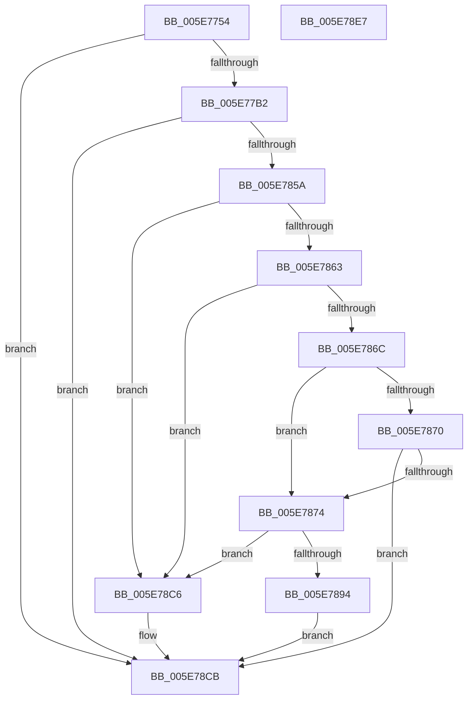

# RtlpFindRegTziForCurrentYear

- RVA: `0x005E7754`–`0x005E78E8` (길이 `404` bytes)
- VA: `0x00000001405E7754`
- 실행 섹션: `.text`
- PDB 이름 있음: `예`; PDB Function 태그: `아니요`
- unwind 정보 RVA: `0x00092640`
- 디코드: `104`개 명령, `404/404` bytes 표시
- 미해석 바이트: `0` (있으면 어셈블리에 `.byte`로 보존)

> 이 문서는 커널 이미지의 기계어와 PDB 기호를 분석해 생성했습니다. 4번과 5번은 함수 원형과 자료형을 바이너리 사용 방식에서 추정한 C 해석이며 원본 소스 복구 결과는 아닙니다.

## 1. Dependencies

- 직접 호출 지점: **6**; 고유 호출 대상: **4**
- 직접 호출자로 확인된 함수: **2**
- RIP 상대 이미지 참조: **3**

### Outgoing calls
- `0x005E77A5` → [itow_s](../50/itow_s_function_00504EE0.md) (function, `0x00504EE0`)
- `0x005E77BF` → [memset](../6C/memset_function_006C6C40.md) (function, `0x006C6C40`)
- `0x005E784F` → [RtlQueryRegistryValuesEx](../../page/8C/RtlQueryRegistryValuesEx_function_008C8FF0.md) (function, `0x008C8FF0`)
- `0x005E788B` → [itow_s](../50/itow_s_function_00504EE0.md) (function, `0x00504EE0`)
- `0x005E78BD` → [RtlQueryRegistryValuesEx](../../page/8C/RtlQueryRegistryValuesEx_function_008C8FF0.md) (function, `0x008C8FF0`)
- `0x005E78D4` → [_security_check_cookie](../6A/_security_check_cookie_function_006AC640.md) (function, `0x006AC640`)

### Direct callers
- [RtlpCheckDynamicTimeZoneInformation](../../page/78/RtlpCheckDynamicTimeZoneInformation_function_0078FB3C.md) at `0x0078FBAA`
- [RtlpUpdateDynamicTimeZones](../../page/79/RtlpUpdateDynamicTimeZones_function_0079019C.md) at `0x00790393`

### Static image references
- `0x005E7767` → RVA `0x00E0A740` (`.data`; read)
- `0x005E77CA` → RVA `0x00B4C2F8` (`szFirstEntry`; read)
- `0x005E77F9` → RVA `0x00B4C148` (`szLastEntry`; read)

## 2. Other-region calls and transfers

- 다른 실행 섹션으로 향하는 call: **2**
  - `0x005E784F` → [RtlQueryRegistryValuesEx](../../page/8C/RtlQueryRegistryValuesEx_function_008C8FF0.md) (`.text` → `PAGE`)
  - `0x005E78BD` → [RtlQueryRegistryValuesEx](../../page/8C/RtlQueryRegistryValuesEx_function_008C8FF0.md) (`.text` → `PAGE`)
- 별도 외부 분기/꼬리 이동을 확인하지 못했습니다.

## 3. Assembly (complete function range)

```asm
005E7754  40 55                           push rbp
005E7756  53                              push rbx
005E7757  56                              push rsi
005E7758  57                              push rdi
005E7759  41 56                           push r14
005E775B  48 8D 6C 24 C0                  lea rbp, [rsp - 0x40]
005E7760  48 81 EC 40 01 00 00            sub rsp, 0x140
005E7767  48 8B 05 D2 2F 82 00            mov rax, qword ptr [rip + 0x822fd2]
005E776E  48 33 C4                        xor rax, rsp
005E7771  48 89 45 30                     mov qword ptr [rbp + 0x30], rax
005E7775  33 C0                           xor eax, eax
005E7777  41 0F BF F0                     movsx esi, r8w
005E777B  0F 57 C0                        xorps xmm0, xmm0
005E777E  4C 8B F2                        mov r14, rdx
005E7781  0F 11 01                        movups xmmword ptr [rcx], xmm0
005E7784  48 8B F9                        mov rdi, rcx
005E7787  48 8D 55 20                     lea rdx, [rbp + 0x20]
005E778B  0F 11 41 10                     movups xmmword ptr [rcx + 0x10], xmm0
005E778F  48 89 41 20                     mov qword ptr [rcx + 0x20], rax
005E7793  44 8D 48 0A                     lea r9d, [rax + 0xa]
005E7797  89 41 28                        mov dword ptr [rcx + 0x28], eax
005E779A  44 8D 40 05                     lea r8d, [rax + 5]
005E779E  8B CE                           mov ecx, esi
005E77A0  BB 0D 00 00 C0                  mov ebx, 0xc000000d
005E77A5  E8 36 D7 F1 FF                  call 0x140504ee0
005E77AA  85 C0                           test eax, eax
005E77AC  0F 85 19 01 00 00               jne 0x1405e78cb
005E77B2  33 D2                           xor edx, edx
005E77B4  48 8D 4C 24 40                  lea rcx, [rsp + 0x40]
005E77B9  41 B8 E0 00 00 00               mov r8d, 0xe0
005E77BF  E8 7C F4 0D 00                  call 0x1406c6c40
005E77C4  48 83 64 24 20 00               and qword ptr [rsp + 0x20], 0
005E77CA  48 8D 05 27 4B 56 00            lea rax, [rip + 0x564b27]
005E77D1  48 89 44 24 50                  mov qword ptr [rsp + 0x50], rax
005E77D6  4C 8D 44 24 40                  lea r8, [rsp + 0x40]
005E77DB  B9 00 00 00 04                  mov ecx, 0x4000000
005E77E0  C7 44 24 48 24 01 00 00         mov dword ptr [rsp + 0x48], 0x124
005E77E8  48 8D 44 24 34                  lea rax, [rsp + 0x34]
005E77ED  89 4C 24 60                     mov dword ptr [rsp + 0x60], ecx
005E77F1  48 89 44 24 58                  mov qword ptr [rsp + 0x58], rax
005E77F6  45 33 C9                        xor r9d, r9d
005E77F9  48 8D 05 48 49 56 00            lea rax, [rip + 0x564948]
005E7800  89 4D 98                        mov dword ptr [rbp - 0x68], ecx
005E7803  48 89 45 88                     mov qword ptr [rbp - 0x78], rax
005E7807  49 8B D6                        mov rdx, r14
005E780A  48 8D 44 24 30                  lea rax, [rsp + 0x30]
005E780F  C7 44 24 34 FC FF FF FF         mov dword ptr [rsp + 0x34], 0xfffffffc
005E7817  48 89 45 90                     mov qword ptr [rbp - 0x70], rax
005E781B  B9 00 00 00 40                  mov ecx, 0x40000000
005E7820  48 8D 45 20                     lea rax, [rbp + 0x20]
005E7824  C7 45 80 24 01 00 00            mov dword ptr [rbp - 0x80], 0x124
005E782B  48 89 45 C0                     mov qword ptr [rbp - 0x40], rax
005E782F  C7 44 24 30 FC FF FF FF         mov dword ptr [rsp + 0x30], 0xfffffffc
005E7837  C7 45 B8 20 01 00 00            mov dword ptr [rbp - 0x48], 0x120
005E783E  48 89 7D C8                     mov qword ptr [rbp - 0x38], rdi
005E7842  C7 45 D0 00 00 00 03            mov dword ptr [rbp - 0x30], 0x3000000
005E7849  C7 07 D4 FF FF FF               mov dword ptr [rdi], 0xffffffd4
005E784F  E8 9C 17 2E 00                  call 0x1408c8ff0
005E7854  8B D8                           mov ebx, eax
005E7856  85 C0                           test eax, eax
005E7858  78 71                           js 0x1405e78cb
005E785A  8B 4C 24 30                     mov ecx, dword ptr [rsp + 0x30]
005E785E  83 F9 FC                        cmp ecx, -4
005E7861  74 63                           je 0x1405e78c6
005E7863  8B 44 24 34                     mov eax, dword ptr [rsp + 0x34]
005E7867  83 F8 FC                        cmp eax, -4
005E786A  74 5A                           je 0x1405e78c6
005E786C  3B F0                           cmp esi, eax
005E786E  7C 04                           jl 0x1405e7874
005E7870  3B F1                           cmp esi, ecx
005E7872  7E 57                           jle 0x1405e78cb
005E7874  3B F1                           cmp esi, ecx
005E7876  48 8D 55 20                     lea rdx, [rbp + 0x20]
005E787A  41 B9 0A 00 00 00               mov r9d, 0xa
005E7880  66 0F 4F C1                     cmovg ax, cx
005E7884  0F BF C8                        movsx ecx, ax
005E7887  45 8D 41 FB                     lea r8d, [r9 - 5]
005E788B  E8 50 D6 F1 FF                  call 0x140504ee0
005E7890  85 C0                           test eax, eax
005E7892  75 32                           jne 0x1405e78c6
005E7894  48 83 64 24 20 00               and qword ptr [rsp + 0x20], 0
005E789A  4C 8D 45 B0                     lea r8, [rbp - 0x50]
005E789E  45 33 C9                        xor r9d, r9d
005E78A1  C7 45 B8 24 01 00 00            mov dword ptr [rbp - 0x48], 0x124
005E78A8  49 8B D6                        mov rdx, r14
005E78AB  C7 45 D0 00 00 00 03            mov dword ptr [rbp - 0x30], 0x3000000
005E78B2  B9 00 00 00 40                  mov ecx, 0x40000000
005E78B7  C7 07 D4 FF FF FF               mov dword ptr [rdi], 0xffffffd4
005E78BD  E8 2E 17 2E 00                  call 0x1408c8ff0
005E78C2  8B D8                           mov ebx, eax
005E78C4  EB 05                           jmp 0x1405e78cb
005E78C6  BB 3E 00 00 C0                  mov ebx, 0xc000003e
005E78CB  8B C3                           mov eax, ebx
005E78CD  48 8B 4D 30                     mov rcx, qword ptr [rbp + 0x30]
005E78D1  48 33 CC                        xor rcx, rsp
005E78D4  E8 67 4D 0C 00                  call 0x1406ac640
005E78D9  48 81 C4 40 01 00 00            add rsp, 0x140
005E78E0  41 5E                           pop r14
005E78E2  5F                              pop rdi
005E78E3  5E                              pop rsi
005E78E4  5B                              pop rbx
005E78E5  5D                              pop rbp
005E78E6  C3                              ret
005E78E7  CC                              int3
```

## 4. C-style interpretation (structured pseudocode)

```c
__int64 __fastcall RtlpFindRegTziForCurrentYear(__int64 a1, __int64 a2, unsigned __int16 a3)
{
    __int64 result;
    __int64 v_rsp;
    unsigned int v_stack_m108;
    unsigned __int64 v_stack_m110;
    unsigned __int64 v_stack_m118;
    unsigned int v_stack_m120;
    unsigned __int64 v_stack_m128;
    unsigned __int64 v_stack_m134;
    unsigned __int64 v_stack_m138;
    unsigned __int64 v_stack_m148;
    unsigned __int64 v_stack_m38;
    unsigned __int64 v_stack_m48;
    unsigned __int64 v_stack_m68;
    unsigned int v_stack_m98;
    unsigned __int64 v_stack_mA0;
    unsigned __int64 v_stack_mA8;
    unsigned int v_stack_mB0;
    unsigned __int64 v_stack_mB8;
    unsigned int v_stack_mD0;
    unsigned __int64 v_stack_mD8;
    unsigned __int64 v_stack_mE0;
    unsigned int v_stack_mE8;

    v_rsp = (v_rsp) - (320);
    result = (*(unsigned __int64 *)(v_rip + 8531922)) ^ (v_rsp);
    v_stack_m38 = result;
    result = 0;
    *(unsigned __int64 *)(a1) = v_xmm0;
    *(unsigned __int64 *)(a1 + 16) = v_xmm0;
    *(unsigned __int64 *)(a1 + 32) = 0;
    *(unsigned int *)(a1 + 40) = 0;
    result = itow_s((unsigned int)((unsigned int)((__int16)(a3))), v_stack_m48, result + 5, result + 10);
    if ((unsigned int)(result) != 0) goto loc_005E78CB;
    a2 = 0;
    result = memset(v_stack_m128, a2, 224, result + 10);
    v_stack_m118 = v_rip + 5655335;
    v_stack_m120 = 292;
    v_stack_m108 = (unsigned int)((unsigned int)(0x4000000ULL));
    v_stack_m110 = v_stack_m134;
    a4 = 0;
    v_stack_mD0 = (unsigned int)((unsigned int)(0x4000000ULL));
    v_stack_mE0 = v_rip + 5654856;
    v_stack_m134 = 0xFFFFFFFCULL;
    v_stack_mD8 = v_stack_m138;
    v_stack_mE8 = 292;
    v_stack_mA8 = v_stack_m48;
    v_stack_m138 = 0xFFFFFFFCULL;
    v_stack_mB0 = 288;
    v_stack_mA0 = a1;
    v_stack_m98 = 0x3000000ULL;
    *(unsigned int *)(a1) = 0xFFFFFFD4ULL;
    result = RtlQueryRegistryValuesEx((unsigned int)(0x40000000ULL), 0, v_stack_m128, a4);
    if (sign_flag) goto loc_005E78CB;
    if (((unsigned int)((unsigned int)(v_stack_m138))) == -4) goto loc_005E78C6;
    if (((unsigned int)((unsigned int)(v_stack_m134))) == -4) goto loc_005E78C6;
    if (((unsigned int)((__int16)(a3))) < ((unsigned int)((unsigned int)(v_stack_m134)))) goto loc_005E7874;
    if (((unsigned int)((__int16)(a3))) <= ((unsigned int)((unsigned int)(v_stack_m138)))) goto loc_005E78CB;
loc_005E7874:
    result = (unsigned int)(v_stack_m134);
    if (((unsigned int)((__int16)(a3))) > ((unsigned int)((unsigned int)(v_stack_m138)))) { result = (unsigned __int16)((unsigned int)(v_stack_m138)); }
    result = itow_s((__int16)((unsigned __int16)(result)), v_stack_m48, 10 - 5, 10);
    if ((unsigned int)(result) != 0) goto loc_005E78C6;
    a4 = 0;
    v_stack_mB0 = 292;
    v_stack_m98 = 0x3000000ULL;
    *(unsigned int *)(a1) = 0xFFFFFFD4ULL;
    result = RtlQueryRegistryValuesEx((unsigned int)(0x40000000ULL), 0, v_stack_mB8, a4);
    goto loc_005E78CB;
loc_005E78C6:
loc_005E78CB:
    a1 = (v_stack_m38) ^ (v_rsp);
    result = _security_check_cookie(a1, 0, v_stack_mB8, a4);
    v_rsp = (v_rsp) + (320);
    return result;
}
```

## 5. (Beta) C Style

```c
int64_t RtlpFindRegTziForCurrentYear(void *Arg1, int64_t Arg2, uint16_t Arg3)
{
    uint8_t *arg1 = (uint8_t *)Arg1;

    int64_t result;
    int64_t local_rsp;
    uint32_t v_stack_m108;
    uint64_t v_stack_m110;
    uint64_t v_stack_m118;
    uint32_t v_stack_m120;
    uint64_t v_stack_m128;
    uint64_t v_stack_m134;
    uint64_t v_stack_m138;
    uint64_t v_stack_m148;
    uint64_t v_stack_m38;
    uint64_t v_stack_m48;
    uint64_t v_stack_m68;
    uint32_t v_stack_m98;
    uint64_t v_stack_mA0;
    uint64_t v_stack_mA8;
    uint32_t v_stack_mB0;
    uint64_t v_stack_mB8;
    uint32_t v_stack_mD0;
    uint64_t v_stack_mD8;
    uint64_t v_stack_mE0;
    uint32_t v_stack_mE8;

    local_rsp = (local_rsp) - (320);
    result = (*(uint64_t *)(v_rip + 0x822FD2)) ^ (local_rsp);
    v_stack_m38 = result;
    result = 0;
    *(uint64_t *)(arg1) = v_xmm0;
    *(uint64_t *)(arg1 + 0x10) = v_xmm0;
    *(uint64_t *)(arg1 + 0x20) = 0;
    *(uint32_t *)(arg1 + 0x28) = 0;
    result = itow_s((uint32_t)((uint32_t)((int16_t)(Arg3))), v_stack_m48, result + 5, result + 10);
    if ((uint32_t)(result) != 0) goto loc_005E78CB;
    Arg2 = 0;
    result = memset(v_stack_m128, Arg2, 224, result + 10);
    v_stack_m118 = v_rip + 5655335;
    v_stack_m120 = 292;
    v_stack_m108 = (uint32_t)((uint32_t)(0x4000000ULL));
    v_stack_m110 = v_stack_m134;
    a4 = 0;
    v_stack_mD0 = (uint32_t)((uint32_t)(0x4000000ULL));
    v_stack_mE0 = v_rip + 5654856;
    v_stack_m134 = 0xFFFFFFFCULL;
    v_stack_mD8 = v_stack_m138;
    v_stack_mE8 = 292;
    v_stack_mA8 = v_stack_m48;
    v_stack_m138 = 0xFFFFFFFCULL;
    v_stack_mB0 = 288;
    v_stack_mA0 = Arg1;
    v_stack_m98 = 0x3000000ULL;
    *(uint32_t *)(arg1) = 0xFFFFFFD4ULL;
    result = RtlQueryRegistryValuesEx((uint32_t)(0x40000000ULL), 0, v_stack_m128, a4);
    if (sign_flag) goto loc_005E78CB;
    if (((uint32_t)((uint32_t)(v_stack_m138))) == -4) goto loc_005E78C6;
    if (((uint32_t)((uint32_t)(v_stack_m134))) == -4) goto loc_005E78C6;
    if (((uint32_t)((int16_t)(Arg3))) < ((uint32_t)((uint32_t)(v_stack_m134)))) goto loc_005E7874;
    if (((uint32_t)((int16_t)(Arg3))) <= ((uint32_t)((uint32_t)(v_stack_m138)))) goto loc_005E78CB;
loc_005E7874:
    result = (uint32_t)(v_stack_m134);
    if (((uint32_t)((int16_t)(Arg3))) > ((uint32_t)((uint32_t)(v_stack_m138)))) { result = (uint16_t)((uint32_t)(v_stack_m138)); }
    result = itow_s((int16_t)((uint16_t)(result)), v_stack_m48, 10 - 5, 10);
    if ((uint32_t)(result) != 0) goto loc_005E78C6;
    a4 = 0;
    v_stack_mB0 = 292;
    v_stack_m98 = 0x3000000ULL;
    *(uint32_t *)(arg1) = 0xFFFFFFD4ULL;
    result = RtlQueryRegistryValuesEx((uint32_t)(0x40000000ULL), 0, v_stack_mB8, a4);
    goto loc_005E78CB;
loc_005E78C6:
loc_005E78CB:
    Arg1 = (v_stack_m38) ^ (local_rsp);
    result = _security_check_cookie(Arg1, 0, v_stack_mB8, a4);
    local_rsp = (local_rsp) + (320);
    return result;
}
```

### 관측된 메모리 오프셋

구조체 형식이 확인되지 않은 접근은 인자 기준의 오프셋으로만 기록했습니다.

| 기준 인자 | 오프셋 표현 | 폭 (bit) | 접근 |
|---|---:|---:|---|
| `Arg1` | `+ 0x0` | `32` | `W` |
| `Arg1` | `+ 0x0` | `128` | `R` |
| `Arg1` | `+ 0x10` | `128` | `R` |
| `Arg1` | `+ 0x20` | `64` | `W` |
| `Arg1` | `+ 0x28` | `32` | `W` |

## 6. Execution-region graph

[열기: 2D/3D 그래프와 함수 탐색 컨트롤 패널](../../../control-panel.html?section=text&rva=0x005E7754&view=graph)

- 2D 그래프는 위에서 아래로 흐르고, 3D 그래프는 빈 공간을 드래그해 회전합니다. Shift+드래그는 이동, 휠은 확대·축소, 함수 노드 선택은 대상 보고서 이동입니다.

### Static fallback


