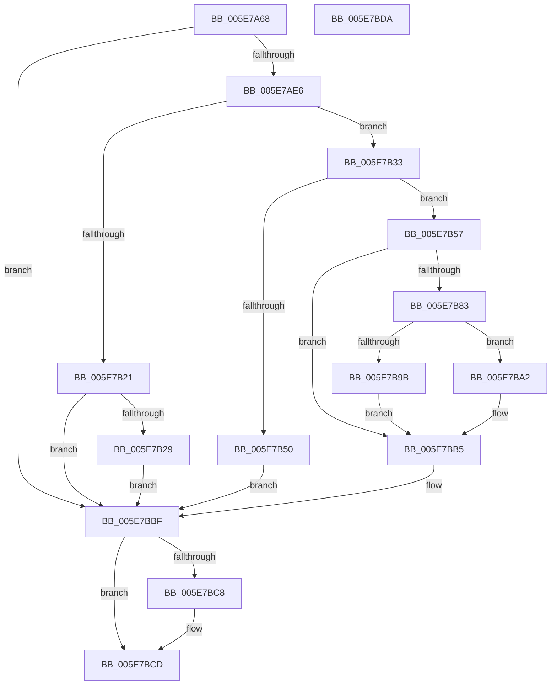

# RtlpGetBootStatusPathFromRegistry

- RVA: `0x005E7A68`–`0x005E7BDB` (길이 `371` bytes)
- VA: `0x00000001405E7A68`
- 실행 섹션: `.text`
- PDB 이름 있음: `예`; PDB Function 태그: `아니요`
- unwind 정보 RVA: `0x000BEF34`
- 디코드: `104`개 명령, `371/371` bytes 표시
- 미해석 바이트: `0` (있으면 어셈블리에 `.byte`로 보존)

> 이 문서는 커널 이미지의 기계어와 PDB 기호를 분석해 생성했습니다. 4번과 5번은 함수 원형과 자료형을 바이너리 사용 방식에서 추정한 C 해석이며 원본 소스 복구 결과는 아닙니다.

## 1. Dependencies

- 직접 호출 지점: **10**; 고유 호출 대상: **7**
- 직접 호출자로 확인된 함수: **1**
- RIP 상대 이미지 참조: **2**

### Outgoing calls
- `0x005E7AA2` → [RtlInitUnicodeString](../42/RtlInitUnicodeString_function_0042A780.md) (function, `0x0042A780`)
- `0x005E7AD7` → [ZwOpenKey](../6A/ZwOpenKey_function_006AD310.md) (function, `0x006AD310`)
- `0x005E7AF1` → [RtlInitUnicodeString](../42/RtlInitUnicodeString_function_0042A780.md) (function, `0x0042A780`)
- `0x005E7B13` → [ZwQueryValueKey](../6A/ZwQueryValueKey_function_006AD3B0.md) (function, `0x006AD3B0`)
- `0x005E7B43` → [ExAllocatePool2](../../poolcode/B8/ExAllocatePool2_function_00B820F0.md) (function, `0x00B820F0`)
- `0x005E7B78` → [ZwQueryValueKey](../6A/ZwQueryValueKey_function_006AD3B0.md) (function, `0x006AD3B0`)
- `0x005E7B8E` → [ExAllocatePool2](../../poolcode/B8/ExAllocatePool2_function_00B820F0.md) (function, `0x00B820F0`)
- `0x005E7BAD` → [memcpy](../6C/memcpy_function_006C6840.md) (function, `0x006C6840`)
- `0x005E7BBA` → [ExFreePoolWithTag](../../poolcode/B8/ExFreePoolWithTag_function_00B82870.md) (function, `0x00B82870`)
- `0x005E7BC8` → [ZwClose](../6A/ZwClose_function_006AD2B0.md) (function, `0x006AD2B0`)

### Direct callers
- [RtlpGetBootStatusPath](RtlpGetBootStatusPath_function_005E7A0C.md) at `0x005E7A21`

### Static image references
- `0x005E7A7A` → RVA `0x006CC810` (` ?? ::FNODOBFM::`string'`; read)
- `0x005E7AE6` → RVA `0x006CC7F0` (` ?? ::FNODOBFM::`string'`; read)

## 2. Other-region calls and transfers

- 다른 실행 섹션으로 향하는 call: **3**
  - `0x005E7B43` → [ExAllocatePool2](../../poolcode/B8/ExAllocatePool2_function_00B820F0.md) (`.text` → `POOLCODE`)
  - `0x005E7B8E` → [ExAllocatePool2](../../poolcode/B8/ExAllocatePool2_function_00B820F0.md) (`.text` → `POOLCODE`)
  - `0x005E7BBA` → [ExFreePoolWithTag](../../poolcode/B8/ExFreePoolWithTag_function_00B82870.md) (`.text` → `POOLCODE`)
- 별도 외부 분기/꼬리 이동을 확인하지 못했습니다.

## 3. Assembly (complete function range)

```asm
005E7A68  40 55                           push rbp
005E7A6A  53                              push rbx
005E7A6B  56                              push rsi
005E7A6C  57                              push rdi
005E7A6D  41 56                           push r14
005E7A6F  48 8B EC                        mov rbp, rsp
005E7A72  48 83 EC 70                     sub rsp, 0x70
005E7A76  83 65 40 00                     and dword ptr [rbp + 0x40], 0
005E7A7A  48 8D 15 8F 4D 0E 00            lea rdx, [rip + 0xe4d8f]
005E7A81  83 65 38 00                     and dword ptr [rbp + 0x38], 0
005E7A85  33 C0                           xor eax, eax
005E7A87  21 45 EC                        and dword ptr [rbp - 0x14], eax
005E7A8A  4C 8B F1                        mov r14, rcx
005E7A8D  48 21 45 48                     and qword ptr [rbp + 0x48], rax
005E7A91  48 8D 4D C0                     lea rcx, [rbp - 0x40]
005E7A95  0F 57 C0                        xorps xmm0, xmm0
005E7A98  89 45 D4                        mov dword ptr [rbp - 0x2c], eax
005E7A9B  21 45 D4                        and dword ptr [rbp - 0x2c], eax
005E7A9E  0F 11 45 C0                     movups xmmword ptr [rbp - 0x40], xmm0
005E7AA2  E8 D9 2C E4 FF                  call 0x14042a780
005E7AA7  48 83 65 D8 00                  and qword ptr [rbp - 0x28], 0
005E7AAC  48 8D 45 C0                     lea rax, [rbp - 0x40]
005E7AB0  0F 57 C0                        xorps xmm0, xmm0
005E7AB3  48 89 45 E0                     mov qword ptr [rbp - 0x20], rax
005E7AB7  4C 8D 45 D0                     lea r8, [rbp - 0x30]
005E7ABB  C7 45 D0 30 00 00 00            mov dword ptr [rbp - 0x30], 0x30
005E7AC2  BA 19 00 02 00                  mov edx, 0x20019
005E7AC7  C7 45 E8 40 02 00 00            mov dword ptr [rbp - 0x18], 0x240
005E7ACE  48 8D 4D 48                     lea rcx, [rbp + 0x48]
005E7AD2  F3 0F 7F 45 F0                  movdqu xmmword ptr [rbp - 0x10], xmm0
005E7AD7  E8 34 58 0C 00                  call 0x1406ad310
005E7ADC  8B D8                           mov ebx, eax
005E7ADE  85 C0                           test eax, eax
005E7AE0  0F 88 D9 00 00 00               js 0x1405e7bbf
005E7AE6  48 8D 15 03 4D 0E 00            lea rdx, [rip + 0xe4d03]
005E7AED  48 8D 4D C0                     lea rcx, [rbp - 0x40]
005E7AF1  E8 8A 2C E4 FF                  call 0x14042a780
005E7AF6  48 8B 4D 48                     mov rcx, qword ptr [rbp + 0x48]
005E7AFA  48 8D 45 38                     lea rax, [rbp + 0x38]
005E7AFE  45 33 C9                        xor r9d, r9d
005E7B01  48 89 44 24 28                  mov qword ptr [rsp + 0x28], rax
005E7B06  83 64 24 20 00                  and dword ptr [rsp + 0x20], 0
005E7B0B  48 8D 55 C0                     lea rdx, [rbp - 0x40]
005E7B0F  45 8D 41 02                     lea r8d, [r9 + 2]
005E7B13  E8 98 58 0C 00                  call 0x1406ad3b0
005E7B18  8B D8                           mov ebx, eax
005E7B1A  3D 23 00 00 C0                  cmp eax, 0xc0000023
005E7B1F  74 12                           je 0x1405e7b33
005E7B21  85 C0                           test eax, eax
005E7B23  0F 88 96 00 00 00               js 0x1405e7bbf
005E7B29  BB 01 00 00 C0                  mov ebx, 0xc0000001
005E7B2E  E9 8C 00 00 00                  jmp 0x1405e7bbf
005E7B33  8B 55 38                        mov edx, dword ptr [rbp + 0x38]
005E7B36  BE 62 73 64 66                  mov esi, 0x66647362
005E7B3B  44 8B C6                        mov r8d, esi
005E7B3E  B9 00 01 00 00                  mov ecx, 0x100
005E7B43  E8 A8 A5 59 00                  call 0x140b820f0
005E7B48  48 8B F8                        mov rdi, rax
005E7B4B  48 85 C0                        test rax, rax
005E7B4E  75 07                           jne 0x1405e7b57
005E7B50  BB 17 00 00 C0                  mov ebx, 0xc0000017
005E7B55  EB 68                           jmp 0x1405e7bbf
005E7B57  48 8B 4D 48                     mov rcx, qword ptr [rbp + 0x48]
005E7B5B  48 8D 45 40                     lea rax, [rbp + 0x40]
005E7B5F  48 89 44 24 28                  mov qword ptr [rsp + 0x28], rax
005E7B64  48 8D 55 C0                     lea rdx, [rbp - 0x40]
005E7B68  8B 45 38                        mov eax, dword ptr [rbp + 0x38]
005E7B6B  4C 8B CF                        mov r9, rdi
005E7B6E  41 B8 02 00 00 00               mov r8d, 2
005E7B74  89 44 24 20                     mov dword ptr [rsp + 0x20], eax
005E7B78  E8 33 58 0C 00                  call 0x1406ad3b0
005E7B7D  8B D8                           mov ebx, eax
005E7B7F  85 C0                           test eax, eax
005E7B81  78 32                           js 0x1405e7bb5
005E7B83  8B 57 08                        mov edx, dword ptr [rdi + 8]
005E7B86  44 8B C6                        mov r8d, esi
005E7B89  B9 00 01 00 00                  mov ecx, 0x100
005E7B8E  E8 5D A5 59 00                  call 0x140b820f0
005E7B93  48 8B F0                        mov rsi, rax
005E7B96  48 85 C0                        test rax, rax
005E7B99  75 07                           jne 0x1405e7ba2
005E7B9B  BB 17 00 00 C0                  mov ebx, 0xc0000017
005E7BA0  EB 13                           jmp 0x1405e7bb5
005E7BA2  44 8B 47 08                     mov r8d, dword ptr [rdi + 8]
005E7BA6  48 8D 57 0C                     lea rdx, [rdi + 0xc]
005E7BAA  48 8B CE                        mov rcx, rsi
005E7BAD  E8 8E EC 0D 00                  call 0x1406c6840
005E7BB2  49 89 36                        mov qword ptr [r14], rsi
005E7BB5  33 D2                           xor edx, edx
005E7BB7  48 8B CF                        mov rcx, rdi
005E7BBA  E8 B1 AC 59 00                  call 0x140b82870
005E7BBF  48 8B 4D 48                     mov rcx, qword ptr [rbp + 0x48]
005E7BC3  48 85 C9                        test rcx, rcx
005E7BC6  74 05                           je 0x1405e7bcd
005E7BC8  E8 E3 56 0C 00                  call 0x1406ad2b0
005E7BCD  8B C3                           mov eax, ebx
005E7BCF  48 83 C4 70                     add rsp, 0x70
005E7BD3  41 5E                           pop r14
005E7BD5  5F                              pop rdi
005E7BD6  5E                              pop rsi
005E7BD7  5B                              pop rbx
005E7BD8  5D                              pop rbp
005E7BD9  C3                              ret
005E7BDA  CC                              int3
```

## 4. C-style interpretation (structured pseudocode)

```c
__int64 __fastcall RtlpGetBootStatusPathFromRegistry(__int64 a1, __int64 a2, __int64 a3, int a4)
{
    __int64 result;
    __int64 v_rsp;
    unsigned __int64 v_stack_m38;
    unsigned int v_stack_m3C;
    unsigned int v_stack_m40;
    unsigned __int64 v_stack_m48;
    unsigned __int64 v_stack_m50;
    unsigned int v_stack_m54;
    unsigned __int64 v_stack_m58;
    unsigned __int64 v_stack_m68;
    unsigned __int64 v_stack_m70;
    unsigned int v_stack_m78;
    unsigned int v_stack_p10;
    unsigned int v_stack_p18;
    unsigned __int64 v_stack_p20;

    v_rsp = (v_rsp) - (112);
    result = 0;
    v_stack_m54 = 0;
    v_stack_m68 = v_xmm0;
    result = RtlInitUnicodeString(v_stack_m68, v_rip + 937359, a3, a4);
    v_stack_m48 = v_stack_m68;
    v_stack_m58 = 48;
    v_stack_m40 = 576;
    v_stack_m38 = v_xmm0;
    result = ZwOpenKey(v_stack_p20, (unsigned int)(0x20019ULL), v_stack_m58, a4);
    if (sign_flag) goto loc_005E7BBF;
    result = RtlInitUnicodeString(v_stack_m68, v_rip + 937219, v_stack_m58, a4);
    a4 = 0;
    v_stack_m70 = v_stack_p10;
    result = ZwQueryValueKey(v_stack_p20, v_stack_m68, a4 + 2, a4);
    if (((unsigned int)(result)) == 0xC0000023ULL) goto loc_005E7B33;
    if (sign_flag) goto loc_005E7BBF;
    goto loc_005E7BBF;
loc_005E7B33:
    result = ExAllocatePool2(256, (unsigned int)(v_stack_p10), (unsigned int)((unsigned int)((unsigned int)(0x66647362ULL))), a4);
    if (result != 0) goto loc_005E7B57;
    goto loc_005E7BBF;
loc_005E7B57:
    v_stack_m70 = v_stack_p18;
    v_stack_m78 = (unsigned int)((unsigned int)(v_stack_p10));
    result = ZwQueryValueKey(v_stack_p20, v_stack_m68, 2, result);
    if (sign_flag) goto loc_005E7BB5;
    result = ExAllocatePool2(256, (unsigned int)(*(unsigned int *)(result + 8)), (unsigned int)((unsigned int)((unsigned int)(0x66647362ULL))), result);
    if (result != 0) goto loc_005E7BA2;
    goto loc_005E7BB5;
loc_005E7BA2:
    result = memcpy(result, result + 12, (unsigned int)(*(unsigned int *)(result + 8)), result);
    *(unsigned __int64 *)(a1) = result;
loc_005E7BB5:
    a2 = 0;
    result = ExFreePoolWithTag(result, a2, (unsigned int)(*(unsigned int *)(result + 8)), result);
loc_005E7BBF:
    if (v_stack_p20 != 0) {
        result = ZwClose(v_stack_p20, a2, (unsigned int)(*(unsigned int *)(result + 8)), result);
    }
    v_rsp = (v_rsp) + (112);
    return (unsigned int)((unsigned int)((unsigned int)(0xC0000017ULL)));
}
```

## 5. (Beta) C Style

```c
int64_t RtlpGetBootStatusPathFromRegistry(void *Arg1, int64_t Arg2, int64_t Arg3, int32_t Arg4)
{
    uint8_t *arg1 = (uint8_t *)Arg1;

    int64_t result;
    int64_t local_rsp;
    uint64_t v_stack_m38;
    uint32_t v_stack_m3C;
    uint32_t v_stack_m40;
    uint64_t v_stack_m48;
    uint64_t v_stack_m50;
    uint32_t v_stack_m54;
    uint64_t v_stack_m58;
    uint64_t v_stack_m68;
    uint64_t v_stack_m70;
    uint32_t v_stack_m78;
    uint32_t v_stack_p10;
    uint32_t v_stack_p18;
    uint64_t v_stack_p20;

    local_rsp = (local_rsp) - (112);
    result = 0;
    v_stack_m54 = 0;
    v_stack_m68 = v_xmm0;
    result = RtlInitUnicodeString(v_stack_m68, v_rip + 937359, Arg3, Arg4);
    v_stack_m48 = v_stack_m68;
    v_stack_m58 = 48;
    v_stack_m40 = 576;
    v_stack_m38 = v_xmm0;
    result = ZwOpenKey(v_stack_p20, (uint32_t)(0x20019ULL), v_stack_m58, Arg4);
    if (sign_flag) goto loc_005E7BBF;
    result = RtlInitUnicodeString(v_stack_m68, v_rip + 937219, v_stack_m58, Arg4);
    Arg4 = 0;
    v_stack_m70 = v_stack_p10;
    result = ZwQueryValueKey(v_stack_p20, v_stack_m68, Arg4 + 2, Arg4);
    if (((uint32_t)(result)) == 0xC0000023ULL) goto loc_005E7B33;
    if (sign_flag) goto loc_005E7BBF;
    goto loc_005E7BBF;
loc_005E7B33:
    result = ExAllocatePool2(256, (uint32_t)(v_stack_p10), (uint32_t)((uint32_t)((uint32_t)(0x66647362ULL))), Arg4);
    if (result != 0) goto loc_005E7B57;
    goto loc_005E7BBF;
loc_005E7B57:
    v_stack_m70 = v_stack_p18;
    v_stack_m78 = (uint32_t)((uint32_t)(v_stack_p10));
    result = ZwQueryValueKey(v_stack_p20, v_stack_m68, 2, result);
    if (sign_flag) goto loc_005E7BB5;
    result = ExAllocatePool2(256, (uint32_t)(*(uint32_t *)(result + 0x8)), (uint32_t)((uint32_t)((uint32_t)(0x66647362ULL))), result);
    if (result != 0) goto loc_005E7BA2;
    goto loc_005E7BB5;
loc_005E7BA2:
    result = memcpy(result, result + 12, (uint32_t)(*(uint32_t *)(result + 0x8)), result);
    *(uint64_t *)(arg1) = result;
loc_005E7BB5:
    Arg2 = 0;
    result = ExFreePoolWithTag(result, Arg2, (uint32_t)(*(uint32_t *)(result + 0x8)), result);
loc_005E7BBF:
    if (v_stack_p20 != 0) {
        result = ZwClose(v_stack_p20, Arg2, (uint32_t)(*(uint32_t *)(result + 0x8)), result);
    }
    local_rsp = (local_rsp) + (112);
    return (uint32_t)((uint32_t)((uint32_t)(0xC0000017ULL)));
}
```

### 관측된 메모리 오프셋

구조체 형식이 확인되지 않은 접근은 인자 기준의 오프셋으로만 기록했습니다.

| 기준 인자 | 오프셋 표현 | 폭 (bit) | 접근 |
|---|---:|---:|---|
| `Arg1` | `+ 0x0` | `64` | `W` |

## 6. Execution-region graph

[열기: 2D/3D 그래프와 함수 탐색 컨트롤 패널](../../../control-panel.html?section=text&rva=0x005E7A68&view=graph)

- 2D 그래프는 위에서 아래로 흐르고, 3D 그래프는 빈 공간을 드래그해 회전합니다. Shift+드래그는 이동, 휠은 확대·축소, 함수 노드 선택은 대상 보고서 이동입니다.

### Static fallback


