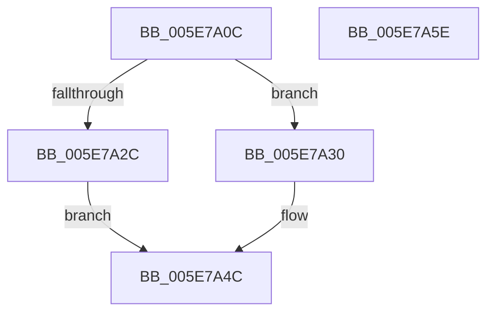

# RtlpGetBootStatusPath

- RVA: `0x005E7A0C`–`0x005E7A5F` (길이 `83` bytes)
- VA: `0x00000001405E7A0C`
- 실행 섹션: `.text`
- PDB 이름 있음: `예`; PDB Function 태그: `아니요`
- unwind 정보 RVA: `0x00060BC4`
- 디코드: `25`개 명령, `83/83` bytes 표시
- 미해석 바이트: `0` (있으면 어셈블리에 `.byte`로 보존)

> 이 문서는 커널 이미지의 기계어와 PDB 기호를 분석해 생성했습니다. 4번과 5번은 함수 원형과 자료형을 바이너리 사용 방식에서 추정한 C 해석이며 원본 소스 복구 결과는 아닙니다.

## 1. Dependencies

- 직접 호출 지점: **2**; 고유 호출 대상: **2**
- 직접 호출자로 확인된 함수: **4**
- RIP 상대 이미지 참조: **2**

### Outgoing calls
- `0x005E7A21` → [RtlpGetBootStatusPathFromRegistry](RtlpGetBootStatusPathFromRegistry_function_005E7A68.md) (function, `0x005E7A68`)
- `0x005E7A30` → [RtlIsStateSeparationEnabled](../../page/A3/RtlIsStateSeparationEnabled_function_00A3C560.md) (function, `0x00A3C560`)

### Direct callers
- [PopBootStatRestoreDefaults](../../page/AC/PopBootStatRestoreDefaults_function_00AC38E8.md) at `0x00AC39B4`
- [sub_00B3B9F4](../../page/B3/Unknown_function_00B3B9F4.md) at `0x00B3BA98`
- [sub_00B3BB7A](../../page/B3/Unknown_function_00B3BB7A.md) at `0x00B3BC29`
- [sub_00B47492](../../page/B4/Unknown_function_00B47492.md) at `0x00B4749A`

### Static image references
- `0x005E7A37` → RVA `0x006CC880` (` ?? ::FNODOBFM::`string'`; read)
- `0x005E7A3E` → RVA `0x006CC8C0` (` ?? ::FNODOBFM::`string'`; read)

## 2. Other-region calls and transfers

- 다른 실행 섹션으로 향하는 call: **1**
  - `0x005E7A30` → [RtlIsStateSeparationEnabled](../../page/A3/RtlIsStateSeparationEnabled_function_00A3C560.md) (`.text` → `PAGE`)
- 별도 외부 분기/꼬리 이동을 확인하지 못했습니다.

## 3. Assembly (complete function range)

```asm
005E7A0C  48 89 5C 24 08                  mov qword ptr [rsp + 8], rbx
005E7A11  48 89 74 24 10                  mov qword ptr [rsp + 0x10], rsi
005E7A16  57                              push rdi
005E7A17  48 83 EC 20                     sub rsp, 0x20
005E7A1B  48 8B FA                        mov rdi, rdx
005E7A1E  48 8B F1                        mov rsi, rcx
005E7A21  E8 42 00 00 00                  call 0x1405e7a68
005E7A26  33 DB                           xor ebx, ebx
005E7A28  85 C0                           test eax, eax
005E7A2A  78 04                           js 0x1405e7a30
005E7A2C  B3 01                           mov bl, 1
005E7A2E  EB 1C                           jmp 0x1405e7a4c
005E7A30  E8 2B 4B 45 00                  call 0x140a3c560
005E7A35  84 C0                           test al, al
005E7A37  48 8D 15 42 4E 0E 00            lea rdx, [rip + 0xe4e42]
005E7A3E  48 8D 0D 7B 4E 0E 00            lea rcx, [rip + 0xe4e7b]
005E7A45  48 0F 44 CA                     cmove rcx, rdx
005E7A49  48 89 0E                        mov qword ptr [rsi], rcx
005E7A4C  88 1F                           mov byte ptr [rdi], bl
005E7A4E  48 8B 5C 24 30                  mov rbx, qword ptr [rsp + 0x30]
005E7A53  48 8B 74 24 38                  mov rsi, qword ptr [rsp + 0x38]
005E7A58  48 83 C4 20                     add rsp, 0x20
005E7A5C  5F                              pop rdi
005E7A5D  C3                              ret
005E7A5E  CC                              int3
```

## 4. C-style interpretation (structured pseudocode)

```c
__int64 __fastcall RtlpGetBootStatusPath(__int64 a1, __int64 a2)
{
    __int64 result;
    __int64 v_rbx;
    __int64 v_rsp;
    unsigned __int64 v_stack_p10;
    unsigned __int64 v_stack_p8;

    v_stack_p8 = v_rbx;
    v_stack_p10 = v_rsi;
    v_rsp = (v_rsp) - (32);
    result = RtlpGetBootStatusPathFromRegistry(a1, a2, a3, a4);
    v_rbx = 0;
    if (sign_flag) goto loc_005E7A30;
    goto loc_005E7A4C;
loc_005E7A30:
    result = RtlIsStateSeparationEnabled(a1, a2, a3, a4);
    a1 = v_rip + 937595;
    if ((unsigned __int8)(result) == 0) { a1 = v_rip + 937538; }
    *(unsigned __int64 *)(a1) = a1;
loc_005E7A4C:
    *(unsigned __int8 *)(a2) = 1;
    v_rsp = (v_rsp) + (32);
    return result;
}
```

## 5. (Beta) C Style

```c
int64_t RtlpGetBootStatusPath(void *Arg1, void *Arg2)
{
    uint8_t *arg1 = (uint8_t *)Arg1;
    uint8_t *arg2 = (uint8_t *)Arg2;

    int64_t result;
    int64_t local_rbx;
    int64_t local_rsp;
    uint64_t v_stack_p10;
    uint64_t v_stack_p8;

    v_stack_p8 = local_rbx;
    v_stack_p10 = local_rsi;
    local_rsp = (local_rsp) - (32);
    result = RtlpGetBootStatusPathFromRegistry(Arg1, Arg2, a3, a4);
    local_rbx = 0;
    if (sign_flag) goto loc_005E7A30;
    goto loc_005E7A4C;
loc_005E7A30:
    result = RtlIsStateSeparationEnabled(Arg1, Arg2, a3, a4);
    Arg1 = v_rip + 937595;
    if ((uint8_t)(result) == 0) { Arg1 = v_rip + 937538; }
    *(void **)(arg1) = Arg1;
loc_005E7A4C:
    *(uint8_t *)(arg2) = 1;
    local_rsp = (local_rsp) + (32);
    return result;
}
```

### 관측된 메모리 오프셋

구조체 형식이 확인되지 않은 접근은 인자 기준의 오프셋으로만 기록했습니다.

| 기준 인자 | 오프셋 표현 | 폭 (bit) | 접근 |
|---|---:|---:|---|
| `Arg1` | `+ 0x0` | `64` | `W` |
| `Arg2` | `+ 0x0` | `8` | `W` |

## 6. Execution-region graph

[열기: 2D/3D 그래프와 함수 탐색 컨트롤 패널](../../../control-panel.html?section=text&rva=0x005E7A0C&view=graph)

- 2D 그래프는 위에서 아래로 흐르고, 3D 그래프는 빈 공간을 드래그해 회전합니다. Shift+드래그는 이동, 휠은 확대·축소, 함수 노드 선택은 대상 보고서 이동입니다.

### Static fallback


