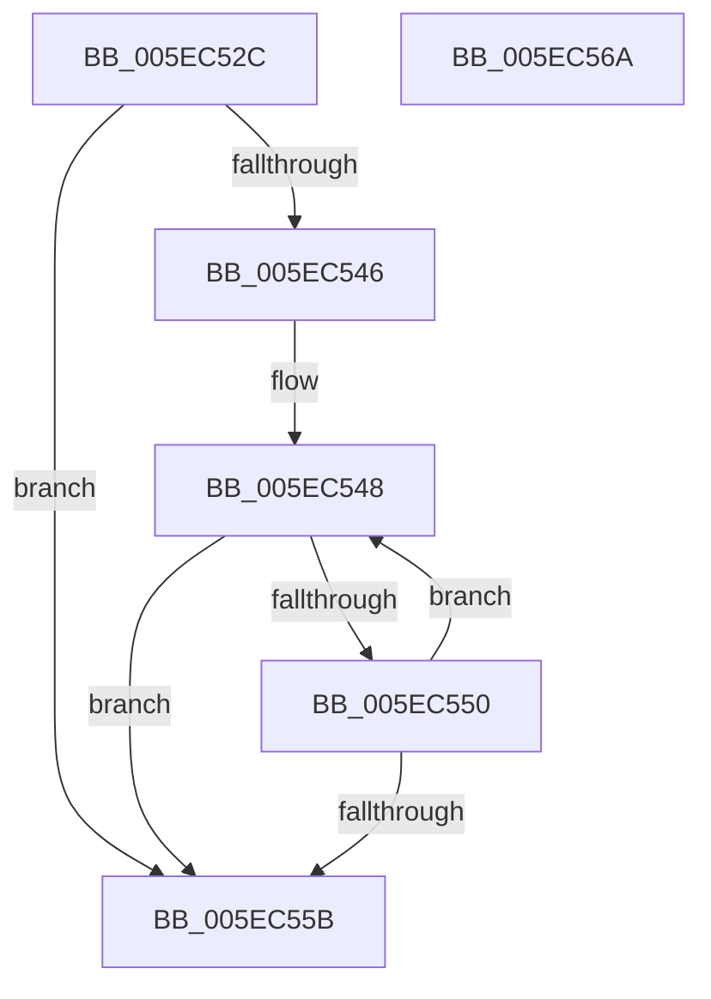

# RtlpGetCorrelationVectorEndPosition

- RVA: `0x005EC52C`–`0x005EC56B` (길이 `63` bytes)
- VA: `0x00000001405EC52C`
- 실행 섹션: `.text`
- PDB 이름 있음: `예`; PDB Function 태그: `예`
- unwind 정보 RVA: `0x0005C788`
- 디코드: `21`개 명령, `63/63` bytes 표시
- 미해석 바이트: `0` (있으면 어셈블리에 `.byte`로 보존)

> 이 문서는 커널 이미지의 기계어와 PDB 기호를 분석해 생성했습니다. 4번과 5번은 함수 원형과 자료형을 바이너리 사용 방식에서 추정한 C 해석이며 원본 소스 복구 결과는 아닙니다.

## 1. Dependencies

- 직접 호출 지점: **1**; 고유 호출 대상: **1**
- 직접 호출자로 확인된 함수: **2**
- RIP 상대 이미지 참조: **0**

### Outgoing calls
- `0x005EC536` → [RtlpGetCorrelationVectorBufferLength](../../page/AB/RtlpGetCorrelationVectorBufferLength_function_00AB9518.md) (function, `0x00AB9518`)

### Direct callers
- [RtlValidateCorrelationVector](../../page/70/RtlValidateCorrelationVector_function_007052E0.md) at `0x0070531A`
- [RtlExtendCorrelationVector](../../page/79/RtlExtendCorrelationVector_function_00791B70.md) at `0x00791B7C`

### Static image references
- 디코드된 RIP-relative 메모리 참조가 없습니다.

## 2. Other-region calls and transfers

- 다른 실행 섹션으로 향하는 call: **1**
  - `0x005EC536` → [RtlpGetCorrelationVectorBufferLength](../../page/AB/RtlpGetCorrelationVectorBufferLength_function_00AB9518.md) (`.text` → `PAGE`)
- 별도 외부 분기/꼬리 이동을 확인하지 못했습니다.

## 3. Assembly (complete function range)

```asm
005EC52C  48 83 EC 28                     sub rsp, 0x28
005EC530  4C 8B D1                        mov r10, rcx
005EC533  45 33 C0                        xor r8d, r8d
005EC536  E8 DD CF 4C 00                  call 0x140ab9518
005EC53B  4C 63 C8                        movsxd r9, eax
005EC53E  49 8B C1                        mov rax, r9
005EC541  45 85 C9                        test r9d, r9d
005EC544  7E 15                           jle 0x1405ec55b
005EC546  33 D2                           xor edx, edx
005EC548  41 80 7C 12 01 00               cmp byte ptr [r10 + rdx + 1], 0
005EC54E  74 0B                           je 0x1405ec55b
005EC550  41 FF C0                        inc r8d
005EC553  48 FF C2                        inc rdx
005EC556  48 3B D0                        cmp rdx, rax
005EC559  7C ED                           jl 0x1405ec548
005EC55B  83 C8 FF                        or eax, 0xffffffff
005EC55E  45 3B C8                        cmp r9d, r8d
005EC561  41 0F 4F C0                     cmovg eax, r8d
005EC565  48 83 C4 28                     add rsp, 0x28
005EC569  C3                              ret
005EC56A  CC                              int3
```

## 4. C-style interpretation (structured pseudocode)

```c
__int64 __fastcall RtlpGetCorrelationVectorEndPosition(__int64 a1, int a2, int a3)
{
    __int64 result;
    __int64 v_rsp;

    v_rsp = (v_rsp) - (40);
    a3 = 0;
    result = RtlpGetCorrelationVectorBufferLength(a1, a2, a3, a4);
    if (condition_is_less_or_equal) goto loc_005EC55B;
    a2 = 0;
loc_005EC548:
    if ((*(unsigned __int8 *)(a1 + a2 * 1 + 1)) == 0) goto loc_005EC55B;
    a3 = (unsigned int)((a3) + 1);
    a2 = (a2) + 1;
    if (a2 < ((int)((unsigned int)(result)))) goto loc_005EC548;
loc_005EC55B:
    result = (unsigned int)(((int)((unsigned int)(result))) | (0xFFFFFFFFULL));
    if (((unsigned int)((int)((unsigned int)(result)))) > a3) { result = a3; }
    v_rsp = (v_rsp) + (40);
    return result;
}
```

## 5. (Beta) C Style

```c
int64_t RtlpGetCorrelationVectorEndPosition(int64_t Arg1, int32_t Arg2, int32_t Arg3)
{
    int64_t result;
    int64_t local_rsp;

    local_rsp = (local_rsp) - (40);
    Arg3 = 0;
    result = RtlpGetCorrelationVectorBufferLength(Arg1, Arg2, Arg3, a4);
    if (condition_is_less_or_equal) goto loc_005EC55B;
    Arg2 = 0;
loc_005EC548:
    if ((*(uint8_t *)(Arg1 + Arg2 * 1 + 0x1)) == 0) goto loc_005EC55B;
    Arg3 = (uint32_t)((Arg3) + 1);
    Arg2 = (Arg2) + 1;
    if (Arg2 < ((int32_t)((uint32_t)(result)))) goto loc_005EC548;
loc_005EC55B:
    result = (uint32_t)(((int32_t)((uint32_t)(result))) | (0xFFFFFFFFULL));
    if (((uint32_t)((int32_t)((uint32_t)(result)))) > Arg3) { result = Arg3; }
    local_rsp = (local_rsp) + (40);
    return result;
}
```

## 6. Execution-region graph

[열기: 2D/3D 그래프와 함수 탐색 컨트롤 패널](../../../control-panel.html?section=text&rva=0x005EC52C&view=graph)

- 2D 그래프는 위에서 아래로 흐르고, 3D 그래프는 빈 공간을 드래그해 회전합니다. Shift+드래그는 이동, 휠은 확대·축소, 함수 노드 선택은 대상 보고서 이동입니다.

### Static fallback


