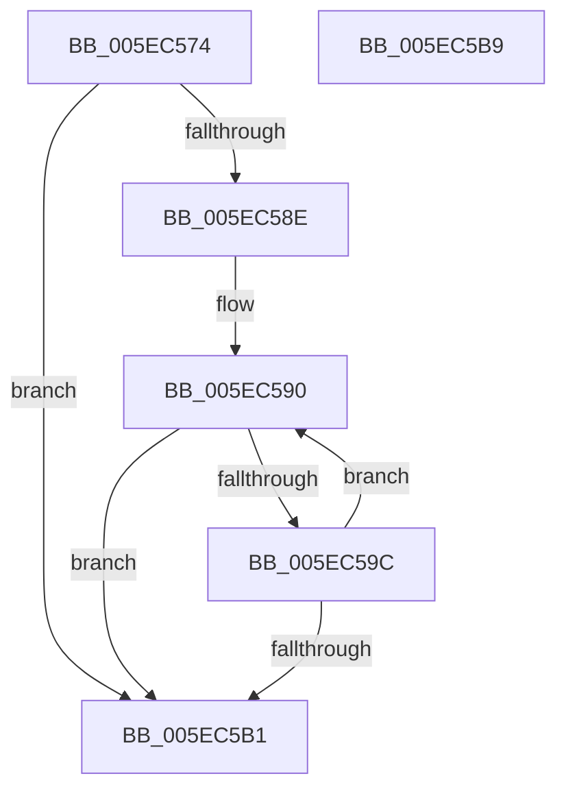

# RtlpGetCorrelationVectorLastDotPosition

- RVA: `0x005EC574`–`0x005EC5BA` (길이 `70` bytes)
- VA: `0x00000001405EC574`
- 실행 섹션: `.text`
- PDB 이름 있음: `예`; PDB Function 태그: `예`
- unwind 정보 RVA: `0x0005C788`
- 디코드: `24`개 명령, `70/70` bytes 표시
- 미해석 바이트: `0` (있으면 어셈블리에 `.byte`로 보존)

> 이 문서는 커널 이미지의 기계어와 PDB 기호를 분석해 생성했습니다. 4번과 5번은 함수 원형과 자료형을 바이너리 사용 방식에서 추정한 C 해석이며 원본 소스 복구 결과는 아닙니다.

## 1. Dependencies

- 직접 호출 지점: **1**; 고유 호출 대상: **1**
- 직접 호출자로 확인된 함수: **1**
- RIP 상대 이미지 참조: **0**

### Outgoing calls
- `0x005EC582` → [RtlpGetCorrelationVectorBufferLength](../../page/AB/RtlpGetCorrelationVectorBufferLength_function_00AB9518.md) (function, `0x00AB9518`)

### Direct callers
- [RtlIncrementCorrelationVector](../../page/AB/RtlIncrementCorrelationVector_function_00AB9430.md) at `0x00AB9473`

### Static image references
- 디코드된 RIP-relative 메모리 참조가 없습니다.

## 2. Other-region calls and transfers

- 다른 실행 섹션으로 향하는 call: **1**
  - `0x005EC582` → [RtlpGetCorrelationVectorBufferLength](../../page/AB/RtlpGetCorrelationVectorBufferLength_function_00AB9518.md) (`.text` → `PAGE`)
- 별도 외부 분기/꼬리 이동을 확인하지 못했습니다.

## 3. Assembly (complete function range)

```asm
005EC574  48 83 EC 28                     sub rsp, 0x28
005EC578  4C 8B D1                        mov r10, rcx
005EC57B  41 83 C8 FF                     or r8d, 0xffffffff
005EC57F  45 33 C9                        xor r9d, r9d
005EC582  E8 91 CF 4C 00                  call 0x140ab9518
005EC587  4C 63 D8                        movsxd r11, eax
005EC58A  85 C0                           test eax, eax
005EC58C  7E 23                           jle 0x1405ec5b1
005EC58E  33 C0                           xor eax, eax
005EC590  41 8A 54 02 01                  mov dl, byte ptr [r10 + rax + 1]
005EC595  41 8B C9                        mov ecx, r9d
005EC598  84 D2                           test dl, dl
005EC59A  74 15                           je 0x1405ec5b1
005EC59C  41 FF C1                        inc r9d
005EC59F  48 FF C0                        inc rax
005EC5A2  80 FA 2E                        cmp dl, 0x2e
005EC5A5  41 0F 45 C8                     cmovne ecx, r8d
005EC5A9  44 8B C1                        mov r8d, ecx
005EC5AC  49 3B C3                        cmp rax, r11
005EC5AF  7C DF                           jl 0x1405ec590
005EC5B1  41 8B C0                        mov eax, r8d
005EC5B4  48 83 C4 28                     add rsp, 0x28
005EC5B8  C3                              ret
005EC5B9  CC                              int3
```

## 4. C-style interpretation (structured pseudocode)

```c
__int64 __fastcall RtlpGetCorrelationVectorLastDotPosition(__int64 a1, __int64 a2, int a3, int a4)
{
    __int64 result;
    __int64 v_rsp;

    v_rsp = (v_rsp) - (40);
    a3 = (unsigned int)((a3) | (0xFFFFFFFFULL));
    a4 = 0;
    result = RtlpGetCorrelationVectorBufferLength(a1, a2, a3, a4);
    if (condition_is_less_or_equal) goto loc_005EC5B1;
    result = 0;
loc_005EC590:
    if ((unsigned __int8)(*(unsigned __int8 *)(a1 + result * 1 + 1)) == 0) goto loc_005EC5B1;
    a4 = (unsigned int)((a4) + 1);
    result = (result) + 1;
    a1 = 0;
    if (((unsigned __int8)(*(unsigned __int8 *)(a1 + result * 1 + 1))) != 46) { a1 = a3; }
    if (result < ((int)((unsigned int)(result)))) goto loc_005EC590;
loc_005EC5B1:
    v_rsp = (v_rsp) + (40);
    return (unsigned int)((unsigned int)((unsigned int)((unsigned int)(a1))));
}
```

## 5. (Beta) C Style

```c
int64_t RtlpGetCorrelationVectorLastDotPosition(int64_t Arg1, int64_t Arg2, int32_t Arg3, int32_t Arg4)
{
    int64_t result;
    int64_t local_rsp;

    local_rsp = (local_rsp) - (40);
    Arg3 = (uint32_t)((Arg3) | (0xFFFFFFFFULL));
    Arg4 = 0;
    result = RtlpGetCorrelationVectorBufferLength(Arg1, Arg2, Arg3, Arg4);
    if (condition_is_less_or_equal) goto loc_005EC5B1;
    result = 0;
loc_005EC590:
    if ((uint8_t)(*(uint8_t *)(Arg1 + result * 1 + 0x1)) == 0) goto loc_005EC5B1;
    Arg4 = (uint32_t)((Arg4) + 1);
    result = (result) + 1;
    Arg1 = 0;
    if (((uint8_t)(*(uint8_t *)(Arg1 + result * 1 + 0x1))) != 46) { Arg1 = Arg3; }
    if (result < ((int32_t)((uint32_t)(result)))) goto loc_005EC590;
loc_005EC5B1:
    local_rsp = (local_rsp) + (40);
    return (uint32_t)((uint32_t)((uint32_t)((uint32_t)(Arg1))));
}
```

## 6. Execution-region graph

[열기: 2D/3D 그래프와 함수 탐색 컨트롤 패널](../../../control-panel.html?section=text&rva=0x005EC574&view=graph)

- 2D 그래프는 위에서 아래로 흐르고, 3D 그래프는 빈 공간을 드래그해 회전합니다. Shift+드래그는 이동, 휠은 확대·축소, 함수 노드 선택은 대상 보고서 이동입니다.

### Static fallback


