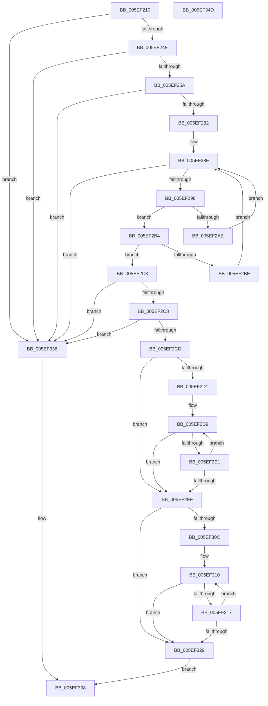

# RtlpGetKernelScpFunctionTable

- RVA: `0x005EF210`–`0x005EF34E` (길이 `318` bytes)
- VA: `0x00000001405EF210`
- 실행 섹션: `.text`
- PDB 이름 있음: `예`; PDB Function 태그: `예`
- unwind 정보 RVA: `0x00066400`
- 디코드: `95`개 명령, `318/318` bytes 표시
- 미해석 바이트: `0` (있으면 어셈블리에 `.byte`로 보존)

> 이 문서는 커널 이미지의 기계어와 PDB 기호를 분석해 생성했습니다. 4번과 5번은 함수 원형과 자료형을 바이너리 사용 방식에서 추정한 C 해석이며 원본 소스 복구 결과는 아닙니다.

## 1. Dependencies

- 직접 호출 지점: **1**; 고유 호출 대상: **1**
- 직접 호출자로 확인된 함수: **2**
- RIP 상대 이미지 참조: **0**

### Outgoing calls
- `0x005EF23D` → [RtlImageDirectoryEntryToData](../43/RtlImageDirectoryEntryToData_function_004328D0.md) (function, `0x004328D0`)

### Direct callers
- [RtlCopyKernelScpUnwindInfo](RtlCopyKernelScpUnwindInfo_function_005EF038.md) at `0x005EF077`
- [RtlCreateKernelScpFunctionTable](RtlCreateKernelScpFunctionTable_function_005EF118.md) at `0x005EF156`

### Static image references
- 디코드된 RIP-relative 메모리 참조가 없습니다.

## 2. Other-region calls and transfers

- 다른 실행 섹션으로 향하는 call: **0**
- 별도 외부 분기/꼬리 이동을 확인하지 못했습니다.

## 3. Assembly (complete function range)

```asm
005EF210  48 8B C4                        mov rax, rsp
005EF213  48 89 58 08                     mov qword ptr [rax + 8], rbx
005EF217  48 89 68 10                     mov qword ptr [rax + 0x10], rbp
005EF21B  48 89 70 18                     mov qword ptr [rax + 0x18], rsi
005EF21F  57                              push rdi
005EF220  48 83 EC 30                     sub rsp, 0x30
005EF224  83 60 E8 00                     and dword ptr [rax - 0x18], 0
005EF228  49 8B D8                        mov rbx, r8
005EF22B  41 8B F1                        mov esi, r9d
005EF22E  48 8B EA                        mov rbp, rdx
005EF231  41 B8 03 00 00 00               mov r8d, 3
005EF237  4C 8D 48 E8                     lea r9, [rax - 0x18]
005EF23B  B2 01                           mov dl, 1
005EF23D  E8 8E 36 E4 FF                  call 0x1404328d0
005EF242  48 8B F8                        mov rdi, rax
005EF245  48 85 C0                        test rax, rax
005EF248  0F 84 E8 00 00 00               je 0x1405ef336
005EF24E  8B 4C 24 20                     mov ecx, dword ptr [rsp + 0x20]
005EF252  85 C9                           test ecx, ecx
005EF254  0F 84 DC 00 00 00               je 0x1405ef336
005EF25A  44 8B C1                        mov r8d, ecx
005EF25D  48 B8 AB AA AA AA AA AA AA AA   movabs rax, 0xaaaaaaaaaaaaaaab
005EF267  48 F7 E1                        mul rcx
005EF26A  4C 8B D2                        mov r10, rdx
005EF26D  49 C1 EA 03                     shr r10, 3
005EF271  4B 8D 0C 52                     lea rcx, [r10 + r10*2]
005EF275  48 C1 E1 02                     shl rcx, 2
005EF279  4C 3B C1                        cmp r8, rcx
005EF27C  0F 85 B4 00 00 00               jne 0x1405ef336
005EF282  48 2B DD                        sub rbx, rbp
005EF285  45 8D 42 FF                     lea r8d, [r10 - 1]
005EF289  33 C0                           xor eax, eax
005EF28B  4C 8D 1C 33                     lea r11, [rbx + rsi]
005EF28F  44 3B C0                        cmp r8d, eax
005EF292  0F 8C 9E 00 00 00               jl 0x1405ef336
005EF298  41 8D 0C 00                     lea ecx, [r8 + rax]
005EF29C  D1 F9                           sar ecx, 1
005EF29E  48 63 D1                        movsxd rdx, ecx
005EF2A1  4C 8D 0C 52                     lea r9, [rdx + rdx*2]
005EF2A5  42 8B 34 8F                     mov esi, dword ptr [rdi + r9*4]
005EF2A9  4C 3B DE                        cmp r11, rsi
005EF2AC  77 06                           ja 0x1405ef2b4
005EF2AE  44 8D 41 FF                     lea r8d, [rcx - 1]
005EF2B2  EB DB                           jmp 0x1405ef28f
005EF2B4  42 8B 44 8F 04                  mov eax, dword ptr [rdi + r9*4 + 4]
005EF2B9  48 3B D8                        cmp rbx, rax
005EF2BC  72 05                           jb 0x1405ef2c3
005EF2BE  8D 41 01                        lea eax, [rcx + 1]
005EF2C1  EB CC                           jmp 0x1405ef28f
005EF2C3  48 3B DE                        cmp rbx, rsi
005EF2C6  77 6E                           ja 0x1405ef336
005EF2C8  4C 3B D8                        cmp r11, rax
005EF2CB  72 69                           jb 0x1405ef336
005EF2CD  85 C9                           test ecx, ecx
005EF2CF  7E 1E                           jle 0x1405ef2ef
005EF2D1  4C 8D 47 F4                     lea r8, [rdi - 0xc]
005EF2D5  4F 8D 04 88                     lea r8, [r8 + r9*4]
005EF2D9  41 8B 00                        mov eax, dword ptr [r8]
005EF2DC  48 3B C3                        cmp rax, rbx
005EF2DF  72 0E                           jb 0x1405ef2ef
005EF2E1  FF C9                           dec ecx
005EF2E3  48 FF CA                        dec rdx
005EF2E6  49 83 E8 0C                     sub r8, 0xc
005EF2EA  48 85 D2                        test rdx, rdx
005EF2ED  7F EA                           jg 0x1405ef2d9
005EF2EF  48 63 C1                        movsxd rax, ecx
005EF2F2  44 8D 49 01                     lea r9d, [rcx + 1]
005EF2F6  41 B8 01 00 00 00               mov r8d, 1
005EF2FC  48 8D 04 40                     lea rax, [rax + rax*2]
005EF300  48 8D 1C 87                     lea rbx, [rdi + rax*4]
005EF304  49 63 C1                        movsxd rax, r9d
005EF307  49 3B C2                        cmp rax, r10
005EF30A  73 1D                           jae 0x1405ef329
005EF30C  48 8D 53 10                     lea rdx, [rbx + 0x10]
005EF310  8B 02                           mov eax, dword ptr [rdx]
005EF312  49 3B C3                        cmp rax, r11
005EF315  77 12                           ja 0x1405ef329
005EF317  41 FF C1                        inc r9d
005EF31A  41 FF C0                        inc r8d
005EF31D  49 63 C9                        movsxd rcx, r9d
005EF320  48 83 C2 0C                     add rdx, 0xc
005EF324  49 3B CA                        cmp rcx, r10
005EF327  72 E7                           jb 0x1405ef310
005EF329  48 8B 4C 24 60                  mov rcx, qword ptr [rsp + 0x60]
005EF32E  48 8B C3                        mov rax, rbx
005EF331  44 89 01                        mov dword ptr [rcx], r8d
005EF334  EB 02                           jmp 0x1405ef338
005EF336  33 C0                           xor eax, eax
005EF338  48 8B 5C 24 40                  mov rbx, qword ptr [rsp + 0x40]
005EF33D  48 8B 6C 24 48                  mov rbp, qword ptr [rsp + 0x48]
005EF342  48 8B 74 24 50                  mov rsi, qword ptr [rsp + 0x50]
005EF347  48 83 C4 30                     add rsp, 0x30
005EF34B  5F                              pop rdi
005EF34C  C3                              ret
005EF34D  CC                              int3
```

## 4. C-style interpretation (structured pseudocode)

```c
__int64 __fastcall RtlpGetKernelScpFunctionTable(__int64 a1, __int64 a2, __int64 a3, int a4, __int64 a5)
{
    __int64 result;
    __int64 v_r10;
    __int64 v_rbx;
    __int64 v_rsp;
    unsigned int v_stack_m18;
    unsigned __int64 v_stack_p10;
    unsigned __int64 v_stack_p18;
    unsigned __int64 v_stack_p8;

    *(unsigned __int64 *)(v_rsp + 8) = v_rbx;
    *(unsigned __int64 *)(v_rsp + 16) = v_rbp;
    *(unsigned __int64 *)(v_rsp + 24) = v_rsi;
    v_rsp = (v_rsp) - (48);
    result = RtlImageDirectoryEntryToData(a1, 1, 3, v_rsp - 24);
    if (result == 0) goto loc_005EF336;
    if ((unsigned int)((unsigned int)(v_stack_m18)) == 0) goto loc_005EF336;
    v_r10 = (1) >> (3);
    a1 = (v_r10 + v_r10 * 2) << (2);
    if (((unsigned int)((unsigned int)((unsigned int)(v_stack_m18)))) != a1) goto loc_005EF336;
    v_rbx = (a3) - (a2);
    result = 0;
loc_005EF28F:
    if (((unsigned int)(v_r10 - 1)) < 0) goto loc_005EF336;
    a1 = (unsigned int)((v_r10 - 1 + result * 1) >> (1));
    if ((v_rbx + (unsigned int)(a4) * 1) > ((unsigned int)(*(unsigned int *)(result + (int)((unsigned int)(a1)) + (int)((unsigned int)(a1)) * 2 * 4)))) goto loc_005EF2B4;
    goto loc_005EF28F;
loc_005EF2B4:
    if (v_rbx < ((unsigned int)(*(unsigned int *)(result + (int)((unsigned int)(a1)) + (int)((unsigned int)(a1)) * 2 * 4 + 4)))) goto loc_005EF2C3;
    goto loc_005EF28F;
loc_005EF2C3:
    if (v_rbx > ((unsigned int)(*(unsigned int *)(result + (int)((unsigned int)(a1)) + (int)((unsigned int)(a1)) * 2 * 4)))) goto loc_005EF336;
    if ((v_rbx + (unsigned int)(a4) * 1) < (a1 + 1)) goto loc_005EF336;
    if (condition_is_less_or_equal) goto loc_005EF2EF;
loc_005EF2D9:
    if (((unsigned int)(*(unsigned int *)(result - 12 + (int)((unsigned int)(a1)) + (int)((unsigned int)(a1)) * 2 * 4))) < v_rbx) goto loc_005EF2EF;
    a1 = (unsigned int)((a1) - 1);
    a2 = ((int)((unsigned int)(a1))) - 1;
    a3 = (result - 12 + (int)((unsigned int)(a1)) + (int)((unsigned int)(a1)) * 2 * 4) - (12);
    if (condition_is_greater) goto loc_005EF2D9;
loc_005EF2EF:
    if (((int)((unsigned int)(a1 + 1))) >= v_r10) goto loc_005EF329;
loc_005EF310:
    if (((unsigned int)(*(unsigned int *)(result + (int)((unsigned int)(a1)) + (int)((unsigned int)(a1)) * 2 * 4 + 16))) > (v_rbx + (unsigned int)(a4) * 1)) goto loc_005EF329;
    a4 = (unsigned int)((a1 + 1) + 1);
    a3 = (unsigned int)((1) + 1);
    a2 = (result + (int)((unsigned int)(a1)) + (int)((unsigned int)(a1)) * 2 * 4 + 16) + (12);
    if (((int)(a4)) < v_r10) goto loc_005EF310;
loc_005EF329:
    *(unsigned int *)(a5) = (unsigned int)(a3);
    goto loc_005EF338;
loc_005EF336:
    result = 0;
loc_005EF338:
    v_rsp = (v_rsp) + (48);
    return result;
}
```

## 5. (Beta) C Style

```c
int64_t RtlpGetKernelScpFunctionTable(int64_t Arg1, int64_t Arg2, void *Arg3, int32_t Arg4, void *Arg5)
{
    uint8_t *arg3 = (uint8_t *)Arg3;
    uint8_t *arg5 = (uint8_t *)Arg5;

    int64_t result;
    int64_t local_r10;
    int64_t local_rbx;
    int64_t local_rsp;
    uint32_t v_stack_m18;
    uint64_t v_stack_p10;
    uint64_t v_stack_p18;
    uint64_t v_stack_p8;

    *(uint64_t *)(local_rsp + 0x8) = local_rbx;
    *(uint64_t *)(local_rsp + 0x10) = local_rbp;
    *(uint64_t *)(local_rsp + 0x18) = local_rsi;
    local_rsp = (local_rsp) - (48);
    result = RtlImageDirectoryEntryToData(Arg1, 1, 3, local_rsp - 24);
    if (result == 0) goto loc_005EF336;
    if ((uint32_t)((uint32_t)(v_stack_m18)) == 0) goto loc_005EF336;
    local_r10 = (1) >> (3);
    Arg1 = (local_r10 + local_r10 * 2) << (2);
    if (((uint32_t)((uint32_t)((uint32_t)(v_stack_m18)))) != Arg1) goto loc_005EF336;
    local_rbx = (Arg3) - (Arg2);
    result = 0;
loc_005EF28F:
    if (((uint32_t)(local_r10 - 1)) < 0) goto loc_005EF336;
    Arg1 = (uint32_t)((local_r10 - 1 + result * 1) >> (1));
    if ((local_rbx + (uint32_t)(Arg4) * 1) > ((uint32_t)(*(uint32_t *)(result + (int32_t)((uint32_t)(Arg1)) + (int32_t)((uint32_t)(Arg1)) * 2 * 4)))) goto loc_005EF2B4;
    goto loc_005EF28F;
loc_005EF2B4:
    if (local_rbx < ((uint32_t)(*(uint32_t *)(result + (int32_t)((uint32_t)(Arg1)) + (int32_t)((uint32_t)(Arg1)) * 2 * 4 + 0x4)))) goto loc_005EF2C3;
    goto loc_005EF28F;
loc_005EF2C3:
    if (local_rbx > ((uint32_t)(*(uint32_t *)(result + (int32_t)((uint32_t)(Arg1)) + (int32_t)((uint32_t)(Arg1)) * 2 * 4)))) goto loc_005EF336;
    if ((local_rbx + (uint32_t)(Arg4) * 1) < (Arg1 + 1)) goto loc_005EF336;
    if (condition_is_less_or_equal) goto loc_005EF2EF;
loc_005EF2D9:
    if (((uint32_t)(*(uint32_t *)(result - 0xC + (int32_t)((uint32_t)(Arg1)) + (int32_t)((uint32_t)(Arg1)) * 2 * 4))) < local_rbx) goto loc_005EF2EF;
    Arg1 = (uint32_t)((Arg1) - 1);
    Arg2 = ((int32_t)((uint32_t)(Arg1))) - 1;
    Arg3 = (result - 12 + (int32_t)((uint32_t)(Arg1)) + (int32_t)((uint32_t)(Arg1)) * 2 * 4) - (12);
    if (condition_is_greater) goto loc_005EF2D9;
loc_005EF2EF:
    if (((int32_t)((uint32_t)(Arg1 + 1))) >= local_r10) goto loc_005EF329;
loc_005EF310:
    if (((uint32_t)(*(uint32_t *)(result + (int32_t)((uint32_t)(Arg1)) + (int32_t)((uint32_t)(Arg1)) * 2 * 4 + 0x10))) > (local_rbx + (uint32_t)(Arg4) * 1)) goto loc_005EF329;
    Arg4 = (uint32_t)((Arg1 + 1) + 1);
    Arg3 = (uint32_t)((1) + 1);
    Arg2 = (result + (int32_t)((uint32_t)(Arg1)) + (int32_t)((uint32_t)(Arg1)) * 2 * 4 + 16) + (12);
    if (((int32_t)(Arg4)) < local_r10) goto loc_005EF310;
loc_005EF329:
    *(uint32_t *)(arg5) = (uint32_t)(Arg3);
    goto loc_005EF338;
loc_005EF336:
    result = 0;
loc_005EF338:
    local_rsp = (local_rsp) + (48);
    return result;
}
```

### 관측된 메모리 오프셋

구조체 형식이 확인되지 않은 접근은 인자 기준의 오프셋으로만 기록했습니다.

| 기준 인자 | 오프셋 표현 | 폭 (bit) | 접근 |
|---|---:|---:|---|
| `Arg3` | `+ 0x0 + rsi*1` | `64` | `R` |
| `Arg5` | `+ 0x0` | `32` | `W` |

## 6. Execution-region graph

[열기: 2D/3D 그래프와 함수 탐색 컨트롤 패널](../../../control-panel.html?section=text&rva=0x005EF210&view=graph)

- 2D 그래프는 위에서 아래로 흐르고, 3D 그래프는 빈 공간을 드래그해 회전합니다. Shift+드래그는 이동, 휠은 확대·축소, 함수 노드 선택은 대상 보고서 이동입니다.

### Static fallback


