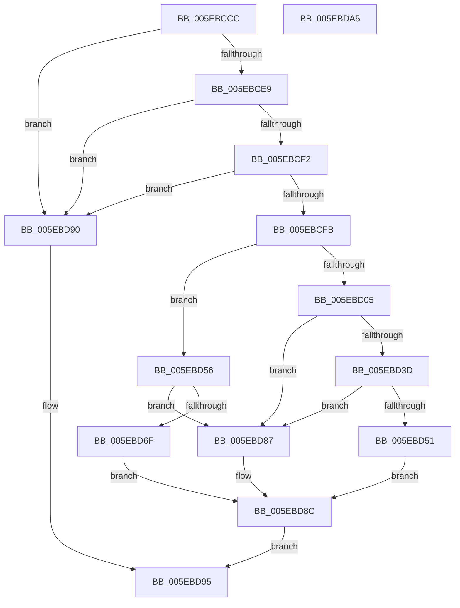

# RtlpGetNameFromLangInfoNode

- RVA: `0x005EBCCC`–`0x005EBDA6` (길이 `218` bytes)
- VA: `0x00000001405EBCCC`
- 실행 섹션: `.text`
- PDB 이름 있음: `예`; PDB Function 태그: `아니요`
- unwind 정보 RVA: `0x000794E0`
- 디코드: `62`개 명령, `218/218` bytes 표시
- 미해석 바이트: `0` (있으면 어셈블리에 `.byte`로 보존)

> 이 문서는 커널 이미지의 기계어와 PDB 기호를 분석해 생성했습니다. 4번과 5번은 함수 원형과 자료형을 바이너리 사용 방식에서 추정한 C 해석이며 원본 소스 복구 결과는 아닙니다.

## 1. Dependencies

- 직접 호출 지점: **3**; 고유 호출 대상: **3**
- 직접 호출자로 확인된 함수: **1**
- RIP 상대 이미지 참조: **0**

### Outgoing calls
- `0x005EBD2A` → [RtlInitUnicodeString](../42/RtlInitUnicodeString_function_0042A780.md) (function, `0x0042A780`)
- `0x005EBD48` → [RtlStringCbCopyW](../43/RtlStringCbCopyW_function_0043B910.md) (function, `0x0043B910`)
- `0x005EBD72` → [RtlLCIDToCultureName](../../page/AD/RtlLCIDToCultureName_function_00AD3010.md) (function, `0x00AD3010`)

### Direct callers
- [RtlpMuiRegValidateInstalled](../../page/84/RtlpMuiRegValidateInstalled_function_008404D4.md) at `0x008406B1`

### Static image references
- 디코드된 RIP-relative 메모리 참조가 없습니다.

## 2. Other-region calls and transfers

- 다른 실행 섹션으로 향하는 call: **1**
  - `0x005EBD72` → [RtlLCIDToCultureName](../../page/AD/RtlLCIDToCultureName_function_00AD3010.md) (`.text` → `PAGE`)
- 별도 외부 분기/꼬리 이동을 확인하지 못했습니다.

## 3. Assembly (complete function range)

```asm
005EBCCC  48 89 5C 24 08                  mov qword ptr [rsp + 8], rbx
005EBCD1  48 89 74 24 10                  mov qword ptr [rsp + 0x10], rsi
005EBCD6  57                              push rdi
005EBCD7  48 83 EC 30                     sub rsp, 0x30
005EBCDB  33 DB                           xor ebx, ebx
005EBCDD  49 8B F8                        mov rdi, r8
005EBCE0  48 85 C9                        test rcx, rcx
005EBCE3  0F 84 A7 00 00 00               je 0x1405ebd90
005EBCE9  48 85 D2                        test rdx, rdx
005EBCEC  0F 84 9E 00 00 00               je 0x1405ebd90
005EBCF2  4D 85 C0                        test r8, r8
005EBCF5  0F 84 95 00 00 00               je 0x1405ebd90
005EBCFB  48 0F BF 42 06                  movsx rax, word ptr [rdx + 6]
005EBD00  66 85 C0                        test ax, ax
005EBD03  7E 51                           jle 0x1405ebd56
005EBD05  4C 8B 41 20                     mov r8, qword ptr [rcx + 0x20]
005EBD09  0F 57 C0                        xorps xmm0, xmm0
005EBD0C  48 8B C8                        mov rcx, rax
005EBD0F  0F 11 44 24 20                  movups xmmword ptr [rsp + 0x20], xmm0
005EBD14  49 8B 40 10                     mov rax, qword ptr [r8 + 0x10]
005EBD18  48 0F BF 14 48                  movsx rdx, word ptr [rax + rcx*2]
005EBD1D  48 8D 4C 24 20                  lea rcx, [rsp + 0x20]
005EBD22  49 8B 40 18                     mov rax, qword ptr [r8 + 0x18]
005EBD26  48 8D 14 50                     lea rdx, [rax + rdx*2]
005EBD2A  E8 51 EA E3 FF                  call 0x14042a780
005EBD2F  0F B7 47 02                     movzx eax, word ptr [rdi + 2]
005EBD33  0F B7 74 24 20                  movzx esi, word ptr [rsp + 0x20]
005EBD38  66 3B F0                        cmp si, ax
005EBD3B  77 4A                           ja 0x1405ebd87
005EBD3D  4C 8B 44 24 28                  mov r8, qword ptr [rsp + 0x28]
005EBD42  8B D0                           mov edx, eax
005EBD44  48 8B 4F 08                     mov rcx, qword ptr [rdi + 8]
005EBD48  E8 C3 FB E4 FF                  call 0x14043b910
005EBD4D  85 C0                           test eax, eax
005EBD4F  78 36                           js 0x1405ebd87
005EBD51  66 89 37                        mov word ptr [rdi], si
005EBD54  EB 36                           jmp 0x1405ebd8c
005EBD56  0F B7 4A 04                     movzx ecx, word ptr [rdx + 4]
005EBD5A  BA 00 10 00 00                  mov edx, 0x1000
005EBD5F  0F B7 C1                        movzx eax, cx
005EBD62  66 2B C2                        sub ax, dx
005EBD65  BA FF FB 00 00                  mov edx, 0xfbff
005EBD6A  66 85 C2                        test dx, ax
005EBD6D  74 18                           je 0x1405ebd87
005EBD6F  48 8B D7                        mov rdx, rdi
005EBD72  E8 99 72 4E 00                  call 0x140ad3010
005EBD77  F6 D8                           neg al
005EBD79  1B C9                           sbb ecx, ecx
005EBD7B  F7 D1                           not ecx
005EBD7D  81 E1 E5 00 00 C0               and ecx, 0xc00000e5
005EBD83  8B D9                           mov ebx, ecx
005EBD85  EB 05                           jmp 0x1405ebd8c
005EBD87  BB E5 00 00 C0                  mov ebx, 0xc00000e5
005EBD8C  8B C3                           mov eax, ebx
005EBD8E  EB 05                           jmp 0x1405ebd95
005EBD90  B8 0D 00 00 C0                  mov eax, 0xc000000d
005EBD95  48 8B 5C 24 40                  mov rbx, qword ptr [rsp + 0x40]
005EBD9A  48 8B 74 24 48                  mov rsi, qword ptr [rsp + 0x48]
005EBD9F  48 83 C4 30                     add rsp, 0x30
005EBDA3  5F                              pop rdi
005EBDA4  C3                              ret
005EBDA5  CC                              int3
```

## 4. C-style interpretation (structured pseudocode)

```c
__int64 __fastcall RtlpGetNameFromLangInfoNode(__int64 a1, __int64 a2, __int64 a3)
{
    __int64 result;
    __int64 v_rbx;
    __int64 v_rsp;
    unsigned __int64 v_stack_m10;
    unsigned __int64 v_stack_m18;
    unsigned __int64 v_stack_p10;
    unsigned __int64 v_stack_p8;

    v_stack_p8 = v_rbx;
    v_stack_p10 = v_rsi;
    v_rsp = (v_rsp) - (48);
    v_rbx = 0;
    if (a1 == 0) goto loc_005EBD90;
    if (a2 == 0) goto loc_005EBD90;
    if (a3 == 0) goto loc_005EBD90;
    if (condition_is_less_or_equal) goto loc_005EBD56;
    v_stack_m18 = v_xmm0;
    result = RtlInitUnicodeString(v_stack_m18, *(unsigned __int64 *)(*(unsigned __int64 *)(a1 + 32) + 24) + (__int16)(*(unsigned __int16 *)(*(unsigned __int64 *)(*(unsigned __int64 *)(a1 + 32) + 16) + (__int16)(*(unsigned __int16 *)(a2 + 6)) * 2)) * 2, *(unsigned __int64 *)(a1 + 32), a4);
    if (((unsigned __int16)(v_stack_m18)) > ((unsigned __int16)(*(unsigned __int16 *)(a3 + 2)))) goto loc_005EBD87;
    result = RtlStringCbCopyW(*(unsigned __int64 *)(a3 + 8), (unsigned int)((unsigned int)(*(unsigned __int16 *)(a3 + 2))), v_stack_m10, a4);
    if (sign_flag) goto loc_005EBD87;
    *(unsigned __int16 *)(a3) = (unsigned __int16)(v_stack_m18);
    goto loc_005EBD8C;
loc_005EBD56:
    result = (unsigned __int16)(((unsigned __int16)(*(unsigned __int16 *)((unsigned int)((unsigned int)(*(unsigned __int16 *)(a3 + 2))) + 4))) - ((unsigned __int16)((unsigned int)(0x1000ULL))));
    if ((((unsigned __int16)((unsigned int)(0xFBFFULL))) & ((unsigned __int16)(result))) == 0) goto loc_005EBD87;
    result = RtlLCIDToCultureName(*(unsigned __int16 *)((unsigned int)((unsigned int)(*(unsigned __int16 *)(a3 + 2))) + 4), a3, v_stack_m10, a4);
    result = (unsigned __int8)(-(result));
    a1 = (unsigned int)(~(*(unsigned __int16 *)((unsigned int)((unsigned int)(*(unsigned __int16 *)(a3 + 2))) + 4)));
    a1 = (unsigned int)((a1) & (0xC00000E5ULL));
    goto loc_005EBD8C;
loc_005EBD87:
loc_005EBD8C:
    goto loc_005EBD95;
loc_005EBD90:
loc_005EBD95:
    v_rsp = (v_rsp) + (48);
    return (unsigned int)(0xC000000DULL);
}
```

## 5. (Beta) C Style

```c
int64_t RtlpGetNameFromLangInfoNode(int64_t Arg1, int64_t Arg2, void *Arg3)
{
    uint8_t *arg3 = (uint8_t *)Arg3;

    int64_t result;
    int64_t local_rbx;
    int64_t local_rsp;
    uint64_t v_stack_m10;
    uint64_t v_stack_m18;
    uint64_t v_stack_p10;
    uint64_t v_stack_p8;

    v_stack_p8 = local_rbx;
    v_stack_p10 = local_rsi;
    local_rsp = (local_rsp) - (48);
    local_rbx = 0;
    if (Arg1 == 0) goto loc_005EBD90;
    if (Arg2 == 0) goto loc_005EBD90;
    if (Arg3 == NULL) goto loc_005EBD90;
    if (condition_is_less_or_equal) goto loc_005EBD56;
    v_stack_m18 = v_xmm0;
    result = RtlInitUnicodeString(v_stack_m18, *(uint64_t *)(*(uint64_t *)(Arg1 + 0x20) + 0x18) + (int16_t)(*(uint16_t *)(*(uint64_t *)(*(uint64_t *)(Arg1 + 0x20) + 0x10) + (int16_t)(*(uint16_t *)(Arg2 + 0x6)) * 2)) * 2, *(uint64_t *)(Arg1 + 0x20), a4);
    if (((uint16_t)(v_stack_m18)) > ((uint16_t)(*(uint16_t *)(arg3 + 0x2)))) goto loc_005EBD87;
    result = RtlStringCbCopyW(*(uint64_t *)(arg3 + 0x8), (uint32_t)((uint32_t)(*(uint16_t *)(arg3 + 0x2))), v_stack_m10, a4);
    if (sign_flag) goto loc_005EBD87;
    *(uint16_t *)(arg3) = (uint16_t)(v_stack_m18);
    goto loc_005EBD8C;
loc_005EBD56:
    result = (uint16_t)(((uint16_t)(*(uint16_t *)((uint32_t)((uint32_t)(*(uint16_t *)(arg3 + 0x2))) + 0x4))) - ((uint16_t)((uint32_t)(0x1000ULL))));
    if ((((uint16_t)((uint32_t)(0xFBFFULL))) & ((uint16_t)(result))) == 0) goto loc_005EBD87;
    result = RtlLCIDToCultureName(*(uint16_t *)((uint32_t)((uint32_t)(*(uint16_t *)(arg3 + 0x2))) + 0x4), Arg3, v_stack_m10, a4);
    result = (uint8_t)(-(result));
    Arg1 = (uint32_t)(~(*(uint16_t *)((uint32_t)((uint32_t)(*(uint16_t *)(arg3 + 0x2))) + 0x4)));
    Arg1 = (uint32_t)((Arg1) & (0xC00000E5ULL));
    goto loc_005EBD8C;
loc_005EBD87:
loc_005EBD8C:
    goto loc_005EBD95;
loc_005EBD90:
loc_005EBD95:
    local_rsp = (local_rsp) + (48);
    return (uint32_t)(0xC000000DULL);
}
```

### 관측된 메모리 오프셋

구조체 형식이 확인되지 않은 접근은 인자 기준의 오프셋으로만 기록했습니다.

| 기준 인자 | 오프셋 표현 | 폭 (bit) | 접근 |
|---|---:|---:|---|
| `Arg3` | `+ 0x0` | `16` | `W` |
| `Arg3` | `+ 0x2` | `16` | `R` |
| `Arg3` | `+ 0x8` | `64` | `R` |

## 6. Execution-region graph

[열기: 2D/3D 그래프와 함수 탐색 컨트롤 패널](../../../control-panel.html?section=text&rva=0x005EBCCC&view=graph)

- 2D 그래프는 위에서 아래로 흐르고, 3D 그래프는 빈 공간을 드래그해 회전합니다. Shift+드래그는 이동, 휠은 확대·축소, 함수 노드 선택은 대상 보고서 이동입니다.

### Static fallback


