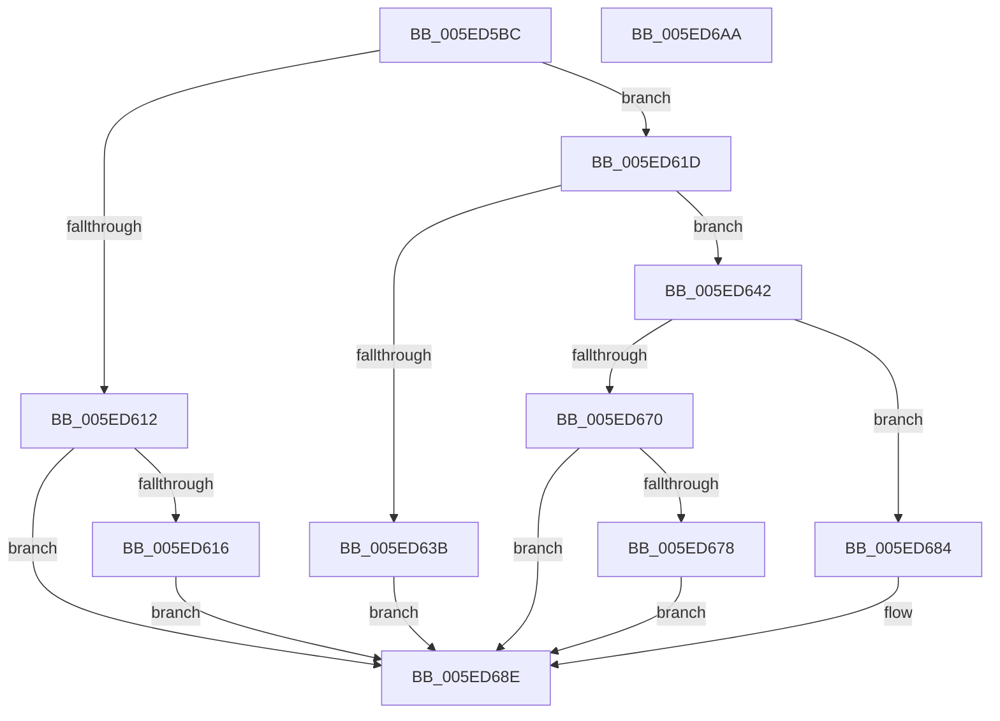

# RtlpGetPersistedRegistryLocation

- RVA: `0x005ED5BC`–`0x005ED6AB` (길이 `239` bytes)
- VA: `0x00000001405ED5BC`
- 실행 섹션: `.text`
- PDB 이름 있음: `예`; PDB Function 태그: `아니요`
- unwind 정보 RVA: `0x0007EE78`
- 디코드: `72`개 명령, `239/239` bytes 표시
- 미해석 바이트: `0` (있으면 어셈블리에 `.byte`로 보존)

> 이 문서는 커널 이미지의 기계어와 PDB 기호를 분석해 생성했습니다. 4번과 5번은 함수 원형과 자료형을 바이너리 사용 방식에서 추정한 C 해석이며 원본 소스 복구 결과는 아닙니다.

## 1. Dependencies

- 직접 호출 지점: **4**; 고유 호출 대상: **3**
- 직접 호출자로 확인된 함수: **1**
- RIP 상대 이미지 참조: **1**

### Outgoing calls
- `0x005ED604` → [RtlGetPersistedStateLocation](../../page/8C/RtlGetPersistedStateLocation_function_008C8DE0.md) (function, `0x008C8DE0`)
- `0x005ED62E` → [ExAllocatePool2](../../poolcode/B8/ExAllocatePool2_function_00B820F0.md) (function, `0x00B820F0`)
- `0x005ED665` → [RtlGetPersistedStateLocation](../../page/8C/RtlGetPersistedStateLocation_function_008C8DE0.md) (function, `0x008C8DE0`)
- `0x005ED689` → [ExFreePoolWithTag](../../poolcode/B8/ExFreePoolWithTag_function_00B82870.md) (function, `0x00B82870`)

### Direct callers
- [RtlpEtcGetDwordFromPersistedState](RtlpEtcGetDwordFromPersistedState_function_005ED38C.md) at `0x005ED3B3`

### Static image references
- `0x005ED5FA` → RVA `0x006CCF40` (` ?? ::FNODOBFM::`string'`; read)

## 2. Other-region calls and transfers

- 다른 실행 섹션으로 향하는 call: **4**
  - `0x005ED604` → [RtlGetPersistedStateLocation](../../page/8C/RtlGetPersistedStateLocation_function_008C8DE0.md) (`.text` → `PAGE`)
  - `0x005ED62E` → [ExAllocatePool2](../../poolcode/B8/ExAllocatePool2_function_00B820F0.md) (`.text` → `POOLCODE`)
  - `0x005ED665` → [RtlGetPersistedStateLocation](../../page/8C/RtlGetPersistedStateLocation_function_008C8DE0.md) (`.text` → `PAGE`)
  - `0x005ED689` → [ExFreePoolWithTag](../../poolcode/B8/ExFreePoolWithTag_function_00B82870.md) (`.text` → `POOLCODE`)
- 별도 외부 분기/꼬리 이동을 확인하지 못했습니다.

## 3. Assembly (complete function range)

```asm
005ED5BC  4C 8B DC                        mov r11, rsp
005ED5BF  49 89 5B 08                     mov qword ptr [r11 + 8], rbx
005ED5C3  49 89 6B 10                     mov qword ptr [r11 + 0x10], rbp
005ED5C7  49 89 73 18                     mov qword ptr [r11 + 0x18], rsi
005ED5CB  57                              push rdi
005ED5CC  41 56                           push r14
005ED5CE  41 57                           push r15
005ED5D0  48 83 EC 50                     sub rsp, 0x50
005ED5D4  83 64 24 40 00                  and dword ptr [rsp + 0x40], 0
005ED5D9  49 8D 43 D8                     lea rax, [r11 - 0x28]
005ED5DD  49 89 43 C8                     mov qword ptr [r11 - 0x38], rax
005ED5E1  4D 8B F0                        mov r14, r8
005ED5E4  83 64 24 28 00                  and dword ptr [rsp + 0x28], 0
005ED5E9  49 8B F1                        mov rsi, r9
005ED5EC  49 83 63 B8 00                  and qword ptr [r11 - 0x48], 0
005ED5F1  48 8B EA                        mov rbp, rdx
005ED5F4  4C 8B C2                        mov r8, rdx
005ED5F7  45 33 C9                        xor r9d, r9d
005ED5FA  48 8D 15 3F F9 0D 00            lea rdx, [rip + 0xdf93f]
005ED601  4C 8B F9                        mov r15, rcx
005ED604  E8 D7 B7 2D 00                  call 0x1408c8de0
005ED609  8B D8                           mov ebx, eax
005ED60B  3D 05 00 00 80                  cmp eax, 0x80000005
005ED610  74 0B                           je 0x1405ed61d
005ED612  85 C0                           test eax, eax
005ED614  78 78                           js 0x1405ed68e
005ED616  BB 01 00 00 C0                  mov ebx, 0xc0000001
005ED61B  EB 71                           jmp 0x1405ed68e
005ED61D  8B 5C 24 40                     mov ebx, dword ptr [rsp + 0x40]
005ED621  B9 00 01 00 00                  mov ecx, 0x100
005ED626  8B D3                           mov edx, ebx
005ED628  41 B8 53 74 72 67               mov r8d, 0x67727453
005ED62E  E8 BD 4A 59 00                  call 0x140b820f0
005ED633  48 8B F8                        mov rdi, rax
005ED636  48 85 C0                        test rax, rax
005ED639  75 07                           jne 0x1405ed642
005ED63B  BB 17 00 00 C0                  mov ebx, 0xc0000017
005ED640  EB 4C                           jmp 0x1405ed68e
005ED642  48 8D 44 24 40                  lea rax, [rsp + 0x40]
005ED647  45 33 C9                        xor r9d, r9d
005ED64A  48 89 44 24 30                  mov qword ptr [rsp + 0x30], rax
005ED64F  48 8D 15 EA F8 0D 00            lea rdx, [rip + 0xdf8ea]
005ED656  89 5C 24 28                     mov dword ptr [rsp + 0x28], ebx
005ED65A  4C 8B C5                        mov r8, rbp
005ED65D  49 8B CF                        mov rcx, r15
005ED660  48 89 7C 24 20                  mov qword ptr [rsp + 0x20], rdi
005ED665  E8 76 B7 2D 00                  call 0x1408c8de0
005ED66A  8B D8                           mov ebx, eax
005ED66C  85 C0                           test eax, eax
005ED66E  78 14                           js 0x1405ed684
005ED670  49 89 3E                        mov qword ptr [r14], rdi
005ED673  48 85 F6                        test rsi, rsi
005ED676  74 16                           je 0x1405ed68e
005ED678  8B 44 24 40                     mov eax, dword ptr [rsp + 0x40]
005ED67C  D1 E8                           shr eax, 1
005ED67E  FF C8                           dec eax
005ED680  89 06                           mov dword ptr [rsi], eax
005ED682  EB 0A                           jmp 0x1405ed68e
005ED684  33 D2                           xor edx, edx
005ED686  48 8B CF                        mov rcx, rdi
005ED689  E8 E2 51 59 00                  call 0x140b82870
005ED68E  4C 8D 5C 24 50                  lea r11, [rsp + 0x50]
005ED693  8B C3                           mov eax, ebx
005ED695  49 8B 5B 20                     mov rbx, qword ptr [r11 + 0x20]
005ED699  49 8B 6B 28                     mov rbp, qword ptr [r11 + 0x28]
005ED69D  49 8B 73 30                     mov rsi, qword ptr [r11 + 0x30]
005ED6A1  49 8B E3                        mov rsp, r11
005ED6A4  41 5F                           pop r15
005ED6A6  41 5E                           pop r14
005ED6A8  5F                              pop rdi
005ED6A9  C3                              ret
005ED6AA  CC                              int3
```

## 4. C-style interpretation (structured pseudocode)

```c
__int64 __fastcall RtlpGetPersistedRegistryLocation(__int64 a1, __int64 a2, __int64 a3, __int64 a4)
{
    __int64 result;
    __int64 v_rsp;
    unsigned __int64 v_stack_m18;
    unsigned int v_stack_m28;
    unsigned __int64 v_stack_m38;
    unsigned int v_stack_m40;
    unsigned __int64 v_stack_m48;

    *(unsigned __int64 *)(v_rsp + 8) = v_rbx;
    *(unsigned __int64 *)(v_rsp + 16) = v_rbp;
    *(unsigned __int64 *)(v_rsp + 24) = v_rsi;
    v_rsp = (v_rsp) - (80);
    *(unsigned __int64 *)(v_rsp - 56) = v_rsp - 40;
    a4 = 0;
    result = RtlGetPersistedStateLocation(a1, v_rip + 915775, a2, a4);
    if (((unsigned int)(result)) == 0x80000005ULL) goto loc_005ED61D;
    if (sign_flag) goto loc_005ED68E;
    goto loc_005ED68E;
loc_005ED61D:
    result = ExAllocatePool2(256, (unsigned int)((unsigned int)((unsigned int)(v_stack_m28))), (unsigned int)(0x67727453ULL), a4);
    if (result != 0) goto loc_005ED642;
    goto loc_005ED68E;
loc_005ED642:
    a4 = 0;
    v_stack_m38 = v_stack_m28;
    v_stack_m40 = (unsigned int)((unsigned int)(0xC0000017ULL));
    v_stack_m48 = result;
    result = RtlGetPersistedStateLocation(a1, v_rip + 915690, a2, a4);
    if (sign_flag) goto loc_005ED684;
    *(unsigned __int64 *)(a3) = result;
    if (0 == 0) goto loc_005ED68E;
    result = (unsigned int)(((unsigned int)(v_stack_m28)) >> (1));
    result = (unsigned int)((result) - 1);
    *(unsigned int *)(a4) = (unsigned int)(result);
    goto loc_005ED68E;
loc_005ED684:
    a2 = 0;
    result = ExFreePoolWithTag(result, a2, a2, a4);
loc_005ED68E:
    return (unsigned int)((unsigned int)((unsigned int)((unsigned int)(result))));
}
```

## 5. (Beta) C Style

```c
int64_t RtlpGetPersistedRegistryLocation(int64_t Arg1, int64_t Arg2, void *Arg3, int64_t Arg4)
{
    uint8_t *arg3 = (uint8_t *)Arg3;

    int64_t result;
    int64_t local_rsp;
    uint64_t v_stack_m18;
    uint32_t v_stack_m28;
    uint64_t v_stack_m38;
    uint32_t v_stack_m40;
    uint64_t v_stack_m48;

    *(uint64_t *)(local_rsp + 0x8) = local_rbx;
    *(uint64_t *)(local_rsp + 0x10) = local_rbp;
    *(uint64_t *)(local_rsp + 0x18) = local_rsi;
    local_rsp = (local_rsp) - (80);
    *(uint64_t *)(local_rsp - 0x38) = local_rsp - 40;
    Arg4 = 0;
    result = RtlGetPersistedStateLocation(Arg1, v_rip + 915775, Arg2, Arg4);
    if (((uint32_t)(result)) == 0x80000005ULL) goto loc_005ED61D;
    if (sign_flag) goto loc_005ED68E;
    goto loc_005ED68E;
loc_005ED61D:
    result = ExAllocatePool2(256, (uint32_t)((uint32_t)((uint32_t)(v_stack_m28))), (uint32_t)(0x67727453ULL), Arg4);
    if (result != 0) goto loc_005ED642;
    goto loc_005ED68E;
loc_005ED642:
    Arg4 = 0;
    v_stack_m38 = v_stack_m28;
    v_stack_m40 = (uint32_t)((uint32_t)(0xC0000017ULL));
    v_stack_m48 = result;
    result = RtlGetPersistedStateLocation(Arg1, v_rip + 915690, Arg2, Arg4);
    if (sign_flag) goto loc_005ED684;
    *(uint64_t *)(arg3) = result;
    if (0 == 0) goto loc_005ED68E;
    result = (uint32_t)(((uint32_t)(v_stack_m28)) >> (1));
    result = (uint32_t)((result) - 1);
    *(uint32_t *)(Arg4) = (uint32_t)(result);
    goto loc_005ED68E;
loc_005ED684:
    Arg2 = 0;
    result = ExFreePoolWithTag(result, Arg2, Arg2, Arg4);
loc_005ED68E:
    return (uint32_t)((uint32_t)((uint32_t)((uint32_t)(result))));
}
```

### 관측된 메모리 오프셋

구조체 형식이 확인되지 않은 접근은 인자 기준의 오프셋으로만 기록했습니다.

| 기준 인자 | 오프셋 표현 | 폭 (bit) | 접근 |
|---|---:|---:|---|
| `Arg3` | `+ 0x0` | `64` | `W` |

## 6. Execution-region graph

[열기: 2D/3D 그래프와 함수 탐색 컨트롤 패널](../../../control-panel.html?section=text&rva=0x005ED5BC&view=graph)

- 2D 그래프는 위에서 아래로 흐르고, 3D 그래프는 빈 공간을 드래그해 회전합니다. Shift+드래그는 이동, 휠은 확대·축소, 함수 노드 선택은 대상 보고서 이동입니다.

### Static fallback


