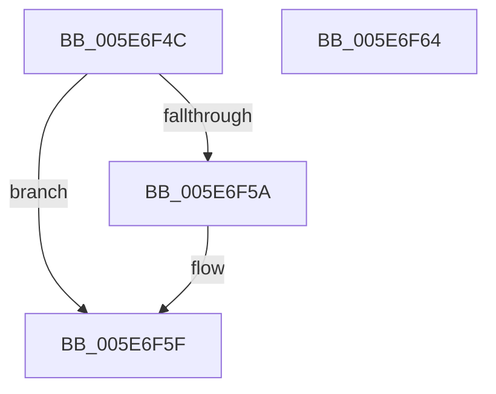

# RtlpHeapFatalExceptionFilter

- RVA: `0x005E6F4C`–`0x005E6F65` (길이 `25` bytes)
- VA: `0x00000001405E6F4C`
- 실행 섹션: `.text`
- PDB 이름 있음: `예`; PDB Function 태그: `아니요`
- unwind 정보 RVA: `0x0005C788`
- 디코드: `9`개 명령, `25/25` bytes 표시
- 미해석 바이트: `0` (있으면 어셈블리에 `.byte`로 보존)

> 이 문서는 커널 이미지의 기계어와 PDB 기호를 분석해 생성했습니다. 4번과 5번은 함수 원형과 자료형을 바이너리 사용 방식에서 추정한 C 해석이며 원본 소스 복구 결과는 아닙니다.

## 1. Dependencies

- 직접 호출 지점: **1**; 고유 호출 대상: **1**
- 직접 호출자로 확인된 함수: **2**
- RIP 상대 이미지 참조: **0**

### Outgoing calls
- `0x005E6F50` → [RtlpHeapExceptionFilter](../5F/RtlpHeapExceptionFilter_function_005F0C50.md) (function, `0x005F0C50`)

### Direct callers
- [RtlAllocateHeap$filt$0](../6D/RtlAllocateHeap_filt_0_function_006D1E87.md) at `0x006D1E98`
- [RtlFreeHeap$filt$0](../6D/RtlFreeHeap_filt_0_function_006D389C.md) at `0x006D38AD`

### Static image references
- 디코드된 RIP-relative 메모리 참조가 없습니다.

## 2. Other-region calls and transfers

- 다른 실행 섹션으로 향하는 call: **0**
- 별도 외부 분기/꼬리 이동을 확인하지 못했습니다.

## 3. Assembly (complete function range)

```asm
005E6F4C  48 83 EC 28                     sub rsp, 0x28
005E6F50  E8 FB 9C 00 00                  call 0x1405f0c50
005E6F55  83 F8 01                        cmp eax, 1
005E6F58  75 05                           jne 0x1405e6f5f
005E6F5A  8D 48 22                        lea ecx, [rax + 0x22]
005E6F5D  CD 29                           int 0x29
005E6F5F  48 83 C4 28                     add rsp, 0x28
005E6F63  C3                              ret
005E6F64  CC                              int3
```

## 4. C-style interpretation (structured pseudocode)

```c
__int64 __fastcall RtlpHeapFatalExceptionFilter(void)
{
    __int64 result;
    __int64 v_rsp;

    v_rsp = (v_rsp) - (40);
    result = RtlpHeapExceptionFilter(a1, a2, a3, a4);
    if (((unsigned int)(result)) == 1) {
        a1 = result + 34;
    }
    v_rsp = (v_rsp) + (40);
    return result;
}
```

## 5. (Beta) C Style

```c
void RtlpHeapFatalExceptionFilter(void)
{
    int64_t result;
    int64_t local_rsp;

    local_rsp = (local_rsp) - (40);
    result = RtlpHeapExceptionFilter(a1, a2, a3, a4);
    if (((uint32_t)(result)) == 1) {
        a1 = result + 34;
    }
    local_rsp = (local_rsp) + (40);
    return result;
}
```

## 6. Execution-region graph

[열기: 2D/3D 그래프와 함수 탐색 컨트롤 패널](../../../control-panel.html?section=text&rva=0x005E6F4C&view=graph)

- 2D 그래프는 위에서 아래로 흐르고, 3D 그래프는 빈 공간을 드래그해 회전합니다. Shift+드래그는 이동, 휠은 확대·축소, 함수 노드 선택은 대상 보고서 이동입니다.

### Static fallback


