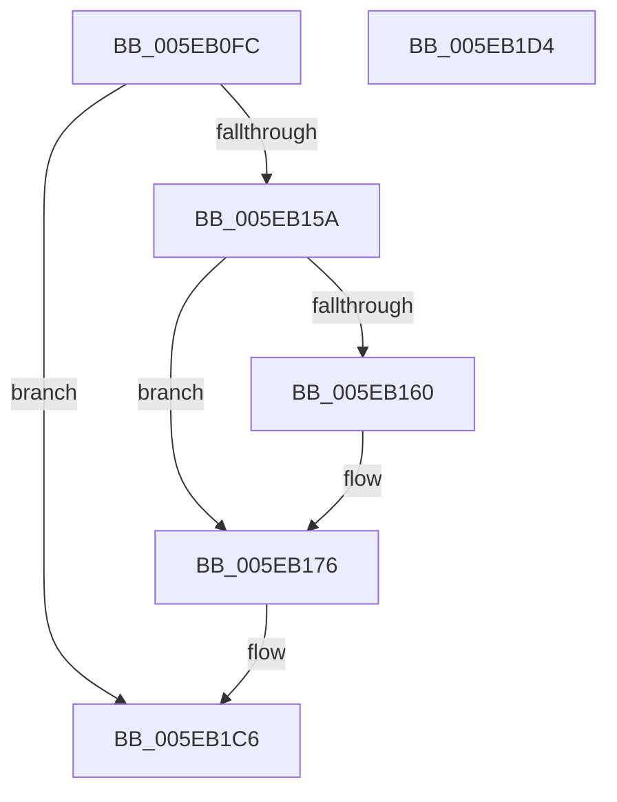

# RtlpHpAllocVirtBlockCommitFirst

- RVA: `0x005EB0FC`–`0x005EB1D5` (길이 `217` bytes)
- VA: `0x00000001405EB0FC`
- 실행 섹션: `.text`
- PDB 이름 있음: `예`; PDB Function 태그: `아니요`
- unwind 정보 RVA: `0x000CFBBC`
- 디코드: `63`개 명령, `217/217` bytes 표시
- 미해석 바이트: `0` (있으면 어셈블리에 `.byte`로 보존)

> 이 문서는 커널 이미지의 기계어와 PDB 기호를 분석해 생성했습니다. 4번과 5번은 함수 원형과 자료형을 바이너리 사용 방식에서 추정한 C 해석이며 원본 소스 복구 결과는 아닙니다.

## 1. Dependencies

- 직접 호출 지점: **3**; 고유 호출 대상: **2**
- 직접 호출자로 확인된 함수: **1**
- RIP 상대 이미지 참조: **0**

### Outgoing calls
- `0x005EB151` → [ZwAllocateVirtualMemory](../6A/ZwAllocateVirtualMemory_function_006AD3D0.md) (function, `0x006AD3D0`)
- `0x005EB171` → [ZwFreeVirtualMemory](../6A/ZwFreeVirtualMemory_function_006AD490.md) (function, `0x006AD490`)
- `0x005EB1A4` → [ZwFreeVirtualMemory](../6A/ZwFreeVirtualMemory_function_006AD490.md) (function, `0x006AD490`)

### Direct callers
- [RtlpAllocateHeap](RtlpAllocateHeap_function_005E8B1C.md) at `0x005E9384`

### Static image references
- 디코드된 RIP-relative 메모리 참조가 없습니다.

## 2. Other-region calls and transfers

- 다른 실행 섹션으로 향하는 call: **0**
- 별도 외부 분기/꼬리 이동을 확인하지 못했습니다.

## 3. Assembly (complete function range)

```asm
005EB0FC  48 8B C4                        mov rax, rsp
005EB0FF  4C 89 40 18                     mov qword ptr [rax + 0x18], r8
005EB103  48 89 48 08                     mov qword ptr [rax + 8], rcx
005EB107  55                              push rbp
005EB108  53                              push rbx
005EB109  56                              push rsi
005EB10A  57                              push rdi
005EB10B  41 57                           push r15
005EB10D  48 8B EC                        mov rbp, rsp
005EB110  48 83 EC 40                     sub rsp, 0x40
005EB114  48 8B 0A                        mov rcx, qword ptr [rdx]
005EB117  49 81 C0 00 10 00 00            add r8, 0x1000
005EB11E  49 03 C8                        add rcx, r8
005EB121  C7 40 C0 04 00 00 00            mov dword ptr [rax - 0x40], 4
005EB128  48 89 4D 38                     mov qword ptr [rbp + 0x38], rcx
005EB12C  49 8B F1                        mov rsi, r9
005EB12F  48 8B FA                        mov rdi, rdx
005EB132  C7 40 B8 00 10 00 00            mov dword ptr [rax - 0x48], 0x1000
005EB139  49 83 CF FF                     or r15, 0xffffffffffffffff
005EB13D  4C 8D 4D 38                     lea r9, [rbp + 0x38]
005EB141  33 DB                           xor ebx, ebx
005EB143  48 8D 55 30                     lea rdx, [rbp + 0x30]
005EB147  49 8B CF                        mov rcx, r15
005EB14A  48 89 5D 30                     mov qword ptr [rbp + 0x30], rbx
005EB14E  45 33 C0                        xor r8d, r8d
005EB151  E8 7A 22 0C 00                  call 0x1406ad3d0
005EB156  85 C0                           test eax, eax
005EB158  78 6C                           js 0x1405eb1c6
005EB15A  48 39 5D 40                     cmp qword ptr [rbp + 0x40], rbx
005EB15E  76 16                           jbe 0x1405eb176
005EB160  41 B9 00 40 00 00               mov r9d, 0x4000
005EB166  4C 8D 45 40                     lea r8, [rbp + 0x40]
005EB16A  48 8D 55 30                     lea rdx, [rbp + 0x30]
005EB16E  49 8B CF                        mov rcx, r15
005EB171  E8 1A 23 0C 00                  call 0x1406ad490
005EB176  48 8B 45 30                     mov rax, qword ptr [rbp + 0x30]
005EB17A  4C 8D 45 F0                     lea r8, [rbp - 0x10]
005EB17E  48 8B 55 38                     mov rdx, qword ptr [rbp + 0x38]
005EB182  48 05 00 F0 FF FF               add rax, -0x1000
005EB188  48 03 D0                        add rdx, rax
005EB18B  48 C7 45 F0 00 10 00 00         mov qword ptr [rbp - 0x10], 0x1000
005EB193  48 89 55 F8                     mov qword ptr [rbp - 8], rdx
005EB197  41 B9 00 40 00 00               mov r9d, 0x4000
005EB19D  48 8D 55 F8                     lea rdx, [rbp - 8]
005EB1A1  49 8B CF                        mov rcx, r15
005EB1A4  E8 E7 22 0C 00                  call 0x1406ad490
005EB1A9  48 8B 55 38                     mov rdx, qword ptr [rbp + 0x38]
005EB1AD  48 8B 5D 30                     mov rbx, qword ptr [rbp + 0x30]
005EB1B1  48 8B CA                        mov rcx, rdx
005EB1B4  48 2B 4D F0                     sub rcx, qword ptr [rbp - 0x10]
005EB1B8  48 03 5D 40                     add rbx, qword ptr [rbp + 0x40]
005EB1BC  48 2B 4D 40                     sub rcx, qword ptr [rbp + 0x40]
005EB1C0  48 89 0F                        mov qword ptr [rdi], rcx
005EB1C3  48 89 16                        mov qword ptr [rsi], rdx
005EB1C6  48 8B C3                        mov rax, rbx
005EB1C9  48 83 C4 40                     add rsp, 0x40
005EB1CD  41 5F                           pop r15
005EB1CF  5F                              pop rdi
005EB1D0  5E                              pop rsi
005EB1D1  5B                              pop rbx
005EB1D2  5D                              pop rbp
005EB1D3  C3                              ret
005EB1D4  CC                              int3
```

## 4. C-style interpretation (structured pseudocode)

```c
__int64 __fastcall RtlpHpAllocVirtBlockCommitFirst(__int64 a1, __int64 a2, __int64 a3, __int64 a4)
{
    __int64 result;
    __int64 v_r15;
    __int64 v_rbx;
    __int64 v_rsp;
    unsigned __int64 v_stack_m30;
    unsigned __int64 v_stack_m38;
    unsigned __int64 v_stack_p10;
    unsigned __int64 v_stack_p18;
    unsigned __int64 v_stack_p8;

    *(unsigned __int64 *)(v_rsp + 24) = a3;
    *(unsigned __int64 *)(v_rsp + 8) = a1;
    v_rsp = (v_rsp) - (64);
    a3 = (a3) + (0x1000ULL);
    a1 = (*(unsigned __int64 *)(a2)) + (a3);
    *(unsigned int *)(v_rsp - 64) = 4;
    v_stack_p10 = a1;
    *(unsigned int *)(v_rsp - 72) = 0x1000ULL;
    v_r15 = (v_r15) | (-1);
    v_rbx = 0;
    v_stack_p8 = 0;
    a3 = 0;
    result = ZwAllocateVirtualMemory(v_r15, v_stack_p8, a3, v_stack_p10);
    if (sign_flag) goto loc_005EB1C6;
    if (v_stack_p18 >= = 0) {
        a4 = 0x4000ULL;
        a3 = v_stack_p18;
        a2 = v_stack_p8;
        a1 = v_r15;
        result = ZwFreeVirtualMemory(a1, a2, a3, a4);
    }
    result = (v_stack_p8) + (0xFFFFFFFFFFFFF000ULL);
    a2 = (v_stack_p10) + (result);
    v_stack_m38 = 0x1000ULL;
    v_stack_m30 = a2;
    result = ZwFreeVirtualMemory(v_r15, v_stack_m30, v_stack_m38, (unsigned int)(0x4000ULL));
    a1 = (v_stack_p10) - (v_stack_m38);
    v_rbx = (v_stack_p8) + (v_stack_p18);
    a1 = (a1) - (v_stack_p18);
    *(unsigned __int64 *)(a2) = a1;
    *(unsigned __int64 *)(a4) = v_stack_p10;
loc_005EB1C6:
    v_rsp = (v_rsp) + (64);
    return v_rbx;
}
```

## 5. (Beta) C Style

```c
int64_t RtlpHpAllocVirtBlockCommitFirst(int64_t Arg1, void *Arg2, int64_t Arg3, void *Arg4)
{
    uint8_t *arg2 = (uint8_t *)Arg2;
    uint8_t *arg4 = (uint8_t *)Arg4;

    int64_t result;
    int64_t local_r15;
    int64_t local_rbx;
    int64_t local_rsp;
    uint64_t v_stack_m30;
    uint64_t v_stack_m38;
    uint64_t v_stack_p10;
    uint64_t v_stack_p18;
    uint64_t v_stack_p8;

    *(uint64_t *)(local_rsp + 0x18) = Arg3;
    *(uint64_t *)(local_rsp + 0x8) = Arg1;
    local_rsp = (local_rsp) - (64);
    Arg3 = (Arg3) + (0x1000ULL);
    Arg1 = (*(uint64_t *)(arg2)) + (Arg3);
    *(uint32_t *)(local_rsp - 0x40) = 4;
    v_stack_p10 = Arg1;
    *(uint32_t *)(local_rsp - 0x48) = 0x1000ULL;
    local_r15 = (local_r15) | (-1);
    local_rbx = 0;
    v_stack_p8 = 0;
    Arg3 = 0;
    result = ZwAllocateVirtualMemory(local_r15, v_stack_p8, Arg3, v_stack_p10);
    if (sign_flag) goto loc_005EB1C6;
    if (v_stack_p18 >= = 0) {
        Arg4 = 0x4000ULL;
        Arg3 = v_stack_p18;
        Arg2 = v_stack_p8;
        Arg1 = local_r15;
        result = ZwFreeVirtualMemory(Arg1, Arg2, Arg3, Arg4);
    }
    result = (v_stack_p8) + (0xFFFFFFFFFFFFF000ULL);
    Arg2 = (v_stack_p10) + (result);
    v_stack_m38 = 0x1000ULL;
    v_stack_m30 = Arg2;
    result = ZwFreeVirtualMemory(local_r15, v_stack_m30, v_stack_m38, (uint32_t)(0x4000ULL));
    Arg1 = (v_stack_p10) - (v_stack_m38);
    local_rbx = (v_stack_p8) + (v_stack_p18);
    Arg1 = (Arg1) - (v_stack_p18);
    *(uint64_t *)(arg2) = Arg1;
    *(uint64_t *)(arg4) = v_stack_p10;
loc_005EB1C6:
    local_rsp = (local_rsp) + (64);
    return local_rbx;
}
```

### 관측된 메모리 오프셋

구조체 형식이 확인되지 않은 접근은 인자 기준의 오프셋으로만 기록했습니다.

| 기준 인자 | 오프셋 표현 | 폭 (bit) | 접근 |
|---|---:|---:|---|
| `Arg2` | `+ 0x0` | `64` | `R` |
| `Arg2` | `+ 0x0` | `64` | `W` |
| `Arg4` | `+ 0x0` | `64` | `W` |

## 6. Execution-region graph

[열기: 2D/3D 그래프와 함수 탐색 컨트롤 패널](../../../control-panel.html?section=text&rva=0x005EB0FC&view=graph)

- 2D 그래프는 위에서 아래로 흐르고, 3D 그래프는 빈 공간을 드래그해 회전합니다. Shift+드래그는 이동, 휠은 확대·축소, 함수 노드 선택은 대상 보고서 이동입니다.

### Static fallback


