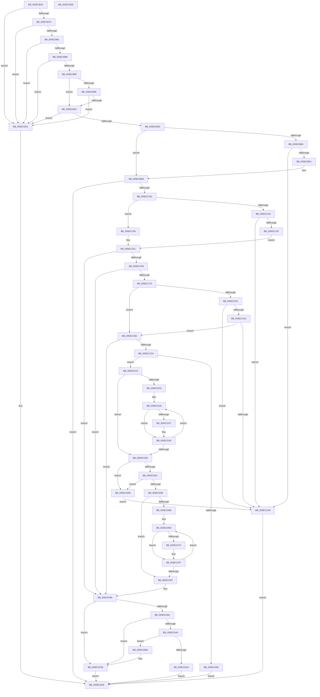

# RtlpIdnToUnicodeWorker

- RVA: `0x005ECB3C`–`0x005ECDEF` (길이 `691` bytes)
- VA: `0x00000001405ECB3C`
- 실행 섹션: `.text`
- PDB 이름 있음: `예`; PDB Function 태그: `아니요`
- unwind 정보 RVA: `0x000C5C40`
- 디코드: `205`개 명령, `691/691` bytes 표시
- 미해석 바이트: `0` (있으면 어셈블리에 `.byte`로 보존)

> 이 문서는 커널 이미지의 기계어와 PDB 기호를 분석해 생성했습니다. 4번과 5번은 함수 원형과 자료형을 바이너리 사용 방식에서 추정한 C 해석이며 원본 소스 복구 결과는 아닙니다.

## 1. Dependencies

- 직접 호출 지점: **8**; 고유 호출 대상: **6**
- 직접 호출자로 확인된 함수: **1**
- RIP 상대 이미지 참조: **0**

### Outgoing calls
- `0x005ECBC4` → [RtlStringCchLengthW](../43/RtlStringCchLengthW_function_00435A70.md) (function, `0x00435A70`)
- `0x005ECC30` → [punycode_decode](../../page/79/punycode_decode_function_007920EC.md) (function, `0x007920EC`)
- `0x005ECC96` → [RtlIsNormalizedString](../../page/79/RtlIsNormalizedString_function_007945B0.md) (function, `0x007945B0`)
- `0x005ECCF7` → [ExAllocatePool2](../../poolcode/B8/ExAllocatePool2_function_00B820F0.md) (function, `0x00B820F0`)
- `0x005ECD56` → [RtlIsNormalizedString](../../page/79/RtlIsNormalizedString_function_007945B0.md) (function, `0x007945B0`)
- `0x005ECD8C` → [ExFreePoolWithTag](../../poolcode/B8/ExFreePoolWithTag_function_00B82870.md) (function, `0x00B82870`)
- `0x005ECDB0` → [ExFreePoolWithTag](../../poolcode/B8/ExFreePoolWithTag_function_00B82870.md) (function, `0x00B82870`)
- `0x005ECDC6` → [memcpy](../6C/memcpy_function_006C6840.md) (function, `0x006C6840`)

### Direct callers
- [RtlIdnToUnicode](../../page/79/RtlIdnToUnicode_function_00791DF0.md) at `0x00791E54`

### Static image references
- 디코드된 RIP-relative 메모리 참조가 없습니다.

## 2. Other-region calls and transfers

- 다른 실행 섹션으로 향하는 call: **6**
  - `0x005ECC30` → [punycode_decode](../../page/79/punycode_decode_function_007920EC.md) (`.text` → `PAGE`)
  - `0x005ECC96` → [RtlIsNormalizedString](../../page/79/RtlIsNormalizedString_function_007945B0.md) (`.text` → `PAGE`)
  - `0x005ECCF7` → [ExAllocatePool2](../../poolcode/B8/ExAllocatePool2_function_00B820F0.md) (`.text` → `POOLCODE`)
  - `0x005ECD56` → [RtlIsNormalizedString](../../page/79/RtlIsNormalizedString_function_007945B0.md) (`.text` → `PAGE`)
  - `0x005ECD8C` → [ExFreePoolWithTag](../../poolcode/B8/ExFreePoolWithTag_function_00B82870.md) (`.text` → `POOLCODE`)
  - `0x005ECDB0` → [ExFreePoolWithTag](../../poolcode/B8/ExFreePoolWithTag_function_00B82870.md) (`.text` → `POOLCODE`)
- 별도 외부 분기/꼬리 이동을 확인하지 못했습니다.

## 3. Assembly (complete function range)

```asm
005ECB3C  48 89 5C 24 08                  mov qword ptr [rsp + 8], rbx
005ECB41  4C 89 4C 24 20                  mov qword ptr [rsp + 0x20], r9
005ECB46  55                              push rbp
005ECB47  56                              push rsi
005ECB48  57                              push rdi
005ECB49  41 54                           push r12
005ECB4B  41 55                           push r13
005ECB4D  41 56                           push r14
005ECB4F  41 57                           push r15
005ECB51  48 8B EC                        mov rbp, rsp
005ECB54  48 83 EC 50                     sub rsp, 0x50
005ECB58  45 33 E4                        xor r12d, r12d
005ECB5B  4D 8B F9                        mov r15, r9
005ECB5E  4C 89 65 F8                     mov qword ptr [rbp - 8], r12
005ECB62  4C 8B D2                        mov r10, rdx
005ECB65  44 88 65 70                     mov byte ptr [rbp + 0x70], r12b
005ECB69  8B F9                           mov edi, ecx
005ECB6B  48 85 D2                        test rdx, rdx
005ECB6E  0F 84 5D 02 00 00               je 0x1405ecdd1
005ECB74  48 8B 75 60                     mov rsi, qword ptr [rbp + 0x60]
005ECB78  48 85 F6                        test rsi, rsi
005ECB7B  0F 84 50 02 00 00               je 0x1405ecdd1
005ECB81  8B 06                           mov eax, dword ptr [rsi]
005ECB83  85 C0                           test eax, eax
005ECB85  0F 88 46 02 00 00               js 0x1405ecdd1
005ECB8B  41 83 F8 FF                     cmp r8d, -1
005ECB8F  0F 8C 3C 02 00 00               jl 0x1405ecdd1
005ECB95  85 C0                           test eax, eax
005ECB97  7E 09                           jle 0x1405ecba2
005ECB99  4D 85 C9                        test r9, r9
005ECB9C  0F 84 2F 02 00 00               je 0x1405ecdd1
005ECBA2  F7 C7 F0 FF FF FF               test edi, 0xfffffff0
005ECBA8  0F 85 23 02 00 00               jne 0x1405ecdd1
005ECBAE  41 83 F8 FF                     cmp r8d, -1
005ECBB2  75 24                           jne 0x1405ecbd8
005ECBB4  4C 8D 45 48                     lea r8, [rbp + 0x48]
005ECBB8  4C 89 65 48                     mov qword ptr [rbp + 0x48], r12
005ECBBC  BA 03 02 00 00                  mov edx, 0x203
005ECBC1  49 8B CA                        mov rcx, r10
005ECBC4  E8 A7 8E E4 FF                  call 0x140435a70
005ECBC9  85 C0                           test eax, eax
005ECBCB  0F 88 D7 00 00 00               js 0x1405ecca8
005ECBD1  44 8B 45 48                     mov r8d, dword ptr [rbp + 0x48]
005ECBD5  41 FF C0                        inc r8d
005ECBD8  4C 8B 6D 68                     mov r13, qword ptr [rbp + 0x68]
005ECBDC  41 8D 50 FF                     lea edx, [r8 - 1]
005ECBE0  49 63 C0                        movsxd rax, r8d
005ECBE3  4C 8D 4D 48                     lea r9, [rbp + 0x48]
005ECBE7  8B CF                           mov ecx, edi
005ECBE9  C7 45 48 FF 01 00 00            mov dword ptr [rbp + 0x48], 0x1ff
005ECBF0  D1 E9                           shr ecx, 1
005ECBF2  80 E1 01                        and cl, 1
005ECBF5  45 0F B7 74 42 FE               movzx r14d, word ptr [r10 + rax*2 - 2]
005ECBFB  8B C7                           mov eax, edi
005ECBFD  83 E0 04                        and eax, 4
005ECC00  85 C0                           test eax, eax
005ECC02  89 45 F0                        mov dword ptr [rbp - 0x10], eax
005ECC05  0F 95 C0                        setne al
005ECC08  66 45 85 F6                     test r14w, r14w
005ECC0C  41 0F 45 D0                     cmovne edx, r8d
005ECC10  4C 8D 45 F8                     lea r8, [rbp - 8]
005ECC14  4C 89 44 24 38                  mov qword ptr [rsp + 0x38], r8
005ECC19  4C 8D 45 70                     lea r8, [rbp + 0x70]
005ECC1D  4C 89 44 24 30                  mov qword ptr [rsp + 0x30], r8
005ECC22  4D 8B C5                        mov r8, r13
005ECC25  88 4C 24 28                     mov byte ptr [rsp + 0x28], cl
005ECC29  49 8B CA                        mov rcx, r10
005ECC2C  88 44 24 20                     mov byte ptr [rsp + 0x20], al
005ECC30  E8 B7 54 1A 00                  call 0x1407920ec
005ECC35  85 C0                           test eax, eax
005ECC37  0F 88 99 01 00 00               js 0x1405ecdd6
005ECC3D  66 45 85 F6                     test r14w, r14w
005ECC41  75 16                           jne 0x1405ecc59
005ECC43  48 63 5D 48                     movsxd rbx, dword ptr [rbp + 0x48]
005ECC47  81 FB FF 01 00 00               cmp ebx, 0x1ff
005ECC4D  7D 59                           jge 0x1405ecca8
005ECC4F  66 45 89 64 5D 00               mov word ptr [r13 + rbx*2], r12w
005ECC55  FF C3                           inc ebx
005ECC57  EB 03                           jmp 0x1405ecc5c
005ECC59  8B 5D 48                        mov ebx, dword ptr [rbp + 0x48]
005ECC5C  40 F6 C7 08                     test dil, 8
005ECC60  0F 85 2F 01 00 00               jne 0x1405ecd95
005ECC66  44 38 65 70                     cmp byte ptr [rbp + 0x70], r12b
005ECC6A  0F 85 25 01 00 00               jne 0x1405ecd95
005ECC70  45 33 C0                        xor r8d, r8d
005ECC73  44 88 65 70                     mov byte ptr [rbp + 0x70], r12b
005ECC77  4C 8B 65 F8                     mov r12, qword ptr [rbp - 8]
005ECC7B  44 39 45 F0                     cmp dword ptr [rbp - 0x10], r8d
005ECC7F  74 31                           je 0x1405eccb2
005ECC81  4D 8B C4                        mov r8, r12
005ECC84  4C 8D 4D 70                     lea r9, [rbp + 0x70]
005ECC88  4D 2B C5                        sub r8, r13
005ECC8B  49 8B D5                        mov rdx, r13
005ECC8E  49 D1 F8                        sar r8, 1
005ECC91  B9 01 00 00 00                  mov ecx, 1
005ECC96  E8 15 79 1A 00                  call 0x1407945b0
005ECC9B  45 33 C0                        xor r8d, r8d
005ECC9E  85 C0                           test eax, eax
005ECCA0  78 06                           js 0x1405ecca8
005ECCA2  44 38 45 70                     cmp byte ptr [rbp + 0x70], r8b
005ECCA6  75 0A                           jne 0x1405eccb2
005ECCA8  B8 16 07 00 C0                  mov eax, 0xc0000716
005ECCAD  E9 24 01 00 00                  jmp 0x1405ecdd6
005ECCB2  41 8B C8                        mov ecx, r8d
005ECCB5  8B C3                           mov eax, ebx
005ECCB7  49 8B D4                        mov rdx, r12
005ECCBA  49 2B D5                        sub rdx, r13
005ECCBD  48 D1 FA                        sar rdx, 1
005ECCC0  66 45 85 F6                     test r14w, r14w
005ECCC4  0F 94 C1                        sete cl
005ECCC7  2B C1                           sub eax, ecx
005ECCC9  48 98                           cdqe
005ECCCB  48 3B D0                        cmp rdx, rax
005ECCCE  0F 8D C1 00 00 00               jge 0x1405ecd95
005ECCD4  8B CB                           mov ecx, ebx
005ECCD6  66 41 F7 DE                     neg r14w
005ECCDA  41 B8 49 64 6E 45               mov r8d, 0x456e6449
005ECCE0  1B C0                           sbb eax, eax
005ECCE2  83 C0 02                        add eax, 2
005ECCE5  2B C8                           sub ecx, eax
005ECCE7  2B CA                           sub ecx, edx
005ECCE9  4C 63 F9                        movsxd r15, ecx
005ECCEC  89 4D 48                        mov dword ptr [rbp + 0x48], ecx
005ECCEF  49 8B D7                        mov rdx, r15
005ECCF2  B9 00 01 00 00                  mov ecx, 0x100
005ECCF7  E8 F4 53 59 00                  call 0x140b820f0
005ECCFC  4C 8B F0                        mov r14, rax
005ECCFF  33 C0                           xor eax, eax
005ECD01  4D 85 F6                        test r14, r14
005ECD04  75 0A                           jne 0x1405ecd10
005ECD06  B8 17 00 00 C0                  mov eax, 0xc0000017
005ECD0B  E9 C6 00 00 00                  jmp 0x1405ecdd6
005ECD10  4D 85 FF                        test r15, r15
005ECD13  7E 29                           jle 0x1405ecd3e
005ECD15  48 8B C8                        mov rcx, rax
005ECD18  41 0F B7 54 4C 02               movzx edx, word ptr [r12 + rcx*2 + 2]
005ECD1E  8D 42 BF                        lea eax, [rdx - 0x41]
005ECD21  66 83 F8 19                     cmp ax, 0x19
005ECD25  77 0F                           ja 0x1405ecd36
005ECD27  66 83 C2 20                     add dx, 0x20
005ECD2B  66 41 89 54 4C 02               mov word ptr [r12 + rcx*2 + 2], dx
005ECD31  42 C6 04 31 01                  mov byte ptr [rcx + r14], 1
005ECD36  48 FF C1                        inc rcx
005ECD39  49 3B CF                        cmp rcx, r15
005ECD3C  7C DA                           jl 0x1405ecd18
005ECD3E  44 8B 45 48                     mov r8d, dword ptr [rbp + 0x48]
005ECD42  4C 8D 4D 70                     lea r9, [rbp + 0x70]
005ECD46  F7 D7                           not edi
005ECD48  49 8D 54 24 02                  lea rdx, [r12 + 2]
005ECD4D  83 E7 01                        and edi, 1
005ECD50  C1 E7 08                        shl edi, 8
005ECD53  8D 4F 0D                        lea ecx, [rdi + 0xd]
005ECD56  E8 55 78 1A 00                  call 0x1407945b0
005ECD5B  33 C9                           xor ecx, ecx
005ECD5D  85 C0                           test eax, eax
005ECD5F  78 4A                           js 0x1405ecdab
005ECD61  38 4D 70                        cmp byte ptr [rbp + 0x70], cl
005ECD64  74 45                           je 0x1405ecdab
005ECD66  4D 85 FF                        test r15, r15
005ECD69  7E 1C                           jle 0x1405ecd87
005ECD6B  8B C1                           mov eax, ecx
005ECD6D  42 80 3C 30 01                  cmp byte ptr [rax + r14], 1
005ECD72  75 0B                           jne 0x1405ecd7f
005ECD74  B9 E0 FF 00 00                  mov ecx, 0xffe0
005ECD79  66 41 01 4C 44 02               add word ptr [r12 + rax*2 + 2], cx
005ECD7F  48 FF C0                        inc rax
005ECD82  49 3B C7                        cmp rax, r15
005ECD85  7C E6                           jl 0x1405ecd6d
005ECD87  33 D2                           xor edx, edx
005ECD89  49 8B CE                        mov rcx, r14
005ECD8C  E8 DF 5A 59 00                  call 0x140b82870
005ECD91  4C 8B 7D 58                     mov r15, qword ptr [rbp + 0x58]
005ECD95  4D 85 FF                        test r15, r15
005ECD98  74 31                           je 0x1405ecdcb
005ECD9A  8B 06                           mov eax, dword ptr [rsi]
005ECD9C  85 C0                           test eax, eax
005ECD9E  74 2B                           je 0x1405ecdcb
005ECDA0  3B D8                           cmp ebx, eax
005ECDA2  7E 16                           jle 0x1405ecdba
005ECDA4  B8 23 00 00 C0                  mov eax, 0xc0000023
005ECDA9  EB 2B                           jmp 0x1405ecdd6
005ECDAB  33 D2                           xor edx, edx
005ECDAD  49 8B CE                        mov rcx, r14
005ECDB0  E8 BB 5A 59 00                  call 0x140b82870
005ECDB5  E9 EE FE FF FF                  jmp 0x1405ecca8
005ECDBA  4C 63 C3                        movsxd r8, ebx
005ECDBD  49 8B D5                        mov rdx, r13
005ECDC0  4D 03 C0                        add r8, r8
005ECDC3  49 8B CF                        mov rcx, r15
005ECDC6  E8 75 9A 0D 00                  call 0x1406c6840
005ECDCB  89 1E                           mov dword ptr [rsi], ebx
005ECDCD  33 C0                           xor eax, eax
005ECDCF  EB 05                           jmp 0x1405ecdd6
005ECDD1  B8 0D 00 00 C0                  mov eax, 0xc000000d
005ECDD6  48 8B 9C 24 90 00 00 00         mov rbx, qword ptr [rsp + 0x90]
005ECDDE  48 83 C4 50                     add rsp, 0x50
005ECDE2  41 5F                           pop r15
005ECDE4  41 5E                           pop r14
005ECDE6  41 5D                           pop r13
005ECDE8  41 5C                           pop r12
005ECDEA  5F                              pop rdi
005ECDEB  5E                              pop rsi
005ECDEC  5D                              pop rbp
005ECDED  C3                              ret
005ECDEE  CC                              int3
```

## 4. C-style interpretation (structured pseudocode)

```c
__int64 __fastcall RtlpIdnToUnicodeWorker(int a1, __int64 a2, int a3, __int64 a4, __int64 a5, __int64 a6, unsigned __int8 a7)
{
    __int64 result;
    __int64 v_r12;
    __int64 v_r14;
    __int64 v_rbx;
    __int64 v_rdi;
    __int64 v_rsp;
    unsigned __int64 v_stack_m40;
    unsigned int v_stack_m48;
    unsigned __int64 v_stack_m50;
    unsigned __int64 v_stack_m58;
    unsigned __int8 v_stack_m60;
    unsigned __int8 v_stack_m68;
    unsigned __int64 v_stack_p10;
    unsigned __int64 v_stack_p20;
    unsigned __int8 v_stack_p38;
    unsigned __int64 v_stack_p8;

    v_stack_p8 = v_rbx;
    v_stack_p20 = a4;
    v_rsp = (v_rsp) - (80);
    v_r12 = 0;
    v_stack_m40 = 0;
    v_stack_p38 = 0;
    if (a2 == 0) goto loc_005ECDD1;
    if (a5 == 0) goto loc_005ECDD1;
    if (sign_flag) goto loc_005ECDD1;
    if (a3 < -1) goto loc_005ECDD1;
    if (condition_is_less_or_equal) goto loc_005ECBA2;
    if (a4 == 0) goto loc_005ECDD1;
loc_005ECBA2:
    if ((((unsigned int)((unsigned int)(a1))) & (0xFFFFFFF0ULL)) != 0) goto loc_005ECDD1;
    if (a3 != -1) goto loc_005ECBD8;
    v_stack_p10 = 0;
    result = RtlStringCchLengthW(a2, 515, v_stack_p10, a4);
    if (sign_flag) goto loc_005ECCA8;
    a3 = (unsigned int)(((unsigned int)(v_stack_p10)) + 1);
loc_005ECBD8:
    v_stack_p10 = 511;
    a1 = (unsigned int)(((unsigned int)((unsigned int)((unsigned int)(a1)))) >> (1));
    a1 = (unsigned __int8)((a1) & (1));
    result = (unsigned int)(((unsigned int)((unsigned int)((unsigned int)(a1)))) & (4));
    v_stack_m48 = (unsigned int)(result);
    result = ((unsigned int)(result) != 0) ? 1 : 0;
    a2 = a3 - 1;
    if ((unsigned __int16)(*(unsigned __int16 *)(a2 + (int)(a3) * 2 - 2)) != 0) { a2 = a3; }
    v_stack_m50 = v_stack_m40;
    v_stack_m58 = a7;
    v_stack_m60 = (unsigned __int8)(a1);
    v_stack_m68 = (unsigned __int8)(result);
    result = punycode_decode(a2, a2, a6, v_stack_p10);
    if (sign_flag) goto loc_005ECDD6;
    if ((unsigned __int16)(*(unsigned __int16 *)(a2 + (int)(a3) * 2 - 2)) != 0) goto loc_005ECC59;
    if (((unsigned int)((int)(v_stack_p10))) >= 511) goto loc_005ECCA8;
    *(unsigned __int16 *)(a6 + (int)(v_stack_p10) * 2) = 0;
    v_rbx = (unsigned int)(((int)(v_stack_p10)) + 1);
    goto loc_005ECC5C;
loc_005ECC59:
loc_005ECC5C:
    if ((((unsigned __int8)((unsigned int)(a1))) & (8)) != 0) goto loc_005ECD95;
    if (a7 != 0) goto loc_005ECD95;
    a3 = 0;
    v_stack_p38 = 0;
    if (v_stack_m48 == 0) goto loc_005ECCB2;
    a3 = (v_stack_m40) - (a6);
    a3 = (a3) >> (1);
    result = RtlIsNormalizedString(1, a6, a3, a7);
    a3 = 0;
    if (sign_flag) goto loc_005ECCA8;
    if (a7 != 0) goto loc_005ECCB2;
loc_005ECCA8:
    goto loc_005ECDD6;
loc_005ECCB2:
    a2 = (v_stack_m40) - (a6);
    a2 = (a2) >> (1);
    a1 = ((unsigned __int16)(*(unsigned __int16 *)(a2 + (int)(a3) * 2 - 2)) == 0) ? 1 : 0;
    result = (unsigned int)(((unsigned int)((unsigned int)((unsigned int)(v_stack_p10)))) - (a1));
    if (a2 >= result) goto loc_005ECD95;
    v_r14 = (unsigned __int16)(-(*(unsigned __int16 *)(a2 + (int)(a3) * 2 - 2)));
    result = (unsigned int)((result) + (2));
    a1 = (unsigned int)(((unsigned int)((unsigned int)((unsigned int)(v_stack_p10)))) - ((unsigned int)(result)));
    a1 = (unsigned int)((a1) - ((unsigned int)(a2)));
    v_stack_p10 = a1;
    result = ExAllocatePool2(256, (int)(a1), (unsigned int)(0x456E6449ULL), a7);
    result = 0;
    if (0 != 0) goto loc_005ECD10;
    goto loc_005ECDD6;
loc_005ECD10:
    if (condition_is_less_or_equal) goto loc_005ECD3E;
loc_005ECD18:
    if (((unsigned __int16)(*(unsigned __int16 *)(v_stack_m40 + (unsigned int)(0xC0000017ULL) * 2 + 2) - 65)) <= 25) {
        a2 = (unsigned __int16)((*(unsigned __int16 *)(v_stack_m40 + (unsigned int)(0xC0000017ULL) * 2 + 2)) + (32));
        *(unsigned __int16 *)(v_stack_m40 + (unsigned int)(0xC0000017ULL) * 2 + 2) = (unsigned __int16)(a2);
        *(unsigned __int8 *)((unsigned int)(0xC0000017ULL) + result * 1) = 1;
    }
    a1 = ((unsigned int)(0xC0000017ULL)) + 1;
    if (a1 < ((int)(a1))) goto loc_005ECD18;
loc_005ECD3E:
    v_rdi = (unsigned int)(~((unsigned int)(a1)));
    v_rdi = (unsigned int)((v_rdi) & (1));
    v_rdi = (unsigned int)((v_rdi) << (8));
    result = RtlIsNormalizedString(v_rdi + 13, v_stack_m40 + 2, (unsigned int)(v_stack_p10), a7);
    a1 = 0;
    if (sign_flag) goto loc_005ECDAB;
    if (a7 == 0) goto loc_005ECDAB;
    if (condition_is_less_or_equal) goto loc_005ECD87;
loc_005ECD6D:
    if ((*(unsigned __int8 *)(0 + result * 1)) == 1) {
        a1 = 0xFFE0ULL;
    }
    result = (0) + 1;
    if (result < ((int)(a1))) goto loc_005ECD6D;
loc_005ECD87:
    a2 = 0;
    result = ExFreePoolWithTag(result, a2, (unsigned int)(v_stack_p10), a7);
loc_005ECD95:
    if (v_stack_p20 == 0) goto loc_005ECDCB;
    if ((unsigned int)((unsigned int)(*(unsigned int *)(a5))) == 0) goto loc_005ECDCB;
    if (((unsigned int)((unsigned int)(v_stack_p10))) <= ((unsigned int)((unsigned int)(*(unsigned int *)(a5))))) goto loc_005ECDBA;
    goto loc_005ECDD6;
loc_005ECDAB:
    a2 = 0;
    result = ExFreePoolWithTag(result, a2, (unsigned int)(v_stack_p10), a7);
    goto loc_005ECCA8;
loc_005ECDBA:
    a3 = ((int)((unsigned int)((unsigned int)(v_stack_p10)))) + ((int)((unsigned int)((unsigned int)(v_stack_p10))));
    result = memcpy(v_stack_p20, a6, a3, a7);
loc_005ECDCB:
    *(unsigned int *)(a5) = (unsigned int)((unsigned int)(v_stack_p10));
    result = 0;
    goto loc_005ECDD6;
loc_005ECDD1:
loc_005ECDD6:
    v_rsp = (v_rsp) + (80);
    return (unsigned int)(0xC000000DULL);
}
```

## 5. (Beta) C Style

```c
int64_t RtlpIdnToUnicodeWorker(int32_t Arg1, int64_t Arg2, int32_t Arg3, int64_t Arg4, int64_t Arg5, void *Arg6, uint8_t Arg7)
{
    uint8_t *arg6 = (uint8_t *)Arg6;

    int64_t result;
    int64_t local_r12;
    int64_t local_r14;
    int64_t local_rbx;
    int64_t local_rdi;
    int64_t local_rsp;
    uint64_t v_stack_m40;
    uint32_t v_stack_m48;
    uint64_t v_stack_m50;
    uint64_t v_stack_m58;
    uint8_t v_stack_m60;
    uint8_t v_stack_m68;
    uint64_t v_stack_p10;
    uint64_t v_stack_p20;
    uint8_t v_stack_p38;
    uint64_t v_stack_p8;

    v_stack_p8 = local_rbx;
    v_stack_p20 = Arg4;
    local_rsp = (local_rsp) - (80);
    local_r12 = 0;
    v_stack_m40 = 0;
    v_stack_p38 = 0;
    if (Arg2 == 0) goto loc_005ECDD1;
    if (Arg5 == 0) goto loc_005ECDD1;
    if (sign_flag) goto loc_005ECDD1;
    if (Arg3 < -1) goto loc_005ECDD1;
    if (condition_is_less_or_equal) goto loc_005ECBA2;
    if (Arg4 == 0) goto loc_005ECDD1;
loc_005ECBA2:
    if ((((uint32_t)((uint32_t)(Arg1))) & (0xFFFFFFF0ULL)) != 0) goto loc_005ECDD1;
    if (Arg3 != -1) goto loc_005ECBD8;
    v_stack_p10 = 0;
    result = RtlStringCchLengthW(Arg2, 515, v_stack_p10, Arg4);
    if (sign_flag) goto loc_005ECCA8;
    Arg3 = (uint32_t)(((uint32_t)(v_stack_p10)) + 1);
loc_005ECBD8:
    v_stack_p10 = 511;
    Arg1 = (uint32_t)(((uint32_t)((uint32_t)((uint32_t)(Arg1)))) >> (1));
    Arg1 = (uint8_t)((Arg1) & (1));
    result = (uint32_t)(((uint32_t)((uint32_t)((uint32_t)(Arg1)))) & (4));
    v_stack_m48 = (uint32_t)(result);
    result = ((uint32_t)(result) != 0) ? 1 : 0;
    Arg2 = Arg3 - 1;
    if ((uint16_t)(*(uint16_t *)(Arg2 + (int32_t)(Arg3) * 2 - 0x2)) != 0) { Arg2 = Arg3; }
    v_stack_m50 = v_stack_m40;
    v_stack_m58 = Arg7;
    v_stack_m60 = (uint8_t)(Arg1);
    v_stack_m68 = (uint8_t)(result);
    result = punycode_decode(Arg2, Arg2, Arg6, v_stack_p10);
    if (sign_flag) goto loc_005ECDD6;
    if ((uint16_t)(*(uint16_t *)(Arg2 + (int32_t)(Arg3) * 2 - 0x2)) != 0) goto loc_005ECC59;
    if (((uint32_t)((int32_t)(v_stack_p10))) >= 511) goto loc_005ECCA8;
    *(uint16_t *)(arg6 + (int32_t)(v_stack_p10) * 2) = 0;
    local_rbx = (uint32_t)(((int32_t)(v_stack_p10)) + 1);
    goto loc_005ECC5C;
loc_005ECC59:
loc_005ECC5C:
    if ((((uint8_t)((uint32_t)(Arg1))) & (8)) != 0) goto loc_005ECD95;
    if (Arg7 != 0) goto loc_005ECD95;
    Arg3 = 0;
    v_stack_p38 = 0;
    if (v_stack_m48 == 0) goto loc_005ECCB2;
    Arg3 = (v_stack_m40) - (Arg6);
    Arg3 = (Arg3) >> (1);
    result = RtlIsNormalizedString(1, Arg6, Arg3, Arg7);
    Arg3 = 0;
    if (sign_flag) goto loc_005ECCA8;
    if (Arg7 != 0) goto loc_005ECCB2;
loc_005ECCA8:
    goto loc_005ECDD6;
loc_005ECCB2:
    Arg2 = (v_stack_m40) - (Arg6);
    Arg2 = (Arg2) >> (1);
    Arg1 = ((uint16_t)(*(uint16_t *)(Arg2 + (int32_t)(Arg3) * 2 - 0x2)) == 0) ? 1 : 0;
    result = (uint32_t)(((uint32_t)((uint32_t)((uint32_t)(v_stack_p10)))) - (Arg1));
    if (Arg2 >= result) goto loc_005ECD95;
    local_r14 = (uint16_t)(-(*(uint16_t *)(Arg2 + (int32_t)(Arg3) * 2 - 0x2)));
    result = (uint32_t)((result) + (2));
    Arg1 = (uint32_t)(((uint32_t)((uint32_t)((uint32_t)(v_stack_p10)))) - ((uint32_t)(result)));
    Arg1 = (uint32_t)((Arg1) - ((uint32_t)(Arg2)));
    v_stack_p10 = Arg1;
    result = ExAllocatePool2(256, (int32_t)(Arg1), (uint32_t)(0x456E6449ULL), Arg7);
    result = 0;
    if (0 != 0) goto loc_005ECD10;
    goto loc_005ECDD6;
loc_005ECD10:
    if (condition_is_less_or_equal) goto loc_005ECD3E;
loc_005ECD18:
    if (((uint16_t)(*(uint16_t *)(v_stack_m40 + (uint32_t)(0xC0000017ULL) * 2 + 0x2) - 65)) <= 25) {
        Arg2 = (uint16_t)((*(uint16_t *)(v_stack_m40 + (uint32_t)(0xC0000017ULL) * 2 + 0x2)) + (32));
        *(uint16_t *)(v_stack_m40 + (uint32_t)(0xC0000017ULL) * 2 + 0x2) = (uint16_t)(Arg2);
        *(uint8_t *)((uint32_t)(0xC0000017ULL) + result * 1) = 1;
    }
    Arg1 = ((uint32_t)(0xC0000017ULL)) + 1;
    if (Arg1 < ((int32_t)(Arg1))) goto loc_005ECD18;
loc_005ECD3E:
    local_rdi = (uint32_t)(~((uint32_t)(Arg1)));
    local_rdi = (uint32_t)((local_rdi) & (1));
    local_rdi = (uint32_t)((local_rdi) << (8));
    result = RtlIsNormalizedString(local_rdi + 13, v_stack_m40 + 2, (uint32_t)(v_stack_p10), Arg7);
    Arg1 = 0;
    if (sign_flag) goto loc_005ECDAB;
    if (Arg7 == 0) goto loc_005ECDAB;
    if (condition_is_less_or_equal) goto loc_005ECD87;
loc_005ECD6D:
    if ((*(uint8_t *)(0 + result * 1)) == 1) {
        Arg1 = 0xFFE0ULL;
    }
    result = (0) + 1;
    if (result < ((int32_t)(Arg1))) goto loc_005ECD6D;
loc_005ECD87:
    Arg2 = 0;
    result = ExFreePoolWithTag(result, Arg2, (uint32_t)(v_stack_p10), Arg7);
loc_005ECD95:
    if (v_stack_p20 == 0) goto loc_005ECDCB;
    if ((uint32_t)((uint32_t)(*(uint32_t *)(Arg5))) == 0) goto loc_005ECDCB;
    if (((uint32_t)((uint32_t)(v_stack_p10))) <= ((uint32_t)((uint32_t)(*(uint32_t *)(Arg5))))) goto loc_005ECDBA;
    goto loc_005ECDD6;
loc_005ECDAB:
    Arg2 = 0;
    result = ExFreePoolWithTag(result, Arg2, (uint32_t)(v_stack_p10), Arg7);
    goto loc_005ECCA8;
loc_005ECDBA:
    Arg3 = ((int32_t)((uint32_t)((uint32_t)(v_stack_p10)))) + ((int32_t)((uint32_t)((uint32_t)(v_stack_p10))));
    result = memcpy(v_stack_p20, Arg6, Arg3, Arg7);
loc_005ECDCB:
    *(uint32_t *)(Arg5) = (uint32_t)((uint32_t)(v_stack_p10));
    result = 0;
    goto loc_005ECDD6;
loc_005ECDD1:
loc_005ECDD6:
    local_rsp = (local_rsp) + (80);
    return (uint32_t)(0xC000000DULL);
}
```

### 관측된 메모리 오프셋

구조체 형식이 확인되지 않은 접근은 인자 기준의 오프셋으로만 기록했습니다.

| 기준 인자 | 오프셋 표현 | 폭 (bit) | 접근 |
|---|---:|---:|---|
| `Arg6` | `+ 0x0 + rbx*2` | `16` | `W` |

## 6. Execution-region graph

[열기: 2D/3D 그래프와 함수 탐색 컨트롤 패널](../../../control-panel.html?section=text&rva=0x005ECB3C&view=graph)

- 2D 그래프는 위에서 아래로 흐르고, 3D 그래프는 빈 공간을 드래그해 회전합니다. Shift+드래그는 이동, 휠은 확대·축소, 함수 노드 선택은 대상 보고서 이동입니다.

### Static fallback


