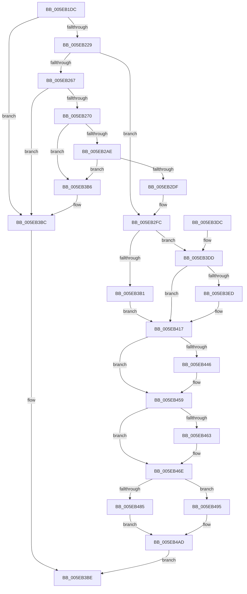

# RtlpInitializeHeapSegment

- RVA: `0x005EB1DC`–`0x005EB4BA` (길이 `734` bytes)
- VA: `0x00000001405EB1DC`
- 실행 섹션: `.text`
- PDB 이름 있음: `예`; PDB Function 태그: `아니요`
- unwind 정보 RVA: `0x000CFC04`
- 디코드: `181`개 명령, `734/734` bytes 표시
- 미해석 바이트: `0` (있으면 어셈블리에 `.byte`로 보존)

> 이 문서는 커널 이미지의 기계어와 PDB 기호를 분석해 생성했습니다. 4번과 5번은 함수 원형과 자료형을 바이너리 사용 방식에서 추정한 C 해석이며 원본 소스 복구 결과는 아닙니다.

## 1. Dependencies

- 직접 호출 지점: **6**; 고유 호출 대상: **5**
- 직접 호출자로 확인된 함수: **2**
- RIP 상대 이미지 참조: **0**

### Outgoing calls
- `0x005EB2A1` → [RtlpHpHeapCheckCommitLimit](../45/RtlpHpHeapCheckCommitLimit_function_0045820C.md) (function, `0x0045820C`)
- `0x005EB2CF` → [ZwAllocateVirtualMemory](../6A/ZwAllocateVirtualMemory_function_006AD3D0.md) (function, `0x006AD3D0`)
- `0x005EB402` → [RtlpLogHeapFailure](../35/RtlpLogHeapFailure_function_0035B7BC.md) (function, `0x0035B7BC`)
- `0x005EB43B` → [RtlpCreateUCREntry](RtlpCreateUCREntry_function_005EA010.md) (function, `0x005EA010`)
- `0x005EB469` → [RtlpInsertFreeBlock](RtlpInsertFreeBlock_function_005EB4C0.md) (function, `0x005EB4C0`)
- `0x005EB4A8` → [RtlpLogHeapFailure](../35/RtlpLogHeapFailure_function_0035B7BC.md) (function, `0x0035B7BC`)

### Direct callers
- [RtlpCreateHeap](../4E/RtlpCreateHeap_function_004E1904.md) at `0x004E22F5`
- [RtlpExtendHeap](RtlpExtendHeap_function_005EA708.md) at `0x005EA8E7`

### Static image references
- 디코드된 RIP-relative 메모리 참조가 없습니다.

## 2. Other-region calls and transfers

- 다른 실행 섹션으로 향하는 call: **0**
- 별도 외부 분기/꼬리 이동을 확인하지 못했습니다.

## 3. Assembly (complete function range)

```asm
005EB1DC  48 8B C4                        mov rax, rsp
005EB1DF  48 89 58 08                     mov qword ptr [rax + 8], rbx
005EB1E3  48 89 68 10                     mov qword ptr [rax + 0x10], rbp
005EB1E7  48 89 70 18                     mov qword ptr [rax + 0x18], rsi
005EB1EB  57                              push rdi
005EB1EC  41 54                           push r12
005EB1EE  41 55                           push r13
005EB1F0  41 56                           push r14
005EB1F2  41 57                           push r15
005EB1F4  48 83 EC 40                     sub rsp, 0x40
005EB1F8  48 8B BC 24 A8 00 00 00         mov rdi, qword ptr [rsp + 0xa8]
005EB200  45 33 DB                        xor r11d, r11d
005EB203  4C 8B AC 24 98 00 00 00         mov r13, qword ptr [rsp + 0x98]
005EB20B  48 8B D9                        mov rbx, rcx
005EB20E  4C 89 58 C8                     mov qword ptr [rax - 0x38], r11
005EB212  B9 00 F0 FF FF                  mov ecx, 0xfffff000
005EB217  48 8B C7                        mov rax, rdi
005EB21A  48 8B F2                        mov rsi, rdx
005EB21D  49 2B C5                        sub rax, r13
005EB220  48 3B C1                        cmp rax, rcx
005EB223  0F 87 93 01 00 00               ja 0x1405eb3bc
005EB229  48 99                           cqo
005EB22B  4D 8D 70 0F                     lea r14, [r8 + 0xf]
005EB22F  4C 8B 84 24 A0 00 00 00         mov r8, qword ptr [rsp + 0xa0]
005EB237  41 BC 00 10 00 00               mov r12d, 0x1000
005EB23D  49 F7 FC                        idiv r12
005EB240  49 83 E6 F0                     and r14, 0xfffffffffffffff0
005EB244  4D 8B FE                        mov r15, r14
005EB247  48 89 84 24 A8 00 00 00         mov qword ptr [rsp + 0xa8], rax
005EB24F  49 C1 FF 04                     sar r15, 4
005EB253  4C 8B D0                        mov r10, rax
005EB256  49 8D 2C 36                     lea rbp, [r14 + rsi]
005EB25A  48 8D 4D 50                     lea rcx, [rbp + 0x50]
005EB25E  49 3B C8                        cmp rcx, r8
005EB261  0F 82 95 00 00 00               jb 0x1405eb2fc
005EB267  48 3B CF                        cmp rcx, rdi
005EB26A  0F 83 4C 01 00 00               jae 0x1405eb3bc
005EB270  48 8B 93 40 02 00 00            mov rdx, qword ptr [rbx + 0x240]
005EB277  4C 8D 8B 78 01 00 00            lea r9, [rbx + 0x178]
005EB27E  48 2B 93 A0 02 00 00            sub rdx, qword ptr [rbx + 0x2a0]
005EB285  48 8B CD                        mov rcx, rbp
005EB288  49 2B C8                        sub rcx, r8
005EB28B  4C 8B C3                        mov r8, rbx
005EB28E  48 81 C1 0F 10 00 00            add rcx, 0x100f
005EB295  48 81 E1 00 F0 FF FF            and rcx, 0xfffffffffffff000
005EB29C  48 89 4C 24 30                  mov qword ptr [rsp + 0x30], rcx
005EB2A1  E8 66 CF E6 FF                  call 0x14045820c
005EB2A6  85 C0                           test eax, eax
005EB2A8  0F 84 08 01 00 00               je 0x1405eb3b6
005EB2AE  C7 44 24 28 04 00 00 00         mov dword ptr [rsp + 0x28], 4
005EB2B6  4C 8D 4C 24 30                  lea r9, [rsp + 0x30]
005EB2BB  45 33 C0                        xor r8d, r8d
005EB2BE  44 89 64 24 20                  mov dword ptr [rsp + 0x20], r12d
005EB2C3  48 8D 94 24 A0 00 00 00         lea rdx, [rsp + 0xa0]
005EB2CB  48 83 C9 FF                     or rcx, 0xffffffffffffffff
005EB2CF  E8 FC 20 0C 00                  call 0x1406ad3d0
005EB2D4  45 33 DB                        xor r11d, r11d
005EB2D7  85 C0                           test eax, eax
005EB2D9  0F 88 D7 00 00 00               js 0x1405eb3b6
005EB2DF  4C 8B 84 24 A0 00 00 00         mov r8, qword ptr [rsp + 0xa0]
005EB2E7  4C 03 44 24 30                  add r8, qword ptr [rsp + 0x30]
005EB2EC  4C 8B 94 24 A8 00 00 00         mov r10, qword ptr [rsp + 0xa8]
005EB2F4  4C 89 84 24 A0 00 00 00         mov qword ptr [rsp + 0xa0], r8
005EB2FC  49 2B F8                        sub rdi, r8
005EB2FF  C6 46 0A 01                     mov byte ptr [rsi + 0xa], 1
005EB303  C6 46 0F 01                     mov byte ptr [rsi + 0xf], 1
005EB307  48 8B C7                        mov rax, rdi
005EB30A  48 99                           cqo
005EB30C  48 8D 7E 08                     lea rdi, [rsi + 8]
005EB310  49 F7 FC                        idiv r12
005EB313  66 44 89 3F                     mov word ptr [rdi], r15w
005EB317  4C 8B CB                        mov r9, rbx
005EB31A  4C 8B E0                        mov r12, rax
005EB31D  4C 8D 7E 0B                     lea r15, [rsi + 0xb]
005EB321  8B 84 24 90 00 00 00            mov eax, dword ptr [rsp + 0x90]
005EB328  45 88 1F                        mov byte ptr [r15], r11b
005EB32B  0F B7 8B 8C 00 00 00            movzx ecx, word ptr [rbx + 0x8c]
005EB332  89 46 14                        mov dword ptr [rsi + 0x14], eax
005EB335  41 8B C2                        mov eax, r10d
005EB338  66 89 4E 0C                     mov word ptr [rsi + 0xc], cx
005EB33C  48 89 5E 28                     mov qword ptr [rsi + 0x28], rbx
005EB340  C7 46 10 EE FF EE FF            mov dword ptr [rsi + 0x10], 0xffeeffee
005EB347  4C 89 6E 30                     mov qword ptr [rsi + 0x30], r13
005EB34B  48 89 6E 40                     mov qword ptr [rsi + 0x40], rbp
005EB34F  44 89 56 38                     mov dword ptr [rsi + 0x38], r10d
005EB353  44 89 5E 50                     mov dword ptr [rsi + 0x50], r11d
005EB357  C1 E0 0C                        shl eax, 0xc
005EB35A  8B D0                           mov edx, eax
005EB35C  49 03 C5                        add rax, r13
005EB35F  48 89 46 48                     mov qword ptr [rsi + 0x48], rax
005EB363  48 8D 46 60                     lea rax, [rsi + 0x60]
005EB367  48 8B 8B 40 02 00 00            mov rcx, qword ptr [rbx + 0x240]
005EB36E  48 03 CA                        add rcx, rdx
005EB371  48 89 8B 40 02 00 00            mov qword ptr [rbx + 0x240], rcx
005EB378  48 8B 8B 38 02 00 00            mov rcx, qword ptr [rbx + 0x238]
005EB37F  48 03 CA                        add rcx, rdx
005EB382  48 89 8B 38 02 00 00            mov qword ptr [rbx + 0x238], rcx
005EB389  48 89 40 08                     mov qword ptr [rax + 8], rax
005EB38D  48 89 00                        mov qword ptr [rax], rax
005EB390  48 39 76 28                     cmp qword ptr [rsi + 0x28], rsi
005EB394  0F 95 C0                        setne al
005EB397  88 46 0E                        mov byte ptr [rsi + 0xe], al
005EB39A  0F B7 0F                        movzx ecx, word ptr [rdi]
005EB39D  66 33 8B 8C 00 00 00            xor cx, word ptr [rbx + 0x8c]
005EB3A4  66 89 4D 0C                     mov word ptr [rbp + 0xc], cx
005EB3A8  48 8B 56 28                     mov rdx, qword ptr [rsi + 0x28]
005EB3AC  48 3B D6                        cmp rdx, rsi
005EB3AF  75 2C                           jne 0x1405eb3dd
005EB3B1  45 8A F3                        mov r14b, r11b
005EB3B4  EB 61                           jmp 0x1405eb417
005EB3B6  FF 83 80 02 00 00               inc dword ptr [rbx + 0x280]
005EB3BC  32 C0                           xor al, al
005EB3BE  4C 8D 5C 24 40                  lea r11, [rsp + 0x40]
005EB3C3  49 8B 5B 30                     mov rbx, qword ptr [r11 + 0x30]
005EB3C7  49 8B 6B 38                     mov rbp, qword ptr [r11 + 0x38]
005EB3CB  49 8B 73 40                     mov rsi, qword ptr [r11 + 0x40]
005EB3CF  49 8B E3                        mov rsp, r11
005EB3D2  41 5F                           pop r15
005EB3D4  41 5E                           pop r14
005EB3D6  41 5D                           pop r13
005EB3D8  41 5C                           pop r12
005EB3DA  5F                              pop rdi
005EB3DB  C3                              ret
005EB3DC  CC                              int3
005EB3DD  49 C1 EE 10                     shr r14, 0x10
005EB3E1  49 FF C6                        inc r14
005EB3E4  49 81 FE FE 00 00 00            cmp r14, 0xfe
005EB3EB  72 2A                           jb 0x1405eb417
005EB3ED  4C 89 5C 24 28                  mov qword ptr [rsp + 0x28], r11
005EB3F2  4C 8B CE                        mov r9, rsi
005EB3F5  4C 8B C5                        mov r8, rbp
005EB3F8  4C 89 5C 24 20                  mov qword ptr [rsp + 0x20], r11
005EB3FD  B9 03 00 00 00                  mov ecx, 3
005EB402  E8 B5 03 D7 FF                  call 0x14035b7bc
005EB407  4C 8B 84 24 A0 00 00 00         mov r8, qword ptr [rsp + 0xa0]
005EB40F  48 8D 7E 08                     lea rdi, [rsi + 8]
005EB413  4C 8D 7E 0B                     lea r15, [rsi + 0xb]
005EB417  48 8D 44 24 30                  lea rax, [rsp + 0x30]
005EB41C  41 C1 E4 0C                     shl r12d, 0xc
005EB420  48 89 44 24 28                  mov qword ptr [rsp + 0x28], rax
005EB425  49 83 C0 D0                     add r8, -0x30
005EB429  45 8B CC                        mov r9d, r12d
005EB42C  48 8B D6                        mov rdx, rsi
005EB42F  48 8B CB                        mov rcx, rbx
005EB432  48 89 6C 24 20                  mov qword ptr [rsp + 0x20], rbp
005EB437  44 88 75 0E                     mov byte ptr [rbp + 0xe], r14b
005EB43B  E8 D0 EB FF FF                  call 0x1405ea010
005EB440  83 7B 7C 00                     cmp dword ptr [rbx + 0x7c], 0
005EB444  74 13                           je 0x1405eb459
005EB446  8A 4F 02                        mov cl, byte ptr [rdi + 2]
005EB449  32 4F 01                        xor cl, byte ptr [rdi + 1]
005EB44C  32 0F                           xor cl, byte ptr [rdi]
005EB44E  41 88 0F                        mov byte ptr [r15], cl
005EB451  8B 83 88 00 00 00               mov eax, dword ptr [rbx + 0x88]
005EB457  31 07                           xor dword ptr [rdi], eax
005EB459  4C 8B 44 24 30                  mov r8, qword ptr [rsp + 0x30]
005EB45E  4D 85 C0                        test r8, r8
005EB461  74 0B                           je 0x1405eb46e
005EB463  48 8B D5                        mov rdx, rbp
005EB466  48 8B CB                        mov rcx, rbx
005EB469  E8 52 00 00 00                  call 0x1405eb4c0
005EB46E  4C 8D 83 20 01 00 00            lea r8, [rbx + 0x120]
005EB475  48 83 C6 18                     add rsi, 0x18
005EB479  49 8B 40 08                     mov rax, qword ptr [r8 + 8]
005EB47D  48 8B 08                        mov rcx, qword ptr [rax]
005EB480  49 3B C8                        cmp rcx, r8
005EB483  75 10                           jne 0x1405eb495
005EB485  4C 89 06                        mov qword ptr [rsi], r8
005EB488  48 89 46 08                     mov qword ptr [rsi + 8], rax
005EB48C  48 89 30                        mov qword ptr [rax], rsi
005EB48F  49 89 70 08                     mov qword ptr [r8 + 8], rsi
005EB493  EB 18                           jmp 0x1405eb4ad
005EB495  48 83 64 24 28 00               and qword ptr [rsp + 0x28], 0
005EB49B  33 D2                           xor edx, edx
005EB49D  48 89 4C 24 20                  mov qword ptr [rsp + 0x20], rcx
005EB4A2  45 33 C9                        xor r9d, r9d
005EB4A5  8D 4A 0D                        lea ecx, [rdx + 0xd]
005EB4A8  E8 0F 03 D7 FF                  call 0x14035b7bc
005EB4AD  FF 83 60 02 00 00               inc dword ptr [rbx + 0x260]
005EB4B3  B0 01                           mov al, 1
005EB4B5  E9 04 FF FF FF                  jmp 0x1405eb3be
```

## 4. C-style interpretation (structured pseudocode)

```c
__int64 __fastcall RtlpInitializeHeapSegment(__int64 a1, __int64 a2, __int64 a3, __int64 a4, unsigned int a5, __int64 a6, __int64 a7, __int64 a8)
{
    __int64 result;
    __int64 v_r11;
    __int64 v_r12;
    __int64 v_r14;
    __int64 v_r15;
    __int64 v_rdi;
    __int64 v_rsi;
    __int64 v_rsp;
    unsigned __int64 v_stack_m10;
    unsigned __int64 v_stack_m18;
    unsigned __int64 v_stack_m20;
    unsigned __int64 v_stack_m28;
    unsigned __int64 v_stack_m38;
    unsigned int v_stack_m40;
    unsigned int v_stack_m48;
    unsigned __int64 v_stack_p38;
    unsigned __int64 v_stack_p40;

    *(unsigned __int64 *)(v_rsp + 8) = v_rbx;
    *(unsigned __int64 *)(v_rsp + 16) = v_rbp;
    *(unsigned __int64 *)(v_rsp + 24) = v_rsi;
    v_rsp = (v_rsp) - (64);
    v_r11 = 0;
    *(unsigned __int64 *)(v_rsp - 56) = 0;
    result = (a8) - (a6);
    if (result > ((unsigned int)(0xFFFFF000ULL))) goto loc_005EB3BC;
    v_r14 = (a3 + 15) & (-16);
    v_stack_p40 = result;
    v_r15 = (v_r14) >> (4);
    if ((v_r14 + a2 * 1 + 80) < a7) goto loc_005EB2FC;
    if ((v_r14 + a2 * 1 + 80) >= a8) goto loc_005EB3BC;
    a2 = (*(unsigned __int64 *)(a1 + 576)) - (*(unsigned __int64 *)(a1 + 672));
    a1 = (v_r14 + a2 * 1) - (a7);
    a1 = (a1) + (0x100FULL);
    a1 = (a1) & (0xFFFFFFFFFFFFF000ULL);
    v_stack_m38 = a1;
    result = RtlpHpHeapCheckCommitLimit(a1, a2, a1, a1 + 376);
    if ((unsigned int)(result) == 0) goto loc_005EB3B6;
    v_stack_m40 = 4;
    a3 = 0;
    v_stack_m48 = (unsigned int)((unsigned int)(0x1000ULL));
    a1 = (a1) | (-1);
    result = ZwAllocateVirtualMemory(a1, a7, a3, v_stack_m38);
    v_r11 = 0;
    if (sign_flag) goto loc_005EB3B6;
    a3 = (a7) + (v_stack_m38);
    v_stack_p38 = a3;
loc_005EB2FC:
    v_rdi = (a8) - (a3);
    *(unsigned __int8 *)(a2 + 10) = 1;
    *(unsigned __int8 *)(a2 + 15) = 1;
    *(unsigned __int16 *)(a2 + 8) = (unsigned __int16)(v_r15);
    *(unsigned __int8 *)(a2 + 11) = 0;
    *(unsigned int *)(a2 + 20) = (unsigned int)((unsigned int)(a5));
    *(unsigned __int16 *)(a2 + 12) = (unsigned __int16)(*(unsigned __int16 *)(a1 + 140));
    *(unsigned __int64 *)(a2 + 40) = a1;
    *(unsigned int *)(a2 + 16) = 0xFFEEFFEEULL;
    *(unsigned __int64 *)(a2 + 48) = a6;
    *(unsigned __int64 *)(a2 + 64) = v_r14 + a2 * 1;
    *(unsigned int *)(a2 + 56) = (unsigned int)(a8);
    *(unsigned int *)(a2 + 80) = 0;
    result = (unsigned int)(((unsigned int)((unsigned int)(a8))) << (12));
    result = (result) + (a6);
    *(unsigned __int64 *)(a2 + 72) = result;
    a1 = (*(unsigned __int64 *)(a1 + 576)) + ((unsigned int)((unsigned int)(result)));
    *(unsigned __int64 *)(a1 + 576) = a1;
    a1 = (*(unsigned __int64 *)(a1 + 568)) + ((unsigned int)((unsigned int)(result)));
    *(unsigned __int64 *)(a1 + 568) = a1;
    *(unsigned __int64 *)(a2 + 96 + 8) = a2 + 96;
    *(unsigned __int64 *)(a2 + 96) = a2 + 96;
    result = ((*(unsigned __int64 *)(a2 + 40)) != a2) ? 1 : 0;
    *(unsigned __int8 *)(a2 + 14) = (unsigned __int8)(result);
    a1 = (unsigned __int16)((*(unsigned __int16 *)(a2 + 8)) ^ (*(unsigned __int16 *)(a1 + 140)));
    *(unsigned __int16 *)(v_r14 + a2 * 1 + 12) = (unsigned __int16)(a1);
    if ((*(unsigned __int64 *)(a2 + 40)) != a2) goto loc_005EB3DD;
    goto loc_005EB417;
loc_005EB3B6:
loc_005EB3BC:
    result = 0;
loc_005EB3BE:
    return result;
loc_005EB3DD:
    v_r14 = (0) >> (16);
    v_r14 = (v_r14) + 1;
    v_rdi = a2 + 8;
    v_r15 = a2 + 11;
    if (v_r14 >= 254) {
        v_stack_m18 = v_stack_m28;
        a4 = *(unsigned __int64 *)(v_stack_m28 + 64);
        a3 = *(unsigned __int64 *)(v_stack_m28 + 56);
        v_stack_m20 = v_stack_m28;
        a1 = 3;
        result = RtlpLogHeapFailure(a1, *(unsigned __int64 *)(a2 + 40), a3, a4);
        a3 = a7;
        v_rdi = *(unsigned __int64 *)(v_stack_m28 + 64) + 8;
        v_r15 = *(unsigned __int64 *)(v_stack_m28 + 64) + 11;
    }
    v_r12 = (unsigned int)((v_rdi) << (12));
    v_stack_m18 = v_stack_m10;
    a3 = (a3) + (-48);
    v_stack_m20 = *(unsigned __int64 *)(v_stack_m28 + 56);
    *(unsigned __int8 *)(*(unsigned __int64 *)(v_stack_m28 + 56) + 14) = (unsigned __int8)(v_r14);
    result = RtlpCreateUCREntry(*(unsigned __int64 *)(v_stack_m28 + 48), *(unsigned __int64 *)(v_stack_m28 + 64), a3, (unsigned int)((unsigned int)(v_r12)));
    if ((*(unsigned int *)(*(unsigned __int64 *)(v_stack_m28 + 48) + 124)) != 0) {
        a1 = *(unsigned __int8 *)(v_rdi + 2);
        a1 = (unsigned __int8)((a1) ^ (*(unsigned __int8 *)(v_rdi + 1)));
        a1 = (unsigned __int8)((a1) ^ (*(unsigned __int8 *)(v_rdi)));
        *(unsigned __int8 *)(v_r15) = (unsigned __int8)(a1);
        result = *(unsigned int *)(*(unsigned __int64 *)(v_stack_m28 + 48) + 136);
    }
    if (v_stack_m10 != 0) {
        a2 = *(unsigned __int64 *)(v_stack_m28 + 56);
        a1 = *(unsigned __int64 *)(v_stack_m28 + 48);
        result = RtlpInsertFreeBlock(a1, a2, v_stack_m10, (unsigned int)((unsigned int)(v_r12)));
    }
    v_rsi = (*(unsigned __int64 *)(v_stack_m28 + 64)) + (24);
    if ((*(unsigned __int64 *)(*(unsigned __int64 *)(*(unsigned __int64 *)(v_stack_m28 + 48) + 288 + 8))) != (*(unsigned __int64 *)(v_stack_m28 + 48) + 288)) goto loc_005EB495;
    *(unsigned __int64 *)(v_rsi) = *(unsigned __int64 *)(v_stack_m28 + 48) + 288;
    *(unsigned __int64 *)(v_rsi + 8) = *(unsigned __int64 *)(*(unsigned __int64 *)(v_stack_m28 + 48) + 288 + 8);
    *(unsigned __int64 *)(*(unsigned __int64 *)(*(unsigned __int64 *)(v_stack_m28 + 48) + 288 + 8)) = v_rsi;
    *(unsigned __int64 *)(*(unsigned __int64 *)(v_stack_m28 + 48) + 288 + 8) = v_rsi;
    goto loc_005EB4AD;
loc_005EB495:
    a2 = 0;
    v_stack_m20 = *(unsigned __int64 *)(*(unsigned __int64 *)(*(unsigned __int64 *)(v_stack_m28 + 48) + 288 + 8));
    a4 = 0;
    result = RtlpLogHeapFailure(a2 + 13, a2, *(unsigned __int64 *)(v_stack_m28 + 48) + 288, a4);
loc_005EB4AD:
    goto loc_005EB3BE;
}
```

## 5. (Beta) C Style

```c
int64_t RtlpInitializeHeapSegment(void *Arg1, void *Arg2, void *Arg3, int64_t Arg4, uint32_t Arg5, int64_t Arg6, int64_t Arg7, int64_t Arg8)
{
    uint8_t *arg1 = (uint8_t *)Arg1;
    uint8_t *arg2 = (uint8_t *)Arg2;
    uint8_t *arg3 = (uint8_t *)Arg3;

    int64_t result;
    int64_t local_r11;
    int64_t local_r12;
    int64_t local_r14;
    int64_t local_r15;
    int64_t local_rdi;
    int64_t local_rsi;
    int64_t local_rsp;
    uint64_t v_stack_m10;
    uint64_t v_stack_m18;
    uint64_t v_stack_m20;
    uint64_t v_stack_m28;
    uint64_t v_stack_m38;
    uint32_t v_stack_m40;
    uint32_t v_stack_m48;
    uint64_t v_stack_p38;
    uint64_t v_stack_p40;

    *(uint64_t *)(local_rsp + 0x8) = local_rbx;
    *(uint64_t *)(local_rsp + 0x10) = local_rbp;
    *(uint64_t *)(local_rsp + 0x18) = local_rsi;
    local_rsp = (local_rsp) - (64);
    local_r11 = 0;
    *(uint64_t *)(local_rsp - 0x38) = 0;
    result = (Arg8) - (Arg6);
    if (result > ((uint32_t)(0xFFFFF000ULL))) goto loc_005EB3BC;
    local_r14 = (Arg3 + 15) & (-16);
    v_stack_p40 = result;
    local_r15 = (local_r14) >> (4);
    if ((local_r14 + Arg2 * 1 + 80) < Arg7) goto loc_005EB2FC;
    if ((local_r14 + Arg2 * 1 + 80) >= Arg8) goto loc_005EB3BC;
    Arg2 = (*(uint64_t *)(arg1 + 0x240)) - (*(uint64_t *)(arg1 + 0x2A0));
    Arg1 = (local_r14 + Arg2 * 1) - (Arg7);
    Arg1 = (Arg1) + (0x100FULL);
    Arg1 = (Arg1) & (0xFFFFFFFFFFFFF000ULL);
    v_stack_m38 = Arg1;
    result = RtlpHpHeapCheckCommitLimit(Arg1, Arg2, Arg1, Arg1 + 376);
    if ((uint32_t)(result) == 0) goto loc_005EB3B6;
    v_stack_m40 = 4;
    Arg3 = 0;
    v_stack_m48 = (uint32_t)((uint32_t)(0x1000ULL));
    Arg1 = (Arg1) | (-1);
    result = ZwAllocateVirtualMemory(Arg1, Arg7, Arg3, v_stack_m38);
    local_r11 = 0;
    if (sign_flag) goto loc_005EB3B6;
    Arg3 = (Arg7) + (v_stack_m38);
    v_stack_p38 = Arg3;
loc_005EB2FC:
    local_rdi = (Arg8) - (Arg3);
    *(uint8_t *)(arg2 + 0xA) = 1;
    *(uint8_t *)(arg2 + 0xF) = 1;
    *(uint16_t *)(arg2 + 0x8) = (uint16_t)(local_r15);
    *(uint8_t *)(arg2 + 0xB) = 0;
    *(uint32_t *)(arg2 + 0x14) = (uint32_t)((uint32_t)(Arg5));
    *(uint16_t *)(arg2 + 0xC) = (uint16_t)(*(uint16_t *)(arg1 + 0x8C));
    *(void **)(arg2 + 0x28) = Arg1;
    *(uint32_t *)(arg2 + 0x10) = 0xFFEEFFEEULL;
    *(uint64_t *)(arg2 + 0x30) = Arg6;
    *(uint64_t *)(arg2 + 0x40) = local_r14 + Arg2 * 1;
    *(uint32_t *)(arg2 + 0x38) = (uint32_t)(Arg8);
    *(uint32_t *)(arg2 + 0x50) = 0;
    result = (uint32_t)(((uint32_t)((uint32_t)(Arg8))) << (12));
    result = (result) + (Arg6);
    *(uint64_t *)(arg2 + 0x48) = result;
    Arg1 = (*(uint64_t *)(arg1 + 0x240)) + ((uint32_t)((uint32_t)(result)));
    *(void **)(arg1 + 0x240) = Arg1;
    Arg1 = (*(uint64_t *)(arg1 + 0x238)) + ((uint32_t)((uint32_t)(result)));
    *(void **)(arg1 + 0x238) = Arg1;
    *(void **)(arg2 + 0x60 + 0x8) = Arg2 + 96;
    *(void **)(arg2 + 0x60) = Arg2 + 96;
    result = ((*(uint64_t *)(arg2 + 0x28)) != Arg2) ? 1 : 0;
    *(uint8_t *)(arg2 + 0xE) = (uint8_t)(result);
    Arg1 = (uint16_t)((*(uint16_t *)(arg2 + 0x8)) ^ (*(uint16_t *)(arg1 + 0x8C)));
    *(uint16_t *)(local_r14 + arg2 * 1 + 0xC) = (uint16_t)(Arg1);
    if ((*(uint64_t *)(arg2 + 0x28)) != Arg2) goto loc_005EB3DD;
    goto loc_005EB417;
loc_005EB3B6:
loc_005EB3BC:
    result = 0;
loc_005EB3BE:
    return result;
loc_005EB3DD:
    local_r14 = (0) >> (16);
    local_r14 = (local_r14) + 1;
    local_rdi = Arg2 + 8;
    local_r15 = Arg2 + 11;
    if (local_r14 >= 254) {
        v_stack_m18 = v_stack_m28;
        Arg4 = *(uint64_t *)(v_stack_m28 + 0x40);
        Arg3 = *(uint64_t *)(v_stack_m28 + 0x38);
        v_stack_m20 = v_stack_m28;
        Arg1 = 3;
        result = RtlpLogHeapFailure(Arg1, *(uint64_t *)(arg2 + 0x28), Arg3, Arg4);
        Arg3 = Arg7;
        local_rdi = *(uint64_t *)(v_stack_m28 + 0x40) + 8;
        local_r15 = *(uint64_t *)(v_stack_m28 + 0x40) + 11;
    }
    local_r12 = (uint32_t)((local_rdi) << (12));
    v_stack_m18 = v_stack_m10;
    Arg3 = (Arg3) + (-48);
    v_stack_m20 = *(uint64_t *)(v_stack_m28 + 0x38);
    *(uint8_t *)(*(uint64_t *)(v_stack_m28 + 0x38) + 0xE) = (uint8_t)(local_r14);
    result = RtlpCreateUCREntry(*(uint64_t *)(v_stack_m28 + 0x30), *(uint64_t *)(v_stack_m28 + 0x40), Arg3, (uint32_t)((uint32_t)(local_r12)));
    if ((*(uint32_t *)(*(uint64_t *)(v_stack_m28 + 0x30) + 0x7C)) != 0) {
        Arg1 = *(uint8_t *)(local_rdi + 0x2);
        Arg1 = (uint8_t)((Arg1) ^ (*(uint8_t *)(local_rdi + 0x1)));
        Arg1 = (uint8_t)((Arg1) ^ (*(uint8_t *)(local_rdi)));
        *(uint8_t *)(local_r15) = (uint8_t)(Arg1);
        result = *(uint32_t *)(*(uint64_t *)(v_stack_m28 + 0x30) + 0x88);
    }
    if (v_stack_m10 != 0) {
        Arg2 = *(uint64_t *)(v_stack_m28 + 0x38);
        Arg1 = *(uint64_t *)(v_stack_m28 + 0x30);
        result = RtlpInsertFreeBlock(Arg1, Arg2, v_stack_m10, (uint32_t)((uint32_t)(local_r12)));
    }
    local_rsi = (*(uint64_t *)(v_stack_m28 + 0x40)) + (24);
    if ((*(uint64_t *)(*(uint64_t *)(*(uint64_t *)(v_stack_m28 + 0x30) + 0x120 + 0x8))) != (*(uint64_t *)(v_stack_m28 + 0x30) + 288)) goto loc_005EB495;
    *(uint64_t *)(local_rsi) = *(uint64_t *)(v_stack_m28 + 0x30) + 288;
    *(uint64_t *)(local_rsi + 0x8) = *(uint64_t *)(*(uint64_t *)(v_stack_m28 + 0x30) + 0x120 + 0x8);
    *(uint64_t *)(*(uint64_t *)(*(uint64_t *)(v_stack_m28 + 0x30) + 0x120 + 0x8)) = local_rsi;
    *(uint64_t *)(*(uint64_t *)(v_stack_m28 + 0x30) + 0x120 + 0x8) = local_rsi;
    goto loc_005EB4AD;
loc_005EB495:
    Arg2 = 0;
    v_stack_m20 = *(uint64_t *)(*(uint64_t *)(*(uint64_t *)(v_stack_m28 + 0x30) + 0x120 + 0x8));
    Arg4 = 0;
    result = RtlpLogHeapFailure(Arg2 + 13, Arg2, *(uint64_t *)(v_stack_m28 + 0x30) + 288, Arg4);
loc_005EB4AD:
    goto loc_005EB3BE;
}
```

### 관측된 메모리 오프셋

구조체 형식이 확인되지 않은 접근은 인자 기준의 오프셋으로만 기록했습니다.

| 기준 인자 | 오프셋 표현 | 폭 (bit) | 접근 |
|---|---:|---:|---|
| `Arg1` | `+ 0x8` | `64` | `R` |
| `Arg1` | `+ 0x8` | `64` | `W` |
| `Arg1` | `+ 0x7C` | `32` | `R` |
| `Arg1` | `+ 0x88` | `32` | `R` |
| `Arg1` | `+ 0x8C` | `16` | `R` |
| `Arg1` | `+ 0x120` | `64` | `R` |
| `Arg1` | `+ 0x178` | `64` | `R` |
| `Arg1` | `+ 0x238` | `64` | `R` |
| `Arg1` | `+ 0x238` | `64` | `W` |
| `Arg1` | `+ 0x240` | `64` | `R` |
| `Arg1` | `+ 0x240` | `64` | `W` |
| `Arg1` | `+ 0x260` | `32` | `R/W` |
| `Arg1` | `+ 0x280` | `32` | `R/W` |
| `Arg1` | `+ 0x2A0` | `64` | `R` |
| `Arg2` | `+ 0x0` | `8` | `R` |
| `Arg2` | `+ 0x0` | `8` | `W` |
| `Arg2` | `+ 0x0` | `16` | `R` |
| `Arg2` | `+ 0x0` | `16` | `W` |
| `Arg2` | `+ 0x0` | `32` | `R/W` |
| `Arg2` | `+ 0x0` | `64` | `W` |
| `Arg2` | `+ 0x1` | `8` | `R` |
| `Arg2` | `+ 0x2` | `8` | `R` |
| `Arg2` | `+ 0x8` | `64` | `R` |
| `Arg2` | `+ 0x8` | `64` | `W` |
| `Arg2` | `+ 0xA` | `8` | `W` |
| `Arg2` | `+ 0xB` | `64` | `R` |
| `Arg2` | `+ 0xC` | `16` | `W` |
| `Arg2` | `+ 0xE` | `8` | `W` |
| `Arg2` | `+ 0xF` | `8` | `W` |
| `Arg2` | `+ 0x10` | `32` | `W` |
| `Arg2` | `+ 0x14` | `32` | `W` |
| `Arg2` | `+ 0x28` | `64` | `R` |

추가 오프셋 12개는 표에서 생략했습니다.

## 6. Execution-region graph

[열기: 2D/3D 그래프와 함수 탐색 컨트롤 패널](../../../control-panel.html?section=text&rva=0x005EB1DC&view=graph)

- 2D 그래프는 위에서 아래로 흐르고, 3D 그래프는 빈 공간을 드래그해 회전합니다. Shift+드래그는 이동, 휠은 확대·축소, 함수 노드 선택은 대상 보고서 이동입니다.

### Static fallback


