# RtlpInsertFreeBlock

- RVA: `0x005EB4C0`–`0x005EB7E1` (길이 `801` bytes)
- VA: `0x00000001405EB4C0`
- 실행 섹션: `.text`
- PDB 이름 있음: `예`; PDB Function 태그: `아니요`
- unwind 정보 RVA: `0x000CFBD0`
- 디코드: `221`개 명령, `801/801` bytes 표시
- 미해석 바이트: `0` (있으면 어셈블리에 `.byte`로 보존)

> 이 문서는 커널 이미지의 기계어와 PDB 기호를 분석해 생성했습니다. 4번과 5번은 함수 원형과 자료형을 바이너리 사용 방식에서 추정한 C 해석이며 원본 소스 복구 결과는 아닙니다.

## 1. Dependencies

- 직접 호출 지점: **8**; 고유 호출 대상: **5**
- 직접 호출자로 확인된 함수: **5**
- RIP 상대 이미지 참조: **3**

### Outgoing calls
- `0x005EB526` → [DbgPrint](../35/DbgPrint_function_00358CB0.md) (function, `0x00358CB0`)
- `0x005EB52B` → [RtlpHeapHandleError](../5F/RtlpHeapHandleError_function_005F12AC.md) (function, `0x005F12AC`)
- `0x005EB5D2` → [RtlpLogHeapFailure](../35/RtlpLogHeapFailure_function_0035B7BC.md) (function, `0x0035B7BC`)
- `0x005EB669` → [RtlpFindEntry](../5F/RtlpFindEntry_function_005F17B4.md) (function, `0x005F17B4`)
- `0x005EB6EC` → [RtlpLogHeapFailure](../35/RtlpLogHeapFailure_function_0035B7BC.md) (function, `0x0035B7BC`)
- `0x005EB73A` → [RtlpHeapAddListEntry](../5F/RtlpHeapAddListEntry_function_005F18C8.md) (function, `0x005F18C8`)
- `0x005EB7D6` → [DbgPrint](../35/DbgPrint_function_00358CB0.md) (function, `0x00358CB0`)
- `0x005EB7DB` → [RtlpHeapHandleError](../5F/RtlpHeapHandleError_function_005F12AC.md) (function, `0x005F12AC`)

### Direct callers
- [RtlpCreateSplitBlock](RtlpCreateSplitBlock_function_005E98F0.md) at `0x005E9D66`
- [RtlpDeCommitFreeBlock](RtlpDeCommitFreeBlock_function_005EA158.md) at `0x005EA661`
- [RtlpDeCommitFreeBlock](RtlpDeCommitFreeBlock_function_005EA158.md) at `0x005EA6E3`
- [RtlpExtendHeap](RtlpExtendHeap_function_005EA708.md) at `0x005EA760`
- [RtlpFreeHeap](RtlpFreeHeap_function_005EABC0.md) at `0x005EB00B`
- [RtlpInitializeHeapSegment](RtlpInitializeHeapSegment_function_005EB1DC.md) at `0x005EB469`

### Static image references
- `0x005EB4FE` → RVA `0x00E67B60` (`.data`; read)
- `0x005EB51F` → RVA `0x006CCA70` (` ?? ::FNODOBFM::`string'`; read)
- `0x005EB7CF` → RVA `0x006CCA20` (` ?? ::FNODOBFM::`string'`; read)

## 2. Other-region calls and transfers

- 다른 실행 섹션으로 향하는 call: **0**
- 별도 외부 분기/꼬리 이동을 확인하지 못했습니다.

## 3. Assembly (complete function range)

```asm
005EB4C0  4D 85 C0                        test r8, r8
005EB4C3  0F 84 D6 02 00 00               je 0x1405eb79f
005EB4C9  48 89 5C 24 08                  mov qword ptr [rsp + 8], rbx
005EB4CE  48 89 6C 24 10                  mov qword ptr [rsp + 0x10], rbp
005EB4D3  48 89 74 24 18                  mov qword ptr [rsp + 0x18], rsi
005EB4D8  57                              push rdi
005EB4D9  41 54                           push r12
005EB4DB  41 55                           push r13
005EB4DD  41 56                           push r14
005EB4DF  41 57                           push r15
005EB4E1  48 83 EC 40                     sub rsp, 0x40
005EB4E5  48 8B DA                        mov rbx, rdx
005EB4E8  45 33 C9                        xor r9d, r9d
005EB4EB  0F B7 52 0C                     movzx edx, word ptr [rdx + 0xc]
005EB4EF  4D 8B F8                        mov r15, r8
005EB4F2  66 33 91 8C 00 00 00            xor dx, word ptr [rcx + 0x8c]
005EB4F9  48 8B F1                        mov rsi, rcx
005EB4FC  75 33                           jne 0x1405eb531
005EB4FE  83 3D 5B C6 87 00 01            cmp dword ptr [rip + 0x87c65b], 1
005EB505  7C 2A                           jl 0x1405eb531
005EB507  F6 43 0A 08                     test byte ptr [rbx + 0xa], 8
005EB50B  75 24                           jne 0x1405eb531
005EB50D  48 8D 83 FF 0F 00 00            lea rax, [rbx + 0xfff]
005EB514  48 25 00 F0 FF FF               and rax, 0xfffffffffffff000
005EB51A  48 3B C3                        cmp rax, rbx
005EB51D  74 12                           je 0x1405eb531
005EB51F  48 8D 0D 4A 15 0E 00            lea rcx, [rip + 0xe154a]
005EB526  E8 85 D7 D6 FF                  call 0x140358cb0
005EB52B  E8 7C 5D 00 00                  call 0x1405f12ac
005EB530  CC                              int3
005EB531  0F B6 43 0E                     movzx eax, byte ptr [rbx + 0xe]
005EB535  84 C0                           test al, al
005EB537  74 1A                           je 0x1405eb553
005EB539  48 C1 E0 10                     shl rax, 0x10
005EB53D  48 8B EB                        mov rbp, rbx
005EB540  48 81 E5 00 00 FF FF            and rbp, 0xffffffffffff0000
005EB547  48 2B E8                        sub rbp, rax
005EB54A  48 81 C5 00 00 01 00            add rbp, 0x10000
005EB551  EB 03                           jmp 0x1405eb556
005EB553  48 8B EE                        mov rbp, rsi
005EB556  44 8A 6B 0A                     mov r13b, byte ptr [rbx + 0xa]
005EB55A  B8 00 FF 00 00                  mov eax, 0xff00
005EB55F  4D 85 FF                        test r15, r15
005EB562  0F 84 39 02 00 00               je 0x1405eb7a1
005EB568  4C 3B F8                        cmp r15, rax
005EB56B  76 17                           jbe 0x1405eb584
005EB56D  49 81 FF 01 FF 00 00            cmp r15, 0xff01
005EB574  41 BC F0 FE 00 00               mov r12d, 0xfef0
005EB57A  41 8A C9                        mov cl, r9b
005EB57D  66 44 0F 45 E0                  cmovne r12w, ax
005EB582  EB 07                           jmp 0x1405eb58b
005EB584  45 0F B7 E7                     movzx r12d, r15w
005EB588  41 8A CD                        mov cl, r13b
005EB58B  88 4B 0A                        mov byte ptr [rbx + 0xa], cl
005EB58E  66 33 96 8C 00 00 00            xor dx, word ptr [rsi + 0x8c]
005EB595  66 89 53 0C                     mov word ptr [rbx + 0xc], dx
005EB599  48 8B 55 28                     mov rdx, qword ptr [rbp + 0x28]
005EB59D  48 3B D5                        cmp rdx, rbp
005EB5A0  75 05                           jne 0x1405eb5a7
005EB5A2  41 8A F9                        mov dil, r9b
005EB5A5  EB 36                           jmp 0x1405eb5dd
005EB5A7  48 8B FB                        mov rdi, rbx
005EB5AA  48 2B FD                        sub rdi, rbp
005EB5AD  48 C1 EF 10                     shr rdi, 0x10
005EB5B1  48 FF C7                        inc rdi
005EB5B4  48 81 FF FE 00 00 00            cmp rdi, 0xfe
005EB5BB  72 20                           jb 0x1405eb5dd
005EB5BD  4C 89 4C 24 28                  mov qword ptr [rsp + 0x28], r9
005EB5C2  4C 8B C3                        mov r8, rbx
005EB5C5  4C 89 4C 24 20                  mov qword ptr [rsp + 0x20], r9
005EB5CA  B9 03 00 00 00                  mov ecx, 3
005EB5CF  4C 8B CD                        mov r9, rbp
005EB5D2  E8 E5 01 D7 FF                  call 0x14035b7bc
005EB5D7  8A 4B 0A                        mov cl, byte ptr [rbx + 0xa]
005EB5DA  45 33 C9                        xor r9d, r9d
005EB5DD  80 E1 F0                        and cl, 0xf0
005EB5E0  40 88 7B 0E                     mov byte ptr [rbx + 0xe], dil
005EB5E4  88 4B 0A                        mov byte ptr [rbx + 0xa], cl
005EB5E7  66 44 89 63 08                  mov word ptr [rbx + 8], r12w
005EB5EC  44 88 4B 0B                     mov byte ptr [rbx + 0xb], r9b
005EB5F0  44 88 4B 0F                     mov byte ptr [rbx + 0xf], r9b
005EB5F4  8B 46 70                        mov eax, dword ptr [rsi + 0x70]
005EB5F7  45 0F B7 F4                     movzx r14d, r12w
005EB5FB  A8 40                           test al, 0x40
005EB5FD  74 54                           je 0x1405eb653
005EB5FF  41 8B D6                        mov edx, r14d
005EB602  4C 8D 43 20                     lea r8, [rbx + 0x20]
005EB606  48 C1 E2 04                     shl rdx, 4
005EB60A  48 83 EA 20                     sub rdx, 0x20
005EB60E  48 C1 EA 02                     shr rdx, 2
005EB612  48 85 D2                        test rdx, rdx
005EB615  74 38                           je 0x1405eb64f
005EB617  41 F6 C0 04                     test r8b, 4
005EB61B  74 0E                           je 0x1405eb62b
005EB61D  48 FF CA                        dec rdx
005EB620  41 C7 00 EE FE EE FE            mov dword ptr [r8], 0xfeeefeee
005EB627  49 83 C0 04                     add r8, 4
005EB62B  48 8B CA                        mov rcx, rdx
005EB62E  48 B8 EE FE EE FE EE FE EE FE   movabs rax, 0xfeeefeeefeeefeee
005EB638  48 D1 E9                        shr rcx, 1
005EB63B  49 8B F8                        mov rdi, r8
005EB63E  F3 48 AB                        rep stosq qword ptr [rdi], rax
005EB641  F6 C2 01                        test dl, 1
005EB644  74 09                           je 0x1405eb64f
005EB646  41 C7 44 90 FC EE FE EE FE      mov dword ptr [r8 + rdx*4 - 4], 0xfeeefeee
005EB64F  80 4B 0A 04                     or byte ptr [rbx + 0xa], 4
005EB653  48 8D BE 50 01 00 00            lea rdi, [rsi + 0x150]
005EB65A  4C 39 8E 38 01 00 00            cmp qword ptr [rsi + 0x138], r9
005EB661  74 13                           je 0x1405eb676
005EB663  49 8B D6                        mov rdx, r14
005EB666  48 8B CE                        mov rcx, rsi
005EB669  E8 46 61 00 00                  call 0x1405f17b4
005EB66E  4C 8B C0                        mov r8, rax
005EB671  45 33 C9                        xor r9d, r9d
005EB674  EB 03                           jmp 0x1405eb679
005EB676  4C 8B 07                        mov r8, qword ptr [rdi]
005EB679  49 3B F8                        cmp rdi, r8
005EB67C  74 3C                           je 0x1405eb6ba
005EB67E  8B 4E 7C                        mov ecx, dword ptr [rsi + 0x7c]
005EB681  85 C9                           test ecx, ecx
005EB683  74 20                           je 0x1405eb6a5
005EB685  41 8B 40 F8                     mov eax, dword ptr [r8 - 8]
005EB689  8B 4E 7C                        mov ecx, dword ptr [rsi + 0x7c]
005EB68C  89 44 24 38                     mov dword ptr [rsp + 0x38], eax
005EB690  85 C8                           test eax, ecx
005EB692  74 0A                           je 0x1405eb69e
005EB694  33 86 88 00 00 00               xor eax, dword ptr [rsi + 0x88]
005EB69A  89 44 24 38                     mov dword ptr [rsp + 0x38], eax
005EB69E  0F B7 44 24 38                  movzx eax, word ptr [rsp + 0x38]
005EB6A3  EB 05                           jmp 0x1405eb6aa
005EB6A5  41 0F B7 40 F8                  movzx eax, word ptr [r8 - 8]
005EB6AA  0F B7 C0                        movzx eax, ax
005EB6AD  4C 3B F0                        cmp r14, rax
005EB6B0  76 08                           jbe 0x1405eb6ba
005EB6B2  4D 8B 00                        mov r8, qword ptr [r8]
005EB6B5  49 3B F8                        cmp rdi, r8
005EB6B8  75 C7                           jne 0x1405eb681
005EB6BA  49 8B 40 08                     mov rax, qword ptr [r8 + 8]
005EB6BE  4C 8D 73 10                     lea r14, [rbx + 0x10]
005EB6C2  48 8B 08                        mov rcx, qword ptr [rax]
005EB6C5  49 3B C8                        cmp rcx, r8
005EB6C8  75 10                           jne 0x1405eb6da
005EB6CA  4D 89 06                        mov qword ptr [r14], r8
005EB6CD  49 89 46 08                     mov qword ptr [r14 + 8], rax
005EB6D1  4C 89 30                        mov qword ptr [rax], r14
005EB6D4  4D 89 70 08                     mov qword ptr [r8 + 8], r14
005EB6D8  EB 1A                           jmp 0x1405eb6f4
005EB6DA  4C 89 4C 24 28                  mov qword ptr [rsp + 0x28], r9
005EB6DF  33 D2                           xor edx, edx
005EB6E1  48 89 4C 24 20                  mov qword ptr [rsp + 0x20], rcx
005EB6E6  45 33 C9                        xor r9d, r9d
005EB6E9  8D 4A 0D                        lea ecx, [rdx + 0xd]
005EB6EC  E8 CB 00 D7 FF                  call 0x14035b7bc
005EB6F1  45 33 C9                        xor r9d, r9d
005EB6F4  0F B7 43 08                     movzx eax, word ptr [rbx + 8]
005EB6F8  48 01 86 C0 00 00 00            add qword ptr [rsi + 0xc0], rax
005EB6FF  48 8B 96 38 01 00 00            mov rdx, qword ptr [rsi + 0x138]
005EB706  48 85 D2                        test rdx, rdx
005EB709  74 37                           je 0x1405eb742
005EB70B  0F B7 7B 08                     movzx edi, word ptr [rbx + 8]
005EB70F  8B 4A 08                        mov ecx, dword ptr [rdx + 8]
005EB712  48 3B F9                        cmp rdi, rcx
005EB715  72 11                           jb 0x1405eb728
005EB717  48 8B 02                        mov rax, qword ptr [rdx]
005EB71A  48 85 C0                        test rax, rax
005EB71D  74 05                           je 0x1405eb724
005EB71F  48 8B D0                        mov rdx, rax
005EB722  EB EB                           jmp 0x1405eb70f
005EB724  FF C9                           dec ecx
005EB726  EB 03                           jmp 0x1405eb72b
005EB728  48 8B CF                        mov rcx, rdi
005EB72B  48 89 7C 24 28                  mov qword ptr [rsp + 0x28], rdi
005EB730  4D 8B CE                        mov r9, r14
005EB733  89 4C 24 20                     mov dword ptr [rsp + 0x20], ecx
005EB737  48 8B CE                        mov rcx, rsi
005EB73A  E8 89 61 00 00                  call 0x1405f18c8
005EB73F  45 33 C9                        xor r9d, r9d
005EB742  44 39 4E 7C                     cmp dword ptr [rsi + 0x7c], r9d
005EB746  74 15                           je 0x1405eb75d
005EB748  8A 4B 0A                        mov cl, byte ptr [rbx + 0xa]
005EB74B  32 4B 09                        xor cl, byte ptr [rbx + 9]
005EB74E  32 4B 08                        xor cl, byte ptr [rbx + 8]
005EB751  88 4B 0B                        mov byte ptr [rbx + 0xb], cl
005EB754  8B 8E 88 00 00 00               mov ecx, dword ptr [rsi + 0x88]
005EB75A  31 4B 08                        xor dword ptr [rbx + 8], ecx
005EB75D  41 0F B7 C4                     movzx eax, r12w
005EB761  41 0F B7 D4                     movzx edx, r12w
005EB765  4C 2B F8                        sub r15, rax
005EB768  41 0F B7 C4                     movzx eax, r12w
005EB76C  48 C1 E0 04                     shl rax, 4
005EB770  48 03 D8                        add rbx, rax
005EB773  B8 00 FF 00 00                  mov eax, 0xff00
005EB778  48 3B 5D 48                     cmp rbx, qword ptr [rbp + 0x48]
005EB77C  0F 82 DD FD FF FF               jb 0x1405eb55f
005EB782  4C 8D 5C 24 40                  lea r11, [rsp + 0x40]
005EB787  49 8B 5B 30                     mov rbx, qword ptr [r11 + 0x30]
005EB78B  49 8B 6B 38                     mov rbp, qword ptr [r11 + 0x38]
005EB78F  49 8B 73 40                     mov rsi, qword ptr [r11 + 0x40]
005EB793  49 8B E3                        mov rsp, r11
005EB796  41 5F                           pop r15
005EB798  41 5E                           pop r14
005EB79A  41 5D                           pop r13
005EB79C  41 5C                           pop r12
005EB79E  5F                              pop rdi
005EB79F  C3                              ret
005EB7A0  CC                              int3
005EB7A1  0F B7 C2                        movzx eax, dx
005EB7A4  66 33 86 8C 00 00 00            xor ax, word ptr [rsi + 0x8c]
005EB7AB  66 89 43 0C                     mov word ptr [rbx + 0xc], ax
005EB7AF  66 85 D2                        test dx, dx
005EB7B2  75 CE                           jne 0x1405eb782
005EB7B4  83 3D A5 C3 87 00 01            cmp dword ptr [rip + 0x87c3a5], 1
005EB7BB  7C C5                           jl 0x1405eb782
005EB7BD  48 8D 83 FF 0F 00 00            lea rax, [rbx + 0xfff]
005EB7C4  48 25 00 F0 FF FF               and rax, 0xfffffffffffff000
005EB7CA  48 3B C3                        cmp rax, rbx
005EB7CD  74 B3                           je 0x1405eb782
005EB7CF  48 8D 0D 4A 12 0E 00            lea rcx, [rip + 0xe124a]
005EB7D6  E8 D5 D4 D6 FF                  call 0x140358cb0
005EB7DB  E8 CC 5A 00 00                  call 0x1405f12ac
005EB7E0  CC                              int3
```

## 4. C-style interpretation (structured pseudocode)

```c
__int64 __fastcall RtlpInsertFreeBlock(__int64 a1, __int64 a2, __int64 a3, int a4)
{
    __int64 result;
    __int64 v_r12;
    __int64 v_r15;
    __int64 v_rbp;
    __int64 v_rbx;
    __int64 v_rdi;
    __int64 v_rsp;
    unsigned __int64 v_stack_m28;
    unsigned int v_stack_m30;
    unsigned __int64 v_stack_m40;
    unsigned __int64 v_stack_m48;
    unsigned __int64 v_stack_p10;
    unsigned __int64 v_stack_p18;
    unsigned __int64 v_stack_p8;

    if (a3 == 0) goto loc_005EB79F;
    v_stack_p8 = v_rbx;
    v_stack_p10 = v_rbp;
    v_stack_p18 = v_rsi;
    v_rsp = (v_rsp) - (64);
    a4 = 0;
    a2 = (unsigned __int16)((*(unsigned __int16 *)(a2 + 12)) ^ (*(unsigned __int16 *)(a1 + 140)));
    if (condition_is_not_equal) goto loc_005EB531;
    if ((*(unsigned int *)(v_rip + 8898139)) < 1) goto loc_005EB531;
    if (((*(unsigned __int8 *)(a2 + 10)) & (8)) != 0) goto loc_005EB531;
    result = (a2 + 4095) & (0xFFFFFFFFFFFFF000ULL);
    if (result != a2) {
        a1 = v_rip + 922954;
        result = DbgPrint(a1, a2, a3, a4);
        result = RtlpHeapHandleError(a1, a2, a3, a4);
    }
    if ((unsigned __int8)(*(unsigned __int8 *)(a2 + 14)) == 0) goto loc_005EB553;
    result = (*(unsigned __int8 *)(a2 + 14)) << (16);
    v_rbp = (a2) & (0xFFFFFFFFFFFF0000ULL);
    v_rbp = (v_rbp) - (result);
    v_rbp = (v_rbp) + (0x10000ULL);
    goto loc_005EB556;
loc_005EB553:
loc_005EB556:
loc_005EB55F:
    if (a3 == 0) goto loc_005EB7A1;
    if (a3 <= ((unsigned int)(0xFF00ULL))) goto loc_005EB584;
    v_r12 = (unsigned int)(0xFEF0ULL);
    if (a3 != 0xFF01ULL) { v_r12 = (unsigned __int16)((unsigned int)(0xFF00ULL)); }
    goto loc_005EB58B;
loc_005EB584:
loc_005EB58B:
    *(unsigned __int8 *)(a2 + 10) = (unsigned __int8)((unsigned __int8)(*(unsigned __int8 *)(a2 + 10)));
    a2 = (unsigned __int16)((a2) ^ (*(unsigned __int16 *)(a1 + 140)));
    *(unsigned __int16 *)(a2 + 12) = (unsigned __int16)(a2);
    if ((*(unsigned __int64 *)(a1 + 40)) != a1) goto loc_005EB5A7;
    goto loc_005EB5DD;
loc_005EB5A7:
    v_rdi = (a2) - (a1);
    v_rdi = (v_rdi) >> (16);
    v_rdi = (v_rdi) + 1;
    result = (unsigned int)(0xFF00ULL);
    if (v_rdi >= 254) {
        v_stack_m40 = 0;
        a3 = a2;
        v_stack_m48 = 0;
        a1 = 3;
        a4 = a1;
        result = RtlpLogHeapFailure(a1, *(unsigned __int64 *)(a1 + 40), a3, a4);
        a1 = *(unsigned __int8 *)(a2 + 10);
        a4 = 0;
    }
    a1 = (unsigned __int8)((a1) & (240));
    *(unsigned __int8 *)(a2 + 14) = (unsigned __int8)(v_rdi);
    *(unsigned __int8 *)(a2 + 10) = (unsigned __int8)(a1);
    *(unsigned __int16 *)(a2 + 8) = (unsigned __int16)((unsigned __int16)(a3));
    *(unsigned __int8 *)(a2 + 11) = 0;
    *(unsigned __int8 *)(a2 + 15) = 0;
    if ((((unsigned __int8)((unsigned int)(*(unsigned int *)(a1 + 112)))) & (64)) == 0) goto loc_005EB653;
    a2 = ((unsigned int)((unsigned int)((unsigned __int16)((unsigned __int16)(a3))))) << (4);
    a2 = (a2) - (32);
    a2 = (a2) >> (2);
    if (a2 == 0) goto loc_005EB64F;
    if ((((unsigned __int8)(a2 + 32)) & (4)) != 0) {
        a2 = (a2) - 1;
        *(unsigned int *)(a2 + 32) = 0xFEEEFEEEULL;
        a3 = (a2 + 32) + (4);
    }
    a1 = (a2) >> (1);
    if ((((unsigned __int8)(a2)) & (1)) != 0) {
        *(unsigned int *)(a3 + a2 * 4 - 4) = 0xFEEEFEEEULL;
    }
loc_005EB653:
    if ((*(unsigned __int64 *)(a1 + 312)) == 0) goto loc_005EB676;
    result = RtlpFindEntry(a1, (unsigned __int16)((unsigned __int16)(a3)), a3, a4);
    a4 = 0;
    goto loc_005EB679;
loc_005EB676:
loc_005EB679:
    if ((a1 + 336) == (*(unsigned __int64 *)(a1 + 336))) goto loc_005EB6BA;
loc_005EB681:
    if ((unsigned int)((unsigned int)(*(unsigned int *)(a1 + 124))) == 0) goto loc_005EB6A5;
    v_stack_m30 = (unsigned int)((unsigned int)(*(unsigned int *)(*(unsigned __int64 *)(a1 + 336) - 8)));
    result = (unsigned int)(*(unsigned int *)(*(unsigned __int64 *)(a1 + 336) - 8));
    if ((((unsigned int)((unsigned int)(*(unsigned int *)(*(unsigned __int64 *)(a1 + 336) - 8)))) & ((unsigned int)((unsigned int)(*(unsigned int *)(a1 + 124))))) != 0) {
        result = (unsigned int)(((unsigned int)(*(unsigned int *)(*(unsigned __int64 *)(a1 + 336) - 8))) ^ (*(unsigned int *)(a1 + 136)));
        v_stack_m30 = (unsigned int)(result);
    }
    goto loc_005EB6AA;
loc_005EB6A5:
loc_005EB6AA:
    if (((unsigned __int16)((unsigned __int16)(a3))) <= ((unsigned __int16)(*(unsigned __int16 *)(*(unsigned __int64 *)(a1 + 336) - 8)))) goto loc_005EB6BA;
    if ((a1 + 336) != (*(unsigned __int64 *)(*(unsigned __int64 *)(a1 + 336)))) goto loc_005EB681;
loc_005EB6BA:
    if ((*(unsigned __int64 *)(*(unsigned __int64 *)(*(unsigned __int64 *)(*(unsigned __int64 *)(a1 + 336)) + 8))) != (*(unsigned __int64 *)(*(unsigned __int64 *)(a1 + 336)))) goto loc_005EB6DA;
    *(unsigned __int64 *)(a2 + 16) = *(unsigned __int64 *)(*(unsigned __int64 *)(a1 + 336));
    *(unsigned __int64 *)(a2 + 16 + 8) = *(unsigned __int64 *)(*(unsigned __int64 *)(*(unsigned __int64 *)(a1 + 336)) + 8);
    *(unsigned __int64 *)(*(unsigned __int64 *)(*(unsigned __int64 *)(*(unsigned __int64 *)(a1 + 336)) + 8)) = a2 + 16;
    *(unsigned __int64 *)(*(unsigned __int64 *)(*(unsigned __int64 *)(a1 + 336)) + 8) = a2 + 16;
    goto loc_005EB6F4;
loc_005EB6DA:
    v_stack_m40 = 0;
    a2 = 0;
    v_stack_m48 = *(unsigned __int64 *)(*(unsigned __int64 *)(*(unsigned __int64 *)(*(unsigned __int64 *)(a1 + 336)) + 8));
    a4 = 0;
    result = RtlpLogHeapFailure(a2 + 13, a2, *(unsigned __int64 *)(*(unsigned __int64 *)(a1 + 336)), a4);
    a4 = 0;
loc_005EB6F4:
    if (*(unsigned __int64 *)(a1 + 312) == 0) goto loc_005EB742;
loc_005EB70F:
    if ((*(unsigned __int16 *)(a2 + 8)) < ((unsigned int)(*(unsigned int *)(*(unsigned __int64 *)(a1 + 312) + 8)))) goto loc_005EB728;
    if (*(unsigned __int64 *)(*(unsigned __int64 *)(a1 + 312)) == 0) goto loc_005EB724;
    goto loc_005EB70F;
loc_005EB724:
    a1 = (unsigned int)(((unsigned int)(*(unsigned int *)(*(unsigned __int64 *)(a1 + 312) + 8))) - 1);
    goto loc_005EB72B;
loc_005EB728:
loc_005EB72B:
    v_stack_m40 = *(unsigned __int16 *)(a2 + 8);
    v_stack_m48 = (unsigned int)(*(unsigned __int16 *)(a2 + 8));
    result = RtlpHeapAddListEntry(a1, *(unsigned __int64 *)(*(unsigned __int64 *)(a1 + 312)), *(unsigned __int64 *)(*(unsigned __int64 *)(a1 + 336)), a2 + 16);
    a4 = 0;
loc_005EB742:
    if ((*(unsigned int *)(a1 + 124)) != 0) {
        a1 = *(unsigned __int8 *)(a2 + 10);
        a1 = (unsigned __int8)((a1) ^ (*(unsigned __int8 *)(a2 + 9)));
        a1 = (unsigned __int8)((a1) ^ (*(unsigned __int8 *)(a2 + 8)));
        *(unsigned __int8 *)(a2 + 11) = (unsigned __int8)(a1);
        a1 = *(unsigned int *)(a1 + 136);
    }
    v_r15 = (a3) - ((unsigned __int16)((unsigned __int16)(a3)));
    result = ((unsigned __int16)((unsigned __int16)(a3))) << (4);
    v_rbx = (a2) + (result);
    if (v_rbx < (*(unsigned __int64 *)(a1 + 72))) goto loc_005EB55F;
loc_005EB782:
loc_005EB79F:
    return (unsigned int)(0xFF00ULL);
loc_005EB7A1:
    result = (unsigned __int16)(((unsigned __int16)((unsigned __int16)((unsigned __int16)(a3)))) ^ (*(unsigned __int16 *)(*(unsigned __int64 *)(v_stack_m28 + 64) + 140)));
    *(unsigned __int16 *)(*(unsigned __int64 *)(v_stack_m28 + 48) + 12) = (unsigned __int16)(result);
    if ((unsigned __int16)((unsigned __int16)((unsigned __int16)(a3))) != 0) goto loc_005EB782;
    if ((*(unsigned int *)(v_rip + 8897445)) < 1) goto loc_005EB782;
    result = (*(unsigned __int64 *)(v_stack_m28 + 48) + 4095) & (0xFFFFFFFFFFFFF000ULL);
    if (result == (*(unsigned __int64 *)(v_stack_m28 + 48))) goto loc_005EB782;
    result = DbgPrint(v_rip + 922186, (unsigned __int16)((unsigned __int16)(a3)), *(unsigned __int64 *)(*(unsigned __int64 *)(a1 + 336)), a4);
    result = RtlpHeapHandleError(v_rip + 922186, (unsigned __int16)((unsigned __int16)(a3)), *(unsigned __int64 *)(*(unsigned __int64 *)(a1 + 336)), a4);
    return result;
}
```

## 5. (Beta) C Style

```c
int64_t RtlpInsertFreeBlock(void *Arg1, void *Arg2, int64_t Arg3, int32_t Arg4)
{
    uint8_t *arg1 = (uint8_t *)Arg1;
    uint8_t *arg2 = (uint8_t *)Arg2;

    int64_t result;
    int64_t local_r12;
    int64_t local_r15;
    int64_t local_rbp;
    int64_t local_rbx;
    int64_t local_rdi;
    int64_t local_rsp;
    uint64_t v_stack_m28;
    uint32_t v_stack_m30;
    uint64_t v_stack_m40;
    uint64_t v_stack_m48;
    uint64_t v_stack_p10;
    uint64_t v_stack_p18;
    uint64_t v_stack_p8;

    if (Arg3 == 0) goto loc_005EB79F;
    v_stack_p8 = local_rbx;
    v_stack_p10 = local_rbp;
    v_stack_p18 = local_rsi;
    local_rsp = (local_rsp) - (64);
    Arg4 = 0;
    Arg2 = (uint16_t)((*(uint16_t *)(arg2 + 0xC)) ^ (*(uint16_t *)(arg1 + 0x8C)));
    if (condition_is_not_equal) goto loc_005EB531;
    if ((*(uint32_t *)(v_rip + 0x87C65B)) < 1) goto loc_005EB531;
    if (((*(uint8_t *)(arg2 + 0xA)) & (8)) != 0) goto loc_005EB531;
    result = (Arg2 + 4095) & (0xFFFFFFFFFFFFF000ULL);
    if (result != Arg2) {
        Arg1 = v_rip + 922954;
        result = DbgPrint(Arg1, Arg2, Arg3, Arg4);
        result = RtlpHeapHandleError(Arg1, Arg2, Arg3, Arg4);
    }
    if ((uint8_t)(*(uint8_t *)(arg2 + 0xE)) == 0) goto loc_005EB553;
    result = (*(uint8_t *)(arg2 + 0xE)) << (16);
    local_rbp = (Arg2) & (0xFFFFFFFFFFFF0000ULL);
    local_rbp = (local_rbp) - (result);
    local_rbp = (local_rbp) + (0x10000ULL);
    goto loc_005EB556;
loc_005EB553:
loc_005EB556:
loc_005EB55F:
    if (Arg3 == 0) goto loc_005EB7A1;
    if (Arg3 <= ((uint32_t)(0xFF00ULL))) goto loc_005EB584;
    local_r12 = (uint32_t)(0xFEF0ULL);
    if (Arg3 != 0xFF01ULL) { local_r12 = (uint16_t)((uint32_t)(0xFF00ULL)); }
    goto loc_005EB58B;
loc_005EB584:
loc_005EB58B:
    *(uint8_t *)(arg2 + 0xA) = (uint8_t)((uint8_t)(*(uint8_t *)(arg2 + 0xA)));
    Arg2 = (uint16_t)((Arg2) ^ (*(uint16_t *)(arg1 + 0x8C)));
    *(uint16_t *)(arg2 + 0xC) = (uint16_t)(Arg2);
    if ((*(uint64_t *)(arg1 + 0x28)) != Arg1) goto loc_005EB5A7;
    goto loc_005EB5DD;
loc_005EB5A7:
    local_rdi = (Arg2) - (Arg1);
    local_rdi = (local_rdi) >> (16);
    local_rdi = (local_rdi) + 1;
    result = (uint32_t)(0xFF00ULL);
    if (local_rdi >= 254) {
        v_stack_m40 = 0;
        Arg3 = Arg2;
        v_stack_m48 = 0;
        Arg1 = 3;
        Arg4 = Arg1;
        result = RtlpLogHeapFailure(Arg1, *(uint64_t *)(arg1 + 0x28), Arg3, Arg4);
        Arg1 = *(uint8_t *)(arg2 + 0xA);
        Arg4 = 0;
    }
    Arg1 = (uint8_t)((Arg1) & (240));
    *(uint8_t *)(arg2 + 0xE) = (uint8_t)(local_rdi);
    *(uint8_t *)(arg2 + 0xA) = (uint8_t)(Arg1);
    *(uint16_t *)(arg2 + 0x8) = (uint16_t)((uint16_t)(Arg3));
    *(uint8_t *)(arg2 + 0xB) = 0;
    *(uint8_t *)(arg2 + 0xF) = 0;
    if ((((uint8_t)((uint32_t)(*(uint32_t *)(arg1 + 0x70)))) & (64)) == 0) goto loc_005EB653;
    Arg2 = ((uint32_t)((uint32_t)((uint16_t)((uint16_t)(Arg3))))) << (4);
    Arg2 = (Arg2) - (32);
    Arg2 = (Arg2) >> (2);
    if (Arg2 == NULL) goto loc_005EB64F;
    if ((((uint8_t)(Arg2 + 32)) & (4)) != 0) {
        Arg2 = (Arg2) - 1;
        *(uint32_t *)(arg2 + 0x20) = 0xFEEEFEEEULL;
        Arg3 = (Arg2 + 32) + (4);
    }
    Arg1 = (Arg2) >> (1);
    if ((((uint8_t)(Arg2)) & (1)) != 0) {
        *(uint32_t *)(Arg3 + arg2 * 4 - 0x4) = 0xFEEEFEEEULL;
    }
loc_005EB653:
    if ((*(uint64_t *)(arg1 + 0x138)) == 0) goto loc_005EB676;
    result = RtlpFindEntry(Arg1, (uint16_t)((uint16_t)(Arg3)), Arg3, Arg4);
    Arg4 = 0;
    goto loc_005EB679;
loc_005EB676:
loc_005EB679:
    if ((Arg1 + 336) == (*(uint64_t *)(arg1 + 0x150))) goto loc_005EB6BA;
loc_005EB681:
    if ((uint32_t)((uint32_t)(*(uint32_t *)(arg1 + 0x7C))) == 0) goto loc_005EB6A5;
    v_stack_m30 = (uint32_t)((uint32_t)(*(uint32_t *)(*(uint64_t *)(arg1 + 0x150) - 0x8)));
    result = (uint32_t)(*(uint32_t *)(*(uint64_t *)(arg1 + 0x150) - 0x8));
    if ((((uint32_t)((uint32_t)(*(uint32_t *)(*(uint64_t *)(arg1 + 0x150) - 0x8)))) & ((uint32_t)((uint32_t)(*(uint32_t *)(arg1 + 0x7C))))) != 0) {
        result = (uint32_t)(((uint32_t)(*(uint32_t *)(*(uint64_t *)(arg1 + 0x150) - 0x8))) ^ (*(uint32_t *)(arg1 + 0x88)));
        v_stack_m30 = (uint32_t)(result);
    }
    goto loc_005EB6AA;
loc_005EB6A5:
loc_005EB6AA:
    if (((uint16_t)((uint16_t)(Arg3))) <= ((uint16_t)(*(uint16_t *)(*(uint64_t *)(arg1 + 0x150) - 0x8)))) goto loc_005EB6BA;
    if ((Arg1 + 336) != (*(uint64_t *)(*(uint64_t *)(arg1 + 0x150)))) goto loc_005EB681;
loc_005EB6BA:
    if ((*(uint64_t *)(*(uint64_t *)(*(uint64_t *)(*(uint64_t *)(arg1 + 0x150)) + 0x8))) != (*(uint64_t *)(*(uint64_t *)(arg1 + 0x150)))) goto loc_005EB6DA;
    *(uint64_t *)(arg2 + 0x10) = *(uint64_t *)(*(uint64_t *)(arg1 + 0x150));
    *(uint64_t *)(arg2 + 0x10 + 0x8) = *(uint64_t *)(*(uint64_t *)(*(uint64_t *)(arg1 + 0x150)) + 0x8);
    *(void **)(*(uint64_t *)(*(uint64_t *)(*(uint64_t *)(arg1 + 0x150)) + 0x8)) = Arg2 + 16;
    *(void **)(*(uint64_t *)(*(uint64_t *)(arg1 + 0x150)) + 0x8) = Arg2 + 16;
    goto loc_005EB6F4;
loc_005EB6DA:
    v_stack_m40 = 0;
    Arg2 = 0;
    v_stack_m48 = *(uint64_t *)(*(uint64_t *)(*(uint64_t *)(*(uint64_t *)(arg1 + 0x150)) + 0x8));
    Arg4 = 0;
    result = RtlpLogHeapFailure(Arg2 + 13, Arg2, *(uint64_t *)(*(uint64_t *)(arg1 + 0x150)), Arg4);
    Arg4 = 0;
loc_005EB6F4:
    if (*(uint64_t *)(arg1 + 0x138) == 0) goto loc_005EB742;
loc_005EB70F:
    if ((*(uint16_t *)(arg2 + 0x8)) < ((uint32_t)(*(uint32_t *)(*(uint64_t *)(arg1 + 0x138) + 0x8)))) goto loc_005EB728;
    if (*(uint64_t *)(*(uint64_t *)(arg1 + 0x138)) == 0) goto loc_005EB724;
    goto loc_005EB70F;
loc_005EB724:
    Arg1 = (uint32_t)(((uint32_t)(*(uint32_t *)(*(uint64_t *)(arg1 + 0x138) + 0x8))) - 1);
    goto loc_005EB72B;
loc_005EB728:
loc_005EB72B:
    v_stack_m40 = *(uint16_t *)(arg2 + 0x8);
    v_stack_m48 = (uint32_t)(*(uint16_t *)(arg2 + 0x8));
    result = RtlpHeapAddListEntry(Arg1, *(uint64_t *)(*(uint64_t *)(arg1 + 0x138)), *(uint64_t *)(*(uint64_t *)(arg1 + 0x150)), Arg2 + 16);
    Arg4 = 0;
loc_005EB742:
    if ((*(uint32_t *)(arg1 + 0x7C)) != 0) {
        Arg1 = *(uint8_t *)(arg2 + 0xA);
        Arg1 = (uint8_t)((Arg1) ^ (*(uint8_t *)(arg2 + 0x9)));
        Arg1 = (uint8_t)((Arg1) ^ (*(uint8_t *)(arg2 + 0x8)));
        *(uint8_t *)(arg2 + 0xB) = (uint8_t)(Arg1);
        Arg1 = *(uint32_t *)(arg1 + 0x88);
    }
    local_r15 = (Arg3) - ((uint16_t)((uint16_t)(Arg3)));
    result = ((uint16_t)((uint16_t)(Arg3))) << (4);
    local_rbx = (Arg2) + (result);
    if (local_rbx < (*(uint64_t *)(arg1 + 0x48))) goto loc_005EB55F;
loc_005EB782:
loc_005EB79F:
    return (uint32_t)(0xFF00ULL);
loc_005EB7A1:
    result = (uint16_t)(((uint16_t)((uint16_t)((uint16_t)(Arg3)))) ^ (*(uint16_t *)(*(uint64_t *)(v_stack_m28 + 0x40) + 0x8C)));
    *(uint16_t *)(*(uint64_t *)(v_stack_m28 + 0x30) + 0xC) = (uint16_t)(result);
    if ((uint16_t)((uint16_t)((uint16_t)(Arg3))) != 0) goto loc_005EB782;
    if ((*(uint32_t *)(v_rip + 0x87C3A5)) < 1) goto loc_005EB782;
    result = (*(uint64_t *)(v_stack_m28 + 0x30) + 4095) & (0xFFFFFFFFFFFFF000ULL);
    if (result == (*(uint64_t *)(v_stack_m28 + 0x30))) goto loc_005EB782;
    result = DbgPrint(v_rip + 922186, (uint16_t)((uint16_t)(Arg3)), *(uint64_t *)(*(uint64_t *)(arg1 + 0x150)), Arg4);
    result = RtlpHeapHandleError(v_rip + 922186, (uint16_t)((uint16_t)(Arg3)), *(uint64_t *)(*(uint64_t *)(arg1 + 0x150)), Arg4);
    return result;
}
```

### 관측된 메모리 오프셋

구조체 형식이 확인되지 않은 접근은 인자 기준의 오프셋으로만 기록했습니다.

| 기준 인자 | 오프셋 표현 | 폭 (bit) | 접근 |
|---|---:|---:|---|
| `Arg1` | `+ 0x0` | `64` | `R` |
| `Arg1` | `+ 0x70` | `32` | `R` |
| `Arg1` | `+ 0x7C` | `32` | `R` |
| `Arg1` | `+ 0x88` | `32` | `R` |
| `Arg1` | `+ 0x8C` | `16` | `R` |
| `Arg1` | `+ 0xC0` | `64` | `R/W` |
| `Arg1` | `+ 0x138` | `64` | `R` |
| `Arg1` | `+ 0x150` | `64` | `R` |
| `Arg2` | `+ 0xA` | `8` | `R` |
| `Arg2` | `+ 0xC` | `16` | `R` |
| `Arg2` | `+ 0xE` | `8` | `R` |
| `Arg2` | `+ 0xFFF` | `64` | `R` |

## 6. Execution-region graph

[열기: 2D/3D 그래프와 함수 탐색 컨트롤 패널](../../../control-panel.html?section=text&rva=0x005EB4C0&view=graph)

- 2D 그래프는 위에서 아래로 흐르고, 3D 그래프는 빈 공간을 드래그해 회전합니다. Shift+드래그는 이동, 휠은 확대·축소, 함수 노드 선택은 대상 보고서 이동입니다.

### Static fallback

```mermaid
flowchart TD
  bb_005EB4C0[BB_005EB4C0]
  bb_005EB4C9[BB_005EB4C9]
  bb_005EB4FE[BB_005EB4FE]
  bb_005EB507[BB_005EB507]
  bb_005EB50D[BB_005EB50D]
  bb_005EB51F[BB_005EB51F]
  bb_005EB531[BB_005EB531]
  bb_005EB539[BB_005EB539]
  bb_005EB553[BB_005EB553]
  bb_005EB556[BB_005EB556]
  bb_005EB55F[BB_005EB55F]
  bb_005EB568[BB_005EB568]
  bb_005EB56D[BB_005EB56D]
  bb_005EB584[BB_005EB584]
  bb_005EB58B[BB_005EB58B]
  bb_005EB5A2[BB_005EB5A2]
  bb_005EB5A7[BB_005EB5A7]
  bb_005EB5BD[BB_005EB5BD]
  bb_005EB5DD[BB_005EB5DD]
  bb_005EB5FF[BB_005EB5FF]
  bb_005EB617[BB_005EB617]
  bb_005EB61D[BB_005EB61D]
  bb_005EB62B[BB_005EB62B]
  bb_005EB646[BB_005EB646]
  bb_005EB64F[BB_005EB64F]
  bb_005EB653[BB_005EB653]
  bb_005EB663[BB_005EB663]
  bb_005EB676[BB_005EB676]
  bb_005EB679[BB_005EB679]
  bb_005EB67E[BB_005EB67E]
  bb_005EB681[BB_005EB681]
  bb_005EB685[BB_005EB685]
  bb_005EB694[BB_005EB694]
  bb_005EB69E[BB_005EB69E]
  bb_005EB6A5[BB_005EB6A5]
  bb_005EB6AA[BB_005EB6AA]
  bb_005EB6B2[BB_005EB6B2]
  bb_005EB6BA[BB_005EB6BA]
  bb_005EB6CA[BB_005EB6CA]
  bb_005EB6DA[BB_005EB6DA]
  bb_005EB6F4[BB_005EB6F4]
  bb_005EB70B[BB_005EB70B]
  bb_005EB70F[BB_005EB70F]
  bb_005EB717[BB_005EB717]
  bb_005EB71F[BB_005EB71F]
  bb_005EB724[BB_005EB724]
  bb_005EB728[BB_005EB728]
  bb_005EB72B[BB_005EB72B]
  bb_005EB742[BB_005EB742]
  bb_005EB748[BB_005EB748]
  bb_005EB75D[BB_005EB75D]
  bb_005EB782[BB_005EB782]
  bb_005EB79F[BB_005EB79F]
  bb_005EB7A0[BB_005EB7A0]
  bb_005EB7A1[BB_005EB7A1]
  bb_005EB7B4[BB_005EB7B4]
  bb_005EB7BD[BB_005EB7BD]
  bb_005EB7CF[BB_005EB7CF]
  bb_005EB4C0 -->|branch| bb_005EB79F
  bb_005EB4C0 -->|fallthrough| bb_005EB4C9
  bb_005EB4C9 -->|branch| bb_005EB531
  bb_005EB4C9 -->|fallthrough| bb_005EB4FE
  bb_005EB4FE -->|branch| bb_005EB531
  bb_005EB4FE -->|fallthrough| bb_005EB507
  bb_005EB507 -->|branch| bb_005EB531
  bb_005EB507 -->|fallthrough| bb_005EB50D
  bb_005EB50D -->|branch| bb_005EB531
  bb_005EB50D -->|fallthrough| bb_005EB51F
  bb_005EB51F -->|flow| bb_005EB531
  bb_005EB531 -->|branch| bb_005EB553
  bb_005EB531 -->|fallthrough| bb_005EB539
  bb_005EB539 -->|branch| bb_005EB556
  bb_005EB553 -->|flow| bb_005EB556
  bb_005EB556 -->|flow| bb_005EB55F
  bb_005EB55F -->|branch| bb_005EB7A1
  bb_005EB55F -->|fallthrough| bb_005EB568
  bb_005EB568 -->|branch| bb_005EB584
  bb_005EB568 -->|fallthrough| bb_005EB56D
  bb_005EB56D -->|branch| bb_005EB58B
  bb_005EB584 -->|flow| bb_005EB58B
  bb_005EB58B -->|branch| bb_005EB5A7
  bb_005EB58B -->|fallthrough| bb_005EB5A2
  bb_005EB5A2 -->|branch| bb_005EB5DD
  bb_005EB5A7 -->|branch| bb_005EB5DD
  bb_005EB5A7 -->|fallthrough| bb_005EB5BD
  bb_005EB5BD -->|flow| bb_005EB5DD
  bb_005EB5DD -->|branch| bb_005EB653
  bb_005EB5DD -->|fallthrough| bb_005EB5FF
  bb_005EB5FF -->|branch| bb_005EB64F
  bb_005EB5FF -->|fallthrough| bb_005EB617
  bb_005EB617 -->|branch| bb_005EB62B
  bb_005EB617 -->|fallthrough| bb_005EB61D
  bb_005EB61D -->|flow| bb_005EB62B
  bb_005EB62B -->|branch| bb_005EB64F
  bb_005EB62B -->|fallthrough| bb_005EB646
  bb_005EB646 -->|flow| bb_005EB64F
  bb_005EB64F -->|flow| bb_005EB653
  bb_005EB653 -->|branch| bb_005EB676
  bb_005EB653 -->|fallthrough| bb_005EB663
  bb_005EB663 -->|branch| bb_005EB679
  bb_005EB676 -->|flow| bb_005EB679
  bb_005EB679 -->|branch| bb_005EB6BA
  bb_005EB679 -->|fallthrough| bb_005EB67E
  bb_005EB67E -->|flow| bb_005EB681
  bb_005EB681 -->|branch| bb_005EB6A5
  bb_005EB681 -->|fallthrough| bb_005EB685
  bb_005EB685 -->|branch| bb_005EB69E
  bb_005EB685 -->|fallthrough| bb_005EB694
  bb_005EB694 -->|flow| bb_005EB69E
  bb_005EB69E -->|branch| bb_005EB6AA
  bb_005EB6A5 -->|flow| bb_005EB6AA
  bb_005EB6AA -->|branch| bb_005EB6BA
  bb_005EB6AA -->|fallthrough| bb_005EB6B2
  bb_005EB6B2 -->|branch| bb_005EB681
  bb_005EB6B2 -->|fallthrough| bb_005EB6BA
  bb_005EB6BA -->|branch| bb_005EB6DA
  bb_005EB6BA -->|fallthrough| bb_005EB6CA
  bb_005EB6CA -->|branch| bb_005EB6F4
  bb_005EB6DA -->|flow| bb_005EB6F4
  bb_005EB6F4 -->|branch| bb_005EB742
  bb_005EB6F4 -->|fallthrough| bb_005EB70B
  bb_005EB70B -->|flow| bb_005EB70F
  bb_005EB70F -->|branch| bb_005EB728
  bb_005EB70F -->|fallthrough| bb_005EB717
  bb_005EB717 -->|branch| bb_005EB724
  bb_005EB717 -->|fallthrough| bb_005EB71F
  bb_005EB71F -->|branch| bb_005EB70F
  bb_005EB724 -->|branch| bb_005EB72B
  bb_005EB728 -->|flow| bb_005EB72B
  bb_005EB72B -->|flow| bb_005EB742
  bb_005EB742 -->|branch| bb_005EB75D
  bb_005EB742 -->|fallthrough| bb_005EB748
  bb_005EB748 -->|flow| bb_005EB75D
  bb_005EB75D -->|branch| bb_005EB55F
  bb_005EB75D -->|fallthrough| bb_005EB782
  bb_005EB782 -->|flow| bb_005EB79F
  bb_005EB7A0 -->|flow| bb_005EB7A1
  bb_005EB7A1 -->|branch| bb_005EB782
  bb_005EB7A1 -->|fallthrough| bb_005EB7B4
  bb_005EB7B4 -->|branch| bb_005EB782
  bb_005EB7B4 -->|fallthrough| bb_005EB7BD
  bb_005EB7BD -->|branch| bb_005EB782
  bb_005EB7BD -->|fallthrough| bb_005EB7CF
```


