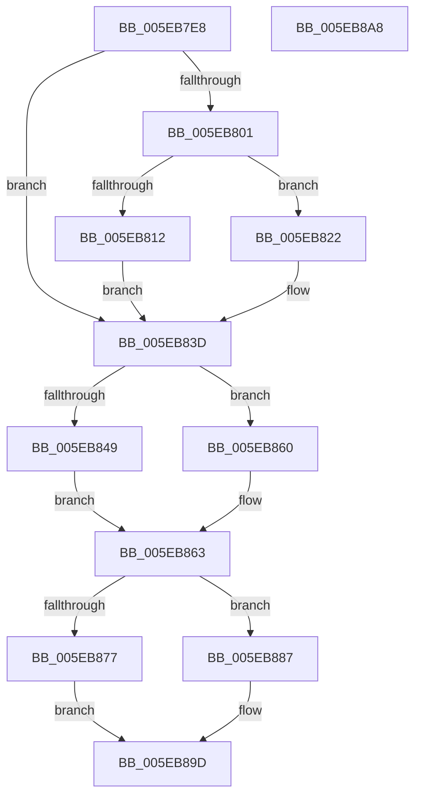

# RtlpInsertUCRBlock

- RVA: `0x005EB7E8`–`0x005EB8A9` (길이 `193` bytes)
- VA: `0x00000001405EB7E8`
- 실행 섹션: `.text`
- PDB 이름 있음: `예`; PDB Function 태그: `아니요`
- unwind 정보 RVA: `0x0006E5F8`
- 디코드: `56`개 명령, `193/193` bytes 표시
- 미해석 바이트: `0` (있으면 어셈블리에 `.byte`로 보존)

> 이 문서는 커널 이미지의 기계어와 PDB 기호를 분석해 생성했습니다. 4번과 5번은 함수 원형과 자료형을 바이너리 사용 방식에서 추정한 C 해석이며 원본 소스 복구 결과는 아닙니다.

## 1. Dependencies

- 직접 호출 지점: **3**; 고유 호출 대상: **2**
- 직접 호출자로 확인된 함수: **2**
- RIP 상대 이미지 참조: **0**

### Outgoing calls
- `0x005EB801` → [RtlpFindUCREntry](../5F/RtlpFindUCREntry_function_005F1828.md) (function, `0x005F1828`)
- `0x005EB838` → [RtlpLogHeapFailure](../35/RtlpLogHeapFailure_function_0035B7BC.md) (function, `0x0035B7BC`)
- `0x005EB898` → [RtlpLogHeapFailure](../35/RtlpLogHeapFailure_function_0035B7BC.md) (function, `0x0035B7BC`)

### Direct callers
- [RtlpCreateUCREntry](RtlpCreateUCREntry_function_005EA010.md) at `0x005EA0E7`
- [RtlpDeCommitFreeBlock](RtlpDeCommitFreeBlock_function_005EA158.md) at `0x005EA3E2`

### Static image references
- 디코드된 RIP-relative 메모리 참조가 없습니다.

## 2. Other-region calls and transfers

- 다른 실행 섹션으로 향하는 call: **0**
- 별도 외부 분기/꼬리 이동을 확인하지 못했습니다.

## 3. Assembly (complete function range)

```asm
005EB7E8  48 89 5C 24 08                  mov qword ptr [rsp + 8], rbx
005EB7ED  57                              push rdi
005EB7EE  48 83 EC 30                     sub rsp, 0x30
005EB7F2  48 8B DA                        mov rbx, rdx
005EB7F5  48 8B F9                        mov rdi, rcx
005EB7F8  48 8B 52 28                     mov rdx, qword ptr [rdx + 0x28]
005EB7FC  48 85 D2                        test rdx, rdx
005EB7FF  74 3C                           je 0x1405eb83d
005EB801  E8 22 60 00 00                  call 0x1405f1828
005EB806  48 8B 50 08                     mov rdx, qword ptr [rax + 8]
005EB80A  48 8B 0A                        mov rcx, qword ptr [rdx]
005EB80D  48 3B C8                        cmp rcx, rax
005EB810  75 10                           jne 0x1405eb822
005EB812  48 89 03                        mov qword ptr [rbx], rax
005EB815  48 89 53 08                     mov qword ptr [rbx + 8], rdx
005EB819  48 89 1A                        mov qword ptr [rdx], rbx
005EB81C  48 89 58 08                     mov qword ptr [rax + 8], rbx
005EB820  EB 1B                           jmp 0x1405eb83d
005EB822  48 83 64 24 28 00               and qword ptr [rsp + 0x28], 0
005EB828  33 D2                           xor edx, edx
005EB82A  48 89 4C 24 20                  mov qword ptr [rsp + 0x20], rcx
005EB82F  45 33 C9                        xor r9d, r9d
005EB832  4C 8B C0                        mov r8, rax
005EB835  8D 4A 0D                        lea ecx, [rdx + 0xd]
005EB838  E8 7F FF D6 FF                  call 0x14035b7bc
005EB83D  48 8D 4B F0                     lea rcx, [rbx - 0x10]
005EB841  0F B6 41 0E                     movzx eax, byte ptr [rcx + 0xe]
005EB845  84 C0                           test al, al
005EB847  74 17                           je 0x1405eb860
005EB849  48 C1 E0 10                     shl rax, 0x10
005EB84D  48 81 E1 00 00 FF FF            and rcx, 0xffffffffffff0000
005EB854  48 2B C8                        sub rcx, rax
005EB857  48 81 C1 00 00 01 00            add rcx, 0x10000
005EB85E  EB 03                           jmp 0x1405eb863
005EB860  48 8B CF                        mov rcx, rdi
005EB863  4C 8D 41 60                     lea r8, [rcx + 0x60]
005EB867  48 83 C3 10                     add rbx, 0x10
005EB86B  49 8B 00                        mov rax, qword ptr [r8]
005EB86E  4C 8B 48 08                     mov r9, qword ptr [rax + 8]
005EB872  4D 3B C8                        cmp r9, r8
005EB875  75 10                           jne 0x1405eb887
005EB877  48 89 03                        mov qword ptr [rbx], rax
005EB87A  4C 89 43 08                     mov qword ptr [rbx + 8], r8
005EB87E  48 89 58 08                     mov qword ptr [rax + 8], rbx
005EB882  49 89 18                        mov qword ptr [r8], rbx
005EB885  EB 16                           jmp 0x1405eb89d
005EB887  48 83 64 24 28 00               and qword ptr [rsp + 0x28], 0
005EB88D  33 D2                           xor edx, edx
005EB88F  48 83 64 24 20 00               and qword ptr [rsp + 0x20], 0
005EB895  8D 4A 0D                        lea ecx, [rdx + 0xd]
005EB898  E8 1F FF D6 FF                  call 0x14035b7bc
005EB89D  48 8B 5C 24 40                  mov rbx, qword ptr [rsp + 0x40]
005EB8A2  48 83 C4 30                     add rsp, 0x30
005EB8A6  5F                              pop rdi
005EB8A7  C3                              ret
005EB8A8  CC                              int3
```

## 4. C-style interpretation (structured pseudocode)

```c
__int64 __fastcall RtlpInsertUCRBlock(__int64 a1, __int64 a2, __int64 a3, int a4)
{
    __int64 result;
    __int64 v_rbx;
    __int64 v_rsp;
    unsigned __int64 v_stack_m10;
    unsigned __int64 v_stack_m18;
    unsigned __int64 v_stack_p8;

    v_stack_p8 = v_rbx;
    v_rsp = (v_rsp) - (48);
    if (*(unsigned __int64 *)(a2 + 40) == 0) goto loc_005EB83D;
    result = RtlpFindUCREntry(a1, *(unsigned __int64 *)(a2 + 40), a3, a4);
    if ((*(unsigned __int64 *)(*(unsigned __int64 *)(result + 8))) != result) goto loc_005EB822;
    *(unsigned __int64 *)(a2) = result;
    *(unsigned __int64 *)(a2 + 8) = *(unsigned __int64 *)(result + 8);
    *(unsigned __int64 *)(*(unsigned __int64 *)(result + 8)) = a2;
    *(unsigned __int64 *)(result + 8) = a2;
    goto loc_005EB83D;
loc_005EB822:
    a2 = 0;
    v_stack_m18 = *(unsigned __int64 *)(*(unsigned __int64 *)(result + 8));
    a4 = 0;
    result = RtlpLogHeapFailure(a2 + 13, a2, result, a4);
loc_005EB83D:
    if ((unsigned __int8)(*(unsigned __int8 *)(a2 - 16 + 14)) == 0) goto loc_005EB860;
    result = (*(unsigned __int8 *)(a2 - 16 + 14)) << (16);
    a1 = (a2 - 16) & (0xFFFFFFFFFFFF0000ULL);
    a1 = (a1) - (result);
    a1 = (a1) + (0x10000ULL);
    goto loc_005EB863;
loc_005EB860:
loc_005EB863:
    v_rbx = (a2) + (16);
    if ((*(unsigned __int64 *)(*(unsigned __int64 *)(a1 + 96) + 8)) != (a1 + 96)) goto loc_005EB887;
    *(unsigned __int64 *)(v_rbx) = *(unsigned __int64 *)(a1 + 96);
    *(unsigned __int64 *)(v_rbx + 8) = a1 + 96;
    *(unsigned __int64 *)(*(unsigned __int64 *)(a1 + 96) + 8) = v_rbx;
    *(unsigned __int64 *)(a1 + 96) = v_rbx;
    goto loc_005EB89D;
loc_005EB887:
    a2 = 0;
    result = RtlpLogHeapFailure(a2 + 13, a2, a1 + 96, *(unsigned __int64 *)(*(unsigned __int64 *)(a1 + 96) + 8));
loc_005EB89D:
    v_rsp = (v_rsp) + (48);
    return result;
}
```

## 5. (Beta) C Style

```c
int64_t RtlpInsertUCRBlock(int64_t Arg1, void *Arg2, int64_t Arg3, int32_t Arg4)
{
    uint8_t *arg2 = (uint8_t *)Arg2;

    int64_t result;
    int64_t local_rbx;
    int64_t local_rsp;
    uint64_t v_stack_m10;
    uint64_t v_stack_m18;
    uint64_t v_stack_p8;

    v_stack_p8 = local_rbx;
    local_rsp = (local_rsp) - (48);
    if (*(uint64_t *)(arg2 + 0x28) == 0) goto loc_005EB83D;
    result = RtlpFindUCREntry(Arg1, *(uint64_t *)(arg2 + 0x28), Arg3, Arg4);
    if ((*(uint64_t *)(*(uint64_t *)(result + 0x8))) != result) goto loc_005EB822;
    *(uint64_t *)(arg2) = result;
    *(uint64_t *)(arg2 + 0x8) = *(uint64_t *)(result + 0x8);
    *(void **)(*(uint64_t *)(result + 0x8)) = Arg2;
    *(void **)(result + 0x8) = Arg2;
    goto loc_005EB83D;
loc_005EB822:
    Arg2 = 0;
    v_stack_m18 = *(uint64_t *)(*(uint64_t *)(result + 0x8));
    Arg4 = 0;
    result = RtlpLogHeapFailure(Arg2 + 13, Arg2, result, Arg4);
loc_005EB83D:
    if ((uint8_t)(*(uint8_t *)(arg2 - 0x10 + 0xE)) == 0) goto loc_005EB860;
    result = (*(uint8_t *)(arg2 - 0x10 + 0xE)) << (16);
    Arg1 = (Arg2 - 16) & (0xFFFFFFFFFFFF0000ULL);
    Arg1 = (Arg1) - (result);
    Arg1 = (Arg1) + (0x10000ULL);
    goto loc_005EB863;
loc_005EB860:
loc_005EB863:
    local_rbx = (Arg2) + (16);
    if ((*(uint64_t *)(*(uint64_t *)(Arg1 + 0x60) + 0x8)) != (Arg1 + 96)) goto loc_005EB887;
    *(uint64_t *)(local_rbx) = *(uint64_t *)(Arg1 + 0x60);
    *(uint64_t *)(local_rbx + 0x8) = Arg1 + 96;
    *(uint64_t *)(*(uint64_t *)(Arg1 + 0x60) + 0x8) = local_rbx;
    *(uint64_t *)(Arg1 + 0x60) = local_rbx;
    goto loc_005EB89D;
loc_005EB887:
    Arg2 = 0;
    result = RtlpLogHeapFailure(Arg2 + 13, Arg2, Arg1 + 96, *(uint64_t *)(*(uint64_t *)(Arg1 + 0x60) + 0x8));
loc_005EB89D:
    local_rsp = (local_rsp) + (48);
    return result;
}
```

### 관측된 메모리 오프셋

구조체 형식이 확인되지 않은 접근은 인자 기준의 오프셋으로만 기록했습니다.

| 기준 인자 | 오프셋 표현 | 폭 (bit) | 접근 |
|---|---:|---:|---|
| `Arg2` | `- 0x10` | `64` | `R` |
| `Arg2` | `+ 0x0` | `64` | `W` |
| `Arg2` | `+ 0x8` | `64` | `W` |
| `Arg2` | `+ 0xE` | `8` | `R` |
| `Arg2` | `+ 0x28` | `64` | `R` |

## 6. Execution-region graph

[열기: 2D/3D 그래프와 함수 탐색 컨트롤 패널](../../../control-panel.html?section=text&rva=0x005EB7E8&view=graph)

- 2D 그래프는 위에서 아래로 흐르고, 3D 그래프는 빈 공간을 드래그해 회전합니다. Shift+드래그는 이동, 휠은 확대·축소, 함수 노드 선택은 대상 보고서 이동입니다.

### Static fallback


