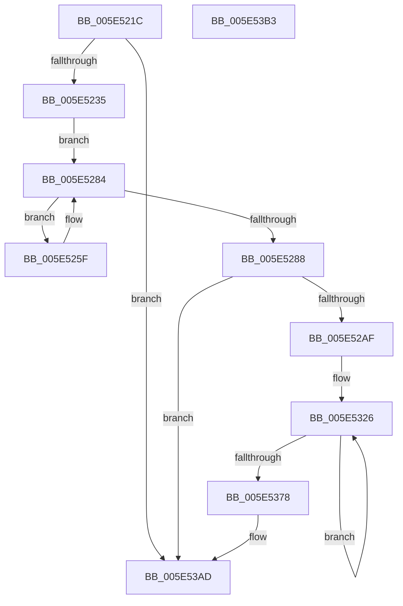

# RtlpLogExceptionDispatch

- RVA: `0x005E521C`–`0x005E53B4` (길이 `408` bytes)
- VA: `0x00000001405E521C`
- 실행 섹션: `.text`
- PDB 이름 있음: `예`; PDB Function 태그: `아니요`
- unwind 정보 RVA: `0x00071750`
- 디코드: `91`개 명령, `408/408` bytes 표시
- 미해석 바이트: `0` (있으면 어셈블리에 `.byte`로 보존)

> 이 문서는 커널 이미지의 기계어와 PDB 기호를 분석해 생성했습니다. 4번과 5번은 함수 원형과 자료형을 바이너리 사용 방식에서 추정한 C 해석이며 원본 소스 복구 결과는 아닙니다.

## 1. Dependencies

- 직접 호출 지점: **0**; 고유 호출 대상: **0**
- 직접 호출자로 확인된 함수: **1**
- RIP 상대 이미지 참조: **2**

### Outgoing calls
- 직접 디코드된 call 명령이 없습니다.

### Direct callers
- [RtlDispatchException](../2F/RtlDispatchException_function_002F22A0.md) at `0x002F26D0`

### Static image references
- `0x005E5221` → RVA `0x00E67AF0` (`.data`; read)
- `0x005E5235` → RVA `0x00F05C98` (`.data`; read)

## 2. Other-region calls and transfers

- 다른 실행 섹션으로 향하는 call: **0**
- 별도 외부 분기/꼬리 이동을 확인하지 못했습니다.

## 3. Assembly (complete function range)

```asm
005E521C  48 89 5C 24 08                  mov qword ptr [rsp + 8], rbx
005E5221  48 83 3D C7 28 88 00 00         cmp qword ptr [rip + 0x8828c7], 0
005E5229  4C 8B CA                        mov r9, rdx
005E522C  4C 8B D1                        mov r10, rcx
005E522F  0F 84 78 01 00 00               je 0x1405e53ad
005E5235  44 8B 1D 5C 0A 92 00            mov r11d, dword ptr [rip + 0x920a5c]
005E523C  B8 1F 85 EB 51                  mov eax, 0x51eb851f
005E5241  45 8D 43 01                     lea r8d, [r11 + 1]
005E5245  41 F7 E0                        mul r8d
005E5248  C1 EA 04                        shr edx, 4
005E524B  6B C2 32                        imul eax, edx, 0x32
005E524E  44 2B C0                        sub r8d, eax
005E5251  41 8B C3                        mov eax, r11d
005E5254  F0 44 0F B1 05 3B 0A 92 00      lock cmpxchg dword ptr [rip + 0x920a3b], r8d
005E525D  EB 25                           jmp 0x1405e5284
005E525F  44 8D 43 01                     lea r8d, [rbx + 1]
005E5263  B8 1F 85 EB 51                  mov eax, 0x51eb851f
005E5268  41 F7 E0                        mul r8d
005E526B  44 8B DB                        mov r11d, ebx
005E526E  8B C3                           mov eax, ebx
005E5270  C1 EA 04                        shr edx, 4
005E5273  6B CA 32                        imul ecx, edx, 0x32
005E5276  44 2B C1                        sub r8d, ecx
005E5279  F0 44 0F B1 05 16 0A 92 00      lock cmpxchg dword ptr [rip + 0x920a16], r8d
005E5282  3B C3                           cmp eax, ebx
005E5284  8B D8                           mov ebx, eax
005E5286  75 D7                           jne 0x1405e525f
005E5288  41 8B C3                        mov eax, r11d
005E528B  48 69 D0 90 05 00 00            imul rdx, rax, 0x590
005E5292  65 48 8B 04 25 88 01 00 00      mov rax, qword ptr gs:[0x188]
005E529B  48 03 15 4E 28 88 00            add rdx, qword ptr [rip + 0x88284e]
005E52A2  48 89 82 78 05 00 00            mov qword ptr [rdx + 0x578], rax
005E52A9  0F 84 FE 00 00 00               je 0x1405e53ad
005E52AF  C7 82 70 05 00 00 01 00 00 00   mov dword ptr [rdx + 0x570], 1
005E52B9  41 B8 80 00 00 00               mov r8d, 0x80
005E52BF  41 0F 10 02                     movups xmm0, xmmword ptr [r10]
005E52C3  0F 11 02                        movups xmmword ptr [rdx], xmm0
005E52C6  41 8D 48 89                     lea ecx, [r8 - 0x77]
005E52CA  41 0F 10 4A 10                  movups xmm1, xmmword ptr [r10 + 0x10]
005E52CF  0F 11 4A 10                     movups xmmword ptr [rdx + 0x10], xmm1
005E52D3  41 0F 10 42 20                  movups xmm0, xmmword ptr [r10 + 0x20]
005E52D8  0F 11 42 20                     movups xmmword ptr [rdx + 0x20], xmm0
005E52DC  41 0F 10 4A 30                  movups xmm1, xmmword ptr [r10 + 0x30]
005E52E1  0F 11 4A 30                     movups xmmword ptr [rdx + 0x30], xmm1
005E52E5  41 0F 10 42 40                  movups xmm0, xmmword ptr [r10 + 0x40]
005E52EA  0F 11 42 40                     movups xmmword ptr [rdx + 0x40], xmm0
005E52EE  41 0F 10 4A 50                  movups xmm1, xmmword ptr [r10 + 0x50]
005E52F3  0F 11 4A 50                     movups xmmword ptr [rdx + 0x50], xmm1
005E52F7  41 0F 10 42 60                  movups xmm0, xmmword ptr [r10 + 0x60]
005E52FC  0F 11 42 60                     movups xmmword ptr [rdx + 0x60], xmm0
005E5300  41 0F 10 42 70                  movups xmm0, xmmword ptr [r10 + 0x70]
005E5305  42 0F 11 44 02 F0               movups xmmword ptr [rdx + r8 - 0x10], xmm0
005E530B  43 0F 10 0C 02                  movups xmm1, xmmword ptr [r10 + r8]
005E5310  42 0F 11 0C 02                  movups xmmword ptr [rdx + r8], xmm1
005E5315  4B 8B 44 02 10                  mov rax, qword ptr [r10 + r8 + 0x10]
005E531A  4A 89 44 02 10                  mov qword ptr [rdx + r8 + 0x10], rax
005E531F  48 8D 82 A0 00 00 00            lea rax, [rdx + 0xa0]
005E5326  41 0F 10 01                     movups xmm0, xmmword ptr [r9]
005E532A  0F 11 00                        movups xmmword ptr [rax], xmm0
005E532D  41 0F 10 49 10                  movups xmm1, xmmword ptr [r9 + 0x10]
005E5332  0F 11 48 10                     movups xmmword ptr [rax + 0x10], xmm1
005E5336  41 0F 10 41 20                  movups xmm0, xmmword ptr [r9 + 0x20]
005E533B  0F 11 40 20                     movups xmmword ptr [rax + 0x20], xmm0
005E533F  41 0F 10 49 30                  movups xmm1, xmmword ptr [r9 + 0x30]
005E5344  0F 11 48 30                     movups xmmword ptr [rax + 0x30], xmm1
005E5348  41 0F 10 41 40                  movups xmm0, xmmword ptr [r9 + 0x40]
005E534D  0F 11 40 40                     movups xmmword ptr [rax + 0x40], xmm0
005E5351  41 0F 10 49 50                  movups xmm1, xmmword ptr [r9 + 0x50]
005E5356  0F 11 48 50                     movups xmmword ptr [rax + 0x50], xmm1
005E535A  41 0F 10 41 60                  movups xmm0, xmmword ptr [r9 + 0x60]
005E535F  0F 11 40 60                     movups xmmword ptr [rax + 0x60], xmm0
005E5363  49 03 C0                        add rax, r8
005E5366  41 0F 10 49 70                  movups xmm1, xmmword ptr [r9 + 0x70]
005E536B  4D 03 C8                        add r9, r8
005E536E  0F 11 48 F0                     movups xmmword ptr [rax - 0x10], xmm1
005E5372  48 83 E9 01                     sub rcx, 1
005E5376  75 AE                           jne 0x1405e5326
005E5378  41 0F 10 01                     movups xmm0, xmmword ptr [r9]
005E537C  0F 11 00                        movups xmmword ptr [rax], xmm0
005E537F  41 0F 10 49 10                  movups xmm1, xmmword ptr [r9 + 0x10]
005E5384  0F 11 48 10                     movups xmmword ptr [rax + 0x10], xmm1
005E5388  41 0F 10 41 20                  movups xmm0, xmmword ptr [r9 + 0x20]
005E538D  0F 11 40 20                     movups xmmword ptr [rax + 0x20], xmm0
005E5391  41 0F 10 49 30                  movups xmm1, xmmword ptr [r9 + 0x30]
005E5396  0F 11 48 30                     movups xmmword ptr [rax + 0x30], xmm1
005E539A  41 0F 10 41 40                  movups xmm0, xmmword ptr [r9 + 0x40]
005E539F  0F 11 40 40                     movups xmmword ptr [rax + 0x40], xmm0
005E53A3  81 A2 D0 00 00 00 1F 00 10 00   and dword ptr [rdx + 0xd0], 0x10001f
005E53AD  48 8B 5C 24 08                  mov rbx, qword ptr [rsp + 8]
005E53B2  C3                              ret
005E53B3  CC                              int3
```

## 4. C-style interpretation (structured pseudocode)

```c
__int64 __fastcall RtlpLogExceptionDispatch(__int64 a1, __int64 a2)
{
    __int64 result;
    unsigned __int64 v_stack_p8;

    v_stack_p8 = v_rbx;
    if ((*(unsigned __int64 *)(v_rip + 8923335)) == 0) goto loc_005E53AD;
    a2 = (unsigned int)((a2) >> (4));
    result = (unsigned int)(((unsigned int)(0x51EB851FULL)) * ((unsigned int)(a2)));
    a3 = (unsigned int)(((unsigned int)(*(unsigned int *)(v_rip + 9570908)) + 1) - ((unsigned int)(result)));
    goto loc_005E5284;
loc_005E525F:
    a2 = (unsigned int)((a2) >> (4));
    a1 = (unsigned int)((a1) * ((unsigned int)(a2)));
    a3 = (unsigned int)((v_rbx + 1) - ((unsigned int)(a1)));
loc_005E5284:
    if (((unsigned int)((unsigned int)((unsigned int)(v_rbx)))) != ((unsigned int)(v_rbx))) goto loc_005E525F;
    a2 = (a2) * ((unsigned int)((unsigned int)((unsigned int)((unsigned int)(v_rbx)))));
    a2 = (a2) + (*(unsigned __int64 *)(v_rip + 8923214));
    *(unsigned __int64 *)(a2 + 1400) = *(unsigned __int64 *)(gs_base + (0 + 392));
    if (condition_is_equal) goto loc_005E53AD;
    *(unsigned int *)(a2 + 1392) = 1;
    *(unsigned __int64 *)(a2) = v_xmm0;
    *(unsigned __int64 *)(a2 + 16) = v_xmm1;
    *(unsigned __int64 *)(a2 + 32) = v_xmm0;
    *(unsigned __int64 *)(a2 + 48) = v_xmm1;
    *(unsigned __int64 *)(a2 + 64) = v_xmm0;
    *(unsigned __int64 *)(a2 + 80) = v_xmm1;
    *(unsigned __int64 *)(a2 + 96) = v_xmm0;
    *(unsigned __int64 *)(a2 + 128 * 1 - 16) = v_xmm0;
    *(unsigned __int64 *)(a2 + 128 * 1) = v_xmm1;
    *(unsigned __int64 *)(a2 + 128 * 1 + 16) = *(unsigned __int64 *)(a1 + 128 * 1 + 16);
loc_005E5326:
    *(unsigned __int64 *)(a2 + 160) = v_xmm0;
    *(unsigned __int64 *)(a2 + 160 + 16) = v_xmm1;
    *(unsigned __int64 *)(a2 + 160 + 32) = v_xmm0;
    *(unsigned __int64 *)(a2 + 160 + 48) = v_xmm1;
    *(unsigned __int64 *)(a2 + 160 + 64) = v_xmm0;
    *(unsigned __int64 *)(a2 + 160 + 80) = v_xmm1;
    *(unsigned __int64 *)(a2 + 160 + 96) = v_xmm0;
    result = (a2 + 160) + (128);
    a4 = (a2) + (128);
    *(unsigned __int64 *)(result - 16) = v_xmm1;
    a1 = (128 - 119) - (1);
    if (condition_is_not_equal) goto loc_005E5326;
    *(unsigned __int64 *)(result) = v_xmm0;
    *(unsigned __int64 *)(result + 16) = v_xmm1;
    *(unsigned __int64 *)(result + 32) = v_xmm0;
    *(unsigned __int64 *)(result + 48) = v_xmm1;
    *(unsigned __int64 *)(result + 64) = v_xmm0;
loc_005E53AD:
    return result;
}
```

## 5. (Beta) C Style

```c
int64_t RtlpLogExceptionDispatch(void *Arg1, void *Arg2)
{
    uint8_t *arg1 = (uint8_t *)Arg1;
    uint8_t *arg2 = (uint8_t *)Arg2;

    int64_t result;
    uint64_t v_stack_p8;

    v_stack_p8 = local_rbx;
    if ((*(uint64_t *)(v_rip + 0x8828C7)) == 0) goto loc_005E53AD;
    Arg2 = (uint32_t)((Arg2) >> (4));
    result = (uint32_t)(((uint32_t)(0x51EB851FULL)) * ((uint32_t)(Arg2)));
    a3 = (uint32_t)(((uint32_t)(*(uint32_t *)(v_rip + 0x920A5C)) + 1) - ((uint32_t)(result)));
    goto loc_005E5284;
loc_005E525F:
    Arg2 = (uint32_t)((Arg2) >> (4));
    Arg1 = (uint32_t)((Arg1) * ((uint32_t)(Arg2)));
    a3 = (uint32_t)((local_rbx + 1) - ((uint32_t)(Arg1)));
loc_005E5284:
    if (((uint32_t)((uint32_t)((uint32_t)(local_rbx)))) != ((uint32_t)(local_rbx))) goto loc_005E525F;
    Arg2 = (Arg2) * ((uint32_t)((uint32_t)((uint32_t)((uint32_t)(local_rbx)))));
    Arg2 = (Arg2) + (*(uint64_t *)(v_rip + 0x88284E));
    *(uint64_t *)(arg2 + 0x578) = *(uint64_t *)(gs_base + (0 + 0x188));
    if (condition_is_equal) goto loc_005E53AD;
    *(uint32_t *)(arg2 + 0x570) = 1;
    *(uint64_t *)(arg2) = v_xmm0;
    *(uint64_t *)(arg2 + 0x10) = v_xmm1;
    *(uint64_t *)(arg2 + 0x20) = v_xmm0;
    *(uint64_t *)(arg2 + 0x30) = v_xmm1;
    *(uint64_t *)(arg2 + 0x40) = v_xmm0;
    *(uint64_t *)(arg2 + 0x50) = v_xmm1;
    *(uint64_t *)(arg2 + 0x60) = v_xmm0;
    *(uint64_t *)(arg2 + 0x80 * 1 - 0x10) = v_xmm0;
    *(uint64_t *)(arg2 + 0x80 * 1) = v_xmm1;
    *(uint64_t *)(arg2 + 0x80 * 1 + 0x10) = *(uint64_t *)(arg1 + 0x80 * 1 + 0x10);
loc_005E5326:
    *(uint64_t *)(arg2 + 0xA0) = v_xmm0;
    *(uint64_t *)(arg2 + 0xA0 + 0x10) = v_xmm1;
    *(uint64_t *)(arg2 + 0xA0 + 0x20) = v_xmm0;
    *(uint64_t *)(arg2 + 0xA0 + 0x30) = v_xmm1;
    *(uint64_t *)(arg2 + 0xA0 + 0x40) = v_xmm0;
    *(uint64_t *)(arg2 + 0xA0 + 0x50) = v_xmm1;
    *(uint64_t *)(arg2 + 0xA0 + 0x60) = v_xmm0;
    result = (Arg2 + 160) + (128);
    a4 = (Arg2) + (128);
    *(uint64_t *)(result - 0x10) = v_xmm1;
    Arg1 = (128 - 119) - (1);
    if (condition_is_not_equal) goto loc_005E5326;
    *(uint64_t *)(result) = v_xmm0;
    *(uint64_t *)(result + 0x10) = v_xmm1;
    *(uint64_t *)(result + 0x20) = v_xmm0;
    *(uint64_t *)(result + 0x30) = v_xmm1;
    *(uint64_t *)(result + 0x40) = v_xmm0;
loc_005E53AD:
    return result;
}
```

### 관측된 메모리 오프셋

구조체 형식이 확인되지 않은 접근은 인자 기준의 오프셋으로만 기록했습니다.

| 기준 인자 | 오프셋 표현 | 폭 (bit) | 접근 |
|---|---:|---:|---|
| `Arg1` | `+ 0x0` | `128` | `R` |
| `Arg1` | `+ 0x0 + r8*1` | `128` | `R` |
| `Arg1` | `+ 0x10` | `128` | `R` |
| `Arg1` | `+ 0x10 + r8*1` | `64` | `R` |
| `Arg1` | `+ 0x20` | `128` | `R` |
| `Arg1` | `+ 0x30` | `128` | `R` |
| `Arg1` | `+ 0x40` | `128` | `R` |
| `Arg1` | `+ 0x50` | `128` | `R` |
| `Arg1` | `+ 0x60` | `128` | `R` |
| `Arg1` | `+ 0x70` | `128` | `R` |
| `Arg2` | `+ 0x0` | `128` | `R` |
| `Arg2` | `+ 0x10` | `128` | `R` |
| `Arg2` | `+ 0x20` | `128` | `R` |
| `Arg2` | `+ 0x30` | `128` | `R` |
| `Arg2` | `+ 0x40` | `128` | `R` |
| `Arg2` | `+ 0x50` | `128` | `R` |
| `Arg2` | `+ 0x60` | `128` | `R` |
| `Arg2` | `+ 0x70` | `128` | `R` |

## 6. Execution-region graph

[열기: 2D/3D 그래프와 함수 탐색 컨트롤 패널](../../../control-panel.html?section=text&rva=0x005E521C&view=graph)

- 2D 그래프는 위에서 아래로 흐르고, 3D 그래프는 빈 공간을 드래그해 회전합니다. Shift+드래그는 이동, 휠은 확대·축소, 함수 노드 선택은 대상 보고서 이동입니다.

### Static fallback


