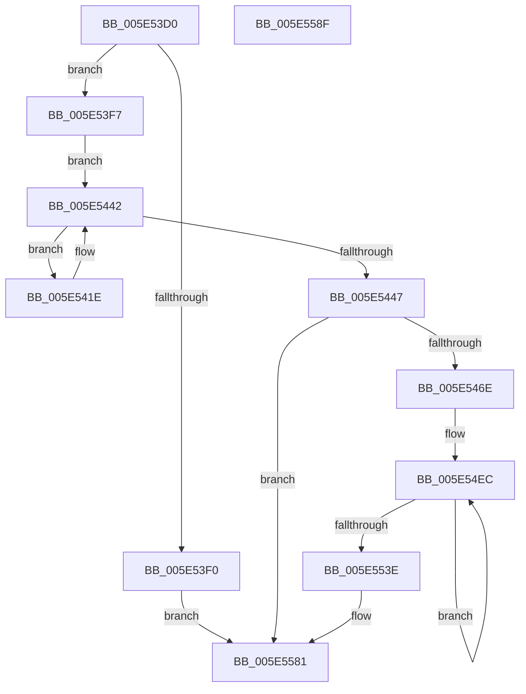

# RtlpLogExceptionHandler

- RVA: `0x005E53D0`–`0x005E5590` (길이 `448` bytes)
- VA: `0x00000001405E53D0`
- 실행 섹션: `.text`
- PDB 이름 있음: `예`; PDB Function 태그: `아니요`
- unwind 정보 RVA: `0x000950EC`
- 디코드: `101`개 명령, `448/448` bytes 표시
- 미해석 바이트: `0` (있으면 어셈블리에 `.byte`로 보존)

> 이 문서는 커널 이미지의 기계어와 PDB 기호를 분석해 생성했습니다. 4번과 5번은 함수 원형과 자료형을 바이너리 사용 방식에서 추정한 C 해석이며 원본 소스 복구 결과는 아닙니다.

## 1. Dependencies

- 직접 호출 지점: **0**; 고유 호출 대상: **0**
- 직접 호출자로 확인된 함수: **1**
- RIP 상대 이미지 참조: **2**

### Outgoing calls
- 직접 디코드된 call 명령이 없습니다.

### Direct callers
- [RtlDispatchException](../2F/RtlDispatchException_function_002F22A0.md) at `0x002F2705`

### Static image references
- `0x005E53DA` → RVA `0x00E67AF0` (`.data`; read)
- `0x005E53F7` → RVA `0x00F05C98` (`.data`; read)

## 2. Other-region calls and transfers

- 다른 실행 섹션으로 향하는 call: **0**
- 별도 외부 분기/꼬리 이동을 확인하지 못했습니다.

## 3. Assembly (complete function range)

```asm
005E53D0  48 89 5C 24 08                  mov qword ptr [rsp + 8], rbx
005E53D5  48 89 7C 24 10                  mov qword ptr [rsp + 0x10], rdi
005E53DA  48 83 3D 0E 27 88 00 00         cmp qword ptr [rip + 0x88270e], 0
005E53E2  49 8B D9                        mov rbx, r9
005E53E5  49 8B F8                        mov rdi, r8
005E53E8  4C 8B D2                        mov r10, rdx
005E53EB  4C 8B D9                        mov r11, rcx
005E53EE  75 07                           jne 0x1405e53f7
005E53F0  33 D2                           xor edx, edx
005E53F2  E9 8A 01 00 00                  jmp 0x1405e5581
005E53F7  44 8B 05 9A 08 92 00            mov r8d, dword ptr [rip + 0x92089a]
005E53FE  B8 1F 85 EB 51                  mov eax, 0x51eb851f
005E5403  41 8D 48 01                     lea ecx, [r8 + 1]
005E5407  F7 E1                           mul ecx
005E5409  C1 EA 04                        shr edx, 4
005E540C  6B C2 32                        imul eax, edx, 0x32
005E540F  2B C8                           sub ecx, eax
005E5411  41 8B C0                        mov eax, r8d
005E5414  F0 0F B1 0D 7C 08 92 00         lock cmpxchg dword ptr [rip + 0x92087c], ecx
005E541C  EB 24                           jmp 0x1405e5442
005E541E  41 8D 49 01                     lea ecx, [r9 + 1]
005E5422  B8 1F 85 EB 51                  mov eax, 0x51eb851f
005E5427  F7 E1                           mul ecx
005E5429  45 8B C1                        mov r8d, r9d
005E542C  C1 EA 04                        shr edx, 4
005E542F  6B C2 32                        imul eax, edx, 0x32
005E5432  2B C8                           sub ecx, eax
005E5434  41 8B C1                        mov eax, r9d
005E5437  F0 0F B1 0D 59 08 92 00         lock cmpxchg dword ptr [rip + 0x920859], ecx
005E543F  41 3B C1                        cmp eax, r9d
005E5442  44 8B C8                        mov r9d, eax
005E5445  75 D7                           jne 0x1405e541e
005E5447  41 8B C0                        mov eax, r8d
005E544A  48 69 D0 90 05 00 00            imul rdx, rax, 0x590
005E5451  65 48 8B 04 25 88 01 00 00      mov rax, qword ptr gs:[0x188]
005E545A  48 03 15 8F 26 88 00            add rdx, qword ptr [rip + 0x88268f]
005E5461  48 89 82 78 05 00 00            mov qword ptr [rdx + 0x578], rax
005E5468  0F 84 13 01 00 00               je 0x1405e5581
005E546E  83 8A 74 05 00 00 FF            or dword ptr [rdx + 0x574], 0xffffffff
005E5475  48 8D 8A A0 00 00 00            lea rcx, [rdx + 0xa0]
005E547C  C7 82 70 05 00 00 02 00 00 00   mov dword ptr [rdx + 0x570], 2
005E5486  41 B8 80 00 00 00               mov r8d, 0x80
005E548C  41 0F 10 03                     movups xmm0, xmmword ptr [r11]
005E5490  0F 11 02                        movups xmmword ptr [rdx], xmm0
005E5493  41 0F 10 4B 10                  movups xmm1, xmmword ptr [r11 + 0x10]
005E5498  0F 11 4A 10                     movups xmmword ptr [rdx + 0x10], xmm1
005E549C  41 0F 10 43 20                  movups xmm0, xmmword ptr [r11 + 0x20]
005E54A1  0F 11 42 20                     movups xmmword ptr [rdx + 0x20], xmm0
005E54A5  41 0F 10 4B 30                  movups xmm1, xmmword ptr [r11 + 0x30]
005E54AA  0F 11 4A 30                     movups xmmword ptr [rdx + 0x30], xmm1
005E54AE  41 0F 10 43 40                  movups xmm0, xmmword ptr [r11 + 0x40]
005E54B3  0F 11 42 40                     movups xmmword ptr [rdx + 0x40], xmm0
005E54B7  41 0F 10 4B 50                  movups xmm1, xmmword ptr [r11 + 0x50]
005E54BC  0F 11 4A 50                     movups xmmword ptr [rdx + 0x50], xmm1
005E54C0  41 0F 10 43 60                  movups xmm0, xmmword ptr [r11 + 0x60]
005E54C5  0F 11 42 60                     movups xmmword ptr [rdx + 0x60], xmm0
005E54C9  41 0F 10 43 70                  movups xmm0, xmmword ptr [r11 + 0x70]
005E54CE  42 0F 11 44 02 F0               movups xmmword ptr [rdx + r8 - 0x10], xmm0
005E54D4  43 0F 10 0C 03                  movups xmm1, xmmword ptr [r11 + r8]
005E54D9  42 0F 11 0C 02                  movups xmmword ptr [rdx + r8], xmm1
005E54DE  4B 8B 44 03 10                  mov rax, qword ptr [r11 + r8 + 0x10]
005E54E3  4A 89 44 02 10                  mov qword ptr [rdx + r8 + 0x10], rax
005E54E8  41 8D 40 89                     lea eax, [r8 - 0x77]
005E54EC  41 0F 10 02                     movups xmm0, xmmword ptr [r10]
005E54F0  0F 11 01                        movups xmmword ptr [rcx], xmm0
005E54F3  41 0F 10 4A 10                  movups xmm1, xmmword ptr [r10 + 0x10]
005E54F8  0F 11 49 10                     movups xmmword ptr [rcx + 0x10], xmm1
005E54FC  41 0F 10 42 20                  movups xmm0, xmmword ptr [r10 + 0x20]
005E5501  0F 11 41 20                     movups xmmword ptr [rcx + 0x20], xmm0
005E5505  41 0F 10 4A 30                  movups xmm1, xmmword ptr [r10 + 0x30]
005E550A  0F 11 49 30                     movups xmmword ptr [rcx + 0x30], xmm1
005E550E  41 0F 10 42 40                  movups xmm0, xmmword ptr [r10 + 0x40]
005E5513  0F 11 41 40                     movups xmmword ptr [rcx + 0x40], xmm0
005E5517  41 0F 10 4A 50                  movups xmm1, xmmword ptr [r10 + 0x50]
005E551C  0F 11 49 50                     movups xmmword ptr [rcx + 0x50], xmm1
005E5520  41 0F 10 42 60                  movups xmm0, xmmword ptr [r10 + 0x60]
005E5525  0F 11 41 60                     movups xmmword ptr [rcx + 0x60], xmm0
005E5529  49 03 C8                        add rcx, r8
005E552C  41 0F 10 4A 70                  movups xmm1, xmmword ptr [r10 + 0x70]
005E5531  4D 03 D0                        add r10, r8
005E5534  0F 11 49 F0                     movups xmmword ptr [rcx - 0x10], xmm1
005E5538  48 83 E8 01                     sub rax, 1
005E553C  75 AE                           jne 0x1405e54ec
005E553E  41 0F 10 02                     movups xmm0, xmmword ptr [r10]
005E5542  0F 11 01                        movups xmmword ptr [rcx], xmm0
005E5545  41 0F 10 4A 10                  movups xmm1, xmmword ptr [r10 + 0x10]
005E554A  0F 11 49 10                     movups xmmword ptr [rcx + 0x10], xmm1
005E554E  41 0F 10 42 20                  movups xmm0, xmmword ptr [r10 + 0x20]
005E5553  0F 11 41 20                     movups xmmword ptr [rcx + 0x20], xmm0
005E5557  41 0F 10 4A 30                  movups xmm1, xmmword ptr [r10 + 0x30]
005E555C  0F 11 49 30                     movups xmmword ptr [rcx + 0x30], xmm1
005E5560  41 0F 10 42 40                  movups xmm0, xmmword ptr [r10 + 0x40]
005E5565  48 89 BA 80 05 00 00            mov qword ptr [rdx + 0x580], rdi
005E556C  48 89 9A 88 05 00 00            mov qword ptr [rdx + 0x588], rbx
005E5573  0F 11 41 40                     movups xmmword ptr [rcx + 0x40], xmm0
005E5577  81 A2 D0 00 00 00 1F 00 10 00   and dword ptr [rdx + 0xd0], 0x10001f
005E5581  48 8B 5C 24 08                  mov rbx, qword ptr [rsp + 8]
005E5586  48 8B C2                        mov rax, rdx
005E5589  48 8B 7C 24 10                  mov rdi, qword ptr [rsp + 0x10]
005E558E  C3                              ret
005E558F  CC                              int3
```

## 4. C-style interpretation (structured pseudocode)

```c
__int64 __fastcall RtlpLogExceptionHandler(__int64 a1, __int64 a2, __int64 a3, __int64 a4)
{
    __int64 result;
    __int64 v_r10;
    unsigned __int64 v_stack_p10;
    unsigned __int64 v_stack_p8;

    v_stack_p8 = v_rbx;
    v_stack_p10 = v_rdi;
    if ((*(unsigned __int64 *)(v_rip + 8922894)) != 0) goto loc_005E53F7;
    a2 = 0;
    goto loc_005E5581;
loc_005E53F7:
    a2 = (unsigned int)((a2) >> (4));
    result = (unsigned int)(((unsigned int)(0x51EB851FULL)) * ((unsigned int)(a2)));
    a1 = (unsigned int)(((unsigned int)(*(unsigned int *)(v_rip + 9570458)) + 1) - ((unsigned int)(result)));
    goto loc_005E5442;
loc_005E541E:
    a2 = (unsigned int)((a2) >> (4));
    result = (unsigned int)(((unsigned int)(0x51EB851FULL)) * ((unsigned int)(a2)));
    a1 = (unsigned int)((a4 + 1) - ((unsigned int)(result)));
loc_005E5442:
    if (((unsigned int)((unsigned int)((unsigned int)(a4)))) != ((unsigned int)(a4))) goto loc_005E541E;
    a2 = (a2) * ((unsigned int)((unsigned int)((unsigned int)((unsigned int)(a4)))));
    a2 = (a2) + (*(unsigned __int64 *)(v_rip + 8922767));
    *(unsigned __int64 *)(a2 + 1400) = *(unsigned __int64 *)(gs_base + (0 + 392));
    if (condition_is_equal) goto loc_005E5581;
    *(unsigned int *)(a2 + 1392) = 2;
    *(unsigned __int64 *)(a2) = v_xmm0;
    *(unsigned __int64 *)(a2 + 16) = v_xmm1;
    *(unsigned __int64 *)(a2 + 32) = v_xmm0;
    *(unsigned __int64 *)(a2 + 48) = v_xmm1;
    *(unsigned __int64 *)(a2 + 64) = v_xmm0;
    *(unsigned __int64 *)(a2 + 80) = v_xmm1;
    *(unsigned __int64 *)(a2 + 96) = v_xmm0;
    *(unsigned __int64 *)(a2 + 128 * 1 - 16) = v_xmm0;
    *(unsigned __int64 *)(a2 + 128 * 1) = v_xmm1;
    *(unsigned __int64 *)(a2 + 128 * 1 + 16) = *(unsigned __int64 *)(a1 + 128 * 1 + 16);
loc_005E54EC:
    *(unsigned __int64 *)(a2 + 160) = v_xmm0;
    *(unsigned __int64 *)(a2 + 160 + 16) = v_xmm1;
    *(unsigned __int64 *)(a2 + 160 + 32) = v_xmm0;
    *(unsigned __int64 *)(a2 + 160 + 48) = v_xmm1;
    *(unsigned __int64 *)(a2 + 160 + 64) = v_xmm0;
    *(unsigned __int64 *)(a2 + 160 + 80) = v_xmm1;
    *(unsigned __int64 *)(a2 + 160 + 96) = v_xmm0;
    a1 = (a2 + 160) + (128);
    v_r10 = (a2) + (128);
    *(unsigned __int64 *)(a1 - 16) = v_xmm1;
    result = (128 - 119) - (1);
    if (condition_is_not_equal) goto loc_005E54EC;
    *(unsigned __int64 *)(a1) = v_xmm0;
    *(unsigned __int64 *)(a1 + 16) = v_xmm1;
    *(unsigned __int64 *)(a1 + 32) = v_xmm0;
    *(unsigned __int64 *)(a1 + 48) = v_xmm1;
    *(unsigned __int64 *)(a2 + 1408) = a3;
    *(unsigned __int64 *)(a2 + 1416) = a4;
    *(unsigned __int64 *)(a1 + 64) = v_xmm0;
loc_005E5581:
    return a2;
}
```

## 5. (Beta) C Style

```c
void *RtlpLogExceptionHandler(void *Arg1, void *Arg2, int64_t Arg3, int64_t Arg4)
{
    uint8_t *arg1 = (uint8_t *)Arg1;
    uint8_t *arg2 = (uint8_t *)Arg2;

    int64_t result;
    int64_t local_r10;
    uint64_t v_stack_p10;
    uint64_t v_stack_p8;

    v_stack_p8 = local_rbx;
    v_stack_p10 = local_rdi;
    if ((*(uint64_t *)(v_rip + 0x88270E)) != 0) goto loc_005E53F7;
    Arg2 = 0;
    goto loc_005E5581;
loc_005E53F7:
    Arg2 = (uint32_t)((Arg2) >> (4));
    result = (uint32_t)(((uint32_t)(0x51EB851FULL)) * ((uint32_t)(Arg2)));
    Arg1 = (uint32_t)(((uint32_t)(*(uint32_t *)(v_rip + 0x92089A)) + 1) - ((uint32_t)(result)));
    goto loc_005E5442;
loc_005E541E:
    Arg2 = (uint32_t)((Arg2) >> (4));
    result = (uint32_t)(((uint32_t)(0x51EB851FULL)) * ((uint32_t)(Arg2)));
    Arg1 = (uint32_t)((Arg4 + 1) - ((uint32_t)(result)));
loc_005E5442:
    if (((uint32_t)((uint32_t)((uint32_t)(Arg4)))) != ((uint32_t)(Arg4))) goto loc_005E541E;
    Arg2 = (Arg2) * ((uint32_t)((uint32_t)((uint32_t)((uint32_t)(Arg4)))));
    Arg2 = (Arg2) + (*(uint64_t *)(v_rip + 0x88268F));
    *(uint64_t *)(arg2 + 0x578) = *(uint64_t *)(gs_base + (0 + 0x188));
    if (condition_is_equal) goto loc_005E5581;
    *(uint32_t *)(arg2 + 0x570) = 2;
    *(uint64_t *)(arg2) = v_xmm0;
    *(uint64_t *)(arg2 + 0x10) = v_xmm1;
    *(uint64_t *)(arg2 + 0x20) = v_xmm0;
    *(uint64_t *)(arg2 + 0x30) = v_xmm1;
    *(uint64_t *)(arg2 + 0x40) = v_xmm0;
    *(uint64_t *)(arg2 + 0x50) = v_xmm1;
    *(uint64_t *)(arg2 + 0x60) = v_xmm0;
    *(uint64_t *)(arg2 + 0x80 * 1 - 0x10) = v_xmm0;
    *(uint64_t *)(arg2 + 0x80 * 1) = v_xmm1;
    *(uint64_t *)(arg2 + 0x80 * 1 + 0x10) = *(uint64_t *)(arg1 + 0x80 * 1 + 0x10);
loc_005E54EC:
    *(uint64_t *)(arg2 + 0xA0) = v_xmm0;
    *(uint64_t *)(arg2 + 0xA0 + 0x10) = v_xmm1;
    *(uint64_t *)(arg2 + 0xA0 + 0x20) = v_xmm0;
    *(uint64_t *)(arg2 + 0xA0 + 0x30) = v_xmm1;
    *(uint64_t *)(arg2 + 0xA0 + 0x40) = v_xmm0;
    *(uint64_t *)(arg2 + 0xA0 + 0x50) = v_xmm1;
    *(uint64_t *)(arg2 + 0xA0 + 0x60) = v_xmm0;
    Arg1 = (Arg2 + 160) + (128);
    local_r10 = (Arg2) + (128);
    *(uint64_t *)(arg1 - 0x10) = v_xmm1;
    result = (128 - 119) - (1);
    if (condition_is_not_equal) goto loc_005E54EC;
    *(uint64_t *)(arg1) = v_xmm0;
    *(uint64_t *)(arg1 + 0x10) = v_xmm1;
    *(uint64_t *)(arg1 + 0x20) = v_xmm0;
    *(uint64_t *)(arg1 + 0x30) = v_xmm1;
    *(uint64_t *)(arg2 + 0x580) = Arg3;
    *(uint64_t *)(arg2 + 0x588) = Arg4;
    *(uint64_t *)(arg1 + 0x40) = v_xmm0;
loc_005E5581:
    return Arg2;
}
```

### 관측된 메모리 오프셋

구조체 형식이 확인되지 않은 접근은 인자 기준의 오프셋으로만 기록했습니다.

| 기준 인자 | 오프셋 표현 | 폭 (bit) | 접근 |
|---|---:|---:|---|
| `Arg1` | `+ 0x0` | `128` | `R` |
| `Arg1` | `+ 0x0 + r8*1` | `128` | `R` |
| `Arg1` | `+ 0x10` | `128` | `R` |
| `Arg1` | `+ 0x10 + r8*1` | `64` | `R` |
| `Arg1` | `+ 0x20` | `128` | `R` |
| `Arg1` | `+ 0x30` | `128` | `R` |
| `Arg1` | `+ 0x40` | `128` | `R` |
| `Arg1` | `+ 0x50` | `128` | `R` |
| `Arg1` | `+ 0x60` | `128` | `R` |
| `Arg1` | `+ 0x70` | `128` | `R` |
| `Arg2` | `+ 0x0` | `128` | `R` |
| `Arg2` | `+ 0x10` | `128` | `R` |
| `Arg2` | `+ 0x20` | `128` | `R` |
| `Arg2` | `+ 0x30` | `128` | `R` |
| `Arg2` | `+ 0x40` | `128` | `R` |
| `Arg2` | `+ 0x50` | `128` | `R` |
| `Arg2` | `+ 0x60` | `128` | `R` |
| `Arg2` | `+ 0x70` | `128` | `R` |

## 6. Execution-region graph

[열기: 2D/3D 그래프와 함수 탐색 컨트롤 패널](../../../control-panel.html?section=text&rva=0x005E53D0&view=graph)

- 2D 그래프는 위에서 아래로 흐르고, 3D 그래프는 빈 공간을 드래그해 회전합니다. Shift+드래그는 이동, 휠은 확대·축소, 함수 노드 선택은 대상 보고서 이동입니다.

### Static fallback


