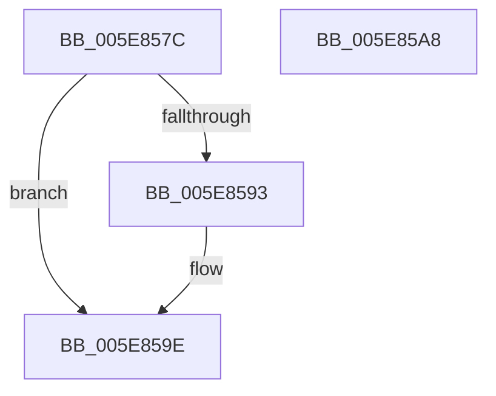

# RtlpReleasePropStoreLockExclusive

- RVA: `0x005E857C`–`0x005E85A9` (길이 `45` bytes)
- VA: `0x00000001405E857C`
- 실행 섹션: `.text`
- PDB 이름 있음: `예`; PDB Function 태그: `아니요`
- unwind 정보 RVA: `0x0005CF00`
- 디코드: `14`개 명령, `45/45` bytes 표시
- 미해석 바이트: `0` (있으면 어셈블리에 `.byte`로 보존)

> 이 문서는 커널 이미지의 기계어와 PDB 기호를 분석해 생성했습니다. 4번과 5번은 함수 원형과 자료형을 바이너리 사용 방식에서 추정한 C 해석이며 원본 소스 복구 결과는 아닙니다.

## 1. Dependencies

- 직접 호출 지점: **2**; 고유 호출 대상: **2**
- 직접 호출자로 확인된 함수: **4**
- RIP 상대 이미지 참조: **1**

### Outgoing calls
- `0x005E8585` → [ExReleaseSpinLockExclusiveFromDpcLevel](../24/ExReleaseSpinLockExclusiveFromDpcLevel_function_002497E0.md) (function, `0x002497E0`)
- `0x005E8599` → [KiLowerIrqlProcessIrqlFlags](../4F/KiLowerIrqlProcessIrqlFlags_function_004F5698.md) (function, `0x004F5698`)

### Direct callers
- [RtlCompareExchangePointerMapping](RtlCompareExchangePointerMapping_function_005E7E20.md) at `0x005E7F2E`
- [RtlCompareExchangePropertyStore](RtlCompareExchangePropertyStore_function_005E7F70.md) at `0x005E8030`
- [RtlCompareExchangePropertyStore](RtlCompareExchangePropertyStore_function_005E7F70.md) at `0x005E807B`
- [RtlCompareExchangePropertyStore](RtlCompareExchangePropertyStore_function_005E7F70.md) at `0x005E8167`
- [RtlRemovePointerMapping](RtlRemovePointerMapping_function_005E8300.md) at `0x005E839C`
- [RtlRemovePropertyStore](RtlRemovePropertyStore_function_005E83E0.md) at `0x005E849E`

### Static image references
- `0x005E858A` → RVA `0x00FC6D20` (`ALMOSTRO`; read)

## 2. Other-region calls and transfers

- 다른 실행 섹션으로 향하는 call: **0**
- 별도 외부 분기/꼬리 이동을 확인하지 못했습니다.

## 3. Assembly (complete function range)

```asm
005E857C  40 53                           push rbx
005E857E  48 83 EC 20                     sub rsp, 0x20
005E8582  0F B6 DA                        movzx ebx, dl
005E8585  E8 56 12 C6 FF                  call 0x1402497e0
005E858A  83 3D 8F E7 9D 00 00            cmp dword ptr [rip + 0x9de78f], 0
005E8591  74 0B                           je 0x1405e859e
005E8593  44 0F 20 C1                     mov rcx, cr8
005E8597  8A D3                           mov dl, bl
005E8599  E8 FA D0 F0 FF                  call 0x1404f5698
005E859E  44 0F 22 C3                     mov cr8, rbx
005E85A2  48 83 C4 20                     add rsp, 0x20
005E85A6  5B                              pop rbx
005E85A7  C3                              ret
005E85A8  CC                              int3
```

## 4. C-style interpretation (structured pseudocode)

```c
__int64 __fastcall RtlpReleasePropStoreLockExclusive(__int64 a1, unsigned __int8 a2)
{
    __int64 result;
    __int64 v_rsp;

    v_rsp = (v_rsp) - (32);
    result = ExReleaseSpinLockExclusiveFromDpcLevel(a1, a2, a3, a4);
    if ((*(unsigned int *)(v_rip + 10348431)) != 0) {
        a1 = v_cr8;
        a2 = a2;
        result = KiLowerIrqlProcessIrqlFlags(a1, a2, a3, a4);
    }
    v_rsp = (v_rsp) + (32);
    return result;
}
```

## 5. (Beta) C Style

```c
int64_t RtlpReleasePropStoreLockExclusive(int64_t Arg1, uint8_t Arg2)
{
    int64_t result;
    int64_t local_rsp;

    local_rsp = (local_rsp) - (32);
    result = ExReleaseSpinLockExclusiveFromDpcLevel(Arg1, Arg2, a3, a4);
    if ((*(uint32_t *)(v_rip + 0x9DE78F)) != 0) {
        Arg1 = v_cr8;
        Arg2 = Arg2;
        result = KiLowerIrqlProcessIrqlFlags(Arg1, Arg2, a3, a4);
    }
    local_rsp = (local_rsp) + (32);
    return result;
}
```

## 6. Execution-region graph

[열기: 2D/3D 그래프와 함수 탐색 컨트롤 패널](../../../control-panel.html?section=text&rva=0x005E857C&view=graph)

- 2D 그래프는 위에서 아래로 흐르고, 3D 그래프는 빈 공간을 드래그해 회전합니다. Shift+드래그는 이동, 휠은 확대·축소, 함수 노드 선택은 대상 보고서 이동입니다.

### Static fallback


