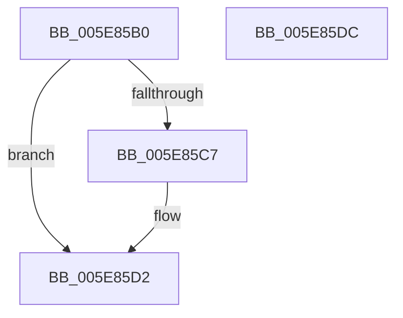

# RtlpReleasePropStoreLockShared

- RVA: `0x005E85B0`–`0x005E85DD` (길이 `45` bytes)
- VA: `0x00000001405E85B0`
- 실행 섹션: `.text`
- PDB 이름 있음: `예`; PDB Function 태그: `아니요`
- unwind 정보 RVA: `0x0005CF00`
- 디코드: `14`개 명령, `45/45` bytes 표시
- 미해석 바이트: `0` (있으면 어셈블리에 `.byte`로 보존)

> 이 문서는 커널 이미지의 기계어와 PDB 기호를 분석해 생성했습니다. 4번과 5번은 함수 원형과 자료형을 바이너리 사용 방식에서 추정한 C 해석이며 원본 소스 복구 결과는 아닙니다.

## 1. Dependencies

- 직접 호출 지점: **2**; 고유 호출 대상: **2**
- 직접 호출자로 확인된 함수: **2**
- RIP 상대 이미지 참조: **1**

### Outgoing calls
- `0x005E85B9` → [ExReleaseSpinLockSharedFromDpcLevel](../24/ExReleaseSpinLockSharedFromDpcLevel_function_0024A590.md) (function, `0x0024A590`)
- `0x005E85CD` → [KiLowerIrqlProcessIrqlFlags](../4F/KiLowerIrqlProcessIrqlFlags_function_004F5698.md) (function, `0x004F5698`)

### Direct callers
- [RtlQueryPointerMapping](RtlQueryPointerMapping_function_005E81A0.md) at `0x005E822F`
- [RtlQueryPropertyStore](RtlQueryPropertyStore_function_005E8260.md) at `0x005E82D3`

### Static image references
- `0x005E85BE` → RVA `0x00FC6D20` (`ALMOSTRO`; read)

## 2. Other-region calls and transfers

- 다른 실행 섹션으로 향하는 call: **0**
- 별도 외부 분기/꼬리 이동을 확인하지 못했습니다.

## 3. Assembly (complete function range)

```asm
005E85B0  40 53                           push rbx
005E85B2  48 83 EC 20                     sub rsp, 0x20
005E85B6  0F B6 DA                        movzx ebx, dl
005E85B9  E8 D2 1F C6 FF                  call 0x14024a590
005E85BE  83 3D 5B E7 9D 00 00            cmp dword ptr [rip + 0x9de75b], 0
005E85C5  74 0B                           je 0x1405e85d2
005E85C7  44 0F 20 C1                     mov rcx, cr8
005E85CB  8A D3                           mov dl, bl
005E85CD  E8 C6 D0 F0 FF                  call 0x1404f5698
005E85D2  44 0F 22 C3                     mov cr8, rbx
005E85D6  48 83 C4 20                     add rsp, 0x20
005E85DA  5B                              pop rbx
005E85DB  C3                              ret
005E85DC  CC                              int3
```

## 4. C-style interpretation (structured pseudocode)

```c
__int64 __fastcall RtlpReleasePropStoreLockShared(__int64 a1, unsigned __int8 a2)
{
    __int64 result;
    __int64 v_rsp;

    v_rsp = (v_rsp) - (32);
    result = ExReleaseSpinLockSharedFromDpcLevel(a1, a2, a3, a4);
    if ((*(unsigned int *)(v_rip + 10348379)) != 0) {
        a1 = v_cr8;
        a2 = a2;
        result = KiLowerIrqlProcessIrqlFlags(a1, a2, a3, a4);
    }
    v_rsp = (v_rsp) + (32);
    return result;
}
```

## 5. (Beta) C Style

```c
int64_t RtlpReleasePropStoreLockShared(int64_t Arg1, uint8_t Arg2)
{
    int64_t result;
    int64_t local_rsp;

    local_rsp = (local_rsp) - (32);
    result = ExReleaseSpinLockSharedFromDpcLevel(Arg1, Arg2, a3, a4);
    if ((*(uint32_t *)(v_rip + 0x9DE75B)) != 0) {
        Arg1 = v_cr8;
        Arg2 = Arg2;
        result = KiLowerIrqlProcessIrqlFlags(Arg1, Arg2, a3, a4);
    }
    local_rsp = (local_rsp) + (32);
    return result;
}
```

## 6. Execution-region graph

[열기: 2D/3D 그래프와 함수 탐색 컨트롤 패널](../../../control-panel.html?section=text&rva=0x005E85B0&view=graph)

- 2D 그래프는 위에서 아래로 흐르고, 3D 그래프는 빈 공간을 드래그해 회전합니다. Shift+드래그는 이동, 휠은 확대·축소, 함수 노드 선택은 대상 보고서 이동입니다.

### Static fallback


