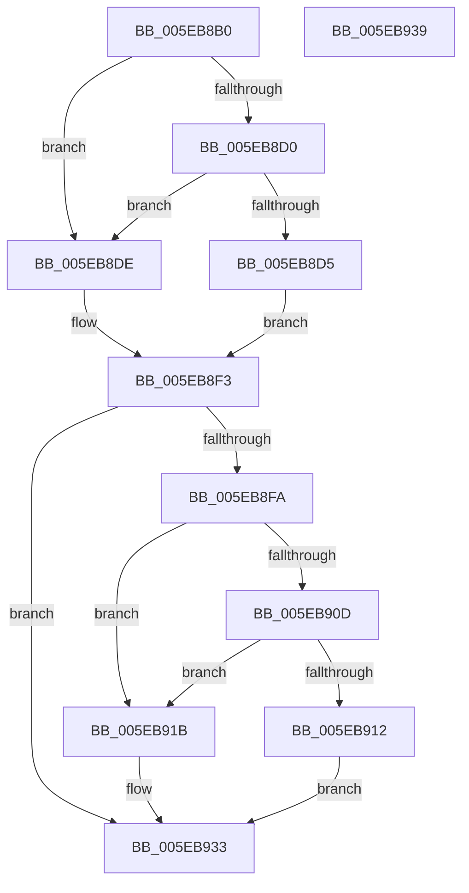

# RtlpRemoveUCRBlock

- RVA: `0x005EB8B0`–`0x005EB93A` (길이 `138` bytes)
- VA: `0x00000001405EB8B0`
- 실행 섹션: `.text`
- PDB 이름 있음: `예`; PDB Function 태그: `아니요`
- unwind 정보 RVA: `0x00064C80`
- 디코드: `43`개 명령, `138/138` bytes 표시
- 미해석 바이트: `0` (있으면 어셈블리에 `.byte`로 보존)

> 이 문서는 커널 이미지의 기계어와 PDB 기호를 분석해 생성했습니다. 4번과 5번은 함수 원형과 자료형을 바이너리 사용 방식에서 추정한 C 해석이며 원본 소스 복구 결과는 아닙니다.

## 1. Dependencies

- 직접 호출 지점: **2**; 고유 호출 대상: **1**
- 직접 호출자로 확인된 함수: **2**
- RIP 상대 이미지 참조: **0**

### Outgoing calls
- `0x005EB8EE` → [RtlpLogHeapFailure](../35/RtlpLogHeapFailure_function_0035B7BC.md) (function, `0x0035B7BC`)
- `0x005EB92E` → [RtlpLogHeapFailure](../35/RtlpLogHeapFailure_function_0035B7BC.md) (function, `0x0035B7BC`)

### Direct callers
- [RtlpDeCommitFreeBlock](RtlpDeCommitFreeBlock_function_005EA158.md) at `0x005EA237`
- [RtlpDeCommitFreeBlock](RtlpDeCommitFreeBlock_function_005EA158.md) at `0x005EA3CE`
- [RtlpFindAndCommitPages](RtlpFindAndCommitPages_function_005EA95C.md) at `0x005EAAD5`

### Static image references
- 디코드된 RIP-relative 메모리 참조가 없습니다.

## 2. Other-region calls and transfers

- 다른 실행 섹션으로 향하는 call: **0**
- 별도 외부 분기/꼬리 이동을 확인하지 못했습니다.

## 3. Assembly (complete function range)

```asm
005EB8B0  40 53                           push rbx
005EB8B2  48 83 EC 30                     sub rsp, 0x30
005EB8B6  4C 8D 42 10                     lea r8, [rdx + 0x10]
005EB8BA  48 8B DA                        mov rbx, rdx
005EB8BD  49 8B 00                        mov rax, qword ptr [r8]
005EB8C0  49 8B 48 08                     mov rcx, qword ptr [r8 + 8]
005EB8C4  4C 8B 48 08                     mov r9, qword ptr [rax + 8]
005EB8C8  48 8B 11                        mov rdx, qword ptr [rcx]
005EB8CB  49 3B D1                        cmp rdx, r9
005EB8CE  75 0E                           jne 0x1405eb8de
005EB8D0  49 3B D0                        cmp rdx, r8
005EB8D3  75 09                           jne 0x1405eb8de
005EB8D5  48 89 01                        mov qword ptr [rcx], rax
005EB8D8  48 89 48 08                     mov qword ptr [rax + 8], rcx
005EB8DC  EB 15                           jmp 0x1405eb8f3
005EB8DE  48 83 64 24 28 00               and qword ptr [rsp + 0x28], 0
005EB8E4  48 89 54 24 20                  mov qword ptr [rsp + 0x20], rdx
005EB8E9  33 D2                           xor edx, edx
005EB8EB  8D 4A 0D                        lea ecx, [rdx + 0xd]
005EB8EE  E8 C9 FE D6 FF                  call 0x14035b7bc
005EB8F3  48 83 7B 28 00                  cmp qword ptr [rbx + 0x28], 0
005EB8F8  74 39                           je 0x1405eb933
005EB8FA  48 8B 03                        mov rax, qword ptr [rbx]
005EB8FD  48 8B 4B 08                     mov rcx, qword ptr [rbx + 8]
005EB901  4C 8B 48 08                     mov r9, qword ptr [rax + 8]
005EB905  48 8B 11                        mov rdx, qword ptr [rcx]
005EB908  49 3B D1                        cmp rdx, r9
005EB90B  75 0E                           jne 0x1405eb91b
005EB90D  48 3B D3                        cmp rdx, rbx
005EB910  75 09                           jne 0x1405eb91b
005EB912  48 89 01                        mov qword ptr [rcx], rax
005EB915  48 89 48 08                     mov qword ptr [rax + 8], rcx
005EB919  EB 18                           jmp 0x1405eb933
005EB91B  48 83 64 24 28 00               and qword ptr [rsp + 0x28], 0
005EB921  4C 8B C3                        mov r8, rbx
005EB924  48 89 54 24 20                  mov qword ptr [rsp + 0x20], rdx
005EB929  33 D2                           xor edx, edx
005EB92B  8D 4A 0D                        lea ecx, [rdx + 0xd]
005EB92E  E8 89 FE D6 FF                  call 0x14035b7bc
005EB933  48 83 C4 30                     add rsp, 0x30
005EB937  5B                              pop rbx
005EB938  C3                              ret
005EB939  CC                              int3
```

## 4. C-style interpretation (structured pseudocode)

```c
__int64 __fastcall RtlpRemoveUCRBlock(__int64 a1, __int64 a2)
{
    __int64 result;
    __int64 v_rsp;
    unsigned __int64 v_stack_m10;
    unsigned __int64 v_stack_m18;

    v_rsp = (v_rsp) - (48);
    if ((*(unsigned __int64 *)(*(unsigned __int64 *)(a2 + 16 + 8))) != (*(unsigned __int64 *)(*(unsigned __int64 *)(a2 + 16) + 8))) goto loc_005EB8DE;
    if ((*(unsigned __int64 *)(*(unsigned __int64 *)(a2 + 16 + 8))) != (a2 + 16)) goto loc_005EB8DE;
    *(unsigned __int64 *)(*(unsigned __int64 *)(a2 + 16 + 8)) = *(unsigned __int64 *)(a2 + 16);
    *(unsigned __int64 *)(*(unsigned __int64 *)(a2 + 16) + 8) = *(unsigned __int64 *)(a2 + 16 + 8);
    goto loc_005EB8F3;
loc_005EB8DE:
    v_stack_m18 = *(unsigned __int64 *)(*(unsigned __int64 *)(a2 + 16 + 8));
    a2 = 0;
    result = RtlpLogHeapFailure(a2 + 13, a2, a2 + 16, *(unsigned __int64 *)(*(unsigned __int64 *)(a2 + 16) + 8));
loc_005EB8F3:
    if ((*(unsigned __int64 *)(a2 + 40)) == 0) goto loc_005EB933;
    if ((*(unsigned __int64 *)(*(unsigned __int64 *)(a2 + 8))) != (*(unsigned __int64 *)(*(unsigned __int64 *)(a2) + 8))) goto loc_005EB91B;
    if ((*(unsigned __int64 *)(*(unsigned __int64 *)(a2 + 8))) != 0) goto loc_005EB91B;
    *(unsigned __int64 *)(*(unsigned __int64 *)(a2 + 8)) = *(unsigned __int64 *)(a2);
    *(unsigned __int64 *)(*(unsigned __int64 *)(a2) + 8) = *(unsigned __int64 *)(a2 + 8);
    goto loc_005EB933;
loc_005EB91B:
    v_stack_m18 = *(unsigned __int64 *)(*(unsigned __int64 *)(a2 + 8));
    a2 = 0;
    result = RtlpLogHeapFailure(a2 + 13, a2, 0, *(unsigned __int64 *)(*(unsigned __int64 *)(a2) + 8));
loc_005EB933:
    v_rsp = (v_rsp) + (48);
    return result;
}
```

## 5. (Beta) C Style

```c
int64_t RtlpRemoveUCRBlock(int64_t Arg1, void *Arg2)
{
    uint8_t *arg2 = (uint8_t *)Arg2;

    int64_t result;
    int64_t local_rsp;
    uint64_t v_stack_m10;
    uint64_t v_stack_m18;

    local_rsp = (local_rsp) - (48);
    if ((*(uint64_t *)(*(uint64_t *)(arg2 + 0x10 + 0x8))) != (*(uint64_t *)(*(uint64_t *)(arg2 + 0x10) + 0x8))) goto loc_005EB8DE;
    if ((*(uint64_t *)(*(uint64_t *)(arg2 + 0x10 + 0x8))) != (Arg2 + 16)) goto loc_005EB8DE;
    *(uint64_t *)(*(uint64_t *)(arg2 + 0x10 + 0x8)) = *(uint64_t *)(arg2 + 0x10);
    *(uint64_t *)(*(uint64_t *)(arg2 + 0x10) + 0x8) = *(uint64_t *)(arg2 + 0x10 + 0x8);
    goto loc_005EB8F3;
loc_005EB8DE:
    v_stack_m18 = *(uint64_t *)(*(uint64_t *)(arg2 + 0x10 + 0x8));
    Arg2 = 0;
    result = RtlpLogHeapFailure(Arg2 + 13, Arg2, Arg2 + 16, *(uint64_t *)(*(uint64_t *)(arg2 + 0x10) + 0x8));
loc_005EB8F3:
    if ((*(uint64_t *)(arg2 + 0x28)) == 0) goto loc_005EB933;
    if ((*(uint64_t *)(*(uint64_t *)(arg2 + 0x8))) != (*(uint64_t *)(*(uint64_t *)(arg2) + 0x8))) goto loc_005EB91B;
    if ((*(uint64_t *)(*(uint64_t *)(arg2 + 0x8))) != 0) goto loc_005EB91B;
    *(uint64_t *)(*(uint64_t *)(arg2 + 0x8)) = *(uint64_t *)(arg2);
    *(uint64_t *)(*(uint64_t *)(arg2) + 0x8) = *(uint64_t *)(arg2 + 0x8);
    goto loc_005EB933;
loc_005EB91B:
    v_stack_m18 = *(uint64_t *)(*(uint64_t *)(arg2 + 0x8));
    Arg2 = 0;
    result = RtlpLogHeapFailure(Arg2 + 13, Arg2, 0, *(uint64_t *)(*(uint64_t *)(arg2) + 0x8));
loc_005EB933:
    local_rsp = (local_rsp) + (48);
    return result;
}
```

### 관측된 메모리 오프셋

구조체 형식이 확인되지 않은 접근은 인자 기준의 오프셋으로만 기록했습니다.

| 기준 인자 | 오프셋 표현 | 폭 (bit) | 접근 |
|---|---:|---:|---|
| `Arg2` | `+ 0x0` | `64` | `R` |
| `Arg2` | `+ 0x8` | `64` | `R` |
| `Arg2` | `+ 0x10` | `64` | `R` |
| `Arg2` | `+ 0x28` | `64` | `R` |

## 6. Execution-region graph

[열기: 2D/3D 그래프와 함수 탐색 컨트롤 패널](../../../control-panel.html?section=text&rva=0x005EB8B0&view=graph)

- 2D 그래프는 위에서 아래로 흐르고, 3D 그래프는 빈 공간을 드래그해 회전합니다. Shift+드래그는 이동, 휠은 확대·축소, 함수 노드 선택은 대상 보고서 이동입니다.

### Static fallback


