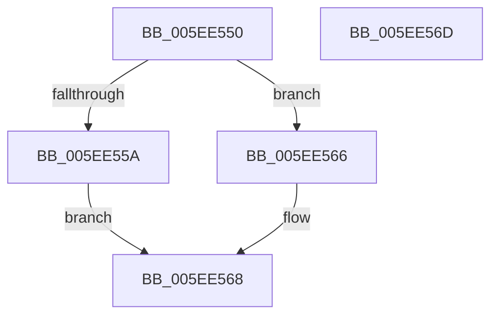

# RtlpRtlpCtSelfSubscribeCallback

- RVA: `0x005EE550`–`0x005EE56E` (길이 `30` bytes)
- VA: `0x00000001405EE550`
- 실행 섹션: `.text`
- PDB 이름 있음: `예`; PDB Function 태그: `아니요`
- unwind 정보 RVA: `0x0005C788`
- 디코드: `10`개 명령, `30/30` bytes 표시
- 미해석 바이트: `0` (있으면 어셈블리에 `.byte`로 보존)

> 이 문서는 커널 이미지의 기계어와 PDB 기호를 분석해 생성했습니다. 4번과 5번은 함수 원형과 자료형을 바이너리 사용 방식에서 추정한 C 해석이며 원본 소스 복구 결과는 아닙니다.

## 1. Dependencies

- 직접 호출 지점: **1**; 고유 호출 대상: **1**
- 직접 호출자로 확인된 함수: **0**
- RIP 상대 이미지 참조: **0**

### Outgoing calls
- `0x005EE55F` → [RtlpCtSelfSubscribe](../../page/79/RtlpCtSelfSubscribe_function_00794A84.md) (function, `0x00794A84`)

### Direct callers
- 이 함수 시작 RVA로 연결되는 직접 call은 확인되지 않았습니다. 간접 호출은 완전히 역산할 수 없습니다.

### Static image references
- 디코드된 RIP-relative 메모리 참조가 없습니다.

## 2. Other-region calls and transfers

- 다른 실행 섹션으로 향하는 call: **1**
  - `0x005EE55F` → [RtlpCtSelfSubscribe](../../page/79/RtlpCtSelfSubscribe_function_00794A84.md) (`.text` → `PAGE`)
- 별도 외부 분기/꼬리 이동을 확인하지 못했습니다.

## 3. Assembly (complete function range)

```asm
005EE550  48 83 EC 28                     sub rsp, 0x28
005EE554  41 F6 C0 08                     test r8b, 8
005EE558  74 0C                           je 0x1405ee566
005EE55A  48 8B 4C 24 58                  mov rcx, qword ptr [rsp + 0x58]
005EE55F  E8 20 65 1A 00                  call 0x140794a84
005EE564  EB 02                           jmp 0x1405ee568
005EE566  33 C0                           xor eax, eax
005EE568  48 83 C4 28                     add rsp, 0x28
005EE56C  C3                              ret
005EE56D  CC                              int3
```

## 4. C-style interpretation (structured pseudocode)

```c
__int64 __fastcall RtlpRtlpCtSelfSubscribeCallback(__int64 a1, __int64 a2, unsigned __int8 a3, __int64 a4, __int64 a5, __int64 a6)
{
    __int64 result;
    __int64 v_rsp;

    v_rsp = (v_rsp) - (40);
    if (((a3) & (8)) == 0) goto loc_005EE566;
    result = RtlpCtSelfSubscribe(a6, a2, a3, a4);
    goto loc_005EE568;
loc_005EE566:
    result = 0;
loc_005EE568:
    v_rsp = (v_rsp) + (40);
    return result;
}
```

## 5. (Beta) C Style

```c
int64_t RtlpRtlpCtSelfSubscribeCallback(int64_t Arg1, int64_t Arg2, uint8_t Arg3, int64_t Arg4, uint64_t Arg5, int64_t Arg6)
{
    int64_t result;
    int64_t local_rsp;

    local_rsp = (local_rsp) - (40);
    if (((Arg3) & (8)) == 0) goto loc_005EE566;
    result = RtlpCtSelfSubscribe(Arg6, Arg2, Arg3, Arg4);
    goto loc_005EE568;
loc_005EE566:
    result = 0;
loc_005EE568:
    local_rsp = (local_rsp) + (40);
    return result;
}
```

## 6. Execution-region graph

[열기: 2D/3D 그래프와 함수 탐색 컨트롤 패널](../../../control-panel.html?section=text&rva=0x005EE550&view=graph)

- 2D 그래프는 위에서 아래로 흐르고, 3D 그래프는 빈 공간을 드래그해 회전합니다. Shift+드래그는 이동, 휠은 확대·축소, 함수 노드 선택은 대상 보고서 이동입니다.

### Static fallback


