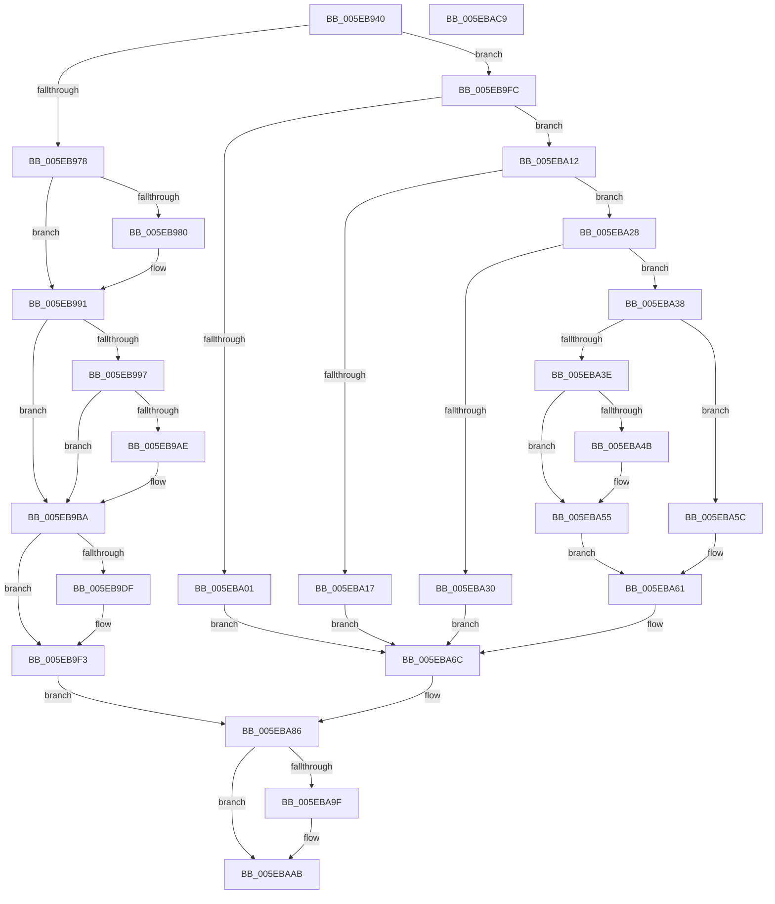

# RtlpSetupExtendedBlock

- RVA: `0x005EB940`–`0x005EBACA` (길이 `394` bytes)
- VA: `0x00000001405EB940`
- 실행 섹션: `.text`
- PDB 이름 있음: `예`; PDB Function 태그: `아니요`
- unwind 정보 RVA: `0x000BDE90`
- 디코드: `111`개 명령, `394/394` bytes 표시
- 미해석 바이트: `0` (있으면 어셈블리에 `.byte`로 보존)

> 이 문서는 커널 이미지의 기계어와 PDB 기호를 분석해 생성했습니다. 4번과 5번은 함수 원형과 자료형을 바이너리 사용 방식에서 추정한 C 해석이며 원본 소스 복구 결과는 아닙니다.

## 1. Dependencies

- 직접 호출 지점: **3**; 고유 호출 대상: **3**
- 직접 호출자로 확인된 함수: **1**
- RIP 상대 이미지 참조: **0**

### Outgoing calls
- `0x005EB989` → [ExAcquireResourceExclusiveLite](../21/ExAcquireResourceExclusiveLite_function_00214E20.md) (function, `0x00214E20`)
- `0x005EB9B5` → [RtlpAnalyzeHeapFailure](../5F/RtlpAnalyzeHeapFailure_function_005F0F9C.md) (function, `0x005F0F9C`)
- `0x005EBAA6` → [ExReleaseResourceLite](../25/ExReleaseResourceLite_function_0025FA10.md) (function, `0x0025FA10`)

### Direct callers
- [sub_006DE680](../6D/Unknown_function_006DE680.md) at `0x006DE7C4`

### Static image references
- 디코드된 RIP-relative 메모리 참조가 없습니다.

## 2. Other-region calls and transfers

- 다른 실행 섹션으로 향하는 call: **0**
- 별도 외부 분기/꼬리 이동을 확인하지 못했습니다.

## 3. Assembly (complete function range)

```asm
005EB940  48 8B C4                        mov rax, rsp
005EB943  48 89 58 08                     mov qword ptr [rax + 8], rbx
005EB947  48 89 70 10                     mov qword ptr [rax + 0x10], rsi
005EB94B  48 89 78 18                     mov qword ptr [rax + 0x18], rdi
005EB94F  4C 89 70 20                     mov qword ptr [rax + 0x20], r14
005EB953  41 57                           push r15
005EB955  48 83 EC 30                     sub rsp, 0x30
005EB959  0F B7 74 24 60                  movzx esi, word ptr [rsp + 0x60]
005EB95E  48 8B F9                        mov rdi, rcx
005EB961  41 0F B6 48 FF                  movzx ecx, byte ptr [r8 - 1]
005EB966  49 03 F0                        add rsi, r8
005EB969  45 32 FF                        xor r15b, r15b
005EB96C  49 8B D8                        mov rbx, r8
005EB96F  80 F9 04                        cmp cl, 4
005EB972  0F 85 84 00 00 00               jne 0x1405eb9fc
005EB978  0B 57 74                        or edx, dword ptr [rdi + 0x74]
005EB97B  F6 C2 01                        test dl, 1
005EB97E  75 11                           jne 0x1405eb991
005EB980  48 8B 8F 60 01 00 00            mov rcx, qword ptr [rdi + 0x160]
005EB987  B2 01                           mov dl, 1
005EB989  E8 92 94 C2 FF                  call 0x140214e20
005EB98E  41 B7 01                        mov r15b, 1
005EB991  83 7F 7C 00                     cmp dword ptr [rdi + 0x7c], 0
005EB995  74 23                           je 0x1405eb9ba
005EB997  8B 8F 88 00 00 00               mov ecx, dword ptr [rdi + 0x88]
005EB99D  31 4B F8                        xor dword ptr [rbx - 8], ecx
005EB9A0  8A 4B FA                        mov cl, byte ptr [rbx - 6]
005EB9A3  32 4B F9                        xor cl, byte ptr [rbx - 7]
005EB9A6  32 4B F8                        xor cl, byte ptr [rbx - 8]
005EB9A9  38 4B FB                        cmp byte ptr [rbx - 5], cl
005EB9AC  74 0C                           je 0x1405eb9ba
005EB9AE  48 8D 53 F0                     lea rdx, [rbx - 0x10]
005EB9B2  48 8B CF                        mov rcx, rdi
005EB9B5  E8 E2 55 00 00                  call 0x1405f0f9c
005EB9BA  0F B7 44 24 60                  movzx eax, word ptr [rsp + 0x60]
005EB9BF  66 03 43 F8                     add ax, word ptr [rbx - 8]
005EB9C3  44 0F B7 44 24 60               movzx r8d, word ptr [rsp + 0x60]
005EB9C9  66 41 C1 E8 04                  shr r8w, 4
005EB9CE  0F B7 D0                        movzx edx, ax
005EB9D1  66 89 53 F8                     mov word ptr [rbx - 8], dx
005EB9D5  44 88 43 FE                     mov byte ptr [rbx - 2], r8b
005EB9D9  83 7F 7C 00                     cmp dword ptr [rdi + 0x7c], 0
005EB9DD  74 14                           je 0x1405eb9f3
005EB9DF  8A 4B FA                        mov cl, byte ptr [rbx - 6]
005EB9E2  32 4B F9                        xor cl, byte ptr [rbx - 7]
005EB9E5  32 CA                           xor cl, dl
005EB9E7  88 4B FB                        mov byte ptr [rbx - 5], cl
005EB9EA  8B 87 88 00 00 00               mov eax, dword ptr [rdi + 0x88]
005EB9F0  31 43 F8                        xor dword ptr [rbx - 8], eax
005EB9F3  44 88 46 FE                     mov byte ptr [rsi - 2], r8b
005EB9F7  E9 8A 00 00 00                  jmp 0x1405eba86
005EB9FC  80 F9 05                        cmp cl, 5
005EB9FF  75 11                           jne 0x1405eba12
005EBA01  0F B7 97 8C 00 00 00            movzx edx, word ptr [rdi + 0x8c]
005EBA08  41 0F B7 40 FC                  movzx eax, word ptr [r8 - 4]
005EBA0D  48 33 D0                        xor rdx, rax
005EBA10  EB 5A                           jmp 0x1405eba6c
005EBA12  F6 C1 40                        test cl, 0x40
005EBA15  74 11                           je 0x1405eba28
005EBA17  48 8B C1                        mov rax, rcx
005EBA1A  83 E0 3F                        and eax, 0x3f
005EBA1D  48 03 C0                        add rax, rax
005EBA20  41 0F B7 54 C0 FC               movzx edx, word ptr [r8 + rax*8 - 4]
005EBA26  EB 44                           jmp 0x1405eba6c
005EBA28  8A C1                           mov al, cl
005EBA2A  24 3F                           and al, 0x3f
005EBA2C  3C 3F                           cmp al, 0x3f
005EBA2E  74 08                           je 0x1405eba38
005EBA30  48 8B D1                        mov rdx, rcx
005EBA33  83 E2 3F                        and edx, 0x3f
005EBA36  EB 34                           jmp 0x1405eba6c
005EBA38  83 7F 7C 00                     cmp dword ptr [rdi + 0x7c], 0
005EBA3C  74 1E                           je 0x1405eba5c
005EBA3E  41 8B 48 F8                     mov ecx, dword ptr [r8 - 8]
005EBA42  89 4C 24 28                     mov dword ptr [rsp + 0x28], ecx
005EBA46  85 4F 7C                        test dword ptr [rdi + 0x7c], ecx
005EBA49  74 0A                           je 0x1405eba55
005EBA4B  33 8F 88 00 00 00               xor ecx, dword ptr [rdi + 0x88]
005EBA51  89 4C 24 28                     mov dword ptr [rsp + 0x28], ecx
005EBA55  0F B7 44 24 28                  movzx eax, word ptr [rsp + 0x28]
005EBA5A  EB 05                           jmp 0x1405eba61
005EBA5C  41 0F B7 40 F8                  movzx eax, word ptr [r8 - 8]
005EBA61  0F B7 C0                        movzx eax, ax
005EBA64  48 03 C0                        add rax, rax
005EBA67  49 8B 54 C0 F0                  mov rdx, qword ptr [r8 + rax*8 - 0x10]
005EBA6C  0F B7 4C 24 60                  movzx ecx, word ptr [rsp + 0x60]
005EBA71  66 C1 E9 04                     shr cx, 4
005EBA75  88 4E FE                        mov byte ptr [rsi - 2], cl
005EBA78  41 8A 40 FF                     mov al, byte ptr [r8 - 1]
005EBA7C  24 C0                           and al, 0xc0
005EBA7E  0A C1                           or al, cl
005EBA80  0C 40                           or al, 0x40
005EBA82  41 88 40 FF                     mov byte ptr [r8 - 1], al
005EBA86  66 03 54 24 60                  add dx, word ptr [rsp + 0x60]
005EBA8B  8B 4C 24 68                     mov ecx, dword ptr [rsp + 0x68]
005EBA8F  C6 46 FF 05                     mov byte ptr [rsi - 1], 5
005EBA93  66 89 56 FC                     mov word ptr [rsi - 4], dx
005EBA97  89 4E F8                        mov dword ptr [rsi - 8], ecx
005EBA9A  45 84 FF                        test r15b, r15b
005EBA9D  74 0C                           je 0x1405ebaab
005EBA9F  48 8B 8F 60 01 00 00            mov rcx, qword ptr [rdi + 0x160]
005EBAA6  E8 65 3F C7 FF                  call 0x14025fa10
005EBAAB  48 8B 5C 24 40                  mov rbx, qword ptr [rsp + 0x40]
005EBAB0  48 8B C6                        mov rax, rsi
005EBAB3  48 8B 74 24 48                  mov rsi, qword ptr [rsp + 0x48]
005EBAB8  48 8B 7C 24 50                  mov rdi, qword ptr [rsp + 0x50]
005EBABD  4C 8B 74 24 58                  mov r14, qword ptr [rsp + 0x58]
005EBAC2  48 83 C4 30                     add rsp, 0x30
005EBAC6  41 5F                           pop r15
005EBAC8  C3                              ret
005EBAC9  CC                              int3
```

## 4. C-style interpretation (structured pseudocode)

```c
__int64 __fastcall RtlpSetupExtendedBlock(__int64 a1, int a2, __int64 a3, __int64 a4, unsigned __int16 a5, unsigned int a6)
{
    __int64 result;
    __int64 v_r15;
    __int64 v_rsi;
    __int64 v_rsp;
    unsigned int v_stack_m10;
    unsigned __int64 v_stack_p10;
    unsigned __int64 v_stack_p18;
    unsigned __int64 v_stack_p20;
    unsigned __int64 v_stack_p8;

    *(unsigned __int64 *)(v_rsp + 8) = v_rbx;
    *(unsigned __int64 *)(v_rsp + 16) = v_rsi;
    *(unsigned __int64 *)(v_rsp + 24) = v_rdi;
    *(unsigned __int64 *)(v_rsp + 32) = v_r14;
    v_rsp = (v_rsp) - (48);
    v_rsi = (a5) + (a3);
    v_r15 = 0;
    if (((unsigned __int8)(*(unsigned __int8 *)(a3 - 1))) != 4) goto loc_005EB9FC;
    a2 = (unsigned int)((a2) | (*(unsigned int *)(a1 + 116)));
    result = v_rsp;
    if ((((unsigned __int8)(a2)) & (1)) == 0) {
        a1 = *(unsigned __int64 *)(a1 + 352);
        a2 = 1;
        result = ExAcquireResourceExclusiveLite(a1, a2, a3, a4);
        v_r15 = 1;
    }
    if ((*(unsigned int *)(a1 + 124)) == 0) goto loc_005EB9BA;
    a1 = (unsigned __int8)((*(unsigned __int8 *)(a3 - 6)) ^ (*(unsigned __int8 *)(a3 - 7)));
    a1 = (unsigned __int8)((a1) ^ (*(unsigned __int8 *)(a3 - 8)));
    if ((*(unsigned __int8 *)(a3 - 5)) != ((unsigned __int8)(a1))) {
        a2 = a3 - 16;
        a1 = a1;
        result = RtlpAnalyzeHeapFailure(a1, a2, a3, a4);
    }
    result = (unsigned __int16)((a5) + (*(unsigned __int16 *)(a3 - 8)));
    a3 = (unsigned __int16)((a5) >> (4));
    *(unsigned __int16 *)(a3 - 8) = (unsigned __int16)((unsigned __int16)(result));
    *(unsigned __int8 *)(a3 - 2) = (unsigned __int8)(a3);
    if ((*(unsigned int *)(a1 + 124)) != 0) {
        a1 = *(unsigned __int8 *)(a3 - 6);
        a1 = (unsigned __int8)((a1) ^ (*(unsigned __int8 *)(a3 - 7)));
        a1 = (unsigned __int8)((a1) ^ ((unsigned __int8)((unsigned __int16)(result))));
        *(unsigned __int8 *)(a3 - 5) = (unsigned __int8)(a1);
        result = *(unsigned int *)(a1 + 136);
    }
    *(unsigned __int8 *)(v_rsi - 2) = (unsigned __int8)(a3);
    goto loc_005EBA86;
loc_005EB9FC:
    if (((unsigned __int8)(a1)) != 5) goto loc_005EBA12;
    a2 = (*(unsigned __int16 *)(a1 + 140)) ^ (*(unsigned __int16 *)(a3 - 4));
    goto loc_005EBA6C;
loc_005EBA12:
    if ((((unsigned __int8)(a1)) & (64)) == 0) goto loc_005EBA28;
    result = (unsigned int)((a1) & (63));
    result = (result) + (result);
    goto loc_005EBA6C;
loc_005EBA28:
    result = (unsigned __int8)(((unsigned __int8)(a1)) & (63));
    if (((unsigned __int8)(result)) == 63) goto loc_005EBA38;
    a2 = (unsigned int)((a1) & (63));
    goto loc_005EBA6C;
loc_005EBA38:
    if ((*(unsigned int *)(a1 + 124)) == 0) goto loc_005EBA5C;
    v_stack_m10 = (unsigned int)((unsigned int)(*(unsigned int *)(a3 - 8)));
    if (((*(unsigned int *)(a1 + 124)) & ((unsigned int)((unsigned int)(*(unsigned int *)(a3 - 8))))) != 0) {
        a1 = (unsigned int)(((unsigned int)(*(unsigned int *)(a3 - 8))) ^ (*(unsigned int *)(a1 + 136)));
        v_stack_m10 = (unsigned int)(a1);
    }
    goto loc_005EBA61;
loc_005EBA5C:
loc_005EBA61:
    result = ((unsigned __int16)(*(unsigned __int16 *)(a3 - 8))) + ((unsigned __int16)(*(unsigned __int16 *)(a3 - 8)));
loc_005EBA6C:
    a1 = (unsigned __int16)((a5) >> (4));
    *(unsigned __int8 *)(v_rsi - 2) = (unsigned __int8)(a1);
    result = (unsigned __int8)((*(unsigned __int8 *)(a3 - 1)) & (192));
    result = (unsigned __int8)((result) | ((unsigned __int8)(a1)));
    result = (unsigned __int8)((result) | (64));
    *(unsigned __int8 *)(a3 - 1) = (unsigned __int8)(result);
loc_005EBA86:
    a2 = (unsigned __int16)((*(unsigned __int64 *)(a3 + result * 8 - 16)) + (a5));
    *(unsigned __int8 *)(v_rsi - 1) = 5;
    *(unsigned __int16 *)(v_rsi - 4) = (unsigned __int16)(a2);
    *(unsigned int *)(v_rsi - 8) = (unsigned int)((unsigned int)(a6));
    if ((unsigned __int8)(v_r15) != 0) {
        a1 = *(unsigned __int64 *)(a1 + 352);
        result = ExReleaseResourceLite(a1, a2, a3, a4);
    }
    v_rsp = (v_rsp) + (48);
    return v_rsi;
}
```

## 5. (Beta) C Style

```c
int64_t RtlpSetupExtendedBlock(void *Arg1, int32_t Arg2, void *Arg3, int64_t Arg4, void *Arg5, uint32_t Arg6)
{
    uint8_t *arg1 = (uint8_t *)Arg1;
    uint8_t *arg3 = (uint8_t *)Arg3;
    uint8_t *arg5 = (uint8_t *)Arg5;

    int64_t result;
    int64_t local_r15;
    int64_t local_rsi;
    int64_t local_rsp;
    uint32_t v_stack_m10;
    uint64_t v_stack_p10;
    uint64_t v_stack_p18;
    uint64_t v_stack_p20;
    uint64_t v_stack_p8;

    *(uint64_t *)(local_rsp + 0x8) = local_rbx;
    *(uint64_t *)(local_rsp + 0x10) = local_rsi;
    *(uint64_t *)(local_rsp + 0x18) = local_rdi;
    *(uint64_t *)(local_rsp + 0x20) = local_r14;
    local_rsp = (local_rsp) - (48);
    local_rsi = (Arg5) + (Arg3);
    local_r15 = 0;
    if (((uint8_t)(*(uint8_t *)(arg3 - 0x1))) != 4) goto loc_005EB9FC;
    Arg2 = (uint32_t)((Arg2) | (*(uint32_t *)(arg1 + 0x74)));
    result = local_rsp;
    if ((((uint8_t)(Arg2)) & (1)) == 0) {
        Arg1 = *(uint64_t *)(arg1 + 0x160);
        Arg2 = 1;
        result = ExAcquireResourceExclusiveLite(Arg1, Arg2, Arg3, Arg4);
        local_r15 = 1;
    }
    if ((*(uint32_t *)(arg1 + 0x7C)) == 0) goto loc_005EB9BA;
    Arg1 = (uint8_t)((*(uint8_t *)(arg3 - 0x6)) ^ (*(uint8_t *)(arg3 - 0x7)));
    Arg1 = (uint8_t)((Arg1) ^ (*(uint8_t *)(arg3 - 0x8)));
    if ((*(uint8_t *)(arg3 - 0x5)) != ((uint8_t)(Arg1))) {
        Arg2 = Arg3 - 16;
        Arg1 = Arg1;
        result = RtlpAnalyzeHeapFailure(Arg1, Arg2, Arg3, Arg4);
    }
    result = (uint16_t)((Arg5) + (*(uint16_t *)(arg3 - 0x8)));
    Arg3 = (uint16_t)((Arg5) >> (4));
    *(uint16_t *)(arg3 - 0x8) = (uint16_t)((uint16_t)(result));
    *(uint8_t *)(arg3 - 0x2) = (uint8_t)(Arg3);
    if ((*(uint32_t *)(arg1 + 0x7C)) != 0) {
        Arg1 = *(uint8_t *)(arg3 - 0x6);
        Arg1 = (uint8_t)((Arg1) ^ (*(uint8_t *)(arg3 - 0x7)));
        Arg1 = (uint8_t)((Arg1) ^ ((uint8_t)((uint16_t)(result))));
        *(uint8_t *)(arg3 - 0x5) = (uint8_t)(Arg1);
        result = *(uint32_t *)(arg1 + 0x88);
    }
    *(uint8_t *)(local_rsi - 0x2) = (uint8_t)(Arg3);
    goto loc_005EBA86;
loc_005EB9FC:
    if (((uint8_t)(Arg1)) != 5) goto loc_005EBA12;
    Arg2 = (*(uint16_t *)(arg1 + 0x8C)) ^ (*(uint16_t *)(arg3 - 0x4));
    goto loc_005EBA6C;
loc_005EBA12:
    if ((((uint8_t)(Arg1)) & (64)) == 0) goto loc_005EBA28;
    result = (uint32_t)((Arg1) & (63));
    result = (result) + (result);
    goto loc_005EBA6C;
loc_005EBA28:
    result = (uint8_t)(((uint8_t)(Arg1)) & (63));
    if (((uint8_t)(result)) == 63) goto loc_005EBA38;
    Arg2 = (uint32_t)((Arg1) & (63));
    goto loc_005EBA6C;
loc_005EBA38:
    if ((*(uint32_t *)(arg1 + 0x7C)) == 0) goto loc_005EBA5C;
    v_stack_m10 = (uint32_t)((uint32_t)(*(uint32_t *)(arg3 - 0x8)));
    if (((*(uint32_t *)(arg1 + 0x7C)) & ((uint32_t)((uint32_t)(*(uint32_t *)(arg3 - 0x8))))) != 0) {
        Arg1 = (uint32_t)(((uint32_t)(*(uint32_t *)(arg3 - 0x8))) ^ (*(uint32_t *)(arg1 + 0x88)));
        v_stack_m10 = (uint32_t)(Arg1);
    }
    goto loc_005EBA61;
loc_005EBA5C:
loc_005EBA61:
    result = ((uint16_t)(*(uint16_t *)(arg3 - 0x8))) + ((uint16_t)(*(uint16_t *)(arg3 - 0x8)));
loc_005EBA6C:
    Arg1 = (uint16_t)((Arg5) >> (4));
    *(uint8_t *)(local_rsi - 0x2) = (uint8_t)(Arg1);
    result = (uint8_t)((*(uint8_t *)(arg3 - 0x1)) & (192));
    result = (uint8_t)((result) | ((uint8_t)(Arg1)));
    result = (uint8_t)((result) | (64));
    *(uint8_t *)(arg3 - 0x1) = (uint8_t)(result);
loc_005EBA86:
    Arg2 = (uint16_t)((*(uint64_t *)(arg3 + result * 8 - 0x10)) + (Arg5));
    *(uint8_t *)(local_rsi - 0x1) = 5;
    *(uint16_t *)(local_rsi - 0x4) = (uint16_t)(Arg2);
    *(uint32_t *)(local_rsi - 0x8) = (uint32_t)((uint32_t)(Arg6));
    if ((uint8_t)(local_r15) != 0) {
        Arg1 = *(uint64_t *)(arg1 + 0x160);
        result = ExReleaseResourceLite(Arg1, Arg2, Arg3, Arg4);
    }
    local_rsp = (local_rsp) + (48);
    return local_rsi;
}
```

### 관측된 메모리 오프셋

구조체 형식이 확인되지 않은 접근은 인자 기준의 오프셋으로만 기록했습니다.

| 기준 인자 | 오프셋 표현 | 폭 (bit) | 접근 |
|---|---:|---:|---|
| `Arg1` | `+ 0x74` | `32` | `R` |
| `Arg1` | `+ 0x7C` | `32` | `R` |
| `Arg1` | `+ 0x88` | `32` | `R` |
| `Arg1` | `+ 0x8C` | `16` | `R` |
| `Arg1` | `+ 0x160` | `64` | `R` |
| `Arg3` | `- 0x10` | `64` | `R` |
| `Arg3` | `- 0x10 + rax*8` | `64` | `R` |
| `Arg3` | `- 0x8` | `8` | `R` |
| `Arg3` | `- 0x8` | `16` | `R` |
| `Arg3` | `- 0x8` | `16` | `W` |
| `Arg3` | `- 0x8` | `32` | `R` |
| `Arg3` | `- 0x8` | `32` | `R/W` |
| `Arg3` | `- 0x7` | `8` | `R` |
| `Arg3` | `- 0x6` | `8` | `R` |
| `Arg3` | `- 0x5` | `8` | `R` |
| `Arg3` | `- 0x5` | `8` | `W` |
| `Arg3` | `- 0x4` | `16` | `R` |
| `Arg3` | `- 0x4 + rax*8` | `16` | `R` |
| `Arg3` | `- 0x2` | `8` | `W` |
| `Arg3` | `- 0x1` | `8` | `R` |
| `Arg3` | `- 0x1` | `8` | `W` |
| `Arg5` | `- 0x8` | `32` | `W` |
| `Arg5` | `- 0x4` | `16` | `W` |
| `Arg5` | `- 0x2` | `8` | `W` |
| `Arg5` | `- 0x1` | `8` | `W` |

## 6. Execution-region graph

[열기: 2D/3D 그래프와 함수 탐색 컨트롤 패널](../../../control-panel.html?section=text&rva=0x005EB940&view=graph)

- 2D 그래프는 위에서 아래로 흐르고, 3D 그래프는 빈 공간을 드래그해 회전합니다. Shift+드래그는 이동, 휠은 확대·축소, 함수 노드 선택은 대상 보고서 이동입니다.

### Static fallback


