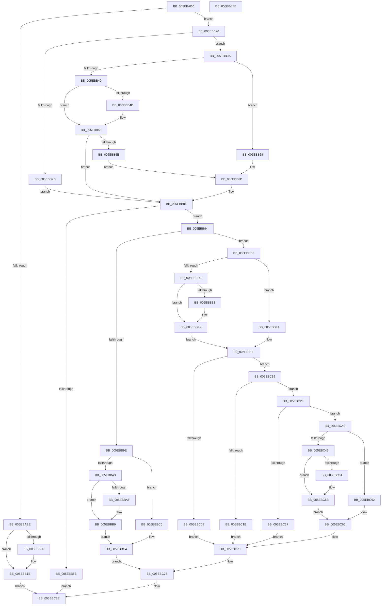

# RtlpSizeHeapInternal

- RVA: `0x005EBAD0`–`0x005EBC8F` (길이 `447` bytes)
- VA: `0x00000001405EBAD0`
- 실행 섹션: `.text`
- PDB 이름 있음: `예`; PDB Function 태그: `아니요`
- unwind 정보 RVA: `0x000CFC84`
- 디코드: `130`개 명령, `447/447` bytes 표시
- 미해석 바이트: `0` (있으면 어셈블리에 `.byte`로 보존)

> 이 문서는 커널 이미지의 기계어와 PDB 기호를 분석해 생성했습니다. 4번과 5번은 함수 원형과 자료형을 바이너리 사용 방식에서 추정한 C 해석이며 원본 소스 복구 결과는 아닙니다.

## 1. Dependencies

- 직접 호출 지점: **4**; 고유 호출 대상: **3**
- 직접 호출자로 확인된 함수: **1**
- RIP 상대 이미지 참조: **0**

### Outgoing calls
- `0x005EBAF8` → [RtlpHpVsChunkSize](../60/RtlpHpVsChunkSize_function_00605588.md) (function, `0x00605588`)
- `0x005EBB19` → [RtlpLogHeapFailure](../35/RtlpLogHeapFailure_function_0035B7BC.md) (function, `0x0035B7BC`)
- `0x005EBB30` → [RtlpProbeUserBufferSafe](../4F/RtlpProbeUserBufferSafe_function_004F6F60.md) (function, `0x004F6F60`)
- `0x005EBB7F` → [RtlpLogHeapFailure](../35/RtlpLogHeapFailure_function_0035B7BC.md) (function, `0x0035B7BC`)

### Direct callers
- [RtlSizeHeap](RtlSizeHeap_function_005E6F00.md) at `0x005E6F32`

### Static image references
- 디코드된 RIP-relative 메모리 참조가 없습니다.

## 2. Other-region calls and transfers

- 다른 실행 섹션으로 향하는 call: **0**
- 별도 외부 분기/꼬리 이동을 확인하지 못했습니다.

## 3. Assembly (complete function range)

```asm
005EBAD0  48 89 5C 24 08                  mov qword ptr [rsp + 8], rbx
005EBAD5  48 89 6C 24 10                  mov qword ptr [rsp + 0x10], rbp
005EBADA  56                              push rsi
005EBADB  48 83 EC 50                     sub rsp, 0x50
005EBADF  81 79 10 DD CC DD CC            cmp dword ptr [rcx + 0x10], 0xccddccdd
005EBAE6  49 8B F0                        mov rsi, r8
005EBAE9  48 8B D9                        mov rbx, rcx
005EBAEC  75 38                           jne 0x1405ebb26
005EBAEE  48 83 C1 40                     add rcx, 0x40
005EBAF2  45 33 C9                        xor r9d, r9d
005EBAF5  49 8B D0                        mov rdx, r8
005EBAF8  E8 8B 9A 01 00                  call 0x140605588
005EBAFD  48 8B E8                        mov rbp, rax
005EBB00  48 83 F8 FF                     cmp rax, -1
005EBB04  75 18                           jne 0x1405ebb1e
005EBB06  4C 21 4C 24 28                  and qword ptr [rsp + 0x28], r9
005EBB0B  8D 48 0A                        lea ecx, [rax + 0xa]
005EBB0E  4C 21 4C 24 20                  and qword ptr [rsp + 0x20], r9
005EBB13  4C 8B C6                        mov r8, rsi
005EBB16  48 8B D3                        mov rdx, rbx
005EBB19  E8 9E FC D6 FF                  call 0x14035b7bc
005EBB1E  48 8B C5                        mov rax, rbp
005EBB21  E9 58 01 00 00                  jmp 0x1405ebc7e
005EBB26  8B 41 78                        mov eax, dword ptr [rcx + 0x78]
005EBB29  A8 01                           test al, 1
005EBB2B  74 0D                           je 0x1405ebb3a
005EBB2D  48 8B D6                        mov rdx, rsi
005EBB30  E8 2B B4 F0 FF                  call 0x1404f6f60
005EBB35  48 8B C8                        mov rcx, rax
005EBB38  EB 4C                           jmp 0x1405ebb86
005EBB3A  40 F6 C6 0F                     test sil, 0xf
005EBB3E  75 28                           jne 0x1405ebb68
005EBB40  49 8D 48 F0                     lea rcx, [r8 - 0x10]
005EBB44  0F 0D 09                        prefetchw byte ptr [rcx]
005EBB47  80 79 0F 05                     cmp byte ptr [rcx + 0xf], 5
005EBB4B  75 0B                           jne 0x1405ebb58
005EBB4D  0F B6 41 0E                     movzx eax, byte ptr [rcx + 0xe]
005EBB51  48 C1 E0 04                     shl rax, 4
005EBB55  48 2B C8                        sub rcx, rax
005EBB58  F6 41 0F 3F                     test byte ptr [rcx + 0xf], 0x3f
005EBB5C  75 28                           jne 0x1405ebb86
005EBB5E  4C 8B C1                        mov r8, rcx
005EBB61  B9 08 00 00 00                  mov ecx, 8
005EBB66  EB 05                           jmp 0x1405ebb6d
005EBB68  B9 09 00 00 00                  mov ecx, 9
005EBB6D  48 83 64 24 28 00               and qword ptr [rsp + 0x28], 0
005EBB73  45 33 C9                        xor r9d, r9d
005EBB76  48 83 64 24 20 00               and qword ptr [rsp + 0x20], 0
005EBB7C  48 8B D3                        mov rdx, rbx
005EBB7F  E8 38 FC D6 FF                  call 0x14035b7bc
005EBB84  33 C9                           xor ecx, ecx
005EBB86  48 85 C9                        test rcx, rcx
005EBB89  75 09                           jne 0x1405ebb94
005EBB8B  48 83 C8 FF                     or rax, 0xffffffffffffffff
005EBB8F  E9 EA 00 00 00                  jmp 0x1405ebc7e
005EBB94  80 79 0F 04                     cmp byte ptr [rcx + 0xf], 4
005EBB98  44 8B 43 7C                     mov r8d, dword ptr [rbx + 0x7c]
005EBB9C  75 35                           jne 0x1405ebbd3
005EBB9E  45 85 C0                        test r8d, r8d
005EBBA1  74 1D                           je 0x1405ebbc0
005EBBA3  8B 41 08                        mov eax, dword ptr [rcx + 8]
005EBBA6  89 44 24 38                     mov dword ptr [rsp + 0x38], eax
005EBBAA  85 43 7C                        test dword ptr [rbx + 0x7c], eax
005EBBAD  74 0A                           je 0x1405ebbb9
005EBBAF  33 83 88 00 00 00               xor eax, dword ptr [rbx + 0x88]
005EBBB5  89 44 24 38                     mov dword ptr [rsp + 0x38], eax
005EBBB9  0F B7 44 24 38                  movzx eax, word ptr [rsp + 0x38]
005EBBBE  EB 04                           jmp 0x1405ebbc4
005EBBC0  0F B7 41 08                     movzx eax, word ptr [rcx + 8]
005EBBC4  48 8B 51 F0                     mov rdx, qword ptr [rcx - 0x10]
005EBBC8  0F B7 C0                        movzx eax, ax
005EBBCB  48 2B D0                        sub rdx, rax
005EBBCE  E9 A8 00 00 00                  jmp 0x1405ebc7b
005EBBD3  45 85 C0                        test r8d, r8d
005EBBD6  74 22                           je 0x1405ebbfa
005EBBD8  8B 41 08                        mov eax, dword ptr [rcx + 8]
005EBBDB  44 8B 43 7C                     mov r8d, dword ptr [rbx + 0x7c]
005EBBDF  89 44 24 38                     mov dword ptr [rsp + 0x38], eax
005EBBE3  44 85 C0                        test eax, r8d
005EBBE6  74 0A                           je 0x1405ebbf2
005EBBE8  33 83 88 00 00 00               xor eax, dword ptr [rbx + 0x88]
005EBBEE  89 44 24 38                     mov dword ptr [rsp + 0x38], eax
005EBBF2  44 0F B7 4C 24 38               movzx r9d, word ptr [rsp + 0x38]
005EBBF8  EB 05                           jmp 0x1405ebbff
005EBBFA  44 0F B7 49 08                  movzx r9d, word ptr [rcx + 8]
005EBBFF  0F B6 51 0F                     movzx edx, byte ptr [rcx + 0xf]
005EBC03  80 FA 05                        cmp dl, 5
005EBC06  75 11                           jne 0x1405ebc19
005EBC08  44 0F B7 83 8C 00 00 00         movzx r8d, word ptr [rbx + 0x8c]
005EBC10  0F B7 41 0C                     movzx eax, word ptr [rcx + 0xc]
005EBC14  4C 33 C0                        xor r8, rax
005EBC17  EB 57                           jmp 0x1405ebc70
005EBC19  F6 C2 40                        test dl, 0x40
005EBC1C  74 11                           je 0x1405ebc2f
005EBC1E  48 8B C2                        mov rax, rdx
005EBC21  83 E0 3F                        and eax, 0x3f
005EBC24  48 03 C0                        add rax, rax
005EBC27  44 0F B7 44 C1 0C               movzx r8d, word ptr [rcx + rax*8 + 0xc]
005EBC2D  EB 41                           jmp 0x1405ebc70
005EBC2F  8A C2                           mov al, dl
005EBC31  24 3F                           and al, 0x3f
005EBC33  3C 3F                           cmp al, 0x3f
005EBC35  74 09                           je 0x1405ebc40
005EBC37  4C 8B C2                        mov r8, rdx
005EBC3A  41 83 E0 3F                     and r8d, 0x3f
005EBC3E  EB 30                           jmp 0x1405ebc70
005EBC40  45 85 C0                        test r8d, r8d
005EBC43  74 1D                           je 0x1405ebc62
005EBC45  8B 41 08                        mov eax, dword ptr [rcx + 8]
005EBC48  89 44 24 48                     mov dword ptr [rsp + 0x48], eax
005EBC4C  85 43 7C                        test dword ptr [rbx + 0x7c], eax
005EBC4F  74 0A                           je 0x1405ebc5b
005EBC51  33 83 88 00 00 00               xor eax, dword ptr [rbx + 0x88]
005EBC57  89 44 24 48                     mov dword ptr [rsp + 0x48], eax
005EBC5B  0F B7 44 24 48                  movzx eax, word ptr [rsp + 0x48]
005EBC60  EB 04                           jmp 0x1405ebc66
005EBC62  0F B7 41 08                     movzx eax, word ptr [rcx + 8]
005EBC66  0F B7 C0                        movzx eax, ax
005EBC69  48 03 C0                        add rax, rax
005EBC6C  4C 8B 04 C1                     mov r8, qword ptr [rcx + rax*8]
005EBC70  41 0F B7 D1                     movzx edx, r9w
005EBC74  48 C1 E2 04                     shl rdx, 4
005EBC78  49 2B D0                        sub rdx, r8
005EBC7B  48 8B C2                        mov rax, rdx
005EBC7E  48 8B 5C 24 60                  mov rbx, qword ptr [rsp + 0x60]
005EBC83  48 8B 6C 24 68                  mov rbp, qword ptr [rsp + 0x68]
005EBC88  48 83 C4 50                     add rsp, 0x50
005EBC8C  5E                              pop rsi
005EBC8D  C3                              ret
005EBC8E  CC                              int3
```

## 4. C-style interpretation (structured pseudocode)

```c
__int64 __fastcall RtlpSizeHeapInternal(__int64 a1, __int64 a2, __int64 a3, int a4)
{
    __int64 result;
    __int64 v_rsp;
    unsigned int v_stack_m10;
    unsigned int v_stack_m20;
    unsigned __int64 v_stack_m30;
    unsigned __int64 v_stack_m38;
    unsigned __int64 v_stack_p10;
    unsigned __int64 v_stack_p8;

    v_stack_p8 = v_rbx;
    v_stack_p10 = v_rbp;
    v_rsp = (v_rsp) - (80);
    if ((*(unsigned int *)(a1 + 16)) != 0xCCDDCCDDULL) goto loc_005EBB26;
    a1 = (a1) + (64);
    a4 = 0;
    result = RtlpHpVsChunkSize(a1, a3, a3, a4);
    if (result == -1) {
        a1 = result + 10;
        a3 = a3;
        a2 = a1;
        result = RtlpLogHeapFailure(a1, a2, a3, a4);
    }
    goto loc_005EBC7E;
loc_005EBB26:
    if ((((unsigned __int8)((unsigned int)(*(unsigned int *)(a1 + 120)))) & (1)) == 0) goto loc_005EBB3A;
    result = RtlpProbeUserBufferSafe(a1, a3, a3, a4);
    goto loc_005EBB86;
loc_005EBB3A:
    if ((((unsigned __int8)(a3)) & (15)) != 0) goto loc_005EBB68;
    if ((*(unsigned __int8 *)(a3 - 16 + 15)) == 5) {
        result = *(unsigned __int8 *)(a3 - 16 + 14);
        result = (result) << (4);
        a1 = (a3 - 16) - (result);
    }
    if (((*(unsigned __int8 *)(a1 + 15)) & (63)) != 0) goto loc_005EBB86;
    goto loc_005EBB6D;
loc_005EBB68:
loc_005EBB6D:
    a4 = 0;
    result = RtlpLogHeapFailure(9, a1, a1, a4);
    a1 = 0;
loc_005EBB86:
    if (0 != 0) goto loc_005EBB94;
    result = (result) | (-1);
    goto loc_005EBC7E;
loc_005EBB94:
    if ((*(unsigned __int8 *)(a1 + 15)) != 4) goto loc_005EBBD3;
    if ((unsigned int)((unsigned int)(*(unsigned int *)(a1 + 124))) == 0) goto loc_005EBBC0;
    v_stack_m20 = (unsigned int)((unsigned int)(*(unsigned int *)(a1 + 8)));
    result = (unsigned int)(*(unsigned int *)(a1 + 8));
    if (((*(unsigned int *)(a1 + 124)) & ((unsigned int)((unsigned int)(*(unsigned int *)(a1 + 8))))) != 0) {
        result = (unsigned int)(((unsigned int)(*(unsigned int *)(a1 + 8))) ^ (*(unsigned int *)(a1 + 136)));
        v_stack_m20 = (unsigned int)(result);
    }
    goto loc_005EBBC4;
loc_005EBBC0:
loc_005EBBC4:
    a2 = (*(unsigned __int64 *)(a1 - 16)) - ((unsigned __int16)(*(unsigned __int16 *)(a1 + 8)));
    goto loc_005EBC7B;
loc_005EBBD3:
    if ((unsigned int)((unsigned int)(*(unsigned int *)(a1 + 124))) == 0) goto loc_005EBBFA;
    v_stack_m20 = (unsigned int)((unsigned int)(*(unsigned int *)(a1 + 8)));
    result = (unsigned int)(*(unsigned int *)(a1 + 8));
    if ((((unsigned int)((unsigned int)(*(unsigned int *)(a1 + 8)))) & ((unsigned int)((unsigned int)(*(unsigned int *)(a1 + 124))))) != 0) {
        result = (unsigned int)(((unsigned int)(*(unsigned int *)(a1 + 8))) ^ (*(unsigned int *)(a1 + 136)));
        v_stack_m20 = (unsigned int)(result);
    }
    goto loc_005EBBFF;
loc_005EBBFA:
loc_005EBBFF:
    if (((unsigned __int8)(*(unsigned __int8 *)(a1 + 15))) != 5) goto loc_005EBC19;
    a3 = (*(unsigned __int16 *)(a1 + 140)) ^ (*(unsigned __int16 *)(a1 + 12));
    goto loc_005EBC70;
loc_005EBC19:
    if ((((unsigned __int8)(*(unsigned __int8 *)(a1 + 15))) & (64)) == 0) goto loc_005EBC2F;
    result = (unsigned int)((*(unsigned __int8 *)(a1 + 15)) & (63));
    result = (result) + (result);
    goto loc_005EBC70;
loc_005EBC2F:
    result = (unsigned __int8)(((unsigned __int8)(*(unsigned __int8 *)(a1 + 15))) & (63));
    if (((unsigned __int8)(result)) == 63) goto loc_005EBC40;
    a3 = (unsigned int)((*(unsigned __int8 *)(a1 + 15)) & (63));
    goto loc_005EBC70;
loc_005EBC40:
    if ((unsigned int)(a3) == 0) goto loc_005EBC62;
    v_stack_m10 = (unsigned int)((unsigned int)(*(unsigned int *)(a1 + 8)));
    result = (unsigned int)(*(unsigned int *)(a1 + 8));
    if (((*(unsigned int *)(a1 + 124)) & ((unsigned int)((unsigned int)(*(unsigned int *)(a1 + 8))))) != 0) {
        result = (unsigned int)(((unsigned int)(*(unsigned int *)(a1 + 8))) ^ (*(unsigned int *)(a1 + 136)));
        v_stack_m10 = (unsigned int)(result);
    }
    goto loc_005EBC66;
loc_005EBC62:
loc_005EBC66:
    result = ((unsigned __int16)(*(unsigned __int16 *)(a1 + 8))) + ((unsigned __int16)(*(unsigned __int16 *)(a1 + 8)));
loc_005EBC70:
    a2 = ((unsigned __int16)(*(unsigned __int16 *)(a1 + 8))) << (4);
    a2 = (a2) - (*(unsigned __int64 *)(a1 + result * 8));
loc_005EBC7B:
loc_005EBC7E:
    v_rsp = (v_rsp) + (80);
    return a2;
}
```

## 5. (Beta) C Style

```c
int64_t RtlpSizeHeapInternal(void *Arg1, int64_t Arg2, void *Arg3, int32_t Arg4)
{
    uint8_t *arg1 = (uint8_t *)Arg1;
    uint8_t *arg3 = (uint8_t *)Arg3;

    int64_t result;
    int64_t local_rsp;
    uint32_t v_stack_m10;
    uint32_t v_stack_m20;
    uint64_t v_stack_m30;
    uint64_t v_stack_m38;
    uint64_t v_stack_p10;
    uint64_t v_stack_p8;

    v_stack_p8 = local_rbx;
    v_stack_p10 = local_rbp;
    local_rsp = (local_rsp) - (80);
    if ((*(uint32_t *)(arg1 + 0x10)) != 0xCCDDCCDDULL) goto loc_005EBB26;
    Arg1 = (Arg1) + (64);
    Arg4 = 0;
    result = RtlpHpVsChunkSize(Arg1, Arg3, Arg3, Arg4);
    if (result == -1) {
        Arg1 = result + 10;
        Arg3 = Arg3;
        Arg2 = Arg1;
        result = RtlpLogHeapFailure(Arg1, Arg2, Arg3, Arg4);
    }
    goto loc_005EBC7E;
loc_005EBB26:
    if ((((uint8_t)((uint32_t)(*(uint32_t *)(arg1 + 0x78)))) & (1)) == 0) goto loc_005EBB3A;
    result = RtlpProbeUserBufferSafe(Arg1, Arg3, Arg3, Arg4);
    goto loc_005EBB86;
loc_005EBB3A:
    if ((((uint8_t)(Arg3)) & (15)) != 0) goto loc_005EBB68;
    if ((*(uint8_t *)(arg3 - 0x10 + 0xF)) == 5) {
        result = *(uint8_t *)(arg3 - 0x10 + 0xE);
        result = (result) << (4);
        Arg1 = (Arg3 - 16) - (result);
    }
    if (((*(uint8_t *)(arg1 + 0xF)) & (63)) != 0) goto loc_005EBB86;
    goto loc_005EBB6D;
loc_005EBB68:
loc_005EBB6D:
    Arg4 = 0;
    result = RtlpLogHeapFailure(9, Arg1, Arg1, Arg4);
    Arg1 = 0;
loc_005EBB86:
    if (0 != 0) goto loc_005EBB94;
    result = (result) | (-1);
    goto loc_005EBC7E;
loc_005EBB94:
    if ((*(uint8_t *)(arg1 + 0xF)) != 4) goto loc_005EBBD3;
    if ((uint32_t)((uint32_t)(*(uint32_t *)(arg1 + 0x7C))) == 0) goto loc_005EBBC0;
    v_stack_m20 = (uint32_t)((uint32_t)(*(uint32_t *)(arg1 + 0x8)));
    result = (uint32_t)(*(uint32_t *)(arg1 + 0x8));
    if (((*(uint32_t *)(arg1 + 0x7C)) & ((uint32_t)((uint32_t)(*(uint32_t *)(arg1 + 0x8))))) != 0) {
        result = (uint32_t)(((uint32_t)(*(uint32_t *)(arg1 + 0x8))) ^ (*(uint32_t *)(arg1 + 0x88)));
        v_stack_m20 = (uint32_t)(result);
    }
    goto loc_005EBBC4;
loc_005EBBC0:
loc_005EBBC4:
    Arg2 = (*(uint64_t *)(arg1 - 0x10)) - ((uint16_t)(*(uint16_t *)(arg1 + 0x8)));
    goto loc_005EBC7B;
loc_005EBBD3:
    if ((uint32_t)((uint32_t)(*(uint32_t *)(arg1 + 0x7C))) == 0) goto loc_005EBBFA;
    v_stack_m20 = (uint32_t)((uint32_t)(*(uint32_t *)(arg1 + 0x8)));
    result = (uint32_t)(*(uint32_t *)(arg1 + 0x8));
    if ((((uint32_t)((uint32_t)(*(uint32_t *)(arg1 + 0x8)))) & ((uint32_t)((uint32_t)(*(uint32_t *)(arg1 + 0x7C))))) != 0) {
        result = (uint32_t)(((uint32_t)(*(uint32_t *)(arg1 + 0x8))) ^ (*(uint32_t *)(arg1 + 0x88)));
        v_stack_m20 = (uint32_t)(result);
    }
    goto loc_005EBBFF;
loc_005EBBFA:
loc_005EBBFF:
    if (((uint8_t)(*(uint8_t *)(arg1 + 0xF))) != 5) goto loc_005EBC19;
    Arg3 = (*(uint16_t *)(arg1 + 0x8C)) ^ (*(uint16_t *)(arg1 + 0xC));
    goto loc_005EBC70;
loc_005EBC19:
    if ((((uint8_t)(*(uint8_t *)(arg1 + 0xF))) & (64)) == 0) goto loc_005EBC2F;
    result = (uint32_t)((*(uint8_t *)(arg1 + 0xF)) & (63));
    result = (result) + (result);
    goto loc_005EBC70;
loc_005EBC2F:
    result = (uint8_t)(((uint8_t)(*(uint8_t *)(arg1 + 0xF))) & (63));
    if (((uint8_t)(result)) == 63) goto loc_005EBC40;
    Arg3 = (uint32_t)((*(uint8_t *)(arg1 + 0xF)) & (63));
    goto loc_005EBC70;
loc_005EBC40:
    if ((uint32_t)(Arg3) == 0) goto loc_005EBC62;
    v_stack_m10 = (uint32_t)((uint32_t)(*(uint32_t *)(arg1 + 0x8)));
    result = (uint32_t)(*(uint32_t *)(arg1 + 0x8));
    if (((*(uint32_t *)(arg1 + 0x7C)) & ((uint32_t)((uint32_t)(*(uint32_t *)(arg1 + 0x8))))) != 0) {
        result = (uint32_t)(((uint32_t)(*(uint32_t *)(arg1 + 0x8))) ^ (*(uint32_t *)(arg1 + 0x88)));
        v_stack_m10 = (uint32_t)(result);
    }
    goto loc_005EBC66;
loc_005EBC62:
loc_005EBC66:
    result = ((uint16_t)(*(uint16_t *)(arg1 + 0x8))) + ((uint16_t)(*(uint16_t *)(arg1 + 0x8)));
loc_005EBC70:
    Arg2 = ((uint16_t)(*(uint16_t *)(arg1 + 0x8))) << (4);
    Arg2 = (Arg2) - (*(uint64_t *)(arg1 + result * 8));
loc_005EBC7B:
loc_005EBC7E:
    local_rsp = (local_rsp) + (80);
    return Arg2;
}
```

### 관측된 메모리 오프셋

구조체 형식이 확인되지 않은 접근은 인자 기준의 오프셋으로만 기록했습니다.

| 기준 인자 | 오프셋 표현 | 폭 (bit) | 접근 |
|---|---:|---:|---|
| `Arg1` | `+ 0x10` | `32` | `R` |
| `Arg1` | `+ 0x78` | `32` | `R` |
| `Arg1` | `+ 0x7C` | `32` | `R` |
| `Arg1` | `+ 0x88` | `32` | `R` |
| `Arg1` | `+ 0x8C` | `16` | `R` |
| `Arg3` | `- 0x10` | `64` | `R` |
| `Arg3` | `+ 0x0` | `8` | `R` |
| `Arg3` | `+ 0xE` | `8` | `R` |
| `Arg3` | `+ 0xF` | `8` | `R` |

## 6. Execution-region graph

[열기: 2D/3D 그래프와 함수 탐색 컨트롤 패널](../../../control-panel.html?section=text&rva=0x005EBAD0&view=graph)

- 2D 그래프는 위에서 아래로 흐르고, 3D 그래프는 빈 공간을 드래그해 회전합니다. Shift+드래그는 이동, 휠은 확대·축소, 함수 노드 선택은 대상 보고서 이동입니다.

### Static fallback


