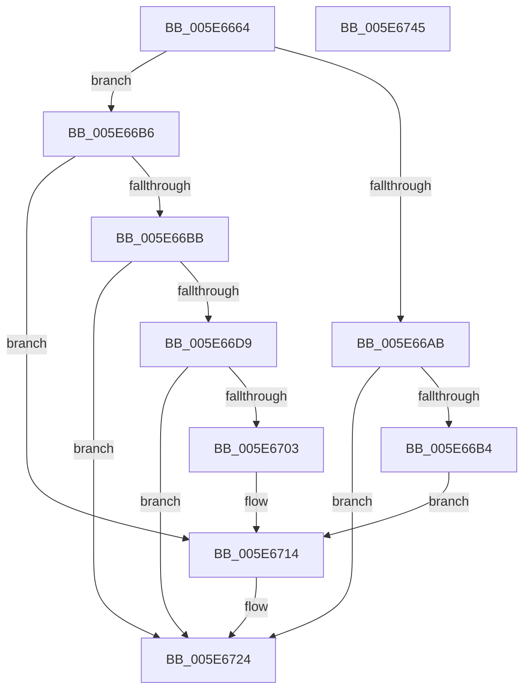

# RtlpStdExtendLowerWatermark

- RVA: `0x005E6664`–`0x005E6746` (길이 `226` bytes)
- VA: `0x00000001405E6664`
- 실행 섹션: `.text`
- PDB 이름 있음: `예`; PDB Function 태그: `아니요`
- unwind 정보 RVA: `0x000CF8C0`
- 디코드: `56`개 명령, `226/226` bytes 표시
- 미해석 바이트: `0` (있으면 어셈블리에 `.byte`로 보존)

> 이 문서는 커널 이미지의 기계어와 PDB 기호를 분석해 생성했습니다. 4번과 5번은 함수 원형과 자료형을 바이너리 사용 방식에서 추정한 C 해석이며 원본 소스 복구 결과는 아닙니다.

## 1. Dependencies

- 직접 호출 지점: **3**; 고유 호출 대상: **3**
- 직접 호출자로 확인된 함수: **1**
- RIP 상대 이미지 참조: **0**

### Outgoing calls
- `0x005E6683` → [KeAcquireSpinLockRaiseToDpc](../20/KeAcquireSpinLockRaiseToDpc_function_00208470.md) (function, `0x00208470`)
- `0x005E66FA` → [ZwAllocateVirtualMemory](../6A/ZwAllocateVirtualMemory_function_006AD3D0.md) (function, `0x006AD3D0`)
- `0x005E672A` → [KeReleaseSpinLock](../39/KeReleaseSpinLock_function_00392BA0.md) (function, `0x00392BA0`)

### Direct callers
- [RtlpStdGetSpaceForTrace](RtlpStdGetSpaceForTrace_function_005E6834.md) at `0x005E689B`

### Static image references
- 디코드된 RIP-relative 메모리 참조가 없습니다.

## 2. Other-region calls and transfers

- 다른 실행 섹션으로 향하는 call: **0**
- 별도 외부 분기/꼬리 이동을 확인하지 못했습니다.

## 3. Assembly (complete function range)

```asm
005E6664  48 89 5C 24 10                  mov qword ptr [rsp + 0x10], rbx
005E6669  48 89 6C 24 20                  mov qword ptr [rsp + 0x20], rbp
005E666E  56                              push rsi
005E666F  57                              push rdi
005E6670  41 56                           push r14
005E6672  48 83 EC 30                     sub rsp, 0x30
005E6676  33 FF                           xor edi, edi
005E6678  48 8B EA                        mov rbp, rdx
005E667B  48 89 7C 24 50                  mov qword ptr [rsp + 0x50], rdi
005E6680  48 8B D9                        mov rbx, rcx
005E6683  E8 E8 1D C2 FF                  call 0x140208470
005E6688  88 43 08                        mov byte ptr [rbx + 8], al
005E668B  4C 8B B3 A0 00 00 00            mov r14, qword ptr [rbx + 0xa0]
005E6692  48 8B 8B 90 00 00 00            mov rcx, qword ptr [rbx + 0x90]
005E6699  48 89 4C 24 60                  mov qword ptr [rsp + 0x60], rcx
005E669E  49 8D 34 2E                     lea rsi, [r14 + rbp]
005E66A2  40 38 BB 80 00 00 00            cmp byte ptr [rbx + 0x80], dil
005E66A9  74 0B                           je 0x1405e66b6
005E66AB  48 3B B3 A8 00 00 00            cmp rsi, qword ptr [rbx + 0xa8]
005E66B2  77 70                           ja 0x1405e6724
005E66B4  EB 5E                           jmp 0x1405e6714
005E66B6  48 3B F1                        cmp rsi, rcx
005E66B9  76 59                           jbe 0x1405e6714
005E66BB  48 8D 85 FF 0F 00 00            lea rax, [rbp + 0xfff]
005E66C2  48 25 00 F0 FF FF               and rax, 0xfffffffffffff000
005E66C8  48 89 44 24 50                  mov qword ptr [rsp + 0x50], rax
005E66CD  48 03 C1                        add rax, rcx
005E66D0  48 3B 83 98 00 00 00            cmp rax, qword ptr [rbx + 0x98]
005E66D7  73 4B                           jae 0x1405e6724
005E66D9  C7 44 24 28 04 00 00 00         mov dword ptr [rsp + 0x28], 4
005E66E1  4C 8D 4C 24 50                  lea r9, [rsp + 0x50]
005E66E6  45 33 C0                        xor r8d, r8d
005E66E9  C7 44 24 20 00 10 00 00         mov dword ptr [rsp + 0x20], 0x1000
005E66F1  48 8D 54 24 60                  lea rdx, [rsp + 0x60]
005E66F6  48 83 C9 FF                     or rcx, 0xffffffffffffffff
005E66FA  E8 D1 6C 0C 00                  call 0x1406ad3d0
005E66FF  85 C0                           test eax, eax
005E6701  78 21                           js 0x1405e6724
005E6703  48 8B 4C 24 60                  mov rcx, qword ptr [rsp + 0x60]
005E6708  48 03 4C 24 50                  add rcx, qword ptr [rsp + 0x50]
005E670D  48 89 8B 90 00 00 00            mov qword ptr [rbx + 0x90], rcx
005E6714  FF 83 C0 00 00 00               inc dword ptr [rbx + 0xc0]
005E671A  49 8B FE                        mov rdi, r14
005E671D  48 89 B3 A0 00 00 00            mov qword ptr [rbx + 0xa0], rsi
005E6724  8A 53 08                        mov dl, byte ptr [rbx + 8]
005E6727  48 8B CB                        mov rcx, rbx
005E672A  E8 71 C4 DA FF                  call 0x140392ba0
005E672F  48 8B 5C 24 58                  mov rbx, qword ptr [rsp + 0x58]
005E6734  48 8B C7                        mov rax, rdi
005E6737  48 8B 6C 24 68                  mov rbp, qword ptr [rsp + 0x68]
005E673C  48 83 C4 30                     add rsp, 0x30
005E6740  41 5E                           pop r14
005E6742  5F                              pop rdi
005E6743  5E                              pop rsi
005E6744  C3                              ret
005E6745  CC                              int3
```

## 4. C-style interpretation (structured pseudocode)

```c
__int64 __fastcall RtlpStdExtendLowerWatermark(__int64 a1, __int64 a2, int a3)
{
    __int64 result;
    __int64 v_rdi;
    __int64 v_rsp;
    unsigned int v_stack_m20;
    unsigned int v_stack_m28;
    unsigned __int64 v_stack_p10;
    unsigned __int64 v_stack_p18;
    unsigned __int64 v_stack_p20;
    unsigned __int64 v_stack_p8;

    v_stack_p10 = v_rbx;
    v_stack_p20 = v_rbp;
    v_rsp = (v_rsp) - (48);
    v_rdi = 0;
    v_stack_p8 = 0;
    result = KeAcquireSpinLockRaiseToDpc(a1, a2, a3, a4);
    *(unsigned __int8 *)(a1 + 8) = (unsigned __int8)(result);
    v_stack_p18 = *(unsigned __int64 *)(a1 + 144);
    if ((*(unsigned __int8 *)(a1 + 128)) == 0) goto loc_005E66B6;
    if ((*(unsigned __int64 *)(a1 + 160) + a2 * 1) > (*(unsigned __int64 *)(a1 + 168))) goto loc_005E6724;
    goto loc_005E6714;
loc_005E66B6:
    if ((*(unsigned __int64 *)(a1 + 160) + a2 * 1) <= (*(unsigned __int64 *)(a1 + 144))) goto loc_005E6714;
    result = (a2 + 4095) & (0xFFFFFFFFFFFFF000ULL);
    v_stack_p8 = result;
    result = (result) + (*(unsigned __int64 *)(a1 + 144));
    if (result >= (*(unsigned __int64 *)(a1 + 152))) goto loc_005E6724;
    v_stack_m20 = 4;
    a3 = 0;
    v_stack_m28 = 0x1000ULL;
    a1 = (*(unsigned __int64 *)(a1 + 144)) | (-1);
    result = ZwAllocateVirtualMemory(a1, v_stack_p18, a3, v_stack_p8);
    if (sign_flag) goto loc_005E6724;
    a1 = (v_stack_p18) + (v_stack_p8);
    *(unsigned __int64 *)(a1 + 144) = a1;
loc_005E6714:
    *(unsigned __int64 *)(a1 + 160) = *(unsigned __int64 *)(a1 + 160) + a2 * 1;
loc_005E6724:
    result = KeReleaseSpinLock(a1, *(unsigned __int8 *)(a1 + 8), a3, v_stack_p8);
    v_rsp = (v_rsp) + (48);
    return *(unsigned __int64 *)(a1 + 160);
}
```

## 5. (Beta) C Style

```c
int64_t RtlpStdExtendLowerWatermark(void *Arg1, void *Arg2, int32_t Arg3)
{
    uint8_t *arg1 = (uint8_t *)Arg1;
    uint8_t *arg2 = (uint8_t *)Arg2;

    int64_t result;
    int64_t local_rdi;
    int64_t local_rsp;
    uint32_t v_stack_m20;
    uint32_t v_stack_m28;
    uint64_t v_stack_p10;
    uint64_t v_stack_p18;
    uint64_t v_stack_p20;
    uint64_t v_stack_p8;

    v_stack_p10 = local_rbx;
    v_stack_p20 = local_rbp;
    local_rsp = (local_rsp) - (48);
    local_rdi = 0;
    v_stack_p8 = 0;
    result = KeAcquireSpinLockRaiseToDpc(Arg1, Arg2, Arg3, a4);
    *(uint8_t *)(arg1 + 0x8) = (uint8_t)(result);
    v_stack_p18 = *(uint64_t *)(arg1 + 0x90);
    if ((*(uint8_t *)(arg1 + 0x80)) == 0) goto loc_005E66B6;
    if ((*(uint64_t *)(arg1 + 0xA0) + Arg2 * 1) > (*(uint64_t *)(arg1 + 0xA8))) goto loc_005E6724;
    goto loc_005E6714;
loc_005E66B6:
    if ((*(uint64_t *)(arg1 + 0xA0) + Arg2 * 1) <= (*(uint64_t *)(arg1 + 0x90))) goto loc_005E6714;
    result = (Arg2 + 4095) & (0xFFFFFFFFFFFFF000ULL);
    v_stack_p8 = result;
    result = (result) + (*(uint64_t *)(arg1 + 0x90));
    if (result >= (*(uint64_t *)(arg1 + 0x98))) goto loc_005E6724;
    v_stack_m20 = 4;
    Arg3 = 0;
    v_stack_m28 = 0x1000ULL;
    Arg1 = (*(uint64_t *)(arg1 + 0x90)) | (-1);
    result = ZwAllocateVirtualMemory(Arg1, v_stack_p18, Arg3, v_stack_p8);
    if (sign_flag) goto loc_005E6724;
    Arg1 = (v_stack_p18) + (v_stack_p8);
    *(void **)(arg1 + 0x90) = Arg1;
loc_005E6714:
    *(uint64_t *)(arg1 + 0xA0) = *(uint64_t *)(arg1 + 0xA0) + Arg2 * 1;
loc_005E6724:
    result = KeReleaseSpinLock(Arg1, *(uint8_t *)(arg1 + 0x8), Arg3, v_stack_p8);
    local_rsp = (local_rsp) + (48);
    return *(uint64_t *)(arg1 + 0xA0);
}
```

### 관측된 메모리 오프셋

구조체 형식이 확인되지 않은 접근은 인자 기준의 오프셋으로만 기록했습니다.

| 기준 인자 | 오프셋 표현 | 폭 (bit) | 접근 |
|---|---:|---:|---|
| `Arg1` | `+ 0x8` | `8` | `R` |
| `Arg1` | `+ 0x8` | `8` | `W` |
| `Arg1` | `+ 0x80` | `8` | `R` |
| `Arg1` | `+ 0x90` | `64` | `R` |
| `Arg1` | `+ 0x90` | `64` | `W` |
| `Arg1` | `+ 0x98` | `64` | `R` |
| `Arg1` | `+ 0xA0` | `64` | `R` |
| `Arg1` | `+ 0xA0` | `64` | `W` |
| `Arg1` | `+ 0xA8` | `64` | `R` |
| `Arg1` | `+ 0xC0` | `32` | `R/W` |
| `Arg2` | `+ 0xFFF` | `64` | `R` |

## 6. Execution-region graph

[열기: 2D/3D 그래프와 함수 탐색 컨트롤 패널](../../../control-panel.html?section=text&rva=0x005E6664&view=graph)

- 2D 그래프는 위에서 아래로 흐르고, 3D 그래프는 빈 공간을 드래그해 회전합니다. Shift+드래그는 이동, 휠은 확대·축소, 함수 노드 선택은 대상 보고서 이동입니다.

### Static fallback


