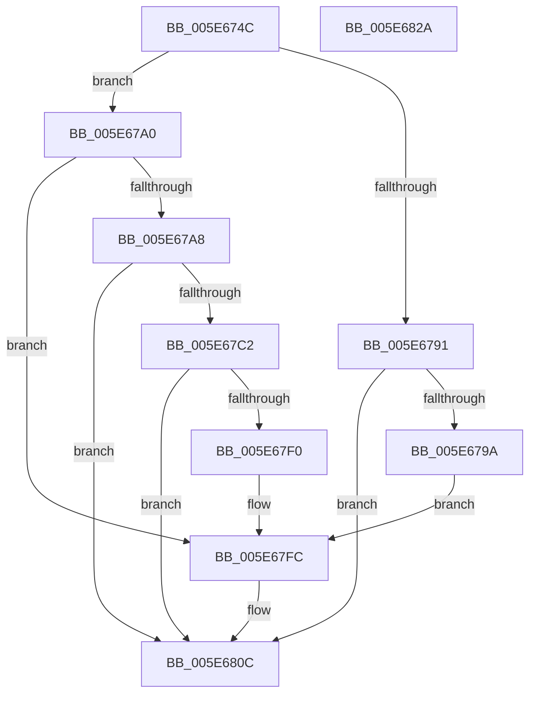

# RtlpStdExtendUpperWatermark

- RVA: `0x005E674C`–`0x005E682B` (길이 `223` bytes)
- VA: `0x00000001405E674C`
- 실행 섹션: `.text`
- PDB 이름 있음: `예`; PDB Function 태그: `아니요`
- unwind 정보 RVA: `0x000CF8AC`
- 디코드: `55`개 명령, `223/223` bytes 표시
- 미해석 바이트: `0` (있으면 어셈블리에 `.byte`로 보존)

> 이 문서는 커널 이미지의 기계어와 PDB 기호를 분석해 생성했습니다. 4번과 5번은 함수 원형과 자료형을 바이너리 사용 방식에서 추정한 C 해석이며 원본 소스 복구 결과는 아닙니다.

## 1. Dependencies

- 직접 호출 지점: **3**; 고유 호출 대상: **3**
- 직접 호출자로 확인된 함수: **1**
- RIP 상대 이미지 참조: **0**

### Outgoing calls
- `0x005E6769` → [KeAcquireSpinLockRaiseToDpc](../20/KeAcquireSpinLockRaiseToDpc_function_00208470.md) (function, `0x00208470`)
- `0x005E67E7` → [ZwAllocateVirtualMemory](../6A/ZwAllocateVirtualMemory_function_006AD3D0.md) (function, `0x006AD3D0`)
- `0x005E6812` → [KeReleaseSpinLock](../39/KeReleaseSpinLock_function_00392BA0.md) (function, `0x00392BA0`)

### Direct callers
- [RtlpStdGetRecordedStackTraceIndex](../49/RtlpStdGetRecordedStackTraceIndex_function_00495C84.md) at `0x00495CF1`

### Static image references
- 디코드된 RIP-relative 메모리 참조가 없습니다.

## 2. Other-region calls and transfers

- 다른 실행 섹션으로 향하는 call: **0**
- 별도 외부 분기/꼬리 이동을 확인하지 못했습니다.

## 3. Assembly (complete function range)

```asm
005E674C  48 8B C4                        mov rax, rsp
005E674F  48 89 58 18                     mov qword ptr [rax + 0x18], rbx
005E6753  48 89 70 20                     mov qword ptr [rax + 0x20], rsi
005E6757  48 89 50 10                     mov qword ptr [rax + 0x10], rdx
005E675B  57                              push rdi
005E675C  48 83 EC 30                     sub rsp, 0x30
005E6760  33 F6                           xor esi, esi
005E6762  48 8B D9                        mov rbx, rcx
005E6765  48 89 70 08                     mov qword ptr [rax + 8], rsi
005E6769  E8 02 1D C2 FF                  call 0x140208470
005E676E  88 43 08                        mov byte ptr [rbx + 8], al
005E6771  48 8B 93 A8 00 00 00            mov rdx, qword ptr [rbx + 0xa8]
005E6778  48 8B 8B 98 00 00 00            mov rcx, qword ptr [rbx + 0x98]
005E677F  48 89 4C 24 48                  mov qword ptr [rsp + 0x48], rcx
005E6784  48 8D 42 F8                     lea rax, [rdx - 8]
005E6788  40 38 B3 80 00 00 00            cmp byte ptr [rbx + 0x80], sil
005E678F  74 0F                           je 0x1405e67a0
005E6791  48 3B 83 A0 00 00 00            cmp rax, qword ptr [rbx + 0xa0]
005E6798  72 72                           jb 0x1405e680c
005E679A  48 8D 7A F8                     lea rdi, [rdx - 8]
005E679E  EB 5C                           jmp 0x1405e67fc
005E67A0  48 8B F8                        mov rdi, rax
005E67A3  48 3B C1                        cmp rax, rcx
005E67A6  73 54                           jae 0x1405e67fc
005E67A8  48 8D 81 00 F0 FF FF            lea rax, [rcx - 0x1000]
005E67AF  BA 00 10 00 00                  mov edx, 0x1000
005E67B4  48 89 54 24 40                  mov qword ptr [rsp + 0x40], rdx
005E67B9  48 3B 83 90 00 00 00            cmp rax, qword ptr [rbx + 0x90]
005E67C0  76 4A                           jbe 0x1405e680c
005E67C2  48 2B CA                        sub rcx, rdx
005E67C5  C7 44 24 28 04 00 00 00         mov dword ptr [rsp + 0x28], 4
005E67CD  48 89 4C 24 48                  mov qword ptr [rsp + 0x48], rcx
005E67D2  4C 8D 4C 24 40                  lea r9, [rsp + 0x40]
005E67D7  89 54 24 20                     mov dword ptr [rsp + 0x20], edx
005E67DB  48 83 C9 FF                     or rcx, 0xffffffffffffffff
005E67DF  45 33 C0                        xor r8d, r8d
005E67E2  48 8D 54 24 48                  lea rdx, [rsp + 0x48]
005E67E7  E8 E4 6B 0C 00                  call 0x1406ad3d0
005E67EC  85 C0                           test eax, eax
005E67EE  78 1C                           js 0x1405e680c
005E67F0  48 8B 44 24 48                  mov rax, qword ptr [rsp + 0x48]
005E67F5  48 89 83 98 00 00 00            mov qword ptr [rbx + 0x98], rax
005E67FC  FF 83 B4 00 00 00               inc dword ptr [rbx + 0xb4]
005E6802  48 8B F7                        mov rsi, rdi
005E6805  48 89 BB A8 00 00 00            mov qword ptr [rbx + 0xa8], rdi
005E680C  8A 53 08                        mov dl, byte ptr [rbx + 8]
005E680F  48 8B CB                        mov rcx, rbx
005E6812  E8 89 C3 DA FF                  call 0x140392ba0
005E6817  48 8B 5C 24 50                  mov rbx, qword ptr [rsp + 0x50]
005E681C  48 8B C6                        mov rax, rsi
005E681F  48 8B 74 24 58                  mov rsi, qword ptr [rsp + 0x58]
005E6824  48 83 C4 30                     add rsp, 0x30
005E6828  5F                              pop rdi
005E6829  C3                              ret
005E682A  CC                              int3
```

## 4. C-style interpretation (structured pseudocode)

```c
__int64 __fastcall RtlpStdExtendUpperWatermark(__int64 a1, __int64 a2, int a3)
{
    __int64 result;
    __int64 v_rsi;
    __int64 v_rsp;
    unsigned int v_stack_m10;
    unsigned int v_stack_m18;
    unsigned __int64 v_stack_p10;
    unsigned __int64 v_stack_p18;
    unsigned __int64 v_stack_p20;
    unsigned __int64 v_stack_p8;

    *(unsigned __int64 *)(v_rsp + 24) = v_rbx;
    *(unsigned __int64 *)(v_rsp + 32) = v_rsi;
    *(unsigned __int64 *)(v_rsp + 16) = a2;
    v_rsp = (v_rsp) - (48);
    v_rsi = 0;
    *(unsigned __int64 *)(v_rsp + 8) = 0;
    result = KeAcquireSpinLockRaiseToDpc(a1, a2, a3, a4);
    *(unsigned __int8 *)(a1 + 8) = (unsigned __int8)(result);
    v_stack_p10 = *(unsigned __int64 *)(a1 + 152);
    if ((*(unsigned __int8 *)(a1 + 128)) == 0) goto loc_005E67A0;
    if ((*(unsigned __int64 *)(a1 + 168) - 8) < (*(unsigned __int64 *)(a1 + 160))) goto loc_005E680C;
    goto loc_005E67FC;
loc_005E67A0:
    if ((*(unsigned __int64 *)(a1 + 168) - 8) >= (*(unsigned __int64 *)(a1 + 152))) goto loc_005E67FC;
    v_stack_p8 = (unsigned int)(0x1000ULL);
    if ((*(unsigned __int64 *)(a1 + 152) - 4096) <= (*(unsigned __int64 *)(a1 + 144))) goto loc_005E680C;
    a1 = (*(unsigned __int64 *)(a1 + 152)) - ((unsigned int)(0x1000ULL));
    v_stack_m10 = 4;
    v_stack_p10 = a1;
    v_stack_m18 = (unsigned int)((unsigned int)(0x1000ULL));
    a1 = (a1) | (-1);
    a3 = 0;
    result = ZwAllocateVirtualMemory(a1, v_stack_p10, a3, v_stack_p8);
    if (sign_flag) goto loc_005E680C;
    *(unsigned __int64 *)(a1 + 152) = v_stack_p10;
loc_005E67FC:
    *(unsigned __int64 *)(a1 + 168) = *(unsigned __int64 *)(a1 + 168) - 8;
loc_005E680C:
    result = KeReleaseSpinLock(a1, *(unsigned __int8 *)(a1 + 8), a3, v_stack_p8);
    v_rsp = (v_rsp) + (48);
    return *(unsigned __int64 *)(a1 + 168) - 8;
}
```

## 5. (Beta) C Style

```c
int64_t RtlpStdExtendUpperWatermark(void *Arg1, int64_t Arg2, int32_t Arg3)
{
    uint8_t *arg1 = (uint8_t *)Arg1;

    int64_t result;
    int64_t local_rsi;
    int64_t local_rsp;
    uint32_t v_stack_m10;
    uint32_t v_stack_m18;
    uint64_t v_stack_p10;
    uint64_t v_stack_p18;
    uint64_t v_stack_p20;
    uint64_t v_stack_p8;

    *(uint64_t *)(local_rsp + 0x18) = local_rbx;
    *(uint64_t *)(local_rsp + 0x20) = local_rsi;
    *(uint64_t *)(local_rsp + 0x10) = Arg2;
    local_rsp = (local_rsp) - (48);
    local_rsi = 0;
    *(uint64_t *)(local_rsp + 0x8) = 0;
    result = KeAcquireSpinLockRaiseToDpc(Arg1, Arg2, Arg3, a4);
    *(uint8_t *)(arg1 + 0x8) = (uint8_t)(result);
    v_stack_p10 = *(uint64_t *)(arg1 + 0x98);
    if ((*(uint8_t *)(arg1 + 0x80)) == 0) goto loc_005E67A0;
    if ((*(uint64_t *)(arg1 + 0xA8) - 8) < (*(uint64_t *)(arg1 + 0xA0))) goto loc_005E680C;
    goto loc_005E67FC;
loc_005E67A0:
    if ((*(uint64_t *)(arg1 + 0xA8) - 8) >= (*(uint64_t *)(arg1 + 0x98))) goto loc_005E67FC;
    v_stack_p8 = (uint32_t)(0x1000ULL);
    if ((*(uint64_t *)(arg1 + 0x98) - 4096) <= (*(uint64_t *)(arg1 + 0x90))) goto loc_005E680C;
    Arg1 = (*(uint64_t *)(arg1 + 0x98)) - ((uint32_t)(0x1000ULL));
    v_stack_m10 = 4;
    v_stack_p10 = Arg1;
    v_stack_m18 = (uint32_t)((uint32_t)(0x1000ULL));
    Arg1 = (Arg1) | (-1);
    Arg3 = 0;
    result = ZwAllocateVirtualMemory(Arg1, v_stack_p10, Arg3, v_stack_p8);
    if (sign_flag) goto loc_005E680C;
    *(uint64_t *)(arg1 + 0x98) = v_stack_p10;
loc_005E67FC:
    *(uint64_t *)(arg1 + 0xA8) = *(uint64_t *)(arg1 + 0xA8) - 8;
loc_005E680C:
    result = KeReleaseSpinLock(Arg1, *(uint8_t *)(arg1 + 0x8), Arg3, v_stack_p8);
    local_rsp = (local_rsp) + (48);
    return *(uint64_t *)(arg1 + 0xA8) - 8;
}
```

### 관측된 메모리 오프셋

구조체 형식이 확인되지 않은 접근은 인자 기준의 오프셋으로만 기록했습니다.

| 기준 인자 | 오프셋 표현 | 폭 (bit) | 접근 |
|---|---:|---:|---|
| `Arg1` | `+ 0x8` | `8` | `R` |
| `Arg1` | `+ 0x8` | `8` | `W` |
| `Arg1` | `+ 0x80` | `8` | `R` |
| `Arg1` | `+ 0x90` | `64` | `R` |
| `Arg1` | `+ 0x98` | `64` | `R` |
| `Arg1` | `+ 0x98` | `64` | `W` |
| `Arg1` | `+ 0xA0` | `64` | `R` |
| `Arg1` | `+ 0xA8` | `64` | `R` |
| `Arg1` | `+ 0xA8` | `64` | `W` |
| `Arg1` | `+ 0xB4` | `32` | `R/W` |

## 6. Execution-region graph

[열기: 2D/3D 그래프와 함수 탐색 컨트롤 패널](../../../control-panel.html?section=text&rva=0x005E674C&view=graph)

- 2D 그래프는 위에서 아래로 흐르고, 3D 그래프는 빈 공간을 드래그해 회전합니다. Shift+드래그는 이동, 휠은 확대·축소, 함수 노드 선택은 대상 보고서 이동입니다.

### Static fallback


