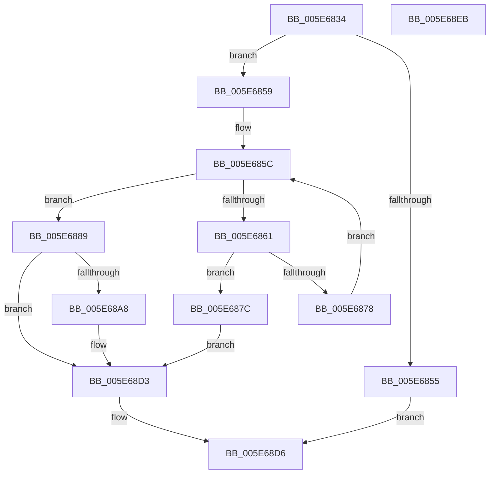

# RtlpStdGetSpaceForTrace

- RVA: `0x005E6834`–`0x005E68EC` (길이 `184` bytes)
- VA: `0x00000001405E6834`
- 실행 섹션: `.text`
- PDB 이름 있음: `예`; PDB Function 태그: `아니요`
- unwind 정보 RVA: `0x0005C954`
- 디코드: `55`개 명령, `184/184` bytes 표시
- 미해석 바이트: `0` (있으면 어셈블리에 `.byte`로 보존)

> 이 문서는 커널 이미지의 기계어와 PDB 기호를 분석해 생성했습니다. 4번과 5번은 함수 원형과 자료형을 바이너리 사용 방식에서 추정한 C 해석이며 원본 소스 복구 결과는 아닙니다.

## 1. Dependencies

- 직접 호출 지점: **2**; 고유 호출 대상: **2**
- 직접 호출자로 확인된 함수: **1**
- RIP 상대 이미지 참조: **0**

### Outgoing calls
- `0x005E686E` → [ExpInterlockedPopEntrySList](../6B/ExpInterlockedPopEntrySList_function_006BA570.md) (function, `0x006BA570`)
- `0x005E689B` → [RtlpStdExtendLowerWatermark](RtlpStdExtendLowerWatermark_function_005E6664.md) (function, `0x005E6664`)

### Direct callers
- [RtlpStdLogCapturedStackTrace](RtlpStdLogCapturedStackTrace_function_005E68F4.md) at `0x005E698D`

### Static image references
- 디코드된 RIP-relative 메모리 참조가 없습니다.

## 2. Other-region calls and transfers

- 다른 실행 섹션으로 향하는 call: **0**
- 별도 외부 분기/꼬리 이동을 확인하지 못했습니다.

## 3. Assembly (complete function range)

```asm
005E6834  48 89 5C 24 08                  mov qword ptr [rsp + 8], rbx
005E6839  48 89 6C 24 10                  mov qword ptr [rsp + 0x10], rbp
005E683E  48 89 74 24 18                  mov qword ptr [rsp + 0x18], rsi
005E6843  57                              push rdi
005E6844  48 83 EC 20                     sub rsp, 0x20
005E6848  0F B7 F2                        movzx esi, dx
005E684B  33 ED                           xor ebp, ebp
005E684D  48 8B F9                        mov rdi, rcx
005E6850  66 85 F6                        test si, si
005E6853  75 04                           jne 0x1405e6859
005E6855  33 C0                           xor eax, eax
005E6857  EB 7D                           jmp 0x1405e68d6
005E6859  8D 5E FF                        lea ebx, [rsi - 1]
005E685C  83 FB 20                        cmp ebx, 0x20
005E685F  73 28                           jae 0x1405e6889
005E6861  8B CB                           mov ecx, ebx
005E6863  48 83 C1 0D                     add rcx, 0xd
005E6867  48 C1 E1 04                     shl rcx, 4
005E686B  48 03 CF                        add rcx, rdi
005E686E  E8 FD 3C 0D 00                  call 0x1406ba570
005E6873  48 85 C0                        test rax, rax
005E6876  75 04                           jne 0x1405e687c
005E6878  FF C3                           inc ebx
005E687A  EB E0                           jmp 0x1405e685c
005E687C  F0 FF 8F C4 00 00 00            lock dec dword ptr [rdi + 0xc4]
005E6883  48 8D 50 F0                     lea rdx, [rax - 0x10]
005E6887  EB 4A                           jmp 0x1405e68d3
005E6889  48 8D 1C F5 1F 00 00 00         lea rbx, [rsi*8 + 0x1f]
005E6891  48 8B CF                        mov rcx, rdi
005E6894  48 83 E3 F0                     and rbx, 0xfffffffffffffff0
005E6898  48 8B D3                        mov rdx, rbx
005E689B  E8 C4 FD FF FF                  call 0x1405e6664
005E68A0  48 8B D0                        mov rdx, rax
005E68A3  48 85 C0                        test rax, rax
005E68A6  74 2B                           je 0x1405e68d3
005E68A8  B8 1F 00 00 00                  mov eax, 0x1f
005E68AD  8D 4B F0                        lea ecx, [rbx - 0x10]
005E68B0  C1 E9 03                        shr ecx, 3
005E68B3  41 B8 FF 07 00 00               mov r8d, 0x7ff
005E68B9  FF C9                           dec ecx
005E68BB  3B C8                           cmp ecx, eax
005E68BD  0F 47 C8                        cmova ecx, eax
005E68C0  0F B7 42 08                     movzx eax, word ptr [rdx + 8]
005E68C4  66 41 23 C0                     and ax, r8w
005E68C8  66 C1 E1 0B                     shl cx, 0xb
005E68CC  66 0B C1                        or ax, cx
005E68CF  66 89 42 08                     mov word ptr [rdx + 8], ax
005E68D3  48 8B C2                        mov rax, rdx
005E68D6  48 8B 5C 24 30                  mov rbx, qword ptr [rsp + 0x30]
005E68DB  48 8B 6C 24 38                  mov rbp, qword ptr [rsp + 0x38]
005E68E0  48 8B 74 24 40                  mov rsi, qword ptr [rsp + 0x40]
005E68E5  48 83 C4 20                     add rsp, 0x20
005E68E9  5F                              pop rdi
005E68EA  C3                              ret
005E68EB  CC                              int3
```

## 4. C-style interpretation (structured pseudocode)

```c
__int64 __fastcall RtlpStdGetSpaceForTrace(__int64 a1, unsigned __int16 a2)
{
    __int64 result;
    __int64 v_rbp;
    __int64 v_rbx;
    __int64 v_rsp;
    unsigned __int64 v_stack_p10;
    unsigned __int64 v_stack_p18;
    unsigned __int64 v_stack_p8;

    v_stack_p8 = v_rbx;
    v_stack_p10 = v_rbp;
    v_stack_p18 = v_rsi;
    v_rsp = (v_rsp) - (32);
    v_rbp = 0;
    if (a2 != 0) goto loc_005E6859;
    result = 0;
    goto loc_005E68D6;
loc_005E6859:
loc_005E685C:
    if (((unsigned int)(a2 - 1)) >= 32) goto loc_005E6889;
    a1 = ((unsigned int)((unsigned int)(a2 - 1))) + (13);
    a1 = (a1) << (4);
    a1 = (a1) + (a1);
    result = ExpInterlockedPopEntrySList(a1, a2, a3, a4);
    if (result != 0) goto loc_005E687C;
    v_rbx = (unsigned int)((a2 - 1) + 1);
    goto loc_005E685C;
loc_005E687C:
    goto loc_005E68D3;
loc_005E6889:
    v_rbx = (a2 * 8 + 31) & (-16);
    result = RtlpStdExtendLowerWatermark(a1, v_rbx, a3, a4);
    if (result != 0) {
        result = 31;
        a1 = v_rbx - 16;
        a1 = (unsigned int)((a1) >> (3));
        a3 = 0x7FFULL;
        a1 = (unsigned int)((a1) - 1);
        if (((unsigned int)(a1)) > ((unsigned int)(result))) { a1 = (unsigned int)(result); }
        result = *(unsigned __int16 *)(result + 8);
        result = (unsigned __int16)((result) & ((unsigned __int16)(a3)));
        a1 = (unsigned __int16)((a1) << (11));
        result = (unsigned __int16)((result) | ((unsigned __int16)(a1)));
        *(unsigned __int16 *)(result + 8) = (unsigned __int16)(result);
    }
loc_005E68D6:
    v_rsp = (v_rsp) + (32);
    return result;
}
```

## 5. (Beta) C Style

```c
int64_t RtlpStdGetSpaceForTrace(void *Arg1, uint16_t Arg2)
{
    uint8_t *arg1 = (uint8_t *)Arg1;

    int64_t result;
    int64_t local_rbp;
    int64_t local_rbx;
    int64_t local_rsp;
    uint64_t v_stack_p10;
    uint64_t v_stack_p18;
    uint64_t v_stack_p8;

    v_stack_p8 = local_rbx;
    v_stack_p10 = local_rbp;
    v_stack_p18 = local_rsi;
    local_rsp = (local_rsp) - (32);
    local_rbp = 0;
    if (Arg2 != 0) goto loc_005E6859;
    result = 0;
    goto loc_005E68D6;
loc_005E6859:
loc_005E685C:
    if (((uint32_t)(Arg2 - 1)) >= 32) goto loc_005E6889;
    Arg1 = ((uint32_t)((uint32_t)(Arg2 - 1))) + (13);
    Arg1 = (Arg1) << (4);
    Arg1 = (Arg1) + (Arg1);
    result = ExpInterlockedPopEntrySList(Arg1, Arg2, a3, a4);
    if (result != 0) goto loc_005E687C;
    local_rbx = (uint32_t)((Arg2 - 1) + 1);
    goto loc_005E685C;
loc_005E687C:
    goto loc_005E68D3;
loc_005E6889:
    local_rbx = (Arg2 * 8 + 31) & (-16);
    result = RtlpStdExtendLowerWatermark(Arg1, local_rbx, a3, a4);
    if (result != 0) {
        result = 31;
        Arg1 = local_rbx - 16;
        Arg1 = (uint32_t)((Arg1) >> (3));
        a3 = 0x7FFULL;
        Arg1 = (uint32_t)((Arg1) - 1);
        if (((uint32_t)(Arg1)) > ((uint32_t)(result))) { Arg1 = (uint32_t)(result); }
        result = *(uint16_t *)(result + 0x8);
        result = (uint16_t)((result) & ((uint16_t)(a3)));
        Arg1 = (uint16_t)((Arg1) << (11));
        result = (uint16_t)((result) | ((uint16_t)(Arg1)));
        *(uint16_t *)(result + 0x8) = (uint16_t)(result);
    }
loc_005E68D6:
    local_rsp = (local_rsp) + (32);
    return result;
}
```

### 관측된 메모리 오프셋

구조체 형식이 확인되지 않은 접근은 인자 기준의 오프셋으로만 기록했습니다.

| 기준 인자 | 오프셋 표현 | 폭 (bit) | 접근 |
|---|---:|---:|---|
| `Arg1` | `+ 0xC4` | `32` | `R/W` |

## 6. Execution-region graph

[열기: 2D/3D 그래프와 함수 탐색 컨트롤 패널](../../../control-panel.html?section=text&rva=0x005E6834&view=graph)

- 2D 그래프는 위에서 아래로 흐르고, 3D 그래프는 빈 공간을 드래그해 회전합니다. Shift+드래그는 이동, 휠은 확대·축소, 함수 노드 선택은 대상 보고서 이동입니다.

### Static fallback


