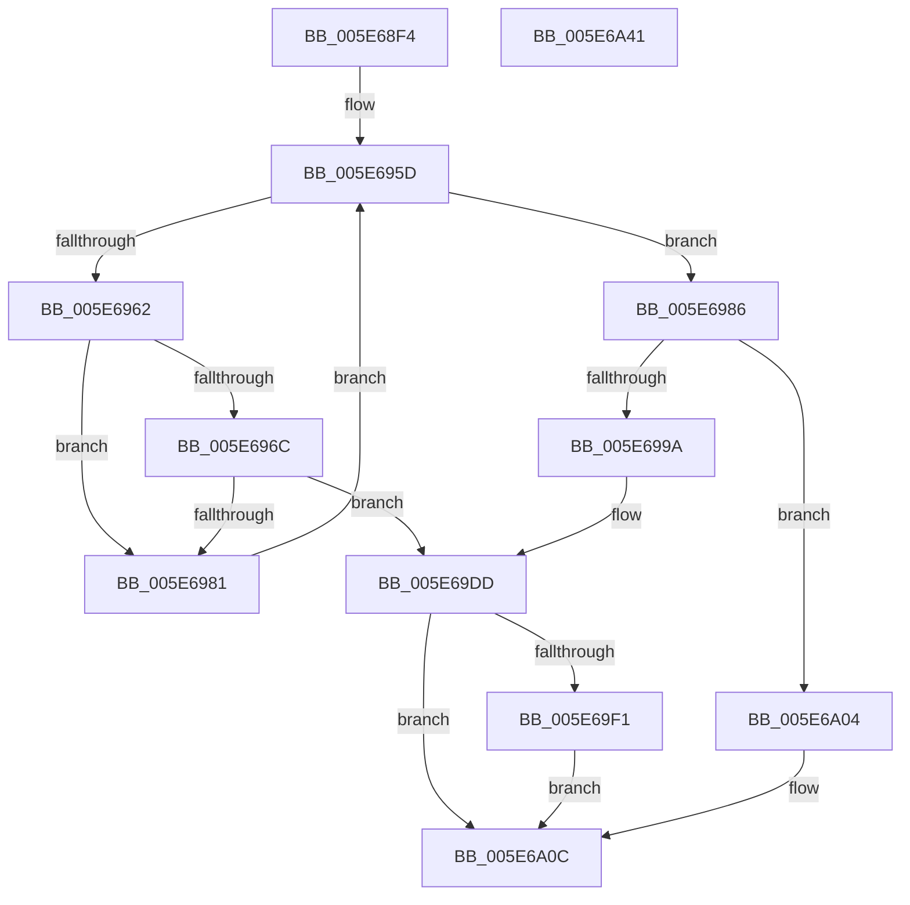

# RtlpStdLogCapturedStackTrace

- RVA: `0x005E68F4`–`0x005E6A42` (길이 `334` bytes)
- VA: `0x00000001405E68F4`
- 실행 섹션: `.text`
- PDB 이름 있음: `예`; PDB Function 태그: `아니요`
- unwind 정보 RVA: `0x0005FEF8`
- 디코드: `87`개 명령, `334/334` bytes 표시
- 미해석 바이트: `0` (있으면 어셈블리에 `.byte`로 보존)

> 이 문서는 커널 이미지의 기계어와 PDB 기호를 분석해 생성했습니다. 4번과 5번은 함수 원형과 자료형을 바이너리 사용 방식에서 추정한 C 해석이며 원본 소스 복구 결과는 아닙니다.

## 1. Dependencies

- 직접 호출 지점: **5**; 고유 호출 대상: **5**
- 직접 호출자로 확인된 함수: **1**
- RIP 상대 이미지 참조: **0**

### Outgoing calls
- `0x005E694A` → [KeAcquireSpinLockRaiseToDpc](../20/KeAcquireSpinLockRaiseToDpc_function_00208470.md) (function, `0x00208470`)
- `0x005E6977` → [RtlCompareMemory](../6B/RtlCompareMemory_function_006BA670.md) (function, `0x006BA670`)
- `0x005E698D` → [RtlpStdGetSpaceForTrace](RtlpStdGetSpaceForTrace_function_005E6834.md) (function, `0x005E6834`)
- `0x005E69A5` → [memcpy](../6C/memcpy_function_006C6840.md) (function, `0x006C6840`)
- `0x005E6A1A` → [KeReleaseSpinLock](../39/KeReleaseSpinLock_function_00392BA0.md) (function, `0x00392BA0`)

### Direct callers
- [RtlStdLogStackTrace](../49/RtlStdLogStackTrace_function_00495BF8.md) at `0x00495C60`

### Static image references
- 디코드된 RIP-relative 메모리 참조가 없습니다.

## 2. Other-region calls and transfers

- 다른 실행 섹션으로 향하는 call: **0**
- 별도 외부 분기/꼬리 이동을 확인하지 못했습니다.

## 3. Assembly (complete function range)

```asm
005E68F4  48 8B C4                        mov rax, rsp
005E68F7  48 89 58 08                     mov qword ptr [rax + 8], rbx
005E68FB  48 89 68 10                     mov qword ptr [rax + 0x10], rbp
005E68FF  48 89 70 18                     mov qword ptr [rax + 0x18], rsi
005E6903  48 89 78 20                     mov qword ptr [rax + 0x20], rdi
005E6907  41 54                           push r12
005E6909  41 56                           push r14
005E690B  41 57                           push r15
005E690D  48 83 EC 20                     sub rsp, 0x20
005E6911  0F B7 6A 0E                     movzx ebp, word ptr [rdx + 0xe]
005E6915  48 8B F2                        mov rsi, rdx
005E6918  33 D2                           xor edx, edx
005E691A  48 C1 E5 03                     shl rbp, 3
005E691E  41 8B C0                        mov eax, r8d
005E6921  45 8B F8                        mov r15d, r8d
005E6924  F7 B1 D0 02 00 00               div dword ptr [rcx + 0x2d0]
005E692A  48 8B F9                        mov rdi, rcx
005E692D  41 BC 01 00 00 00               mov r12d, 1
005E6933  4C 8D 34 52                     lea r14, [rdx + rdx*2]
005E6937  F0 44 01 A1 B0 00 00 00         lock add dword ptr [rcx + 0xb0], r12d
005E693F  4A 8D 1C F1                     lea rbx, [rcx + r14*8]
005E6943  48 8D 8B E0 02 00 00            lea rcx, [rbx + 0x2e0]
005E694A  E8 21 1B C2 FF                  call 0x140208470
005E694F  88 83 E8 02 00 00               mov byte ptr [rbx + 0x2e8], al
005E6955  4A 8B 9C F7 D8 02 00 00         mov rbx, qword ptr [rdi + r14*8 + 0x2d8]
005E695D  48 85 DB                        test rbx, rbx
005E6960  74 24                           je 0x1405e6986
005E6962  0F B7 46 0E                     movzx eax, word ptr [rsi + 0xe]
005E6966  66 39 43 0E                     cmp word ptr [rbx + 0xe], ax
005E696A  75 15                           jne 0x1405e6981
005E696C  48 8D 56 10                     lea rdx, [rsi + 0x10]
005E6970  4C 8B C5                        mov r8, rbp
005E6973  48 8D 4B 10                     lea rcx, [rbx + 0x10]
005E6977  E8 F4 3C 0D 00                  call 0x1406ba670
005E697C  48 3B C5                        cmp rax, rbp
005E697F  74 5C                           je 0x1405e69dd
005E6981  48 8B 1B                        mov rbx, qword ptr [rbx]
005E6984  EB D7                           jmp 0x1405e695d
005E6986  0F B7 56 0E                     movzx edx, word ptr [rsi + 0xe]
005E698A  48 8B CF                        mov rcx, rdi
005E698D  E8 A2 FE FF FF                  call 0x1405e6834
005E6992  48 8B D8                        mov rbx, rax
005E6995  48 85 C0                        test rax, rax
005E6998  74 6A                           je 0x1405e6a04
005E699A  48 8D 56 10                     lea rdx, [rsi + 0x10]
005E699E  4C 8B C5                        mov r8, rbp
005E69A1  48 8D 48 10                     lea rcx, [rax + 0x10]
005E69A5  E8 96 FE 0D 00                  call 0x1406c6840
005E69AA  0F B7 4E 0E                     movzx ecx, word ptr [rsi + 0xe]
005E69AE  B8 00 F8 00 00                  mov eax, 0xf800
005E69B3  66 21 43 08                     and word ptr [rbx + 8], ax
005E69B7  33 D2                           xor edx, edx
005E69B9  66 89 4B 0E                     mov word ptr [rbx + 0xe], cx
005E69BD  41 8B C7                        mov eax, r15d
005E69C0  F7 B7 D0 02 00 00               div dword ptr [rdi + 0x2d0]
005E69C6  48 8D 14 52                     lea rdx, [rdx + rdx*2]
005E69CA  48 8B 84 D7 D8 02 00 00         mov rax, qword ptr [rdi + rdx*8 + 0x2d8]
005E69D2  48 89 03                        mov qword ptr [rbx], rax
005E69D5  48 89 9C D7 D8 02 00 00         mov qword ptr [rdi + rdx*8 + 0x2d8], rbx
005E69DD  0F B7 4B 08                     movzx ecx, word ptr [rbx + 8]
005E69E1  BA FF 07 00 00                  mov edx, 0x7ff
005E69E6  0F B7 C1                        movzx eax, cx
005E69E9  66 23 C2                        and ax, dx
005E69EC  66 3B C2                        cmp ax, dx
005E69EF  74 1B                           je 0x1405e6a0c
005E69F1  41 8D 04 0C                     lea eax, [r12 + rcx]
005E69F5  66 33 C1                        xor ax, cx
005E69F8  66 23 C2                        and ax, dx
005E69FB  66 33 C1                        xor ax, cx
005E69FE  66 89 43 08                     mov word ptr [rbx + 8], ax
005E6A02  EB 08                           jmp 0x1405e6a0c
005E6A04  F0 44 01 A7 C8 00 00 00         lock add dword ptr [rdi + 0xc8], r12d
005E6A0C  48 81 C7 E0 02 00 00            add rdi, 0x2e0
005E6A13  4A 8D 0C F7                     lea rcx, [rdi + r14*8]
005E6A17  8A 51 08                        mov dl, byte ptr [rcx + 8]
005E6A1A  E8 81 C1 DA FF                  call 0x140392ba0
005E6A1F  48 8B 6C 24 48                  mov rbp, qword ptr [rsp + 0x48]
005E6A24  48 8B C3                        mov rax, rbx
005E6A27  48 8B 5C 24 40                  mov rbx, qword ptr [rsp + 0x40]
005E6A2C  48 8B 74 24 50                  mov rsi, qword ptr [rsp + 0x50]
005E6A31  48 8B 7C 24 58                  mov rdi, qword ptr [rsp + 0x58]
005E6A36  48 83 C4 20                     add rsp, 0x20
005E6A3A  41 5F                           pop r15
005E6A3C  41 5E                           pop r14
005E6A3E  41 5C                           pop r12
005E6A40  C3                              ret
005E6A41  CC                              int3
```

## 4. C-style interpretation (structured pseudocode)

```c
__int64 __fastcall RtlpStdLogCapturedStackTrace(__int64 a1, __int64 a2, int a3)
{
    __int64 result;
    __int64 v_rbp;
    __int64 v_rdi;
    __int64 v_rsp;
    unsigned __int64 v_stack_p10;
    unsigned __int64 v_stack_p18;
    unsigned __int64 v_stack_p20;
    unsigned __int64 v_stack_p8;

    *(unsigned __int64 *)(v_rsp + 8) = v_rbx;
    *(unsigned __int64 *)(v_rsp + 16) = v_rbp;
    *(unsigned __int64 *)(v_rsp + 24) = v_rsi;
    *(unsigned __int64 *)(v_rsp + 32) = v_rdi;
    v_rsp = (v_rsp) - (32);
    a2 = 0;
    v_rbp = (*(unsigned __int16 *)(a2 + 14)) << (3);
    result = KeAcquireSpinLockRaiseToDpc(a1 + a2 + a2 * 2 * 8 + 736, a2, a3, a4);
    *(unsigned __int8 *)(a1 + a2 + a2 * 2 * 8 + 744) = (unsigned __int8)(result);
loc_005E695D:
    if (*(unsigned __int64 *)(a1 + a2 + a2 * 2 * 8 + 728) == 0) goto loc_005E6986;
    if ((*(unsigned __int16 *)(*(unsigned __int64 *)(a1 + a2 + a2 * 2 * 8 + 728) + 14)) != ((unsigned __int16)(*(unsigned __int16 *)(a2 + 14)))) goto loc_005E6981;
    result = RtlCompareMemory(*(unsigned __int64 *)(a1 + a2 + a2 * 2 * 8 + 728) + 16, a2 + 16, v_rbp, a4);
    if (result == v_rbp) goto loc_005E69DD;
loc_005E6981:
    goto loc_005E695D;
loc_005E6986:
    result = RtlpStdGetSpaceForTrace(a1, *(unsigned __int16 *)(a2 + 14), v_rbp, a4);
    if (result == 0) goto loc_005E6A04;
    result = memcpy(result + 16, a2 + 16, v_rbp, a4);
    a2 = 0;
    *(unsigned __int16 *)(result + 14) = (unsigned __int16)(*(unsigned __int16 *)(a2 + 14));
    *(unsigned __int64 *)(result) = *(unsigned __int64 *)(a1 + a2 + a2 * 2 * 8 + 728);
    *(unsigned __int64 *)(a1 + a2 + a2 * 2 * 8 + 728) = result;
loc_005E69DD:
    result = (unsigned __int16)(((unsigned __int16)(*(unsigned __int16 *)(result + 8))) & ((unsigned __int16)((unsigned int)(0x7FFULL))));
    if (((unsigned __int16)(result)) == ((unsigned __int16)((unsigned int)(0x7FFULL)))) goto loc_005E6A0C;
    result = (unsigned __int16)((1 + *(unsigned __int16 *)(result + 8) * 1) ^ ((unsigned __int16)(*(unsigned __int16 *)(result + 8))));
    result = (unsigned __int16)((result) & ((unsigned __int16)((unsigned int)(0x7FFULL))));
    result = (unsigned __int16)((result) ^ ((unsigned __int16)(*(unsigned __int16 *)(result + 8))));
    *(unsigned __int16 *)(result + 8) = (unsigned __int16)(result);
    goto loc_005E6A0C;
loc_005E6A04:
loc_005E6A0C:
    v_rdi = (a1) + (736);
    result = KeReleaseSpinLock(v_rdi + a2 + a2 * 2 * 8, *(unsigned __int8 *)(v_rdi + a2 + a2 * 2 * 8 + 8), v_rbp, a4);
    v_rsp = (v_rsp) + (32);
    return result;
}
```

## 5. (Beta) C Style

```c
int64_t RtlpStdLogCapturedStackTrace(void *Arg1, void *Arg2, int32_t Arg3)
{
    uint8_t *arg1 = (uint8_t *)Arg1;
    uint8_t *arg2 = (uint8_t *)Arg2;

    int64_t result;
    int64_t local_rbp;
    int64_t local_rdi;
    int64_t local_rsp;
    uint64_t v_stack_p10;
    uint64_t v_stack_p18;
    uint64_t v_stack_p20;
    uint64_t v_stack_p8;

    *(uint64_t *)(local_rsp + 0x8) = local_rbx;
    *(uint64_t *)(local_rsp + 0x10) = local_rbp;
    *(uint64_t *)(local_rsp + 0x18) = local_rsi;
    *(uint64_t *)(local_rsp + 0x20) = local_rdi;
    local_rsp = (local_rsp) - (32);
    Arg2 = 0;
    local_rbp = (*(uint16_t *)(arg2 + 0xE)) << (3);
    result = KeAcquireSpinLockRaiseToDpc(Arg1 + Arg2 + Arg2 * 2 * 8 + 736, Arg2, Arg3, a4);
    *(uint8_t *)(arg1 + arg2 + arg2 * 2 * 8 + 0x2E8) = (uint8_t)(result);
loc_005E695D:
    if (*(uint64_t *)(arg1 + arg2 + arg2 * 2 * 8 + 0x2D8) == 0) goto loc_005E6986;
    if ((*(uint16_t *)(*(uint64_t *)(arg1 + arg2 + arg2 * 2 * 8 + 0x2D8) + 0xE)) != ((uint16_t)(*(uint16_t *)(arg2 + 0xE)))) goto loc_005E6981;
    result = RtlCompareMemory(*(uint64_t *)(arg1 + arg2 + arg2 * 2 * 8 + 0x2D8) + 16, Arg2 + 16, local_rbp, a4);
    if (result == local_rbp) goto loc_005E69DD;
loc_005E6981:
    goto loc_005E695D;
loc_005E6986:
    result = RtlpStdGetSpaceForTrace(Arg1, *(uint16_t *)(arg2 + 0xE), local_rbp, a4);
    if (result == 0) goto loc_005E6A04;
    result = memcpy(result + 16, Arg2 + 16, local_rbp, a4);
    Arg2 = 0;
    *(uint16_t *)(result + 0xE) = (uint16_t)(*(uint16_t *)(arg2 + 0xE));
    *(uint64_t *)(result) = *(uint64_t *)(arg1 + arg2 + arg2 * 2 * 8 + 0x2D8);
    *(uint64_t *)(arg1 + arg2 + arg2 * 2 * 8 + 0x2D8) = result;
loc_005E69DD:
    result = (uint16_t)(((uint16_t)(*(uint16_t *)(result + 0x8))) & ((uint16_t)((uint32_t)(0x7FFULL))));
    if (((uint16_t)(result)) == ((uint16_t)((uint32_t)(0x7FFULL)))) goto loc_005E6A0C;
    result = (uint16_t)((1 + *(uint16_t *)(result + 0x8) * 1) ^ ((uint16_t)(*(uint16_t *)(result + 0x8))));
    result = (uint16_t)((result) & ((uint16_t)((uint32_t)(0x7FFULL))));
    result = (uint16_t)((result) ^ ((uint16_t)(*(uint16_t *)(result + 0x8))));
    *(uint16_t *)(result + 0x8) = (uint16_t)(result);
    goto loc_005E6A0C;
loc_005E6A04:
loc_005E6A0C:
    local_rdi = (Arg1) + (736);
    result = KeReleaseSpinLock(local_rdi + Arg2 + Arg2 * 2 * 8, *(uint8_t *)(local_rdi + arg2 + arg2 * 2 * 8 + 0x8), local_rbp, a4);
    local_rsp = (local_rsp) + (32);
    return result;
}
```

### 관측된 메모리 오프셋

구조체 형식이 확인되지 않은 접근은 인자 기준의 오프셋으로만 기록했습니다.

| 기준 인자 | 오프셋 표현 | 폭 (bit) | 접근 |
|---|---:|---:|---|
| `Arg1` | `+ 0x0 + r14*8` | `64` | `R` |
| `Arg1` | `+ 0x8` | `8` | `R` |
| `Arg1` | `+ 0xB0` | `32` | `R/W` |
| `Arg1` | `+ 0xC8` | `32` | `R/W` |
| `Arg1` | `+ 0x2D0` | `32` | `R` |
| `Arg1` | `+ 0x2D8 + r14*8` | `64` | `R` |
| `Arg1` | `+ 0x2D8 + rdx*8` | `64` | `R` |
| `Arg1` | `+ 0x2D8 + rdx*8` | `64` | `W` |
| `Arg1` | `+ 0x2E0` | `64` | `R` |
| `Arg1` | `+ 0x2E8` | `8` | `W` |
| `Arg2` | `+ 0xE` | `16` | `R` |
| `Arg2` | `+ 0x10` | `64` | `R` |

## 6. Execution-region graph

[열기: 2D/3D 그래프와 함수 탐색 컨트롤 패널](../../../control-panel.html?section=text&rva=0x005E68F4&view=graph)

- 2D 그래프는 위에서 아래로 흐르고, 3D 그래프는 빈 공간을 드래그해 회전합니다. Shift+드래그는 이동, 휠은 확대·축소, 함수 노드 선택은 대상 보고서 이동입니다.

### Static fallback


