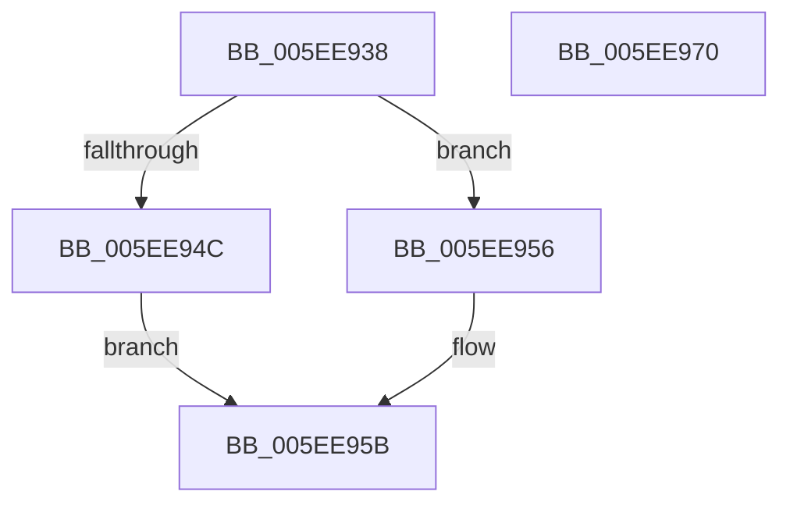

# RtlpTraceDatabaseAcquireLock

- RVA: `0x005EE938`–`0x005EE971` (길이 `57` bytes)
- VA: `0x00000001405EE938`
- 실행 섹션: `.text`
- PDB 이름 있음: `예`; PDB Function 태그: `아니요`
- unwind 정보 RVA: `0x0005CF00`
- 디코드: `18`개 명령, `57/57` bytes 표시
- 미해석 바이트: `0` (있으면 어셈블리에 `.byte`로 보존)

> 이 문서는 커널 이미지의 기계어와 PDB 기호를 분석해 생성했습니다. 4번과 5번은 함수 원형과 자료형을 바이너리 사용 방식에서 추정한 C 해석이며 원본 소스 복구 결과는 아닙니다.

## 1. Dependencies

- 직접 호출 지점: **2**; 고유 호출 대상: **2**
- 직접 호출자로 확인된 함수: **5**
- RIP 상대 이미지 참조: **0**

### Outgoing calls
- `0x005EE94C` → [KeAcquireSpinLockRaiseToDpc](../20/KeAcquireSpinLockRaiseToDpc_function_00208470.md) (function, `0x00208470`)
- `0x005EE956` → [ExAcquireFastMutex](../20/ExAcquireFastMutex_function_0020E5A0.md) (function, `0x0020E5A0`)

### Direct callers
- [RtlTraceDatabaseAdd](RtlTraceDatabaseAdd_function_005EE580.md) at `0x005EE59F`
- [RtlTraceDatabaseEnumerate](RtlTraceDatabaseEnumerate_function_005EE7A0.md) at `0x005EE7BE`
- [RtlTraceDatabaseFind](RtlTraceDatabaseFind_function_005EE860.md) at `0x005EE87F`
- [RtlTraceDatabaseLock](RtlTraceDatabaseLock_function_005EE8D0.md) at `0x005EE8D4`
- [RtlTraceDatabaseValidate](RtlTraceDatabaseValidate_function_005EE910.md) at `0x005EE919`

### Static image references
- 디코드된 RIP-relative 메모리 참조가 없습니다.

## 2. Other-region calls and transfers

- 다른 실행 섹션으로 향하는 call: **0**
- 별도 외부 분기/꼬리 이동을 확인하지 못했습니다.

## 3. Assembly (complete function range)

```asm
005EE938  40 53                           push rbx
005EE93A  48 83 EC 20                     sub rsp, 0x20
005EE93E  48 8B D9                        mov rbx, rcx
005EE941  48 83 C1 38                     add rcx, 0x38
005EE945  8B 43 04                        mov eax, dword ptr [rbx + 4]
005EE948  A8 04                           test al, 4
005EE94A  74 0A                           je 0x1405ee956
005EE94C  E8 1F 9B C1 FF                  call 0x140208470
005EE951  88 43 28                        mov byte ptr [rbx + 0x28], al
005EE954  EB 05                           jmp 0x1405ee95b
005EE956  E8 45 FC C1 FF                  call 0x14020e5a0
005EE95B  65 48 8B 04 25 88 01 00 00      mov rax, qword ptr gs:[0x188]
005EE964  48 89 43 30                     mov qword ptr [rbx + 0x30], rax
005EE968  B0 01                           mov al, 1
005EE96A  48 83 C4 20                     add rsp, 0x20
005EE96E  5B                              pop rbx
005EE96F  C3                              ret
005EE970  CC                              int3
```

## 4. C-style interpretation (structured pseudocode)

```c
__int64 __fastcall RtlpTraceDatabaseAcquireLock(__int64 a1)
{
    __int64 result;
    __int64 v_rsp;

    v_rsp = (v_rsp) - (32);
    a1 = (a1) + (56);
    if ((((unsigned __int8)((unsigned int)(*(unsigned int *)(a1 + 4)))) & (4)) == 0) goto loc_005EE956;
    result = KeAcquireSpinLockRaiseToDpc(a1, a2, a3, a4);
    *(unsigned __int8 *)(a1 + 40) = (unsigned __int8)(result);
    goto loc_005EE95B;
loc_005EE956:
    result = ExAcquireFastMutex(a1, a2, a3, a4);
loc_005EE95B:
    *(unsigned __int64 *)(a1 + 48) = *(unsigned __int64 *)(gs_base + (0 + 392));
    v_rsp = (v_rsp) + (32);
    return 1;
}
```

## 5. (Beta) C Style

```c
int64_t RtlpTraceDatabaseAcquireLock(void *Arg1)
{
    uint8_t *arg1 = (uint8_t *)Arg1;

    int64_t result;
    int64_t local_rsp;

    local_rsp = (local_rsp) - (32);
    Arg1 = (Arg1) + (56);
    if ((((uint8_t)((uint32_t)(*(uint32_t *)(arg1 + 0x4)))) & (4)) == 0) goto loc_005EE956;
    result = KeAcquireSpinLockRaiseToDpc(Arg1, a2, a3, a4);
    *(uint8_t *)(arg1 + 0x28) = (uint8_t)(result);
    goto loc_005EE95B;
loc_005EE956:
    result = ExAcquireFastMutex(Arg1, a2, a3, a4);
loc_005EE95B:
    *(uint64_t *)(arg1 + 0x30) = *(uint64_t *)(gs_base + (0 + 0x188));
    local_rsp = (local_rsp) + (32);
    return 1;
}
```

### 관측된 메모리 오프셋

구조체 형식이 확인되지 않은 접근은 인자 기준의 오프셋으로만 기록했습니다.

| 기준 인자 | 오프셋 표현 | 폭 (bit) | 접근 |
|---|---:|---:|---|
| `Arg1` | `+ 0x4` | `32` | `R` |
| `Arg1` | `+ 0x28` | `8` | `W` |
| `Arg1` | `+ 0x30` | `64` | `W` |

## 6. Execution-region graph

[열기: 2D/3D 그래프와 함수 탐색 컨트롤 패널](../../../control-panel.html?section=text&rva=0x005EE938&view=graph)

- 2D 그래프는 위에서 아래로 흐르고, 3D 그래프는 빈 공간을 드래그해 회전합니다. Shift+드래그는 이동, 휠은 확대·축소, 함수 노드 선택은 대상 보고서 이동입니다.

### Static fallback


