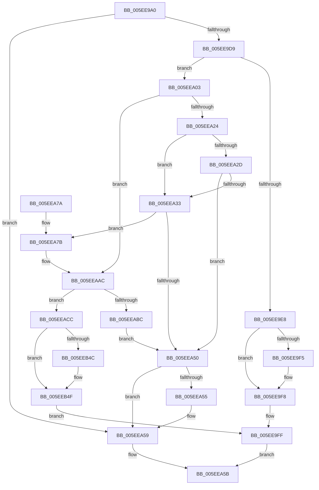

# RtlpTraceDatabaseInternalAdd

- RVA: `0x005EE9A0`–`0x005EEB5B` (길이 `443` bytes)
- VA: `0x00000001405EE9A0`
- 실행 섹션: `.text`
- PDB 이름 있음: `예`; PDB Function 태그: `아니요`
- unwind 정보 RVA: `0x000CFF50`
- 디코드: `120`개 명령, `443/443` bytes 표시
- 미해석 바이트: `0` (있으면 어셈블리에 `.byte`로 보존)

> 이 문서는 커널 이미지의 기계어와 PDB 기호를 분석해 생성했습니다. 4번과 5번은 함수 원형과 자료형을 바이너리 사용 방식에서 추정한 C 해석이며 원본 소스 복구 결과는 아닙니다.

## 1. Dependencies

- 직접 호출 지점: **5**; 고유 호출 대상: **5**
- 직접 호출자로 확인된 함수: **1**
- RIP 상대 이미지 참조: **1**

### Outgoing calls
- `0x005EE9DF` → [RtlpTraceDatabaseInternalFind](RtlpTraceDatabaseInternalFind_function_005EEB64.md) (function, `0x005EEB64`)
- `0x005EEA43` → [RtlpTraceDatabaseAllocate](RtlpTraceDatabaseAllocate_function_005EE978.md) (function, `0x005EE978`)
- `0x005EEAC5` → [DbgPrint](../35/DbgPrint_function_00358CB0.md) (function, `0x00358CB0`)
- `0x005EEB02` → [memcpy](../6C/memcpy_function_006C6840.md) (function, `0x006C6840`)
- `0x005EEB13` → [guard_dispatch_icall](../6B/guard_dispatch_icall_function_006BAAD0.md) (function, `0x006BAAD0`)

### Direct callers
- [RtlTraceDatabaseAdd](RtlTraceDatabaseAdd_function_005EE580.md) at `0x005EE5AF`

### Static image references
- `0x005EEABE` → RVA `0x006CD340` (` ?? ::FNODOBFM::`string'`; read)

## 2. Other-region calls and transfers

- 다른 실행 섹션으로 향하는 call: **0**
- 별도 외부 분기/꼬리 이동을 확인하지 못했습니다.

## 3. Assembly (complete function range)

```asm
005EE9A0  48 8B C4                        mov rax, rsp
005EE9A3  48 89 58 08                     mov qword ptr [rax + 8], rbx
005EE9A7  48 89 68 10                     mov qword ptr [rax + 0x10], rbp
005EE9AB  48 89 70 18                     mov qword ptr [rax + 0x18], rsi
005EE9AF  48 89 78 20                     mov qword ptr [rax + 0x20], rdi
005EE9B3  41 55                           push r13
005EE9B5  41 56                           push r14
005EE9B7  41 57                           push r15
005EE9B9  48 83 EC 30                     sub rsp, 0x30
005EE9BD  48 83 60 D8 00                  and qword ptr [rax - 0x28], 0
005EE9C2  49 8B F9                        mov rdi, r9
005EE9C5  8B F2                           mov esi, edx
005EE9C7  4D 8B F8                        mov r15, r8
005EE9CA  48 8B D9                        mov rbx, rcx
005EE9CD  81 FA 00 01 00 00               cmp edx, 0x100
005EE9D3  0F 87 80 00 00 00               ja 0x1405eea59
005EE9D9  4C 8D 48 D8                     lea r9, [rax - 0x28]
005EE9DD  8B D6                           mov edx, esi
005EE9DF  E8 80 01 00 00                  call 0x1405eeb64
005EE9E4  84 C0                           test al, al
005EE9E6  74 1B                           je 0x1405eea03
005EE9E8  48 8B 44 24 20                  mov rax, qword ptr [rsp + 0x20]
005EE9ED  FF 40 04                        inc dword ptr [rax + 4]
005EE9F0  48 85 FF                        test rdi, rdi
005EE9F3  74 03                           je 0x1405ee9f8
005EE9F5  48 89 07                        mov qword ptr [rdi], rax
005EE9F8  48 FF 83 90 00 00 00            inc qword ptr [rbx + 0x90]
005EE9FF  B0 01                           mov al, 1
005EEA01  EB 58                           jmp 0x1405eea5b
005EEA03  48 8B 53 10                     mov rdx, qword ptr [rbx + 0x10]
005EEA07  4C 8D 2C F5 00 00 00 00         lea r13, [rsi*8]
005EEA0F  49 8D 6D 38                     lea rbp, [r13 + 0x38]
005EEA13  48 8B 4A 28                     mov rcx, qword ptr [rdx + 0x28]
005EEA17  48 2B 4A 30                     sub rcx, qword ptr [rdx + 0x30]
005EEA1B  48 3B E9                        cmp rbp, rcx
005EEA1E  0F 86 88 00 00 00               jbe 0x1405eeaac
005EEA24  48 8B 43 18                     mov rax, qword ptr [rbx + 0x18]
005EEA28  48 85 C0                        test rax, rax
005EEA2B  74 06                           je 0x1405eea33
005EEA2D  48 39 43 20                     cmp qword ptr [rbx + 0x20], rax
005EEA31  77 1D                           ja 0x1405eea50
005EEA33  44 8B 43 08                     mov r8d, dword ptr [rbx + 8]
005EEA37  41 BE 00 10 00 00               mov r14d, 0x1000
005EEA3D  8B 53 04                        mov edx, dword ptr [rbx + 4]
005EEA40  41 8B CE                        mov ecx, r14d
005EEA43  E8 30 FF FF FF                  call 0x1405ee978
005EEA48  48 8B D0                        mov rdx, rax
005EEA4B  48 85 C0                        test rax, rax
005EEA4E  75 2B                           jne 0x1405eea7b
005EEA50  48 85 FF                        test rdi, rdi
005EEA53  74 04                           je 0x1405eea59
005EEA55  48 83 27 00                     and qword ptr [rdi], 0
005EEA59  32 C0                           xor al, al
005EEA5B  48 8B 5C 24 50                  mov rbx, qword ptr [rsp + 0x50]
005EEA60  48 8B 6C 24 58                  mov rbp, qword ptr [rsp + 0x58]
005EEA65  48 8B 74 24 60                  mov rsi, qword ptr [rsp + 0x60]
005EEA6A  48 8B 7C 24 68                  mov rdi, qword ptr [rsp + 0x68]
005EEA6F  48 83 C4 30                     add rsp, 0x30
005EEA73  41 5F                           pop r15
005EEA75  41 5E                           pop r14
005EEA77  41 5D                           pop r13
005EEA79  C3                              ret
005EEA7A  CC                              int3
005EEA7B  C7 00 BB BB CD AB               mov dword ptr [rax], 0xabcdbbbb
005EEA81  48 89 58 08                     mov qword ptr [rax + 8], rbx
005EEA85  4C 89 70 18                     mov qword ptr [rax + 0x18], r14
005EEA89  48 89 50 20                     mov qword ptr [rax + 0x20], rdx
005EEA8D  49 03 C6                        add rax, r14
005EEA90  48 89 42 28                     mov qword ptr [rdx + 0x28], rax
005EEA94  48 8D 42 38                     lea rax, [rdx + 0x38]
005EEA98  48 89 42 30                     mov qword ptr [rdx + 0x30], rax
005EEA9C  48 8B 43 10                     mov rax, qword ptr [rbx + 0x10]
005EEAA0  48 89 42 10                     mov qword ptr [rdx + 0x10], rax
005EEAA4  4C 01 73 20                     add qword ptr [rbx + 0x20], r14
005EEAA8  48 89 53 10                     mov qword ptr [rbx + 0x10], rdx
005EEAAC  4C 8B 72 30                     mov r14, qword ptr [rdx + 0x30]
005EEAB0  48 8B 42 28                     mov rax, qword ptr [rdx + 0x28]
005EEAB4  49 2B C6                        sub rax, r14
005EEAB7  48 3B E8                        cmp rbp, rax
005EEABA  76 10                           jbe 0x1405eeacc
005EEABC  8B D6                           mov edx, esi
005EEABE  48 8D 0D 7B E8 0D 00            lea rcx, [rip + 0xde87b]
005EEAC5  E8 E6 A1 D6 FF                  call 0x140358cb0
005EEACA  EB 84                           jmp 0x1405eea50
005EEACC  49 8D 04 2E                     lea rax, [r14 + rbp]
005EEAD0  4D 8B C5                        mov r8, r13
005EEAD3  48 89 42 30                     mov qword ptr [rdx + 0x30], rax
005EEAD7  49 8D 46 38                     lea rax, [r14 + 0x38]
005EEADB  41 C7 06 AA AA CD AB            mov dword ptr [r14], 0xabcdaaaa
005EEAE2  49 8B D7                        mov rdx, r15
005EEAE5  41 89 76 08                     mov dword ptr [r14 + 8], esi
005EEAE9  48 8B C8                        mov rcx, rax
005EEAEC  41 C7 46 04 01 00 00 00         mov dword ptr [r14 + 4], 1
005EEAF4  49 89 46 30                     mov qword ptr [r14 + 0x30], rax
005EEAF8  49 83 66 10 00                  and qword ptr [r14 + 0x10], 0
005EEAFD  49 83 66 18 00                  and qword ptr [r14 + 0x18], 0
005EEB02  E8 39 7D 0D 00                  call 0x1406c6840
005EEB07  48 8B 83 80 00 00 00            mov rax, qword ptr [rbx + 0x80]
005EEB0E  49 8B D7                        mov rdx, r15
005EEB11  8B CE                           mov ecx, esi
005EEB13  E8 B8 BF 0C 00                  call 0x1406baad0
005EEB18  8B 4B 70                        mov ecx, dword ptr [rbx + 0x70]
005EEB1B  33 D2                           xor edx, edx
005EEB1D  F7 F1                           div ecx
005EEB1F  C1 E9 04                        shr ecx, 4
005EEB22  44 8B C2                        mov r8d, edx
005EEB25  33 D2                           xor edx, edx
005EEB27  41 8B C0                        mov eax, r8d
005EEB2A  F7 F1                           div ecx
005EEB2C  FF 84 83 98 00 00 00            inc dword ptr [rbx + rax*4 + 0x98]
005EEB33  48 8B 43 78                     mov rax, qword ptr [rbx + 0x78]
005EEB37  4A 8B 0C C0                     mov rcx, qword ptr [rax + r8*8]
005EEB3B  49 89 4E 28                     mov qword ptr [r14 + 0x28], rcx
005EEB3F  48 8B 43 78                     mov rax, qword ptr [rbx + 0x78]
005EEB43  4E 89 34 C0                     mov qword ptr [rax + r8*8], r14
005EEB47  48 85 FF                        test rdi, rdi
005EEB4A  74 03                           je 0x1405eeb4f
005EEB4C  4C 89 37                        mov qword ptr [rdi], r14
005EEB4F  48 FF 83 88 00 00 00            inc qword ptr [rbx + 0x88]
005EEB56  E9 A4 FE FF FF                  jmp 0x1405ee9ff
```

## 4. C-style interpretation (structured pseudocode)

```c
__int64 __fastcall RtlpTraceDatabaseInternalAdd(__int64 a1, int a2, __int64 a3, __int64 a4)
{
    __int64 result;
    __int64 v_rsp;
    unsigned __int64 v_stack_m28;
    unsigned __int64 v_stack_p10;
    unsigned __int64 v_stack_p18;
    unsigned __int64 v_stack_p20;
    unsigned __int64 v_stack_p8;

    *(unsigned __int64 *)(v_rsp + 8) = v_rbx;
    *(unsigned __int64 *)(v_rsp + 16) = v_rbp;
    *(unsigned __int64 *)(v_rsp + 24) = v_rsi;
    *(unsigned __int64 *)(v_rsp + 32) = v_rdi;
    v_rsp = (v_rsp) - (48);
    if (a2 > 256) goto loc_005EEA59;
    result = RtlpTraceDatabaseInternalFind(a1, (unsigned int)((unsigned int)((unsigned int)(a2))), a3, v_rsp - 40);
    if ((unsigned __int8)(result) == 0) goto loc_005EEA03;
    if (a4 != 0) {
        *(unsigned __int64 *)(a4) = v_stack_m28;
    }
loc_005EE9FF:
    goto loc_005EEA5B;
loc_005EEA03:
    a1 = (*(unsigned __int64 *)(*(unsigned __int64 *)(a1 + 16) + 40)) - (*(unsigned __int64 *)(*(unsigned __int64 *)(a1 + 16) + 48));
    if (((unsigned int)(a2) * 8 + 56) <= a1) goto loc_005EEAAC;
    if (*(unsigned __int64 *)(a1 + 24) == 0) goto loc_005EEA33;
    if ((*(unsigned __int64 *)(a1 + 32)) > (*(unsigned __int64 *)(a1 + 24))) goto loc_005EEA50;
loc_005EEA33:
    result = RtlpTraceDatabaseAllocate((unsigned int)((unsigned int)((unsigned int)(0x1000ULL))), (unsigned int)(*(unsigned int *)(a1 + 4)), (unsigned int)(*(unsigned int *)(a1 + 8)), v_rsp - 40);
    if (result != 0) goto loc_005EEA7B;
loc_005EEA50:
    if (a4 != 0) {
    }
    result = 0;
loc_005EEA5B:
    v_rsp = (v_rsp) + (48);
    return result;
loc_005EEA7B:
    *(unsigned int *)(result) = 0xABCDBBBBULL;
    *(unsigned __int64 *)(result + 8) = v_stack_p8;
    *(unsigned __int64 *)(result + 24) = (unsigned int)(0x1000ULL);
    *(unsigned __int64 *)(result + 32) = 0;
    result = (result) + ((unsigned int)(0x1000ULL));
    *(unsigned __int64 *)(result + 40) = result;
    *(unsigned __int64 *)(result + 48) = result + 56;
    *(unsigned __int64 *)(result + 16) = *(unsigned __int64 *)(v_stack_p8 + 16);
    *(unsigned __int64 *)(v_stack_p8 + 16) = result;
loc_005EEAAC:
    result = (*(unsigned __int64 *)(result + 40)) - (*(unsigned __int64 *)(result + 48));
    if (v_stack_p10 <= result) goto loc_005EEACC;
    result = DbgPrint(v_rip + 911483, (unsigned int)((unsigned int)(v_stack_p18)), (unsigned int)(*(unsigned int *)(a1 + 8)), v_rsp - 40);
    goto loc_005EEA50;
loc_005EEACC:
    *(unsigned __int64 *)((unsigned int)((unsigned int)(v_stack_p18)) + 48) = *(unsigned __int64 *)(result + 48) + v_stack_p10 * 1;
    *(unsigned int *)(*(unsigned __int64 *)(result + 48)) = 0xABCDAAAAULL;
    *(unsigned int *)(*(unsigned __int64 *)(result + 48) + 8) = (unsigned int)(v_stack_p18);
    *(unsigned int *)(*(unsigned __int64 *)(result + 48) + 4) = 1;
    *(unsigned __int64 *)(*(unsigned __int64 *)(result + 48) + 48) = *(unsigned __int64 *)(result + 48) + 56;
    result = memcpy(*(unsigned __int64 *)(result + 48) + 56, a3, (unsigned int)(a2) * 8, v_rsp - 40);
    result = guard_dispatch_icall((unsigned int)((unsigned int)(v_stack_p18)), a3, (unsigned int)(a2) * 8, v_rsp - 40);
    a2 = 0;
    a1 = (unsigned int)(((unsigned int)(*(unsigned int *)(v_stack_p8 + 112))) >> (4));
    a2 = 0;
    *(unsigned __int64 *)(*(unsigned __int64 *)(result + 48) + 40) = *(unsigned __int64 *)(*(unsigned __int64 *)(v_stack_p8 + 120) + 0 * 8);
    *(unsigned __int64 *)(*(unsigned __int64 *)(v_stack_p8 + 120) + 0 * 8) = *(unsigned __int64 *)(result + 48);
    if (v_stack_p20 != 0) {
        *(unsigned __int64 *)(v_stack_p20) = *(unsigned __int64 *)(result + 48);
    }
    goto loc_005EE9FF;
}
```

## 5. (Beta) C Style

```c
int64_t RtlpTraceDatabaseInternalAdd(void *Arg1, int32_t Arg2, int64_t Arg3, int64_t Arg4)
{
    uint8_t *arg1 = (uint8_t *)Arg1;

    int64_t result;
    int64_t local_rsp;
    uint64_t v_stack_m28;
    uint64_t v_stack_p10;
    uint64_t v_stack_p18;
    uint64_t v_stack_p20;
    uint64_t v_stack_p8;

    *(uint64_t *)(local_rsp + 0x8) = local_rbx;
    *(uint64_t *)(local_rsp + 0x10) = local_rbp;
    *(uint64_t *)(local_rsp + 0x18) = local_rsi;
    *(uint64_t *)(local_rsp + 0x20) = local_rdi;
    local_rsp = (local_rsp) - (48);
    if (Arg2 > 256) goto loc_005EEA59;
    result = RtlpTraceDatabaseInternalFind(Arg1, (uint32_t)((uint32_t)((uint32_t)(Arg2))), Arg3, local_rsp - 40);
    if ((uint8_t)(result) == 0) goto loc_005EEA03;
    if (Arg4 != 0) {
        *(uint64_t *)(Arg4) = v_stack_m28;
    }
loc_005EE9FF:
    goto loc_005EEA5B;
loc_005EEA03:
    Arg1 = (*(uint64_t *)(*(uint64_t *)(arg1 + 0x10) + 0x28)) - (*(uint64_t *)(*(uint64_t *)(arg1 + 0x10) + 0x30));
    if (((uint32_t)(Arg2) * 8 + 56) <= Arg1) goto loc_005EEAAC;
    if (*(uint64_t *)(arg1 + 0x18) == 0) goto loc_005EEA33;
    if ((*(uint64_t *)(arg1 + 0x20)) > (*(uint64_t *)(arg1 + 0x18))) goto loc_005EEA50;
loc_005EEA33:
    result = RtlpTraceDatabaseAllocate((uint32_t)((uint32_t)((uint32_t)(0x1000ULL))), (uint32_t)(*(uint32_t *)(arg1 + 0x4)), (uint32_t)(*(uint32_t *)(arg1 + 0x8)), local_rsp - 40);
    if (result != 0) goto loc_005EEA7B;
loc_005EEA50:
    if (Arg4 != 0) {
    }
    result = 0;
loc_005EEA5B:
    local_rsp = (local_rsp) + (48);
    return result;
loc_005EEA7B:
    *(uint32_t *)(result) = 0xABCDBBBBULL;
    *(uint64_t *)(result + 0x8) = v_stack_p8;
    *(uint64_t *)(result + 0x18) = (uint32_t)(0x1000ULL);
    *(uint64_t *)(result + 0x20) = 0;
    result = (result) + ((uint32_t)(0x1000ULL));
    *(uint64_t *)(result + 0x28) = result;
    *(uint64_t *)(result + 0x30) = result + 56;
    *(uint64_t *)(result + 0x10) = *(uint64_t *)(v_stack_p8 + 0x10);
    *(uint64_t *)(v_stack_p8 + 0x10) = result;
loc_005EEAAC:
    result = (*(uint64_t *)(result + 0x28)) - (*(uint64_t *)(result + 0x30));
    if (v_stack_p10 <= result) goto loc_005EEACC;
    result = DbgPrint(v_rip + 911483, (uint32_t)((uint32_t)(v_stack_p18)), (uint32_t)(*(uint32_t *)(arg1 + 0x8)), local_rsp - 40);
    goto loc_005EEA50;
loc_005EEACC:
    *(uint64_t *)((uint32_t)((uint32_t)(v_stack_p18)) + 0x30) = *(uint64_t *)(result + 0x30) + v_stack_p10 * 1;
    *(uint32_t *)(*(uint64_t *)(result + 0x30)) = 0xABCDAAAAULL;
    *(uint32_t *)(*(uint64_t *)(result + 0x30) + 0x8) = (uint32_t)(v_stack_p18);
    *(uint32_t *)(*(uint64_t *)(result + 0x30) + 0x4) = 1;
    *(uint64_t *)(*(uint64_t *)(result + 0x30) + 0x30) = *(uint64_t *)(result + 0x30) + 56;
    result = memcpy(*(uint64_t *)(result + 0x30) + 56, Arg3, (uint32_t)(Arg2) * 8, local_rsp - 40);
    result = guard_dispatch_icall((uint32_t)((uint32_t)(v_stack_p18)), Arg3, (uint32_t)(Arg2) * 8, local_rsp - 40);
    Arg2 = 0;
    Arg1 = (uint32_t)(((uint32_t)(*(uint32_t *)(v_stack_p8 + 0x70))) >> (4));
    Arg2 = 0;
    *(uint64_t *)(*(uint64_t *)(result + 0x30) + 0x28) = *(uint64_t *)(*(uint64_t *)(v_stack_p8 + 0x78) + 0x0 * 8);
    *(uint64_t *)(*(uint64_t *)(v_stack_p8 + 0x78) + 0x0 * 8) = *(uint64_t *)(result + 0x30);
    if (v_stack_p20 != 0) {
        *(uint64_t *)(v_stack_p20) = *(uint64_t *)(result + 0x30);
    }
    goto loc_005EE9FF;
}
```

### 관측된 메모리 오프셋

구조체 형식이 확인되지 않은 접근은 인자 기준의 오프셋으로만 기록했습니다.

| 기준 인자 | 오프셋 표현 | 폭 (bit) | 접근 |
|---|---:|---:|---|
| `Arg1` | `+ 0x4` | `32` | `R` |
| `Arg1` | `+ 0x8` | `32` | `R` |
| `Arg1` | `+ 0x10` | `64` | `R` |
| `Arg1` | `+ 0x10` | `64` | `W` |
| `Arg1` | `+ 0x18` | `64` | `R` |
| `Arg1` | `+ 0x20` | `64` | `R` |
| `Arg1` | `+ 0x20` | `64` | `R/W` |
| `Arg1` | `+ 0x70` | `32` | `R` |
| `Arg1` | `+ 0x78` | `64` | `R` |
| `Arg1` | `+ 0x80` | `64` | `R` |
| `Arg1` | `+ 0x88` | `64` | `R/W` |
| `Arg1` | `+ 0x90` | `64` | `R/W` |
| `Arg1` | `+ 0x98 + rax*4` | `32` | `R/W` |

## 6. Execution-region graph

[열기: 2D/3D 그래프와 함수 탐색 컨트롤 패널](../../../control-panel.html?section=text&rva=0x005EE9A0&view=graph)

- 2D 그래프는 위에서 아래로 흐르고, 3D 그래프는 빈 공간을 드래그해 회전합니다. Shift+드래그는 이동, 휠은 확대·축소, 함수 노드 선택은 대상 보고서 이동입니다.

### Static fallback


