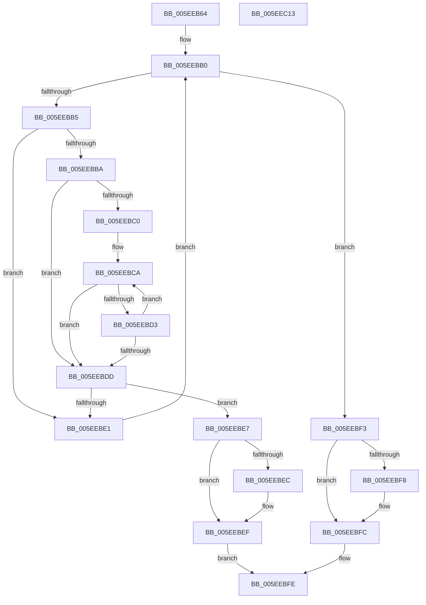

# RtlpTraceDatabaseInternalFind

- RVA: `0x005EEB64`–`0x005EEC14` (길이 `176` bytes)
- VA: `0x00000001405EEB64`
- 실행 섹션: `.text`
- PDB 이름 있음: `예`; PDB Function 태그: `아니요`
- unwind 정보 RVA: `0x0005C954`
- 디코드: `57`개 명령, `176/176` bytes 표시
- 미해석 바이트: `0` (있으면 어셈블리에 `.byte`로 보존)

> 이 문서는 커널 이미지의 기계어와 PDB 기호를 분석해 생성했습니다. 4번과 5번은 함수 원형과 자료형을 바이너리 사용 방식에서 추정한 C 해석이며 원본 소스 복구 결과는 아닙니다.

## 1. Dependencies

- 직접 호출 지점: **1**; 고유 호출 대상: **1**
- 직접 호출자로 확인된 함수: **2**
- RIP 상대 이미지 참조: **0**

### Outgoing calls
- `0x005EEB8F` → [guard_dispatch_icall](../6B/guard_dispatch_icall_function_006BAAD0.md) (function, `0x006BAAD0`)

### Direct callers
- [RtlTraceDatabaseFind](RtlTraceDatabaseFind_function_005EE860.md) at `0x005EE88F`
- [RtlpTraceDatabaseInternalAdd](RtlpTraceDatabaseInternalAdd_function_005EE9A0.md) at `0x005EE9DF`

### Static image references
- 디코드된 RIP-relative 메모리 참조가 없습니다.

## 2. Other-region calls and transfers

- 다른 실행 섹션으로 향하는 call: **0**
- 별도 외부 분기/꼬리 이동을 확인하지 못했습니다.

## 3. Assembly (complete function range)

```asm
005EEB64  48 89 5C 24 08                  mov qword ptr [rsp + 8], rbx
005EEB69  48 89 6C 24 10                  mov qword ptr [rsp + 0x10], rbp
005EEB6E  48 89 74 24 18                  mov qword ptr [rsp + 0x18], rsi
005EEB73  57                              push rdi
005EEB74  48 83 EC 20                     sub rsp, 0x20
005EEB78  48 8B 81 80 00 00 00            mov rax, qword ptr [rcx + 0x80]
005EEB7F  8B F2                           mov esi, edx
005EEB81  48 8B D9                        mov rbx, rcx
005EEB84  49 8B D0                        mov rdx, r8
005EEB87  8B CE                           mov ecx, esi
005EEB89  49 8B F9                        mov rdi, r9
005EEB8C  49 8B E8                        mov rbp, r8
005EEB8F  E8 3C BF 0C 00                  call 0x1406baad0
005EEB94  44 8B D0                        mov r10d, eax
005EEB97  33 D2                           xor edx, edx
005EEB99  41 83 E2 0F                     and r10d, 0xf
005EEB9D  42 FF 84 93 98 00 00 00         inc dword ptr [rbx + r10*4 + 0x98]
005EEBA5  F7 73 70                        div dword ptr [rbx + 0x70]
005EEBA8  48 8B 43 78                     mov rax, qword ptr [rbx + 0x78]
005EEBAC  48 8B 14 D0                     mov rdx, qword ptr [rax + rdx*8]
005EEBB0  48 85 D2                        test rdx, rdx
005EEBB3  74 3E                           je 0x1405eebf3
005EEBB5  3B 72 08                        cmp esi, dword ptr [rdx + 8]
005EEBB8  75 27                           jne 0x1405eebe1
005EEBBA  33 C9                           xor ecx, ecx
005EEBBC  85 F6                           test esi, esi
005EEBBE  74 1D                           je 0x1405eebdd
005EEBC0  4C 8B 4A 30                     mov r9, qword ptr [rdx + 0x30]
005EEBC4  4C 8B C5                        mov r8, rbp
005EEBC7  4C 2B CD                        sub r9, rbp
005EEBCA  49 8B 00                        mov rax, qword ptr [r8]
005EEBCD  4B 39 04 01                     cmp qword ptr [r9 + r8], rax
005EEBD1  75 0A                           jne 0x1405eebdd
005EEBD3  FF C1                           inc ecx
005EEBD5  49 83 C0 08                     add r8, 8
005EEBD9  3B CE                           cmp ecx, esi
005EEBDB  72 ED                           jb 0x1405eebca
005EEBDD  3B CE                           cmp ecx, esi
005EEBDF  74 06                           je 0x1405eebe7
005EEBE1  48 8B 52 28                     mov rdx, qword ptr [rdx + 0x28]
005EEBE5  EB C9                           jmp 0x1405eebb0
005EEBE7  48 85 FF                        test rdi, rdi
005EEBEA  74 03                           je 0x1405eebef
005EEBEC  48 89 17                        mov qword ptr [rdi], rdx
005EEBEF  B0 01                           mov al, 1
005EEBF1  EB 0B                           jmp 0x1405eebfe
005EEBF3  48 85 FF                        test rdi, rdi
005EEBF6  74 04                           je 0x1405eebfc
005EEBF8  48 83 27 00                     and qword ptr [rdi], 0
005EEBFC  32 C0                           xor al, al
005EEBFE  48 8B 5C 24 30                  mov rbx, qword ptr [rsp + 0x30]
005EEC03  48 8B 6C 24 38                  mov rbp, qword ptr [rsp + 0x38]
005EEC08  48 8B 74 24 40                  mov rsi, qword ptr [rsp + 0x40]
005EEC0D  48 83 C4 20                     add rsp, 0x20
005EEC11  5F                              pop rdi
005EEC12  C3                              ret
005EEC13  CC                              int3
```

## 4. C-style interpretation (structured pseudocode)

```c
__int64 __fastcall RtlpTraceDatabaseInternalFind(__int64 a1, int a2, __int64 a3, __int64 a4)
{
    __int64 result;
    __int64 v_r10;
    __int64 v_rsp;
    unsigned __int64 v_stack_p10;
    unsigned __int64 v_stack_p18;
    unsigned __int64 v_stack_p8;

    v_stack_p8 = v_rbx;
    v_stack_p10 = v_rbp;
    v_stack_p18 = v_rsi;
    v_rsp = (v_rsp) - (32);
    result = guard_dispatch_icall((unsigned int)((unsigned int)((unsigned int)(a2))), a3, a3, a4);
    a2 = 0;
    v_r10 = (unsigned int)(((unsigned int)((unsigned int)(result))) & (15));
loc_005EEBB0:
    if (*(unsigned __int64 *)(*(unsigned __int64 *)(a1 + 120) + a2 * 8) == 0) goto loc_005EEBF3;
    if (((unsigned int)((unsigned int)(a2))) != (*(unsigned int *)(*(unsigned __int64 *)(*(unsigned __int64 *)(a1 + 120) + a2 * 8) + 8))) goto loc_005EEBE1;
    a1 = 0;
    if ((unsigned int)((unsigned int)(a2)) == 0) goto loc_005EEBDD;
    a4 = (*(unsigned __int64 *)(*(unsigned __int64 *)(*(unsigned __int64 *)(a1 + 120) + a2 * 8) + 48)) - (a3);
loc_005EEBCA:
    if ((*(unsigned __int64 *)(a4 + a3 * 1)) != (*(unsigned __int64 *)(a3))) goto loc_005EEBDD;
    a1 = (unsigned int)((a1) + 1);
    a3 = (a3) + (8);
    if (((unsigned int)(a1)) < ((unsigned int)((unsigned int)(a2)))) goto loc_005EEBCA;
loc_005EEBDD:
    if (((unsigned int)(a1)) == ((unsigned int)((unsigned int)(a2)))) goto loc_005EEBE7;
loc_005EEBE1:
    goto loc_005EEBB0;
loc_005EEBE7:
    if (a4 != 0) {
        *(unsigned __int64 *)(a4) = *(unsigned __int64 *)(*(unsigned __int64 *)(*(unsigned __int64 *)(a1 + 120) + a2 * 8) + 40);
    }
    goto loc_005EEBFE;
loc_005EEBF3:
    if (a4 != 0) {
    }
    result = 0;
loc_005EEBFE:
    v_rsp = (v_rsp) + (32);
    return result;
}
```

## 5. (Beta) C Style

```c
int64_t RtlpTraceDatabaseInternalFind(void *Arg1, int32_t Arg2, void *Arg3, int64_t Arg4)
{
    uint8_t *arg1 = (uint8_t *)Arg1;
    uint8_t *arg3 = (uint8_t *)Arg3;

    int64_t result;
    int64_t local_r10;
    int64_t local_rsp;
    uint64_t v_stack_p10;
    uint64_t v_stack_p18;
    uint64_t v_stack_p8;

    v_stack_p8 = local_rbx;
    v_stack_p10 = local_rbp;
    v_stack_p18 = local_rsi;
    local_rsp = (local_rsp) - (32);
    result = guard_dispatch_icall((uint32_t)((uint32_t)((uint32_t)(Arg2))), Arg3, Arg3, Arg4);
    Arg2 = 0;
    local_r10 = (uint32_t)(((uint32_t)((uint32_t)(result))) & (15));
loc_005EEBB0:
    if (*(uint64_t *)(*(uint64_t *)(arg1 + 0x78) + Arg2 * 8) == 0) goto loc_005EEBF3;
    if (((uint32_t)((uint32_t)(Arg2))) != (*(uint32_t *)(*(uint64_t *)(*(uint64_t *)(arg1 + 0x78) + Arg2 * 8) + 0x8))) goto loc_005EEBE1;
    Arg1 = 0;
    if ((uint32_t)((uint32_t)(Arg2)) == 0) goto loc_005EEBDD;
    Arg4 = (*(uint64_t *)(*(uint64_t *)(*(uint64_t *)(arg1 + 0x78) + Arg2 * 8) + 0x30)) - (Arg3);
loc_005EEBCA:
    if ((*(uint64_t *)(Arg4 + arg3 * 1)) != (*(uint64_t *)(arg3))) goto loc_005EEBDD;
    Arg1 = (uint32_t)((Arg1) + 1);
    Arg3 = (Arg3) + (8);
    if (((uint32_t)(Arg1)) < ((uint32_t)((uint32_t)(Arg2)))) goto loc_005EEBCA;
loc_005EEBDD:
    if (((uint32_t)(Arg1)) == ((uint32_t)((uint32_t)(Arg2)))) goto loc_005EEBE7;
loc_005EEBE1:
    goto loc_005EEBB0;
loc_005EEBE7:
    if (Arg4 != 0) {
        *(uint64_t *)(Arg4) = *(uint64_t *)(*(uint64_t *)(*(uint64_t *)(arg1 + 0x78) + Arg2 * 8) + 0x28);
    }
    goto loc_005EEBFE;
loc_005EEBF3:
    if (Arg4 != 0) {
    }
    result = 0;
loc_005EEBFE:
    local_rsp = (local_rsp) + (32);
    return result;
}
```

### 관측된 메모리 오프셋

구조체 형식이 확인되지 않은 접근은 인자 기준의 오프셋으로만 기록했습니다.

| 기준 인자 | 오프셋 표현 | 폭 (bit) | 접근 |
|---|---:|---:|---|
| `Arg1` | `+ 0x70` | `32` | `R` |
| `Arg1` | `+ 0x78` | `64` | `R` |
| `Arg1` | `+ 0x80` | `64` | `R` |
| `Arg1` | `+ 0x98 + r10*4` | `32` | `R/W` |
| `Arg3` | `+ 0x0` | `64` | `R` |

## 6. Execution-region graph

[열기: 2D/3D 그래프와 함수 탐색 컨트롤 패널](../../../control-panel.html?section=text&rva=0x005EEB64&view=graph)

- 2D 그래프는 위에서 아래로 흐르고, 3D 그래프는 빈 공간을 드래그해 회전합니다. Shift+드래그는 이동, 휠은 확대·축소, 함수 노드 선택은 대상 보고서 이동입니다.

### Static fallback


