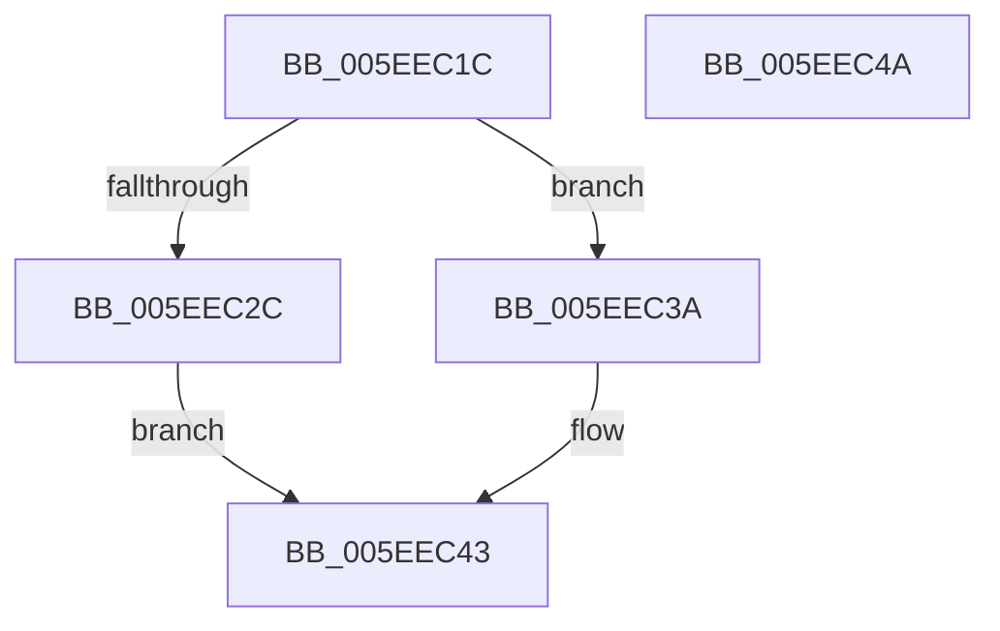

# RtlpTraceDatabaseReleaseLock

- RVA: `0x005EEC1C`–`0x005EEC4B` (길이 `47` bytes)
- VA: `0x00000001405EEC1C`
- 실행 섹션: `.text`
- PDB 이름 있음: `예`; PDB Function 태그: `아니요`
- unwind 정보 RVA: `0x0005C788`
- 디코드: `15`개 명령, `47/47` bytes 표시
- 미해석 바이트: `0` (있으면 어셈블리에 `.byte`로 보존)

> 이 문서는 커널 이미지의 기계어와 PDB 기호를 분석해 생성했습니다. 4번과 5번은 함수 원형과 자료형을 바이너리 사용 방식에서 추정한 C 해석이며 원본 소스 복구 결과는 아닙니다.

## 1. Dependencies

- 직접 호출 지점: **2**; 고유 호출 대상: **2**
- 직접 호출자로 확인된 함수: **5**
- RIP 상대 이미지 참조: **0**

### Outgoing calls
- `0x005EEC33` → [KeReleaseSpinLock](../39/KeReleaseSpinLock_function_00392BA0.md) (function, `0x00392BA0`)
- `0x005EEC3E` → [ExReleaseFastMutex](../25/ExReleaseFastMutex_function_002519C0.md) (function, `0x002519C0`)

### Direct callers
- [RtlTraceDatabaseAdd](RtlTraceDatabaseAdd_function_005EE580.md) at `0x005EE5B9`
- [RtlTraceDatabaseEnumerate](RtlTraceDatabaseEnumerate_function_005EE7A0.md) at `0x005EE83A`
- [RtlTraceDatabaseFind](RtlTraceDatabaseFind_function_005EE860.md) at `0x005EE8A4`
- [RtlTraceDatabaseUnlock](RtlTraceDatabaseUnlock_function_005EE8F0.md) at `0x005EE8F4`
- [RtlTraceDatabaseValidate](RtlTraceDatabaseValidate_function_005EE910.md) at `0x005EE921`

### Static image references
- 디코드된 RIP-relative 메모리 참조가 없습니다.

## 2. Other-region calls and transfers

- 다른 실행 섹션으로 향하는 call: **0**
- 별도 외부 분기/꼬리 이동을 확인하지 못했습니다.

## 3. Assembly (complete function range)

```asm
005EEC1C  48 83 EC 28                     sub rsp, 0x28
005EEC20  48 83 61 30 00                  and qword ptr [rcx + 0x30], 0
005EEC25  8B 41 04                        mov eax, dword ptr [rcx + 4]
005EEC28  A8 04                           test al, 4
005EEC2A  74 0E                           je 0x1405eec3a
005EEC2C  8A 51 28                        mov dl, byte ptr [rcx + 0x28]
005EEC2F  48 83 C1 38                     add rcx, 0x38
005EEC33  E8 68 3F DA FF                  call 0x140392ba0
005EEC38  EB 09                           jmp 0x1405eec43
005EEC3A  48 83 C1 38                     add rcx, 0x38
005EEC3E  E8 7D 2D C6 FF                  call 0x1402519c0
005EEC43  B0 01                           mov al, 1
005EEC45  48 83 C4 28                     add rsp, 0x28
005EEC49  C3                              ret
005EEC4A  CC                              int3
```

## 4. C-style interpretation (structured pseudocode)

```c
__int64 __fastcall RtlpTraceDatabaseReleaseLock(__int64 a1)
{
    __int64 result;
    __int64 v_rsp;

    v_rsp = (v_rsp) - (40);
    if ((((unsigned __int8)((unsigned int)(*(unsigned int *)(a1 + 4)))) & (4)) == 0) goto loc_005EEC3A;
    a1 = (a1) + (56);
    result = KeReleaseSpinLock(a1, *(unsigned __int8 *)(a1 + 40), a3, a4);
    goto loc_005EEC43;
loc_005EEC3A:
    a1 = (a1) + (56);
    result = ExReleaseFastMutex(a1, *(unsigned __int8 *)(a1 + 40), a3, a4);
loc_005EEC43:
    v_rsp = (v_rsp) + (40);
    return 1;
}
```

## 5. (Beta) C Style

```c
int64_t RtlpTraceDatabaseReleaseLock(void *Arg1)
{
    uint8_t *arg1 = (uint8_t *)Arg1;

    int64_t result;
    int64_t local_rsp;

    local_rsp = (local_rsp) - (40);
    if ((((uint8_t)((uint32_t)(*(uint32_t *)(arg1 + 0x4)))) & (4)) == 0) goto loc_005EEC3A;
    Arg1 = (Arg1) + (56);
    result = KeReleaseSpinLock(Arg1, *(uint8_t *)(arg1 + 0x28), a3, a4);
    goto loc_005EEC43;
loc_005EEC3A:
    Arg1 = (Arg1) + (56);
    result = ExReleaseFastMutex(Arg1, *(uint8_t *)(arg1 + 0x28), a3, a4);
loc_005EEC43:
    local_rsp = (local_rsp) + (40);
    return 1;
}
```

### 관측된 메모리 오프셋

구조체 형식이 확인되지 않은 접근은 인자 기준의 오프셋으로만 기록했습니다.

| 기준 인자 | 오프셋 표현 | 폭 (bit) | 접근 |
|---|---:|---:|---|
| `Arg1` | `+ 0x4` | `32` | `R` |
| `Arg1` | `+ 0x28` | `8` | `R` |
| `Arg1` | `+ 0x30` | `64` | `R/W` |

## 6. Execution-region graph

[열기: 2D/3D 그래프와 함수 탐색 컨트롤 패널](../../../control-panel.html?section=text&rva=0x005EEC1C&view=graph)

- 2D 그래프는 위에서 아래로 흐르고, 3D 그래프는 빈 공간을 드래그해 회전합니다. Shift+드래그는 이동, 휠은 확대·축소, 함수 노드 선택은 대상 보고서 이동입니다.

### Static fallback


