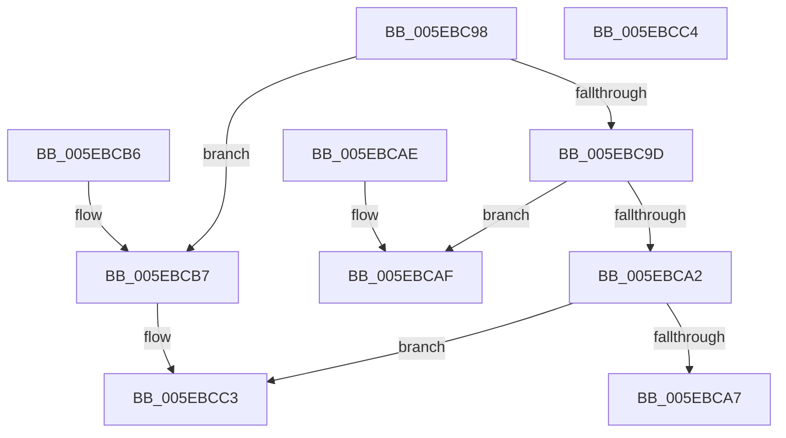

# RtlpUpdateHeapRates

- RVA: `0x005EBC98`–`0x005EBCC5` (길이 `45` bytes)
- VA: `0x00000001405EBC98`
- 실행 섹션: `.text`
- PDB 이름 있음: `예`; PDB Function 태그: `아니요`
- unwind 정보 RVA: `0x000DB714`
- 디코드: `16`개 명령, `45/45` bytes 표시
- 미해석 바이트: `0` (있으면 어셈블리에 `.byte`로 보존)

> 이 문서는 커널 이미지의 기계어와 PDB 기호를 분석해 생성했습니다. 4번과 5번은 함수 원형과 자료형을 바이너리 사용 방식에서 추정한 C 해석이며 원본 소스 복구 결과는 아닙니다.

## 1. Dependencies

- 직접 호출 지점: **0**; 고유 호출 대상: **0**
- 직접 호출자로 확인된 함수: **2**
- RIP 상대 이미지 참조: **0**

### Outgoing calls
- 직접 디코드된 call 명령이 없습니다.

### Direct callers
- [RtlpDeCommitFreeBlock](RtlpDeCommitFreeBlock_function_005EA158.md) at `0x005EA37E`
- [RtlpFindAndCommitPages](RtlpFindAndCommitPages_function_005EA95C.md) at `0x005EAA74`

### Static image references
- 디코드된 RIP-relative 메모리 참조가 없습니다.

## 2. Other-region calls and transfers

- 다른 실행 섹션으로 향하는 call: **0**
- 별도 외부 분기/꼬리 이동을 확인하지 못했습니다.

## 3. Assembly (complete function range)

```asm
005EBC98  83 EA 01                        sub edx, 1
005EBC9B  74 1A                           je 0x1405ebcb7
005EBC9D  83 EA 01                        sub edx, 1
005EBCA0  74 0D                           je 0x1405ebcaf
005EBCA2  83 FA 01                        cmp edx, 1
005EBCA5  75 1C                           jne 0x1405ebcc3
005EBCA7  FF 81 7C 02 00 00               inc dword ptr [rcx + 0x27c]
005EBCAD  C3                              ret
005EBCAE  CC                              int3
005EBCAF  FF 81 78 02 00 00               inc dword ptr [rcx + 0x278]
005EBCB5  C3                              ret
005EBCB6  CC                              int3
005EBCB7  FF 81 70 02 00 00               inc dword ptr [rcx + 0x270]
005EBCBD  FF 81 74 02 00 00               inc dword ptr [rcx + 0x274]
005EBCC3  C3                              ret
005EBCC4  CC                              int3
```

## 4. C-style interpretation (structured pseudocode)

```c
void __fastcall RtlpUpdateHeapRates(__int64 a1, int a2)
{
    a2 = (unsigned int)((a2) - (1));
    if (condition_is_equal) goto loc_005EBCB7;
    a2 = (unsigned int)((a2) - (1));
    if (condition_is_equal) goto loc_005EBCAF;
    if (a2 != 1) goto loc_005EBCC3;
    return;
loc_005EBCAF:
    return;
loc_005EBCB7:
loc_005EBCC3:
    return;
}
```

## 5. (Beta) C Style

```c
void RtlpUpdateHeapRates(void *Arg1, int32_t Arg2)
{
    uint8_t *arg1 = (uint8_t *)Arg1;

    Arg2 = (uint32_t)((Arg2) - (1));
    if (condition_is_equal) goto loc_005EBCB7;
    Arg2 = (uint32_t)((Arg2) - (1));
    if (condition_is_equal) goto loc_005EBCAF;
    if (Arg2 != 1) goto loc_005EBCC3;
    return;
loc_005EBCAF:
    return;
loc_005EBCB7:
loc_005EBCC3:
    return;
}
```

### 관측된 메모리 오프셋

구조체 형식이 확인되지 않은 접근은 인자 기준의 오프셋으로만 기록했습니다.

| 기준 인자 | 오프셋 표현 | 폭 (bit) | 접근 |
|---|---:|---:|---|
| `Arg1` | `+ 0x270` | `32` | `R/W` |
| `Arg1` | `+ 0x274` | `32` | `R/W` |
| `Arg1` | `+ 0x278` | `32` | `R/W` |
| `Arg1` | `+ 0x27C` | `32` | `R/W` |

## 6. Execution-region graph

[열기: 2D/3D 그래프와 함수 탐색 컨트롤 패널](../../../control-panel.html?section=text&rva=0x005EBC98&view=graph)

- 2D 그래프는 위에서 아래로 흐르고, 3D 그래프는 빈 공간을 드래그해 회전합니다. Shift+드래그는 이동, 휠은 확대·축소, 함수 노드 선택은 대상 보고서 이동입니다.

### Static fallback


