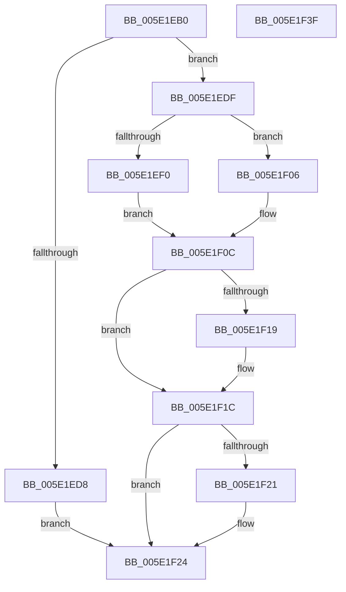

# SleepstudyHelperQueryBlockerStatistics

- RVA: `0x005E1EB0`–`0x005E1F40` (길이 `144` bytes)
- VA: `0x00000001405E1EB0`
- 실행 섹션: `.text`
- PDB 이름 있음: `예`; PDB Function 태그: `아니요`
- unwind 정보 RVA: `0x00060300`
- 디코드: `46`개 명령, `144/144` bytes 표시
- 미해석 바이트: `0` (있으면 어셈블리에 `.byte`로 보존)

> 이 문서는 커널 이미지의 기계어와 PDB 기호를 분석해 생성했습니다. 4번과 5번은 함수 원형과 자료형을 바이너리 사용 방식에서 추정한 C 해석이며 원본 소스 복구 결과는 아닙니다.

## 1. Dependencies

- 직접 호출 지점: **2**; 고유 호출 대상: **2**
- 직접 호출자로 확인된 함수: **0**
- RIP 상대 이미지 참조: **0**

### Outgoing calls
- `0x005E1EDF` → [KeAcquireSpinLockRaiseToDpc](../20/KeAcquireSpinLockRaiseToDpc_function_00208470.md) (function, `0x00208470`)
- `0x005E1F0F` → [KeReleaseSpinLock](../39/KeReleaseSpinLock_function_00392BA0.md) (function, `0x00392BA0`)

### Direct callers
- 이 함수 시작 RVA로 연결되는 직접 call은 확인되지 않았습니다. 간접 호출은 완전히 역산할 수 없습니다.

### Static image references
- 디코드된 RIP-relative 메모리 참조가 없습니다.

## 2. Other-region calls and transfers

- 다른 실행 섹션으로 향하는 call: **0**
- 별도 외부 분기/꼬리 이동을 확인하지 못했습니다.

## 3. Assembly (complete function range)

```asm
005E1EB0  48 89 5C 24 08                  mov qword ptr [rsp + 8], rbx
005E1EB5  48 89 6C 24 10                  mov qword ptr [rsp + 0x10], rbp
005E1EBA  48 89 74 24 18                  mov qword ptr [rsp + 0x18], rsi
005E1EBF  57                              push rdi
005E1EC0  41 56                           push r14
005E1EC2  41 57                           push r15
005E1EC4  48 83 EC 20                     sub rsp, 0x20
005E1EC8  33 DB                           xor ebx, ebx
005E1ECA  4D 8B F0                        mov r14, r8
005E1ECD  4C 8B FA                        mov r15, rdx
005E1ED0  48 8B F9                        mov rdi, rcx
005E1ED3  48 85 C9                        test rcx, rcx
005E1ED6  75 07                           jne 0x1405e1edf
005E1ED8  BB 0D 00 00 C0                  mov ebx, 0xc000000d
005E1EDD  EB 45                           jmp 0x1405e1f24
005E1EDF  E8 8C 65 C2 FF                  call 0x140208470
005E1EE4  8A D0                           mov dl, al
005E1EE6  8B 47 08                        mov eax, dword ptr [rdi + 8]
005E1EE9  83 E0 03                        and eax, 3
005E1EEC  3C 03                           cmp al, 3
005E1EEE  75 16                           jne 0x1405e1f06
005E1EF0  48 A1 08 00 00 00 80 F7 FF FF   movabs rax, qword ptr [0xfffff78000000008]
005E1EFA  40 B5 01                        mov bpl, 1
005E1EFD  48 8B F0                        mov rsi, rax
005E1F00  48 2B 77 20                     sub rsi, qword ptr [rdi + 0x20]
005E1F04  EB 06                           jmp 0x1405e1f0c
005E1F06  40 8A EB                        mov bpl, bl
005E1F09  48 8B F3                        mov rsi, rbx
005E1F0C  48 8B CF                        mov rcx, rdi
005E1F0F  E8 8C 0C DB FF                  call 0x140392ba0
005E1F14  4D 85 FF                        test r15, r15
005E1F17  74 03                           je 0x1405e1f1c
005E1F19  41 88 2F                        mov byte ptr [r15], bpl
005E1F1C  4D 85 F6                        test r14, r14
005E1F1F  74 03                           je 0x1405e1f24
005E1F21  49 89 36                        mov qword ptr [r14], rsi
005E1F24  48 8B 6C 24 48                  mov rbp, qword ptr [rsp + 0x48]
005E1F29  8B C3                           mov eax, ebx
005E1F2B  48 8B 5C 24 40                  mov rbx, qword ptr [rsp + 0x40]
005E1F30  48 8B 74 24 50                  mov rsi, qword ptr [rsp + 0x50]
005E1F35  48 83 C4 20                     add rsp, 0x20
005E1F39  41 5F                           pop r15
005E1F3B  41 5E                           pop r14
005E1F3D  5F                              pop rdi
005E1F3E  C3                              ret
005E1F3F  CC                              int3
```

## 4. C-style interpretation (structured pseudocode)

```c
__int64 __fastcall SleepstudyHelperQueryBlockerStatistics(__int64 a1, __int64 a2, __int64 a3)
{
    __int64 result;
    __int64 v_rbx;
    __int64 v_rsi;
    __int64 v_rsp;
    unsigned __int64 v_stack_p10;
    unsigned __int64 v_stack_p18;
    unsigned __int64 v_stack_p8;

    v_stack_p8 = v_rbx;
    v_stack_p10 = v_rbp;
    v_stack_p18 = v_rsi;
    v_rsp = (v_rsp) - (32);
    v_rbx = 0;
    if (a1 != 0) goto loc_005E1EDF;
    goto loc_005E1F24;
loc_005E1EDF:
    result = KeAcquireSpinLockRaiseToDpc(a1, a2, a3, a4);
    result = (unsigned int)(((unsigned int)(*(unsigned int *)(a1 + 8))) & (3));
    if (((unsigned __int8)(result)) != 3) goto loc_005E1F06;
    v_rsi = (result) - (*(unsigned __int64 *)(a1 + 32));
    goto loc_005E1F0C;
loc_005E1F06:
loc_005E1F0C:
    result = KeReleaseSpinLock(a1, (unsigned __int8)(result), a3, a4);
    if (a2 != 0) {
        *(unsigned __int8 *)(a2) = (unsigned __int8)((unsigned __int8)((unsigned int)(0xC000000DULL)));
    }
    if (a3 != 0) {
        *(unsigned __int64 *)(a3) = (unsigned int)(0xC000000DULL);
    }
    v_rsp = (v_rsp) + (32);
    return (unsigned int)((unsigned int)((unsigned int)(0xC000000DULL)));
}
```

## 5. (Beta) C Style

```c
int64_t SleepstudyHelperQueryBlockerStatistics(void *Arg1, int64_t Arg2, int64_t Arg3)
{
    uint8_t *arg1 = (uint8_t *)Arg1;

    int64_t result;
    int64_t local_rbx;
    int64_t local_rsi;
    int64_t local_rsp;
    uint64_t v_stack_p10;
    uint64_t v_stack_p18;
    uint64_t v_stack_p8;

    v_stack_p8 = local_rbx;
    v_stack_p10 = local_rbp;
    v_stack_p18 = local_rsi;
    local_rsp = (local_rsp) - (32);
    local_rbx = 0;
    if (Arg1 != NULL) goto loc_005E1EDF;
    goto loc_005E1F24;
loc_005E1EDF:
    result = KeAcquireSpinLockRaiseToDpc(Arg1, Arg2, Arg3, a4);
    result = (uint32_t)(((uint32_t)(*(uint32_t *)(arg1 + 0x8))) & (3));
    if (((uint8_t)(result)) != 3) goto loc_005E1F06;
    local_rsi = (result) - (*(uint64_t *)(arg1 + 0x20));
    goto loc_005E1F0C;
loc_005E1F06:
loc_005E1F0C:
    result = KeReleaseSpinLock(Arg1, (uint8_t)(result), Arg3, a4);
    if (Arg2 != 0) {
        *(uint8_t *)(Arg2) = (uint8_t)((uint8_t)((uint32_t)(0xC000000DULL)));
    }
    if (Arg3 != 0) {
        *(uint64_t *)(Arg3) = (uint32_t)(0xC000000DULL);
    }
    local_rsp = (local_rsp) + (32);
    return (uint32_t)((uint32_t)((uint32_t)(0xC000000DULL)));
}
```

### 관측된 메모리 오프셋

구조체 형식이 확인되지 않은 접근은 인자 기준의 오프셋으로만 기록했습니다.

| 기준 인자 | 오프셋 표현 | 폭 (bit) | 접근 |
|---|---:|---:|---|
| `Arg1` | `+ 0x8` | `32` | `R` |
| `Arg1` | `+ 0x20` | `64` | `R` |

## 6. Execution-region graph

[열기: 2D/3D 그래프와 함수 탐색 컨트롤 패널](../../../control-panel.html?section=text&rva=0x005E1EB0&view=graph)

- 2D 그래프는 위에서 아래로 흐르고, 3D 그래프는 빈 공간을 드래그해 회전합니다. Shift+드래그는 이동, 휠은 확대·축소, 함수 노드 선택은 대상 보고서 이동입니다.

### Static fallback


