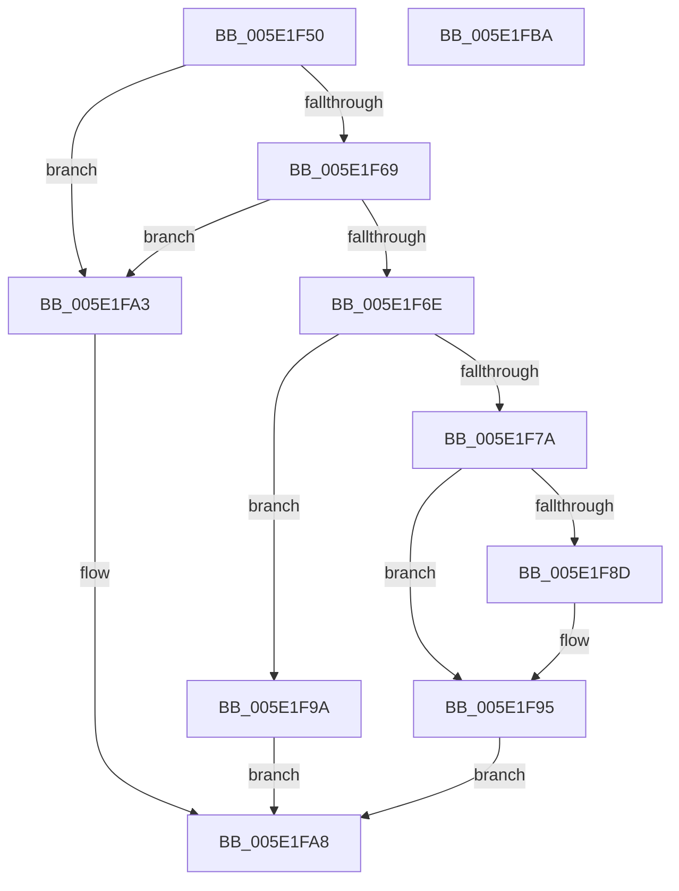

# SleepstudyHelper_AcquireComponentLock

- RVA: `0x005E1F50`–`0x005E1FBB` (길이 `107` bytes)
- VA: `0x00000001405E1F50`
- 실행 섹션: `.text`
- PDB 이름 있음: `예`; PDB Function 태그: `아니요`
- unwind 정보 RVA: `0x00060BC4`
- 디코드: `33`개 명령, `107/107` bytes 표시
- 미해석 바이트: `0` (있으면 어셈블리에 `.byte`로 보존)

> 이 문서는 커널 이미지의 기계어와 PDB 기호를 분석해 생성했습니다. 4번과 5번은 함수 원형과 자료형을 바이너리 사용 방식에서 추정한 C 해석이며 원본 소스 복구 결과는 아닙니다.

## 1. Dependencies

- 직접 호출 지점: **2**; 고유 호출 대상: **2**
- 직접 호출자로 확인된 함수: **0**
- RIP 상대 이미지 참조: **2**

### Outgoing calls
- `0x005E1F90` → [KiRaiseIrqlProcessIrqlFlags](../4F/KiRaiseIrqlProcessIrqlFlags_function_004F56FC.md) (function, `0x004F56FC`)
- `0x005E1F9A` → [KeAcquireSpinLockRaiseToDpc](../20/KeAcquireSpinLockRaiseToDpc_function_00208470.md) (function, `0x00208470`)

### Direct callers
- 이 함수 시작 RVA로 연결되는 직접 call은 확인되지 않았습니다. 간접 호출은 완전히 역산할 수 없습니다.

### Static image references
- `0x005E1F6E` → RVA `0x00F06B68` (`.data`; read)
- `0x005E1F85` → RVA `0x00FC6D20` (`ALMOSTRO`; read)

## 2. Other-region calls and transfers

- 다른 실행 섹션으로 향하는 call: **0**
- 별도 외부 분기/꼬리 이동을 확인하지 못했습니다.

## 3. Assembly (complete function range)

```asm
005E1F50  48 89 5C 24 08                  mov qword ptr [rsp + 8], rbx
005E1F55  48 89 74 24 10                  mov qword ptr [rsp + 0x10], rsi
005E1F5A  57                              push rdi
005E1F5B  48 83 EC 20                     sub rsp, 0x20
005E1F5F  33 DB                           xor ebx, ebx
005E1F61  48 8B FA                        mov rdi, rdx
005E1F64  48 85 C9                        test rcx, rcx
005E1F67  74 3A                           je 0x1405e1fa3
005E1F69  48 85 D2                        test rdx, rdx
005E1F6C  74 35                           je 0x1405e1fa3
005E1F6E  48 8D 05 F3 4B 92 00            lea rax, [rip + 0x924bf3]
005E1F75  48 3B C8                        cmp rcx, rax
005E1F78  75 20                           jne 0x1405e1f9a
005E1F7A  44 0F 20 C6                     mov rsi, cr8
005E1F7E  8D 53 02                        lea edx, [rbx + 2]
005E1F81  44 0F 22 C2                     mov cr8, rdx
005E1F85  39 1D 95 4D 9E 00               cmp dword ptr [rip + 0x9e4d95], ebx
005E1F8B  74 08                           je 0x1405e1f95
005E1F8D  40 8A CE                        mov cl, sil
005E1F90  E8 67 37 F1 FF                  call 0x1404f56fc
005E1F95  40 88 37                        mov byte ptr [rdi], sil
005E1F98  EB 0E                           jmp 0x1405e1fa8
005E1F9A  E8 D1 64 C2 FF                  call 0x140208470
005E1F9F  88 07                           mov byte ptr [rdi], al
005E1FA1  EB 05                           jmp 0x1405e1fa8
005E1FA3  BB 0D 00 00 C0                  mov ebx, 0xc000000d
005E1FA8  48 8B 74 24 38                  mov rsi, qword ptr [rsp + 0x38]
005E1FAD  8B C3                           mov eax, ebx
005E1FAF  48 8B 5C 24 30                  mov rbx, qword ptr [rsp + 0x30]
005E1FB4  48 83 C4 20                     add rsp, 0x20
005E1FB8  5F                              pop rdi
005E1FB9  C3                              ret
005E1FBA  CC                              int3
```

## 4. C-style interpretation (structured pseudocode)

```c
__int64 __fastcall SleepstudyHelper_AcquireComponentLock(__int64 a1, __int64 a2)
{
    __int64 result;
    __int64 v_rbx;
    __int64 v_rsp;
    unsigned __int64 v_stack_p10;
    unsigned __int64 v_stack_p8;

    v_stack_p8 = v_rbx;
    v_stack_p10 = v_rsi;
    v_rsp = (v_rsp) - (32);
    v_rbx = 0;
    if (a1 == 0) goto loc_005E1FA3;
    if (a2 == 0) goto loc_005E1FA3;
    if (a1 != (v_rip + 9587699)) goto loc_005E1F9A;
    result = v_rip + 9587699;
    if ((*(unsigned int *)(v_rip + 10374549)) != 0) {
        a1 = (unsigned __int8)(v_cr8);
        result = KiRaiseIrqlProcessIrqlFlags(a1, v_rbx + 2, a3, a4);
    }
    *(unsigned __int8 *)(a2) = (unsigned __int8)(v_cr8);
    goto loc_005E1FA8;
loc_005E1F9A:
    result = KeAcquireSpinLockRaiseToDpc(a1, v_rbx + 2, a3, a4);
    *(unsigned __int8 *)(a2) = (unsigned __int8)(result);
    goto loc_005E1FA8;
loc_005E1FA3:
loc_005E1FA8:
    v_rsp = (v_rsp) + (32);
    return (unsigned int)((unsigned int)((unsigned int)(0xC000000DULL)));
}
```

## 5. (Beta) C Style

```c
int64_t SleepstudyHelper_AcquireComponentLock(int64_t Arg1, void *Arg2)
{
    uint8_t *arg2 = (uint8_t *)Arg2;

    int64_t result;
    int64_t local_rbx;
    int64_t local_rsp;
    uint64_t v_stack_p10;
    uint64_t v_stack_p8;

    v_stack_p8 = local_rbx;
    v_stack_p10 = local_rsi;
    local_rsp = (local_rsp) - (32);
    local_rbx = 0;
    if (Arg1 == 0) goto loc_005E1FA3;
    if (Arg2 == NULL) goto loc_005E1FA3;
    if (Arg1 != (v_rip + 9587699)) goto loc_005E1F9A;
    result = v_rip + 9587699;
    if ((*(uint32_t *)(v_rip + 0x9E4D95)) != 0) {
        Arg1 = (uint8_t)(v_cr8);
        result = KiRaiseIrqlProcessIrqlFlags(Arg1, local_rbx + 2, a3, a4);
    }
    *(uint8_t *)(arg2) = (uint8_t)(v_cr8);
    goto loc_005E1FA8;
loc_005E1F9A:
    result = KeAcquireSpinLockRaiseToDpc(Arg1, local_rbx + 2, a3, a4);
    *(uint8_t *)(arg2) = (uint8_t)(result);
    goto loc_005E1FA8;
loc_005E1FA3:
loc_005E1FA8:
    local_rsp = (local_rsp) + (32);
    return (uint32_t)((uint32_t)((uint32_t)(0xC000000DULL)));
}
```

### 관측된 메모리 오프셋

구조체 형식이 확인되지 않은 접근은 인자 기준의 오프셋으로만 기록했습니다.

| 기준 인자 | 오프셋 표현 | 폭 (bit) | 접근 |
|---|---:|---:|---|
| `Arg2` | `+ 0x0` | `8` | `W` |

## 6. Execution-region graph

[열기: 2D/3D 그래프와 함수 탐색 컨트롤 패널](../../../control-panel.html?section=text&rva=0x005E1F50&view=graph)

- 2D 그래프는 위에서 아래로 흐르고, 3D 그래프는 빈 공간을 드래그해 회전합니다. Shift+드래그는 이동, 휠은 확대·축소, 함수 노드 선택은 대상 보고서 이동입니다.

### Static fallback


