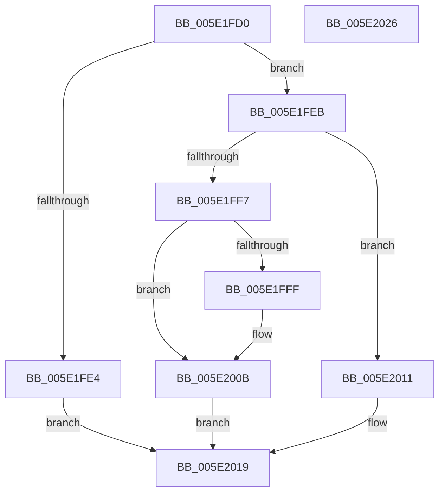

# SleepstudyHelper_ReleaseComponentLock

- RVA: `0x005E1FD0`–`0x005E2027` (길이 `87` bytes)
- VA: `0x00000001405E1FD0`
- 실행 섹션: `.text`
- PDB 이름 있음: `예`; PDB Function 태그: `아니요`
- unwind 정보 RVA: `0x0005CAAC`
- 디코드: `27`개 명령, `87/87` bytes 표시
- 미해석 바이트: `0` (있으면 어셈블리에 `.byte`로 보존)

> 이 문서는 커널 이미지의 기계어와 PDB 기호를 분석해 생성했습니다. 4번과 5번은 함수 원형과 자료형을 바이너리 사용 방식에서 추정한 C 해석이며 원본 소스 복구 결과는 아닙니다.

## 1. Dependencies

- 직접 호출 지점: **2**; 고유 호출 대상: **2**
- 직접 호출자로 확인된 함수: **0**
- RIP 상대 이미지 참조: **2**

### Outgoing calls
- `0x005E2006` → [KiLowerIrqlProcessIrqlFlags](../4F/KiLowerIrqlProcessIrqlFlags_function_004F5698.md) (function, `0x004F5698`)
- `0x005E2014` → [KeReleaseSpinLock](../39/KeReleaseSpinLock_function_00392BA0.md) (function, `0x00392BA0`)

### Direct callers
- 이 함수 시작 RVA로 연결되는 직접 call은 확인되지 않았습니다. 간접 호출은 완전히 역산할 수 없습니다.

### Static image references
- `0x005E1FEB` → RVA `0x00F06B68` (`.data`; read)
- `0x005E1FF7` → RVA `0x00FC6D20` (`ALMOSTRO`; read)

## 2. Other-region calls and transfers

- 다른 실행 섹션으로 향하는 call: **0**
- 별도 외부 분기/꼬리 이동을 확인하지 못했습니다.

## 3. Assembly (complete function range)

```asm
005E1FD0  48 89 5C 24 08                  mov qword ptr [rsp + 8], rbx
005E1FD5  57                              push rdi
005E1FD6  48 83 EC 20                     sub rsp, 0x20
005E1FDA  33 DB                           xor ebx, ebx
005E1FDC  0F B6 FA                        movzx edi, dl
005E1FDF  48 85 C9                        test rcx, rcx
005E1FE2  75 07                           jne 0x1405e1feb
005E1FE4  BB 0D 00 00 C0                  mov ebx, 0xc000000d
005E1FE9  EB 2E                           jmp 0x1405e2019
005E1FEB  48 8D 05 76 4B 92 00            lea rax, [rip + 0x924b76]
005E1FF2  48 3B C8                        cmp rcx, rax
005E1FF5  75 1A                           jne 0x1405e2011
005E1FF7  39 1D 23 4D 9E 00               cmp dword ptr [rip + 0x9e4d23], ebx
005E1FFD  74 0C                           je 0x1405e200b
005E1FFF  44 0F 20 C1                     mov rcx, cr8
005E2003  40 8A D7                        mov dl, dil
005E2006  E8 8D 36 F1 FF                  call 0x1404f5698
005E200B  44 0F 22 C7                     mov cr8, rdi
005E200F  EB 08                           jmp 0x1405e2019
005E2011  40 8A D7                        mov dl, dil
005E2014  E8 87 0B DB FF                  call 0x140392ba0
005E2019  8B C3                           mov eax, ebx
005E201B  48 8B 5C 24 30                  mov rbx, qword ptr [rsp + 0x30]
005E2020  48 83 C4 20                     add rsp, 0x20
005E2024  5F                              pop rdi
005E2025  C3                              ret
005E2026  CC                              int3
```

## 4. C-style interpretation (structured pseudocode)

```c
__int64 __fastcall SleepstudyHelper_ReleaseComponentLock(__int64 a1, unsigned __int8 a2)
{
    __int64 result;
    __int64 v_rbx;
    __int64 v_rsp;
    unsigned __int64 v_stack_p8;

    v_stack_p8 = v_rbx;
    v_rsp = (v_rsp) - (32);
    v_rbx = 0;
    if (a1 != 0) goto loc_005E1FEB;
    goto loc_005E2019;
loc_005E1FEB:
    if (a1 != (v_rip + 9587574)) goto loc_005E2011;
    result = v_rip + 9587574;
    if ((*(unsigned int *)(v_rip + 10374435)) != ((unsigned int)((unsigned int)(0xC000000DULL)))) {
        a1 = v_cr8;
        a2 = a2;
        result = KiLowerIrqlProcessIrqlFlags(a1, a2, a3, a4);
    }
    goto loc_005E2019;
loc_005E2011:
    result = KeReleaseSpinLock(a1, a2, a3, a4);
loc_005E2019:
    v_rsp = (v_rsp) + (32);
    return (unsigned int)((unsigned int)((unsigned int)(0xC000000DULL)));
}
```

## 5. (Beta) C Style

```c
int64_t SleepstudyHelper_ReleaseComponentLock(int64_t Arg1, uint8_t Arg2)
{
    int64_t result;
    int64_t local_rbx;
    int64_t local_rsp;
    uint64_t v_stack_p8;

    v_stack_p8 = local_rbx;
    local_rsp = (local_rsp) - (32);
    local_rbx = 0;
    if (Arg1 != 0) goto loc_005E1FEB;
    goto loc_005E2019;
loc_005E1FEB:
    if (Arg1 != (v_rip + 9587574)) goto loc_005E2011;
    result = v_rip + 9587574;
    if ((*(uint32_t *)(v_rip + 0x9E4D23)) != ((uint32_t)((uint32_t)(0xC000000DULL)))) {
        Arg1 = v_cr8;
        Arg2 = Arg2;
        result = KiLowerIrqlProcessIrqlFlags(Arg1, Arg2, a3, a4);
    }
    goto loc_005E2019;
loc_005E2011:
    result = KeReleaseSpinLock(Arg1, Arg2, a3, a4);
loc_005E2019:
    local_rsp = (local_rsp) + (32);
    return (uint32_t)((uint32_t)((uint32_t)(0xC000000DULL)));
}
```

## 6. Execution-region graph

[열기: 2D/3D 그래프와 함수 탐색 컨트롤 패널](../../../control-panel.html?section=text&rva=0x005E1FD0&view=graph)

- 2D 그래프는 위에서 아래로 흐르고, 3D 그래프는 빈 공간을 드래그해 회전합니다. Shift+드래그는 이동, 휠은 확대·축소, 함수 노드 선택은 대상 보고서 이동입니다.

### Static fallback


