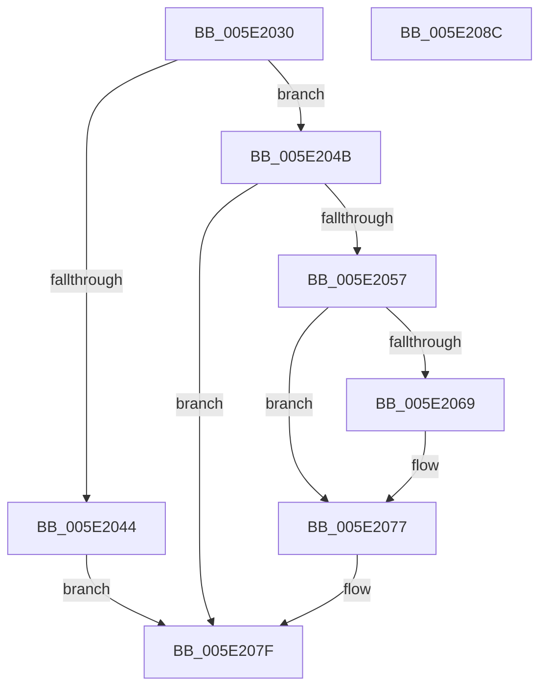

# SleepstudyHelper_ResetComponentsStartTime

- RVA: `0x005E2030`–`0x005E208D` (길이 `93` bytes)
- VA: `0x00000001405E2030`
- 실행 섹션: `.text`
- PDB 이름 있음: `예`; PDB Function 태그: `아니요`
- unwind 정보 RVA: `0x0005CAAC`
- 디코드: `28`개 명령, `93/93` bytes 표시
- 미해석 바이트: `0` (있으면 어셈블리에 `.byte`로 보존)

> 이 문서는 커널 이미지의 기계어와 PDB 기호를 분석해 생성했습니다. 4번과 5번은 함수 원형과 자료형을 바이너리 사용 방식에서 추정한 C 해석이며 원본 소스 복구 결과는 아닙니다.

## 1. Dependencies

- 직접 호출 지점: **2**; 고유 호출 대상: **2**
- 직접 호출자로 확인된 함수: **0**
- RIP 상대 이미지 참조: **1**

### Outgoing calls
- `0x005E2057` → [KeAcquireSpinLockRaiseToDpc](../20/KeAcquireSpinLockRaiseToDpc_function_00208470.md) (function, `0x00208470`)
- `0x005E207A` → [KeReleaseSpinLock](../39/KeReleaseSpinLock_function_00392BA0.md) (function, `0x00392BA0`)

### Direct callers
- 이 함수 시작 RVA로 연결되는 직접 call은 확인되지 않았습니다. 간접 호출은 완전히 역산할 수 없습니다.

### Static image references
- `0x005E204B` → RVA `0x00F06B68` (`.data`; read)

## 2. Other-region calls and transfers

- 다른 실행 섹션으로 향하는 call: **0**
- 별도 외부 분기/꼬리 이동을 확인하지 못했습니다.

## 3. Assembly (complete function range)

```asm
005E2030  48 89 5C 24 08                  mov qword ptr [rsp + 8], rbx
005E2035  57                              push rdi
005E2036  48 83 EC 20                     sub rsp, 0x20
005E203A  33 FF                           xor edi, edi
005E203C  48 8B D9                        mov rbx, rcx
005E203F  48 85 C9                        test rcx, rcx
005E2042  75 07                           jne 0x1405e204b
005E2044  BF 0D 00 00 C0                  mov edi, 0xc000000d
005E2049  EB 34                           jmp 0x1405e207f
005E204B  48 8D 05 16 4B 92 00            lea rax, [rip + 0x924b16]
005E2052  48 3B D8                        cmp rbx, rax
005E2055  74 28                           je 0x1405e207f
005E2057  E8 14 64 C2 FF                  call 0x140208470
005E205C  8B 4B 08                        mov ecx, dword ptr [rbx + 8]
005E205F  8A D0                           mov dl, al
005E2061  83 E1 03                        and ecx, 3
005E2064  80 F9 03                        cmp cl, 3
005E2067  75 0E                           jne 0x1405e2077
005E2069  48 A1 08 00 00 00 80 F7 FF FF   movabs rax, qword ptr [0xfffff78000000008]
005E2073  48 89 43 20                     mov qword ptr [rbx + 0x20], rax
005E2077  48 8B CB                        mov rcx, rbx
005E207A  E8 21 0B DB FF                  call 0x140392ba0
005E207F  48 8B 5C 24 30                  mov rbx, qword ptr [rsp + 0x30]
005E2084  8B C7                           mov eax, edi
005E2086  48 83 C4 20                     add rsp, 0x20
005E208A  5F                              pop rdi
005E208B  C3                              ret
005E208C  CC                              int3
```

## 4. C-style interpretation (structured pseudocode)

```c
__int64 __fastcall SleepstudyHelper_ResetComponentsStartTime(__int64 a1)
{
    __int64 result;
    __int64 v_rdi;
    __int64 v_rsp;
    unsigned __int64 v_stack_p8;

    v_stack_p8 = v_rbx;
    v_rsp = (v_rsp) - (32);
    v_rdi = 0;
    if (a1 != 0) goto loc_005E204B;
    goto loc_005E207F;
loc_005E204B:
    if (a1 == (v_rip + 9587478)) goto loc_005E207F;
    result = KeAcquireSpinLockRaiseToDpc(a1, a2, a3, a4);
    a1 = (unsigned int)(((unsigned int)(*(unsigned int *)(a1 + 8))) & (3));
    if (((unsigned __int8)(a1)) == 3) {
        *(unsigned __int64 *)(a1 + 32) = result;
    }
    result = KeReleaseSpinLock(a1, (unsigned __int8)(result), a3, a4);
loc_005E207F:
    v_rsp = (v_rsp) + (32);
    return (unsigned int)((unsigned int)((unsigned int)(0xC000000DULL)));
}
```

## 5. (Beta) C Style

```c
int64_t SleepstudyHelper_ResetComponentsStartTime(int64_t Arg1)
{
    int64_t result;
    int64_t local_rdi;
    int64_t local_rsp;
    uint64_t v_stack_p8;

    v_stack_p8 = local_rbx;
    local_rsp = (local_rsp) - (32);
    local_rdi = 0;
    if (Arg1 != 0) goto loc_005E204B;
    goto loc_005E207F;
loc_005E204B:
    if (Arg1 == (v_rip + 9587478)) goto loc_005E207F;
    result = KeAcquireSpinLockRaiseToDpc(Arg1, a2, a3, a4);
    Arg1 = (uint32_t)(((uint32_t)(*(uint32_t *)(Arg1 + 0x8))) & (3));
    if (((uint8_t)(Arg1)) == 3) {
        *(uint64_t *)(Arg1 + 0x20) = result;
    }
    result = KeReleaseSpinLock(Arg1, (uint8_t)(result), a3, a4);
loc_005E207F:
    local_rsp = (local_rsp) + (32);
    return (uint32_t)((uint32_t)((uint32_t)(0xC000000DULL)));
}
```

## 6. Execution-region graph

[열기: 2D/3D 그래프와 함수 탐색 컨트롤 패널](../../../control-panel.html?section=text&rva=0x005E2030&view=graph)

- 2D 그래프는 위에서 아래로 흐르고, 3D 그래프는 빈 공간을 드래그해 회전합니다. Shift+드래그는 이동, 휠은 확대·축소, 함수 노드 선택은 대상 보고서 이동입니다.

### Static fallback


