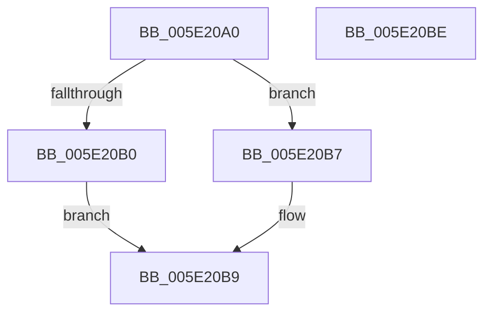

# SleepstudyHelper_UnregisterComponent

- RVA: `0x005E20A0`–`0x005E20BF` (길이 `31` bytes)
- VA: `0x00000001405E20A0`
- 실행 섹션: `.text`
- PDB 이름 있음: `예`; PDB Function 태그: `아니요`
- unwind 정보 RVA: `0x0005C788`
- 디코드: `10`개 명령, `31/31` bytes 표시
- 미해석 바이트: `0` (있으면 어셈블리에 `.byte`로 보존)

> 이 문서는 커널 이미지의 기계어와 PDB 기호를 분석해 생성했습니다. 4번과 5번은 함수 원형과 자료형을 바이너리 사용 방식에서 추정한 C 해석이며 원본 소스 복구 결과는 아닙니다.

## 1. Dependencies

- 직접 호출 지점: **1**; 고유 호출 대상: **1**
- 직접 호출자로 확인된 함수: **0**
- RIP 상대 이미지 참조: **1**

### Outgoing calls
- `0x005E20B0` → [SleepstudyHelperDestroyBlocker](../48/SleepstudyHelperDestroyBlocker_function_00486930.md) (function, `0x00486930`)

### Direct callers
- 이 함수 시작 RVA로 연결되는 직접 call은 확인되지 않았습니다. 간접 호출은 완전히 역산할 수 없습니다.

### Static image references
- `0x005E20A4` → RVA `0x00F06B68` (`.data`; read)

## 2. Other-region calls and transfers

- 다른 실행 섹션으로 향하는 call: **0**
- 별도 외부 분기/꼬리 이동을 확인하지 못했습니다.

## 3. Assembly (complete function range)

```asm
005E20A0  48 83 EC 28                     sub rsp, 0x28
005E20A4  48 8D 05 BD 4A 92 00            lea rax, [rip + 0x924abd]
005E20AB  48 3B C8                        cmp rcx, rax
005E20AE  74 07                           je 0x1405e20b7
005E20B0  E8 7B 48 EA FF                  call 0x140486930
005E20B5  EB 02                           jmp 0x1405e20b9
005E20B7  33 C0                           xor eax, eax
005E20B9  48 83 C4 28                     add rsp, 0x28
005E20BD  C3                              ret
005E20BE  CC                              int3
```

## 4. C-style interpretation (structured pseudocode)

```c
__int64 __fastcall SleepstudyHelper_UnregisterComponent(__int64 a1)
{
    __int64 result;
    __int64 v_rsp;

    v_rsp = (v_rsp) - (40);
    if (a1 == (v_rip + 9587389)) goto loc_005E20B7;
    result = SleepstudyHelperDestroyBlocker(a1, a2, a3, a4);
    goto loc_005E20B9;
loc_005E20B7:
    result = 0;
loc_005E20B9:
    v_rsp = (v_rsp) + (40);
    return result;
}
```

## 5. (Beta) C Style

```c
int64_t SleepstudyHelper_UnregisterComponent(int64_t Arg1)
{
    int64_t result;
    int64_t local_rsp;

    local_rsp = (local_rsp) - (40);
    if (Arg1 == (v_rip + 9587389)) goto loc_005E20B7;
    result = SleepstudyHelperDestroyBlocker(Arg1, a2, a3, a4);
    goto loc_005E20B9;
loc_005E20B7:
    result = 0;
loc_005E20B9:
    local_rsp = (local_rsp) + (40);
    return result;
}
```

## 6. Execution-region graph

[열기: 2D/3D 그래프와 함수 탐색 컨트롤 패널](../../../control-panel.html?section=text&rva=0x005E20A0&view=graph)

- 2D 그래프는 위에서 아래로 흐르고, 3D 그래프는 빈 공간을 드래그해 회전합니다. Shift+드래그는 이동, 휠은 확대·축소, 함수 노드 선택은 대상 보고서 이동입니다.

### Static fallback


