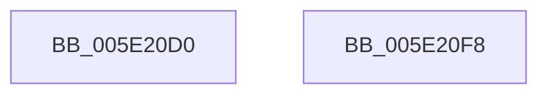

# SshpAlpcOpenGracePeriodTimerCallback

- RVA: `0x005E20D0`–`0x005E20F9` (길이 `41` bytes)
- VA: `0x00000001405E20D0`
- 실행 섹션: `.text`
- PDB 이름 있음: `예`; PDB Function 태그: `아니요`
- unwind 정보 RVA: `0x0005C788`
- 디코드: `11`개 명령, `41/41` bytes 표시
- 미해석 바이트: `0` (있으면 어셈블리에 `.byte`로 보존)

> 이 문서는 커널 이미지의 기계어와 PDB 기호를 분석해 생성했습니다. 4번과 5번은 함수 원형과 자료형을 바이너리 사용 방식에서 추정한 C 해석이며 원본 소스 복구 결과는 아닙니다.

## 1. Dependencies

- 직접 호출 지점: **1**; 고유 호출 대상: **1**
- 직접 호출자로 확인된 함수: **0**
- RIP 상대 이미지 참조: **1**

### Outgoing calls
- `0x005E20EE` → [ExQueueWorkItem](../2F/ExQueueWorkItem_function_002F9520.md) (function, `0x002F9520`)

### Direct callers
- 이 함수 시작 RVA로 연결되는 직접 call은 확인되지 않았습니다. 간접 호출은 완전히 역산할 수 없습니다.

### Static image references
- `0x005E20E4` → RVA `0x00F06A68` (`.data`; read)

## 2. Other-region calls and transfers

- 다른 실행 섹션으로 향하는 call: **0**
- 별도 외부 분기/꼬리 이동을 확인하지 못했습니다.

## 3. Assembly (complete function range)

```asm
005E20D0  48 83 EC 28                     sub rsp, 0x28
005E20D4  48 63 C2                        movsxd rax, edx
005E20D7  BA 01 00 00 00                  mov edx, 1
005E20DC  48 8D 0C 40                     lea rcx, [rax + rax*2]
005E20E0  48 C1 E1 06                     shl rcx, 6
005E20E4  48 8D 05 7D 49 92 00            lea rax, [rip + 0x92497d]
005E20EB  48 03 C8                        add rcx, rax
005E20EE  E8 2D 74 D1 FF                  call 0x1402f9520
005E20F3  48 83 C4 28                     add rsp, 0x28
005E20F7  C3                              ret
005E20F8  CC                              int3
```

## 4. C-style interpretation (structured pseudocode)

```c
__int64 __fastcall SshpAlpcOpenGracePeriodTimerCallback(__int64 a1, int a2)
{
    __int64 result;
    __int64 v_rsp;

    v_rsp = (v_rsp) - (40);
    a1 = ((int)(a2) + (int)(a2) * 2) << (6);
    a1 = (a1) + (v_rip + 9587069);
    result = ExQueueWorkItem(a1, 1, a3, a4);
    v_rsp = (v_rsp) + (40);
    return result;
}
```

## 5. (Beta) C Style

```c
int64_t SshpAlpcOpenGracePeriodTimerCallback(int64_t Arg1, void *Arg2)
{
    uint8_t *arg2 = (uint8_t *)Arg2;

    int64_t result;
    int64_t local_rsp;

    local_rsp = (local_rsp) - (40);
    Arg1 = ((int32_t)(Arg2) + (int32_t)(Arg2) * 2) << (6);
    Arg1 = (Arg1) + (v_rip + 9587069);
    result = ExQueueWorkItem(Arg1, 1, a3, a4);
    local_rsp = (local_rsp) + (40);
    return result;
}
```

### 관측된 메모리 오프셋

구조체 형식이 확인되지 않은 접근은 인자 기준의 오프셋으로만 기록했습니다.

| 기준 인자 | 오프셋 표현 | 폭 (bit) | 접근 |
|---|---:|---:|---|
| `Arg2` | `+ 0x0 + rax*2` | `64` | `R` |

## 6. Execution-region graph

[열기: 2D/3D 그래프와 함수 탐색 컨트롤 패널](../../../control-panel.html?section=text&rva=0x005E20D0&view=graph)

- 2D 그래프는 위에서 아래로 흐르고, 3D 그래프는 빈 공간을 드래그해 회전합니다. Shift+드래그는 이동, 휠은 확대·축소, 함수 노드 선택은 대상 보고서 이동입니다.

### Static fallback


