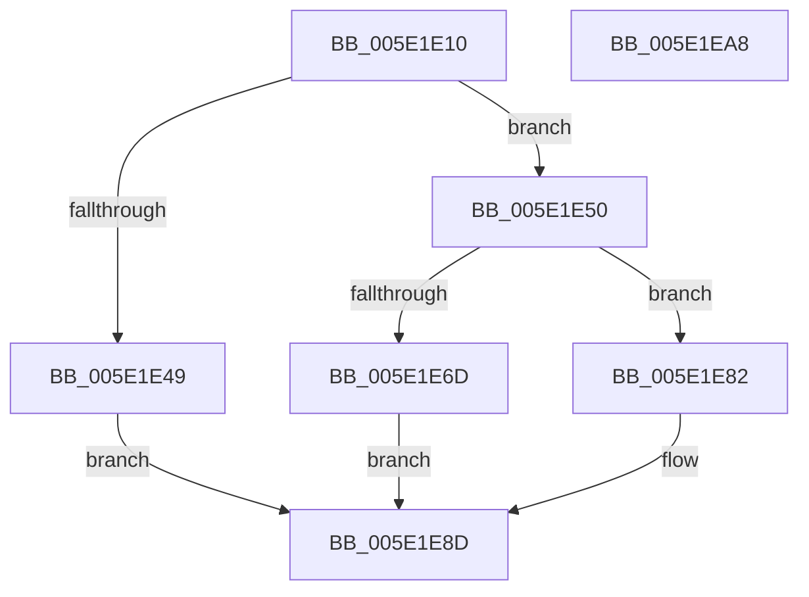

# SshpCopyDataEntry

- RVA: `0x005E1E10`–`0x005E1EA9` (길이 `153` bytes)
- VA: `0x00000001405E1E10`
- 실행 섹션: `.text`
- PDB 이름 있음: `예`; PDB Function 태그: `아니요`
- unwind 정보 RVA: `0x00060300`
- 디코드: `48`개 명령, `153/153` bytes 표시
- 미해석 바이트: `0` (있으면 어셈블리에 `.byte`로 보존)

> 이 문서는 커널 이미지의 기계어와 PDB 기호를 분석해 생성했습니다. 4번과 5번은 함수 원형과 자료형을 바이너리 사용 방식에서 추정한 C 해석이며 원본 소스 복구 결과는 아닙니다.

## 1. Dependencies

- 직접 호출 지점: **3**; 고유 호출 대상: **3**
- 직접 호출자로 확인된 함수: **1**
- RIP 상대 이미지 참조: **0**

### Outgoing calls
- `0x005E1E39` → [SSHSupportAllocatePaged](../../page/A6/SSHSupportAllocatePaged_function_00A624FC.md) (function, `0x00A624FC`)
- `0x005E1E62` → [RtlUnicodeStringCopy](../3D/RtlUnicodeStringCopy_function_003D4130.md) (function, `0x003D4130`)
- `0x005E1E88` → [ExFreePoolWithTag](../../poolcode/B8/ExFreePoolWithTag_function_00B82870.md) (function, `0x00B82870`)

### Direct callers
- [SleepstudyHelperCreateBlockerData](../../page/AD/SleepstudyHelperCreateBlockerData_function_00AD40B0.md) at `0x00AD41A1`

### Static image references
- 디코드된 RIP-relative 메모리 참조가 없습니다.

## 2. Other-region calls and transfers

- 다른 실행 섹션으로 향하는 call: **2**
  - `0x005E1E39` → [SSHSupportAllocatePaged](../../page/A6/SSHSupportAllocatePaged_function_00A624FC.md) (`.text` → `PAGE`)
  - `0x005E1E88` → [ExFreePoolWithTag](../../poolcode/B8/ExFreePoolWithTag_function_00B82870.md) (`.text` → `POOLCODE`)
- 별도 외부 분기/꼬리 이동을 확인하지 못했습니다.

## 3. Assembly (complete function range)

```asm
005E1E10  48 89 5C 24 08                  mov qword ptr [rsp + 8], rbx
005E1E15  48 89 6C 24 10                  mov qword ptr [rsp + 0x10], rbp
005E1E1A  48 89 74 24 18                  mov qword ptr [rsp + 0x18], rsi
005E1E1F  57                              push rdi
005E1E20  41 56                           push r14
005E1E22  41 57                           push r15
005E1E24  48 83 EC 20                     sub rsp, 0x20
005E1E28  0F B7 1A                        movzx ebx, word ptr [rdx]
005E1E2B  44 8B F1                        mov r14d, ecx
005E1E2E  48 8B F2                        mov rsi, rdx
005E1E31  8B CB                           mov ecx, ebx
005E1E33  41 8B D6                        mov edx, r14d
005E1E36  49 8B F8                        mov rdi, r8
005E1E39  E8 BE 06 48 00                  call 0x140a624fc
005E1E3E  45 33 FF                        xor r15d, r15d
005E1E41  48 8B E8                        mov rbp, rax
005E1E44  48 85 C0                        test rax, rax
005E1E47  75 07                           jne 0x1405e1e50
005E1E49  BB 9A 00 00 C0                  mov ebx, 0xc000009a
005E1E4E  EB 3D                           jmp 0x1405e1e8d
005E1E50  48 8B D6                        mov rdx, rsi
005E1E53  48 89 6F 08                     mov qword ptr [rdi + 8], rbp
005E1E57  48 8B CF                        mov rcx, rdi
005E1E5A  66 44 89 3F                     mov word ptr [rdi], r15w
005E1E5E  66 89 5F 02                     mov word ptr [rdi + 2], bx
005E1E62  E8 C9 22 DF FF                  call 0x1403d4130
005E1E67  8B D8                           mov ebx, eax
005E1E69  85 C0                           test eax, eax
005E1E6B  78 15                           js 0x1405e1e82
005E1E6D  48 8B 46 10                     mov rax, qword ptr [rsi + 0x10]
005E1E71  41 8B DF                        mov ebx, r15d
005E1E74  48 89 47 10                     mov qword ptr [rdi + 0x10], rax
005E1E78  48 8B 46 18                     mov rax, qword ptr [rsi + 0x18]
005E1E7C  48 89 47 18                     mov qword ptr [rdi + 0x18], rax
005E1E80  EB 0B                           jmp 0x1405e1e8d
005E1E82  41 8B D6                        mov edx, r14d
005E1E85  48 8B CD                        mov rcx, rbp
005E1E88  E8 E3 09 5A 00                  call 0x140b82870
005E1E8D  48 8B 6C 24 48                  mov rbp, qword ptr [rsp + 0x48]
005E1E92  8B C3                           mov eax, ebx
005E1E94  48 8B 5C 24 40                  mov rbx, qword ptr [rsp + 0x40]
005E1E99  48 8B 74 24 50                  mov rsi, qword ptr [rsp + 0x50]
005E1E9E  48 83 C4 20                     add rsp, 0x20
005E1EA2  41 5F                           pop r15
005E1EA4  41 5E                           pop r14
005E1EA6  5F                              pop rdi
005E1EA7  C3                              ret
005E1EA8  CC                              int3
```

## 4. C-style interpretation (structured pseudocode)

```c
__int64 __fastcall SshpCopyDataEntry(int a1, __int64 a2, __int64 a3)
{
    __int64 result;
    __int64 v_r15;
    __int64 v_rsp;
    unsigned __int64 v_stack_p10;
    unsigned __int64 v_stack_p18;
    unsigned __int64 v_stack_p8;

    v_stack_p8 = v_rbx;
    v_stack_p10 = v_rbp;
    v_stack_p18 = v_rsi;
    v_rsp = (v_rsp) - (32);
    result = SSHSupportAllocatePaged((unsigned int)((unsigned int)(*(unsigned __int16 *)(a2))), (unsigned int)((unsigned int)((unsigned int)(a1))), a3, a4);
    v_r15 = 0;
    if (result != 0) goto loc_005E1E50;
    goto loc_005E1E8D;
loc_005E1E50:
    *(unsigned __int64 *)(a3 + 8) = result;
    *(unsigned __int16 *)(a3) = 0;
    *(unsigned __int16 *)(a3 + 2) = (unsigned __int16)((unsigned int)(0xC000009AULL));
    result = RtlUnicodeStringCopy(a3, a2, a3, a4);
    if (sign_flag) goto loc_005E1E82;
    *(unsigned __int64 *)(a3 + 16) = *(unsigned __int64 *)(a2 + 16);
    *(unsigned __int64 *)(a3 + 24) = *(unsigned __int64 *)(a2 + 24);
    goto loc_005E1E8D;
loc_005E1E82:
    result = ExFreePoolWithTag(result, (unsigned int)((unsigned int)((unsigned int)(a1))), a3, a4);
loc_005E1E8D:
    v_rsp = (v_rsp) + (32);
    return 0;
}
```

## 5. (Beta) C Style

```c
int64_t SshpCopyDataEntry(int32_t Arg1, void *Arg2, void *Arg3)
{
    uint8_t *arg2 = (uint8_t *)Arg2;
    uint8_t *arg3 = (uint8_t *)Arg3;

    int64_t result;
    int64_t local_r15;
    int64_t local_rsp;
    uint64_t v_stack_p10;
    uint64_t v_stack_p18;
    uint64_t v_stack_p8;

    v_stack_p8 = local_rbx;
    v_stack_p10 = local_rbp;
    v_stack_p18 = local_rsi;
    local_rsp = (local_rsp) - (32);
    result = SSHSupportAllocatePaged((uint32_t)((uint32_t)(*(uint16_t *)(arg2))), (uint32_t)((uint32_t)((uint32_t)(Arg1))), Arg3, a4);
    local_r15 = 0;
    if (result != 0) goto loc_005E1E50;
    goto loc_005E1E8D;
loc_005E1E50:
    *(uint64_t *)(arg3 + 0x8) = result;
    *(uint16_t *)(arg3) = 0;
    *(uint16_t *)(arg3 + 0x2) = (uint16_t)((uint32_t)(0xC000009AULL));
    result = RtlUnicodeStringCopy(Arg3, Arg2, Arg3, a4);
    if (sign_flag) goto loc_005E1E82;
    *(uint64_t *)(arg3 + 0x10) = *(uint64_t *)(arg2 + 0x10);
    *(uint64_t *)(arg3 + 0x18) = *(uint64_t *)(arg2 + 0x18);
    goto loc_005E1E8D;
loc_005E1E82:
    result = ExFreePoolWithTag(result, (uint32_t)((uint32_t)((uint32_t)(Arg1))), Arg3, a4);
loc_005E1E8D:
    local_rsp = (local_rsp) + (32);
    return 0;
}
```

### 관측된 메모리 오프셋

구조체 형식이 확인되지 않은 접근은 인자 기준의 오프셋으로만 기록했습니다.

| 기준 인자 | 오프셋 표현 | 폭 (bit) | 접근 |
|---|---:|---:|---|
| `Arg2` | `+ 0x0` | `16` | `R` |
| `Arg2` | `+ 0x10` | `64` | `R` |
| `Arg2` | `+ 0x18` | `64` | `R` |
| `Arg3` | `+ 0x0` | `16` | `W` |
| `Arg3` | `+ 0x2` | `16` | `W` |
| `Arg3` | `+ 0x8` | `64` | `W` |
| `Arg3` | `+ 0x10` | `64` | `W` |
| `Arg3` | `+ 0x18` | `64` | `W` |

## 6. Execution-region graph

[열기: 2D/3D 그래프와 함수 탐색 컨트롤 패널](../../../control-panel.html?section=text&rva=0x005E1E10&view=graph)

- 2D 그래프는 위에서 아래로 흐르고, 3D 그래프는 빈 공간을 드래그해 회전합니다. Shift+드래그는 이동, 휠은 확대·축소, 함수 노드 선택은 대상 보고서 이동입니다.

### Static fallback


