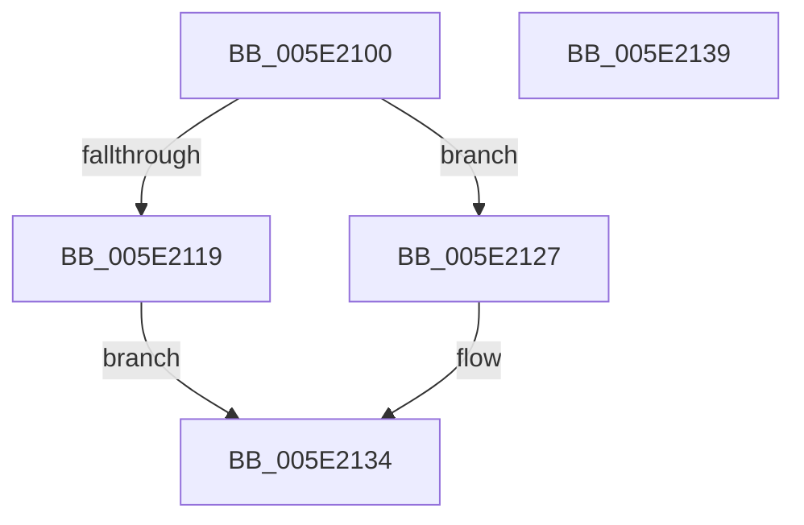

# TtmpScheduledEvaluationDpc

- RVA: `0x005E2100`–`0x005E213A` (길이 `58` bytes)
- VA: `0x00000001405E2100`
- 실행 섹션: `.text`
- PDB 이름 있음: `예`; PDB Function 태그: `아니요`
- unwind 정보 RVA: `0x0005C788`
- 디코드: `16`개 명령, `58/58` bytes 표시
- 미해석 바이트: `0` (있으면 어셈블리에 `.byte`로 보존)

> 이 문서는 커널 이미지의 기계어와 PDB 기호를 분석해 생성했습니다. 4번과 5번은 함수 원형과 자료형을 바이너리 사용 방식에서 추정한 C 해석이며 원본 소스 복구 결과는 아닙니다.

## 1. Dependencies

- 직접 호출 지점: **2**; 고유 호출 대상: **2**
- 직접 호출자로 확인된 함수: **0**
- RIP 상대 이미지 참조: **0**

### Outgoing calls
- `0x005E2120` → [ExQueueWorkItem](../2F/ExQueueWorkItem_function_002F9520.md) (function, `0x002F9520`)
- `0x005E212F` → [ObfDereferenceObjectWithTag](../2F/ObfDereferenceObjectWithTag_function_002F78E0.md) (function, `0x002F78E0`)

### Direct callers
- 이 함수 시작 RVA로 연결되는 직접 call은 확인되지 않았습니다. 간접 호출은 완전히 역산할 수 없습니다.

### Static image references
- 디코드된 RIP-relative 메모리 참조가 없습니다.

## 2. Other-region calls and transfers

- 다른 실행 섹션으로 향하는 call: **0**
- 별도 외부 분기/꼬리 이동을 확인하지 못했습니다.

## 3. Assembly (complete function range)

```asm
005E2100  48 83 EC 28                     sub rsp, 0x28
005E2104  4C 8B C2                        mov r8, rdx
005E2107  BA 01 00 00 00                  mov edx, 1
005E210C  8B C2                           mov eax, edx
005E210E  41 87 80 F8 00 00 00            xchg dword ptr [r8 + 0xf8], eax
005E2115  85 C0                           test eax, eax
005E2117  75 0E                           jne 0x1405e2127
005E2119  49 8D 88 D8 00 00 00            lea rcx, [r8 + 0xd8]
005E2120  E8 FB 73 D1 FF                  call 0x1402f9520
005E2125  EB 0D                           jmp 0x1405e2134
005E2127  BA 44 66 6C 74                  mov edx, 0x746c6644
005E212C  49 8B C8                        mov rcx, r8
005E212F  E8 AC 57 D1 FF                  call 0x1402f78e0
005E2134  48 83 C4 28                     add rsp, 0x28
005E2138  C3                              ret
005E2139  CC                              int3
```

## 4. C-style interpretation (structured pseudocode)

```c
__int64 __fastcall TtmpScheduledEvaluationDpc(__int64 a1, __int64 a2)
{
    __int64 result;
    __int64 v_rsp;

    v_rsp = (v_rsp) - (40);
    if (1 != 0) goto loc_005E2127;
    result = ExQueueWorkItem(a2 + 216, 1, a2, a4);
    goto loc_005E2134;
loc_005E2127:
    result = ObfDereferenceObjectWithTag(a2, (unsigned int)(0x746C6644ULL), a2, a4);
loc_005E2134:
    v_rsp = (v_rsp) + (40);
    return result;
}
```

## 5. (Beta) C Style

```c
int64_t TtmpScheduledEvaluationDpc(int64_t Arg1, void *Arg2)
{
    uint8_t *arg2 = (uint8_t *)Arg2;

    int64_t result;
    int64_t local_rsp;

    local_rsp = (local_rsp) - (40);
    if (1 != 0) goto loc_005E2127;
    result = ExQueueWorkItem(Arg2 + 216, 1, Arg2, a4);
    goto loc_005E2134;
loc_005E2127:
    result = ObfDereferenceObjectWithTag(Arg2, (uint32_t)(0x746C6644ULL), Arg2, a4);
loc_005E2134:
    local_rsp = (local_rsp) + (40);
    return result;
}
```

### 관측된 메모리 오프셋

구조체 형식이 확인되지 않은 접근은 인자 기준의 오프셋으로만 기록했습니다.

| 기준 인자 | 오프셋 표현 | 폭 (bit) | 접근 |
|---|---:|---:|---|
| `Arg2` | `+ 0xD8` | `64` | `R` |
| `Arg2` | `+ 0xF8` | `32` | `R/W` |

## 6. Execution-region graph

[열기: 2D/3D 그래프와 함수 탐색 컨트롤 패널](../../../control-panel.html?section=text&rva=0x005E2100&view=graph)

- 2D 그래프는 위에서 아래로 흐르고, 3D 그래프는 빈 공간을 드래그해 회전합니다. Shift+드래그는 이동, 휠은 확대·축소, 함수 노드 선택은 대상 보고서 이동입니다.

### Static fallback


