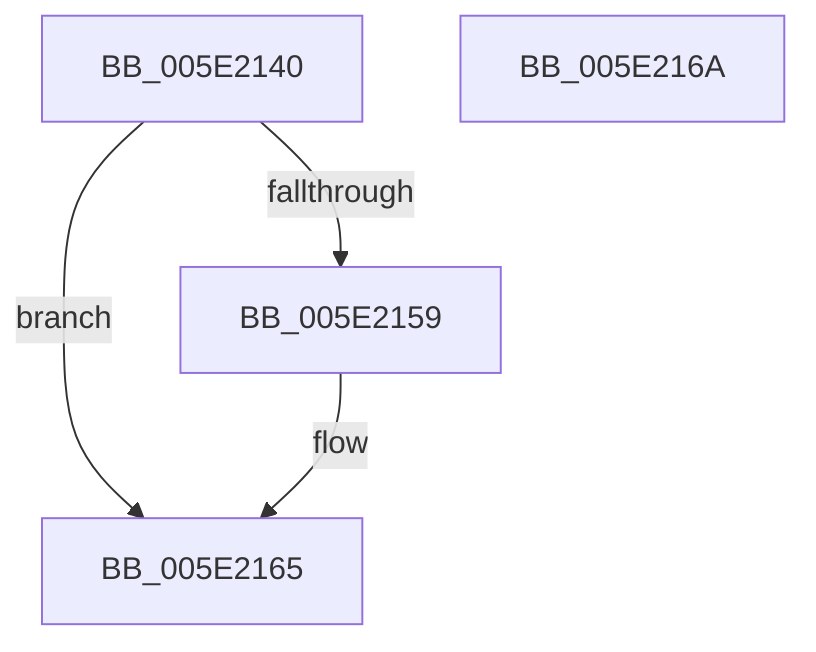

# TtmpTerminalInactivityTimerDpcRoutine

- RVA: `0x005E2140`–`0x005E216B` (길이 `43` bytes)
- VA: `0x00000001405E2140`
- 실행 섹션: `.text`
- PDB 이름 있음: `예`; PDB Function 태그: `아니요`
- unwind 정보 RVA: `0x0005C788`
- 디코드: `12`개 명령, `43/43` bytes 표시
- 미해석 바이트: `0` (있으면 어셈블리에 `.byte`로 보존)

> 이 문서는 커널 이미지의 기계어와 PDB 기호를 분석해 생성했습니다. 4번과 5번은 함수 원형과 자료형을 바이너리 사용 방식에서 추정한 C 해석이며 원본 소스 복구 결과는 아닙니다.

## 1. Dependencies

- 직접 호출 지점: **1**; 고유 호출 대상: **1**
- 직접 호출자로 확인된 함수: **0**
- RIP 상대 이미지 참조: **2**

### Outgoing calls
- `0x005E2160` → [ExQueueWorkItem](../2F/ExQueueWorkItem_function_002F9520.md) (function, `0x002F9520`)

### Direct callers
- 이 함수 시작 RVA로 연결되는 직접 call은 확인되지 않았습니다. 간접 호출은 완전히 역산할 수 없습니다.

### Static image references
- `0x005E214B` → RVA `0x00F06848` (`.data`; read/write)
- `0x005E2159` → RVA `0x00F06900` (`.data`; read)

## 2. Other-region calls and transfers

- 다른 실행 섹션으로 향하는 call: **0**
- 별도 외부 분기/꼬리 이동을 확인하지 못했습니다.

## 3. Assembly (complete function range)

```asm
005E2140  48 83 EC 28                     sub rsp, 0x28
005E2144  BA 01 00 00 00                  mov edx, 1
005E2149  8B C2                           mov eax, edx
005E214B  F0 0F C1 05 F5 46 92 00         lock xadd dword ptr [rip + 0x9246f5], eax
005E2153  03 C2                           add eax, edx
005E2155  3B C2                           cmp eax, edx
005E2157  75 0C                           jne 0x1405e2165
005E2159  48 8D 0D A0 47 92 00            lea rcx, [rip + 0x9247a0]
005E2160  E8 BB 73 D1 FF                  call 0x1402f9520
005E2165  48 83 C4 28                     add rsp, 0x28
005E2169  C3                              ret
005E216A  CC                              int3
```

## 4. C-style interpretation (structured pseudocode)

```c
__int64 __fastcall TtmpTerminalInactivityTimerDpcRoutine(void)
{
    __int64 result;
    __int64 v_rsp;

    v_rsp = (v_rsp) - (40);
    result = (unsigned int)((1) + (1));
    if (((unsigned int)(result)) == 1) {
        a1 = v_rip + 9586592;
        result = ExQueueWorkItem(a1, 1, a3, a4);
    }
    v_rsp = (v_rsp) + (40);
    return result;
}
```

## 5. (Beta) C Style

```c
void TtmpTerminalInactivityTimerDpcRoutine(void)
{
    int64_t result;
    int64_t local_rsp;

    local_rsp = (local_rsp) - (40);
    result = (uint32_t)((1) + (1));
    if (((uint32_t)(result)) == 1) {
        a1 = v_rip + 9586592;
        result = ExQueueWorkItem(a1, 1, a3, a4);
    }
    local_rsp = (local_rsp) + (40);
    return result;
}
```

## 6. Execution-region graph

[열기: 2D/3D 그래프와 함수 탐색 컨트롤 패널](../../../control-panel.html?section=text&rva=0x005E2140&view=graph)

- 2D 그래프는 위에서 아래로 흐르고, 3D 그래프는 빈 공간을 드래그해 회전합니다. Shift+드래그는 이동, 휠은 확대·축소, 함수 노드 선택은 대상 보고서 이동입니다.

### Static fallback


